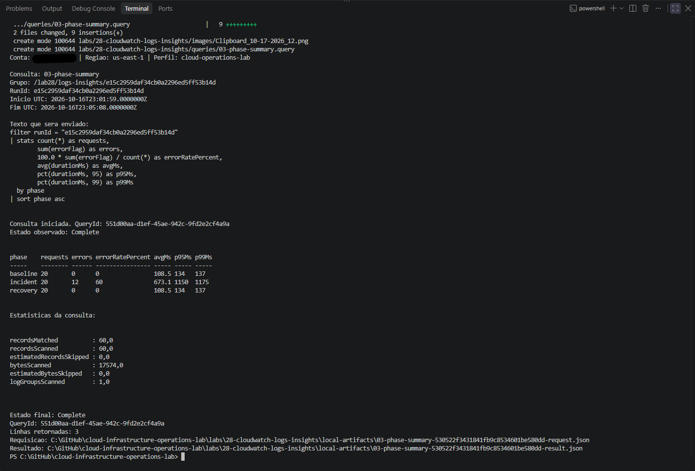

# Cloud Infrastructure Operations Lab

[**Português (Brasil)**](README.md) · **English**

A progressive, hands-on repository covering cloud infrastructure and day-to-day operations with **AWS, Linux, Terraform, GitHub Actions, CloudWatch, Bash, and PowerShell**, alongside planned work with Docker and Zabbix.

The labs follow the operational lifecycle of an application environment: preparing a workstation, establishing secure cloud access, managing Linux services and AWS infrastructure, automating deployments and checks, investigating failures, collecting telemetry, and removing temporary resources.

Each completed lab documents its scope, procedure, validation steps, observations, and supporting evidence. Some labs include reusable scripts. Screenshots and recorded measurements belong to the specific execution documented; they are not universal performance benchmarks.

## Purpose

This repository demonstrates practical skills relevant to **Cloud Operations, Infrastructure Operations, DevOps, and Site Reliability Engineering (SRE)**. Its focus is on reproducible procedures, traceable changes, appropriate access controls, diagnosis before remediation, and resource cleanup.

## Technology overview

| Area | Tools and practices |
|---|---|
| Cloud | Amazon Web Services (AWS) |
| Operating systems | Linux, Windows 11, Windows Subsystem for Linux (WSL) |
| Infrastructure as code | Terraform |
| Continuous integration | GitHub Actions |
| Containers | Docker, Docker Compose |
| Monitoring and logging | Amazon CloudWatch, Zabbix |
| Automation | Bash, PowerShell |
| Access and identity | AWS IAM Identity Center, AWS Systems Manager |
| Version control and documentation | Git, GitHub, Markdown, Mermaid |

Some technologies listed above are part of the planned curriculum and have not yet been exercised in a completed lab.

## Lab index

**Completed: 29 labs, numbered 00–28.** The original Brazilian Portuguese lab READMEs remain the primary technical record. English lab-specific documentation will be introduced incrementally; until then, the links below open the original documentation.

| Lab | Topic | Scope |
|---|---|---|
| 00 | [Workstation preparation](labs/00-workstation-preparation/) | Git, VS Code, PowerShell, and local setup |
| 01 | [Secure AWS account configuration](labs/01-secure-aws-account-configuration/) | Account security and administrative access |
| 02 | [AWS CLI installation and SSO](labs/02-aws-cli-installation-and-configuration/) | Profiles, temporary sessions, and identity checks |
| 03 | [Infrastructure tools](labs/03-infrastructure-tools-installation/) | Terraform and Session Manager Plugin |
| 04 | [Linux file management](labs/04-linux-file-management/) | Navigation, search, and file operations |
| 05 | [Linux users, groups, and permissions](labs/05-linux-users-groups-permissions/) | Identities, permissions, and shared access |
| 06 | [Linux processes, services, and logs](labs/06-linux-processes-services-logs/) | systemd, journalctl, troubleshooting, and recovery |
| 07 | [AWS account baseline](labs/07-aws-account-baseline/) | Read-only inventory, security, tags, monitoring, and costs |
| 08 | [AWS application network](labs/08-aws-application-network/) | VPC, subnets, routing, internet gateway, and security groups |
| 09 | [EC2 with Systems Manager](labs/09-aws-ec2-systems-manager/) | EC2, IAM role, Session Manager, and cleanup |
| 10 | [Linux Nginx web service](labs/10-linux-web-service/) | Nginx, systemd, restricted HTTP access, and validation |
| 11 | [Storage and recovery](labs/11-aws-storage-recovery/) | EBS, S3, integrity checking, and restoration |
| 12 | [Application availability](labs/12-aws-application-availability/) | Application Load Balancer, health checks, and recovery |
| 13 | [Application troubleshooting](labs/13-aws-application-troubleshooting/) | Controlled Nginx failure, diagnosis, and recovery |
| 14 | [Disk utilization](labs/14-aws-disk-utilization/) | Dedicated EBS volume, controlled disk pressure, and mitigation |
| 15 | [Connectivity troubleshooting](labs/15-aws-connectivity-troubleshooting/) | Controlled security-group misconfiguration and recovery |
| 16 | [Systems Manager troubleshooting](labs/16-aws-systems-manager-troubleshooting/) | HTTPS egress interruption, SSM diagnosis, and recovery |
| 17 | [Controlled application update](labs/17-aws-controlled-update/) | Baseline, failed configuration, rollback, and validated update |
| 18 | [Application backup and restore](labs/18-aws-application-backup-restore/) | Versioned S3 backup, SHA-256 verification, and restoration |
| 19 | [Terraform essential workflow](labs/19-terraform-essential-workflow/) | Local resource lifecycle, saved plan, state, outputs, and destroy |
| 20 | [Terraform AWS infrastructure](labs/20-terraform-aws-infrastructure/) | Seven managed resources, Nginx on EC2, and independent validation |
| 21 | [Terraform remote state](labs/21-terraform-remote-state/) | Versioned S3 backend, state migration, concurrent locking, and cleanup |
| 22 | [Terraform variables, outputs, and modules](labs/22-terraform-variables-outputs-modules/) | Typed variables, input validation, and module reuse |
| 23 | [Terraform changes and drift](labs/23-terraform-changes-drift/) | Intentional change, external drift, diagnosis, and recovery |
| 24 | [Automated Terraform validation](labs/24-terraform-automated-validation/) | GitHub Actions matrix, controlled failures, and successful checks |
| 25 | [CloudWatch metrics](labs/25-cloudwatch-metrics/) | EC2 metrics, CPU load, credits, dashboard, and cleanup |
| 26 | [CloudWatch Agent](labs/26-cloudwatch-agent/) | Memory and disk metrics, log collection, and validation |
| 27 | [CloudWatch alarms and notifications](labs/27-cloudwatch-alarms-notifications/) | Synthetic metrics, SNS actions, missing data, and recovery |
| 28 | [CloudWatch Logs Insights](labs/28-cloudwatch-logs-insights/) | 60 synthetic JSON events, seven queries, incident analysis, and cleanup |

The next planned exercise is [Lab 29 — Zabbix monitoring](labs/29-zabbix-monitoring/). Its presence in the repository does **not** mean it has been completed.

See the [roadmap (Portuguese)](docs/roadmap.md) for the full learning sequence.

## Most recent completed lab: CloudWatch Logs Insights (Lab 28)

Lab 28 used a deliberately constructed dataset of **60 synthetic JSON log events**, divided into baseline, incident, and recovery phases. Ingestion was checked against the local dataset by comparing timestamps and messages. Seven completed CloudWatch Logs Insights queries explored the events, filtered errors, compared durations, grouped failures, produced a timeline, and examined one request.

| Check | Observed result |
|---|---|
| Dataset comparison | 60 events matched the local batch |
| Phase distribution | 20 events per phase |
| Errors | 12 HTTP 503 responses on `/orders` |
| Incident-phase error rate | 60% |
| Overall error rate | 20% |
| Average duration | 108.5 ms during baseline and recovery; 673.1 ms during the incident |
| Investigated request | `req-021`, HTTP 503, 900 ms |
| Final retention setting | Seven days |
| Cleanup | Log group deleted; absence confirmed by an independent check |

**Interpretation:** The event durations, HTTP errors, and `dependency_timeout` cause were **synthetic fields generated by PowerShell**. They do not establish that a real application or dependency failed. During the exercise, the retention setting changed from one to seven days, and handling of ingestion responses without a pagination token was corrected. The original events were queried again without republishing the batch.

Cleanup was completed on October 19, 2026. The local inventory, dataset, receipts, and reports were retained, and 20 screenshots document the exercise.

[Lab 28 procedure, results, and evidence](labs/28-cloudwatch-logs-insights/)

## Selected results from earlier labs

These are execution-specific observations. The linked lab documents contain the full procedures, assumptions, and evidence.

### Lab 27 — Alarms and notifications

Fifteen synthetic metric data points were used to test baseline, alarm, recovery, and missing-data behavior. The alarm evaluated `Sum >= 3` for two out of three 60-second periods, with `TreatMissingData=missing`. Its history recorded three successful SNS actions; screenshots document notification emails. The alarm and SNS topic were removed, and two independent checks confirmed their absence.

[Lab 27 evidence](labs/27-cloudwatch-alarms-notifications/)

### Lab 26 — CloudWatch Agent

An Amazon Linux 2023 instance managed through Systems Manager reported memory and root-disk metrics and forwarded synthetic log messages. The versioned configuration used a 60-second collection interval, the `Lab26/CWAgent` namespace, and a dedicated log group. Installation returned SSM `Success` and exit code `0`; the applied configuration was checked against its SHA-256 hash.

The captured dataset contained 29 memory metric points (approximately 23.05%–23.21%) and 30 root-disk points (approximately 23.576%–23.578%). Three INFO/WARN/ERROR messages were confirmed in CloudWatch Logs. Observed differences between event and ingestion timestamps were 6, 5, and 9 seconds; they are **not** a service latency guarantee. Eleven independent cleanup checks passed.

[Lab 26 evidence](labs/26-cloudwatch-agent/)

### Lab 25 — CloudWatch metrics

A dedicated `t3.micro` EC2 instance was observed at rest, under a bounded single-process CPU load, and during recovery. The full load window showed approximately 50.173% average CPU utilization; post-load observations returned to approximately 0.23%–0.26%. Status checks showed zero failures across 50 data points. The dashboard contained five API-verified widgets. Eleven cleanup checks passed.

[Lab 25 evidence](labs/25-cloudwatch-metrics/)

### Lab 24 — Automated Terraform checks

A GitHub Actions workflow validated Terraform configurations from Labs 22 and 23 on Ubuntu 24.04 with Terraform 1.16.1. Two independent matrix jobs exercised formatting and configuration checks. Controlled errors in Lab 22 were detected, corrected, and followed by passing checks; Lab 23 remained unaffected. The test pull request was closed without merging, and no AWS credentials or infrastructure provisioning were involved.

[Workflow](.github/workflows/lab24-terraform-validation.yml) · [Lab 24 evidence](labs/24-terraform-automated-validation/)

### Labs 19–23 — Terraform

The sequence progresses from the lifecycle of a local `terraform_data` resource to provisioning AWS infrastructure, using a private versioned S3 backend, verifying concurrent state locking, testing typed input variables and reusable modules, and diagnosing configuration drift. Lab 20 independently checked seven managed AWS resources and HTTP endpoints `/`, `/health`, and `/version`. Lab 21 confirmed a competing state-lock attempt was rejected with HTTP 412. Lab 23 restored a deliberately modified file and verified its SHA-256 hash before cleanup.

[Terraform lab directory](labs/19-terraform-essential-workflow/)

### Labs 14–18 — Troubleshooting and recovery

These exercises cover disk pressure, HTTP connectivity failures, SSM connectivity loss, controlled Nginx updates with rollback, and application backup and restoration using a versioned S3 object. In Lab 14, a dedicated EBS volume reached 85% utilization before mitigation reduced it to 57%. Lab 18 recorded **5 minutes 56.294 seconds** between controlled file loss and local recovery, including diagnosis and operator wait time. This is an observed exercise interval, not a general recovery-time objective.

[Lab 14](labs/14-aws-disk-utilization/) · [Lab 18](labs/18-aws-application-backup-restore/)

## Repository layout

| Directory | Contents |
|---|---|
| `.github/workflows/` | CI workflows |
| `labs/` | Procedures, scripts, screenshots, and execution evidence |
| `docs/` | Roadmap and supporting documentation |
| `terraform/` | Infrastructure-as-code resources |
| `scripts/` | Shared scripts |
| `templates/` | Lab, checklist, incident, and runbook templates |
| `incident-response/` | Troubleshooting and recovery records |
| `resources/` | Commands, references, and supporting material |

## How to use this repository

1. Review the [roadmap](docs/roadmap.md) and choose a lab.
2. Read its objectives, prerequisites, and safeguards before running commands.
3. Follow the procedure in the environment specified for that lab.
4. Check the observed results against the documented validation criteria.
5. Review the evidence, noting which results are synthetic and which were actually observed.
6. Run the documented cleanup procedure where applicable, and independently verify resource removal.

**Cost and safety:** AWS resources may incur charges. Follow each lab's scope and safeguards, and do not leave temporary resources running after an exercise. Do not reuse destructive commands without understanding their target.

## Operational principles

- Use temporary AWS authentication through IAM Identity Center where applicable.
- Prefer AWS Systems Manager for administrative access.
- Apply least-privilege access and protect sensitive information.
- Define the target profile, Region, environment, and resources explicitly.
- Establish a baseline and investigate before changing the system.
- Review Terraform plans, manage state carefully, and verify real resources rather than relying exclusively on state or outputs.
- Use scoped automation, versioned configurations, and repeatable checks.
- Treat missing metrics as missing data, not automatically as zero.
- Separate synthetic test data from real incidents and avoid generalizing one-off measurements.
- Confirm the end of load tests and independently verify cleanup.
- Preserve shared resources while removing exercise-specific infrastructure.

## Planned development

The curriculum has nine phases: workstation and access, Linux operations, AWS infrastructure, operations and troubleshooting, Terraform, monitoring and logs, Docker, security/costs/reliability, and an integrated web application.

The first five phases are complete. The monitoring-and-logs phase has four of six labs completed (25–28). **Lab 29 — Zabbix monitoring** is the next planned step.

## License

Released under the [MIT License](LICENSE).

## Repository metrics

