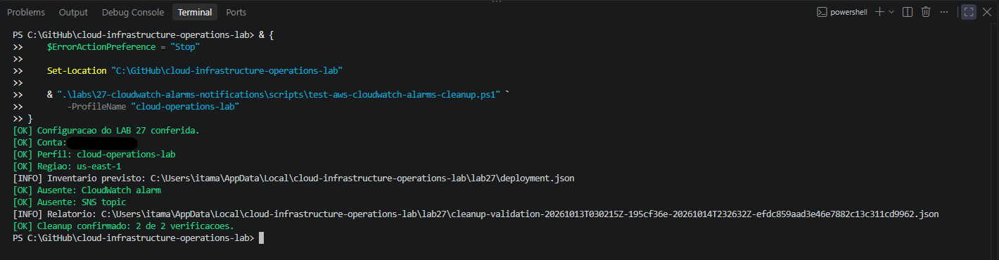
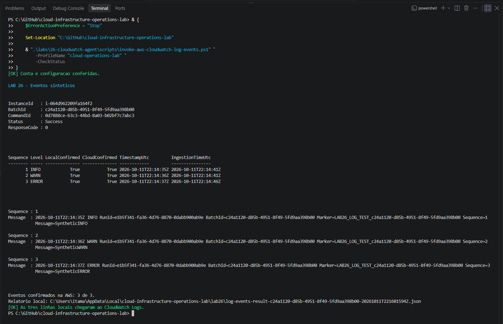
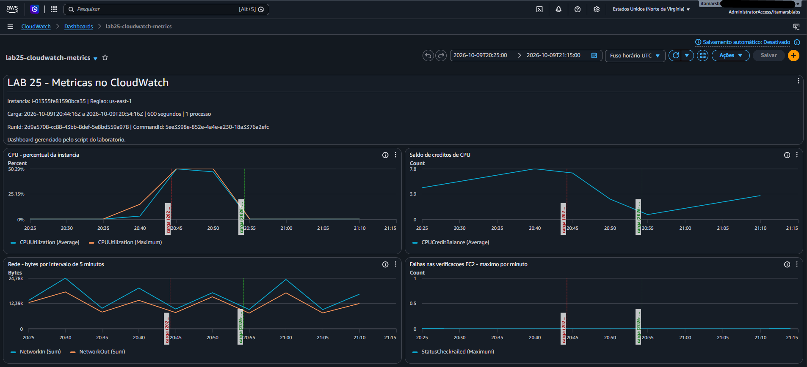

# Cloud Infrastructure Operations Lab

Laboratório progressivo de infraestrutura e operações em nuvem, com atividades práticas em **AWS, Linux, Terraform, GitHub Actions, Docker, CloudWatch, Zabbix, Bash e PowerShell**.

O projeto documenta a construção e a operação de um ambiente de aplicação ao longo de uma trilha evolutiva: preparação da estação de trabalho, acesso seguro à nuvem, administração Linux, infraestrutura AWS, automação, observabilidade, troubleshooting, segurança, custos e confiabilidade.

Cada laboratório apresenta contexto, procedimentos, validações, evidências e, quando aplicável, scripts reutilizáveis e etapas de cleanup.

> **English summary:** Hands-on cloud infrastructure and operations portfolio focused on AWS, Linux administration, Terraform, automation, observability, troubleshooting, security and operational reliability. Labs 00–28 are complete. The latest exercise independently verified 60 synthetic JSON log events and executed seven CloudWatch Logs Insights queries to investigate errors, latency, a timeline, and a specific request. The exclusive log group was removed, and an independent cleanup check confirmed its absence.

---

## Objetivo

Demonstrar competências práticas relacionadas às atividades de **Cloud Operations, Infrastructure Operations, DevOps e SRE**, por meio de cenários progressivos e reproduzíveis.

O repositório prioriza:

- execução prática e evidências verificáveis;
- segurança de acesso e proteção de informações sensíveis;
- diagnóstico antes de alterações;
- automação com escopo controlado;
- infraestrutura reproduzível;
- verificação automatizada do código;
- monitoramento, logs e resposta a falhas;
- controle de custos e remoção de recursos temporários;
- documentação técnica clara e rastreável.

---

## Tecnologias

| Categoria | Tecnologias e práticas |
|:---:|:---:|
| Cloud | AWS |
| Sistemas | Linux, Windows 11 e WSL |
| Infraestrutura como código | Terraform |
| Integração contínua | GitHub Actions |
| Containers | Docker e Docker Compose |
| Observabilidade | Amazon CloudWatch e Zabbix |
| Automação | Bash e PowerShell |
| Acesso e identidade | AWS IAM Identity Center e AWS Systems Manager |
| Versionamento | Git e GitHub |
| Documentação | Markdown e Mermaid |

As tecnologias de etapas futuras estão identificadas no roadmap. A inclusão nesta tabela não significa que todos os respectivos laboratórios já foram executados.

---

## Progresso atual

| Status | Laboratório | Conteúdo principal |
|---|---|---|
| Concluído | [Lab 00 — Preparação da estação de trabalho](labs/00-workstation-preparation/) | Git, VS Code, PowerShell e organização local. |
| Concluído | [Lab 01 — Configuração segura da conta AWS](labs/01-secure-aws-account-configuration/) | Proteção da conta e acesso administrativo. |
| Concluído | [Lab 02 — AWS CLI e autenticação por SSO](labs/02-aws-cli-installation-and-configuration/) | Perfis, sessões temporárias e validação de identidade. |
| Concluído | [Lab 03 — Ferramentas de infraestrutura](labs/03-infrastructure-tools-installation/) | Terraform e Session Manager Plugin. |
| Concluído | [Lab 04 — Arquivos e diretórios Linux](labs/04-linux-file-management/) | Navegação, busca e operações com arquivos. |
| Concluído | [Lab 05 — Usuários, grupos e permissões](labs/05-linux-users-groups-permissions/) | Identidades, permissões e acesso compartilhado. |
| Concluído | [Lab 06 — Serviços e logs no Linux](labs/06-linux-processes-services-logs/) | `systemctl`, `journalctl`, diagnóstico e recuperação de serviço. |
| Concluído | [Lab 07 — Baseline operacional da conta AWS](labs/07-aws-account-baseline/) | Inventário somente leitura, segurança, tags, observabilidade e custos. |
| Concluído | [Lab 08 — Rede da aplicação na AWS](labs/08-aws-application-network/) | VPC, sub-redes, rotas, Internet Gateway, Security Group e cleanup. |
| Concluído | [Lab 09 — EC2 administrada pelo Systems Manager](labs/09-aws-ec2-systems-manager/) | EC2, IAM Role, Session Manager, validação e cleanup. |
| Concluído | [Lab 10 — Serviço web Nginx em Linux](labs/10-linux-web-service/) | Nginx, `systemd`, acesso HTTP restrito, Systems Manager, validação e cleanup. |
| Concluído | [Lab 11 — Armazenamento e recuperação](labs/11-aws-storage-recovery/) | EBS, Amazon S3, integridade, cópia e restauração. |
| Concluído | [Lab 12 — Disponibilidade da aplicação](labs/12-aws-application-availability/) | Application Load Balancer, health checks, distribuição de tráfego e recuperação. |
| Concluído | [Lab 13 — Troubleshooting de aplicação indisponível](labs/13-aws-application-troubleshooting/) | Nginx, falha controlada, diagnóstico estruturado, recuperação e cleanup. |
| Concluído | [Lab 14 — Utilização de disco](labs/14-aws-disk-utilization/) | Volume EBS dedicado, pressão controlada, diagnóstico, mitigação e cleanup. |
| Concluído | [Lab 15 — Troubleshooting de conectividade](labs/15-aws-connectivity-troubleshooting/) | Falha controlada no Security Group, diagnóstico por camadas, recuperação e cleanup. |
| Concluído | [Lab 16 — Troubleshooting do AWS Systems Manager](labs/16-aws-systems-manager-troubleshooting/) | Falha controlada na saída HTTPS, diagnóstico SSM, recuperação e cleanup. |
| Concluído | [Lab 17 — Atualização controlada de aplicação](labs/17-aws-controlled-update/) | Baseline v1, falha de configuração, diagnóstico, rollback, atualização v2, confirmação e cleanup. |
| Concluído | [Lab 18 — Backup e restauração de aplicação](labs/18-aws-application-backup-restore/) | S3 versionado, SHA-256, perda controlada, diagnóstico, restauração por VersionId e cleanup. |
| Concluído | [Lab 19 — Fluxo essencial do Terraform](labs/19-terraform-essential-workflow/) | Recurso local `terraform_data`, plano salvo, aplicação, estado, outputs, plano sem mudanças e destroy. |
| Concluído | [Lab 20 — Infraestrutura AWS como código](labs/20-terraform-aws-infrastructure/) | Provider AWS, lock de dependências, sete recursos, EC2 com Nginx, validação independente e cleanup. |
| Concluído | [Lab 21 — Estado remoto](labs/21-terraform-remote-state/) | Bootstrap independente, S3 privado e versionado, migração de estado, bloqueio concorrente e cleanup. |
| Concluído | [Lab 22 — Variáveis, outputs e módulos](labs/22-terraform-variables-outputs-modules/) | Variáveis tipadas, validação de entradas, módulo reutilizável, outputs e remoção local. |
| Concluído | [Lab 23 — Mudanças e drift](labs/23-terraform-changes-drift/) | Mudança intencional, alteração externa, diagnóstico, recuperação, validação por SHA256 e remoção local. |
| Concluído | [Lab 24 — Validação automatizada](labs/24-terraform-automated-validation/) | GitHub Actions, matriz de jobs, dependências para Windows e Linux, falhas controladas e recuperação dos checks. |
| Concluído | [Lab 25 — Métricas no CloudWatch](labs/25-cloudwatch-metrics/) | Métricas nativas EC2, carga limitada de CPU, recuperação, créditos, dashboard e onze verificações de cleanup. |
| Concluído | [Lab 26 — CloudWatch Agent](labs/26-cloudwatch-agent/) | Memória, disco raiz, eventos sintéticos, relatórios JSON e onze verificações de cleanup. |
| Concluído | [Lab 27 — Alarmes e notificações](labs/27-cloudwatch-alarms-notifications/) | Métrica sintética, avaliação 2 de 3, ações SNS, recuperação, dados ausentes e duas verificações de cleanup. |
| Concluído | [Lab 28 — CloudWatch Logs Insights](labs/28-cloudwatch-logs-insights/) | Sessenta eventos sintéticos, sete consultas, erros, percentis, linha do tempo, investigação por requestId e cleanup independente. |

**28 laboratórios concluídos**, considerando a numeração de 00 a 27.

O planejamento completo está disponível em [`docs/roadmap.md`](docs/roadmap.md).

---

## Resultado mais recente

O **Lab 27 — Alarmes e notificações** utilizou uma métrica sintética de erros de aplicação para verificar thresholds, mudanças de estado, ações pelo Amazon SNS e tratamento de dados ausentes.

O cenário publicou quinze pontos em períodos separados de 60 segundos: cinco zeros de baseline, cinco valores `5` de estímulo e cinco zeros de recuperação. O alarme avaliou `Sum >= 3`, com dois de três períodos e `TreatMissingData=missing`.

| Verificação | Resultado em 14/10/2026 |
|:---:|:---:|
| Métricas | Quinze períodos conferidos, cada um com `SampleCount=1` |
| Baseline | `INSUFFICIENT_DATA → OK` às 19:31:29 |
| Estímulo | `OK → ALARM` às 19:37:29 |
| Recuperação | `ALARM → OK` às 19:42:29 |
| Dados ausentes | `OK → INSUFFICIENT_DATA` às 19:53:29 |
| SNS | Três ações executadas com sucesso no histórico |
| Caixa postal | Capturas dos e-mails da baseline e do alarme |
| Cleanup | Alarme e tópico ausentes; duas consultas independentes aprovadas |

Horários de Brasília (UTC−03:00). O histórico comprova a ação SNS de recuperação; o recebimento desse e-mail não está documentado nas capturas disponíveis.

Inventário, recibos e relatórios locais foram preservados. O cenário não provisionou EC2 nem coletou erros de uma aplicação real.

[Procedimento, resultados e evidências do Lab 27](labs/27-cloudwatch-alarms-notifications/).

---

## Resultados anteriores

### Lab 26 — CloudWatch Agent

O **Lab 26 — CloudWatch Agent** coletou métricas de memória e disco raiz e enviou logs de aplicação a partir de uma instância Amazon Linux 2023 administrada pelo Systems Manager.

A configuração versionada utilizou namespace `Lab26/CWAgent`, intervalo de 60 segundos, grupo de logs exclusivo e retenção de um dia. A role publicou métricas somente no namespace previsto e eventos somente no grupo exclusivo.

| Verificação | Resultado |
|:---:|:---:|
| Instalação | SSM `Success`, código `0`, agente `1.300071.0` |
| Configuração | SHA-256 aplicado conferido |
| Memória | 29 pontos na consulta versionada; aproximadamente `23,05%` a `23,21%` |
| Disco raiz | 30 pontos para `/`, `xfs`; aproximadamente `23,576%` a `23,578%` |
| Eventos sintéticos | INFO, WARN e ERROR: três linhas locais confirmadas no CloudWatch Logs |
| Ingestão do lote | Diferenças observadas de 6, 5 e 9 segundos entre timestamp e ingestão |
| Cleanup | Onze consultas independentes aprovadas |

As métricas foram consultadas com todas as dimensões efetivamente publicadas. Os resultados foram preservados em relatórios JSON locais. Os intervalos de ingestão são observações do lote, não uma garantia de latência.

A EC2 foi terminada, e os demais recursos exclusivos consultados, incluindo o grupo de logs, estavam ausentes após o cleanup.

[Procedimento, resultados e evidências do Lab 26](labs/26-cloudwatch-agent/).

### Lab 25 — Métricas no CloudWatch

O **Lab 25 — Métricas no CloudWatch** provisionou uma instância EC2 exclusiva para observar repouso, carga limitada de CPU e recuperação.

O cenário utilizou Amazon Linux 2023, instância `t3.micro`, créditos `standard`, monitoramento básico e administração pelo Systems Manager. A rede era exclusiva do laboratório, e o security group não tinha regras de entrada.

As consultas utilizaram o namespace `AWS/EC2`, a dimensão `InstanceId` e períodos e estatísticas definidos explicitamente.

| Observação | Resultado |
|:---:|:---:|
| Coleta inicial | Quatro métricas com dados |
| Carga | Um processo durante 600 segundos |
| Confirmação da execução | SSM `Success`, código de resposta `0` e marcador de encerramento |
| CPU no intervalo completo de carga | Média de aproximadamente `50,173%` |
| CPU após a carga | Retorno para aproximadamente `0,23%` a `0,26%` |
| Créditos de CPU | Redução durante a carga e recuperação posterior |
| Verificações de status | Zero falhas nos 50 pontos da janela comparativa |
| Dashboard | Cinco widgets, com conteúdo conferido pela API |
| Cleanup | Onze verificações independentes aprovadas |

A utilização próxima de 50% foi compatível com um processo de carga em uma instância com duas vCPUs. Os intervalos que continham apenas parte da carga foram interpretados considerando os horários de início e fim.

O dashboard reuniu CPU, créditos, rede e verificações de status, com anotações temporais da carga. A validação comparou o conteúdo JSON, considerando diferenças de representação.

Após o registro das evidências, o dashboard e a infraestrutura foram removidos. A verificação final confirmou a ausência dos recursos consultados e nenhuma interface de rede restante na VPC.

[Procedimento, resultados e evidências do Lab 25](labs/25-cloudwatch-metrics/).

### Lab 24 — Validação automatizada

Um workflow no GitHub Actions verificou as configurações Terraform dos Labs 22 e 23, utilizando Terraform `1.16.1`, runner Ubuntu `24.04` e uma matriz com dois jobs independentes.

O arquivo de dependências do Lab 23 foi preparado para `windows_amd64` e `linux_amd64`, preservando o provider `hashicorp/local` na versão `2.9.1`. A execução utilizou `-lockfile=readonly` e conferiu a preservação do lockfile.

Os testes em branch temporária demonstraram falhas de formatação e de referência a uma variável não declarada. Após cada correção, os dois jobs foram aprovados. O job do Lab 23 permaneceu aprovado durante as falhas introduzidas no Lab 22.

O pull request #1 foi fechado sem merge e a branch temporária foi excluída. O pipeline não executou plano, aplicação ou remoção de recursos e não utilizou credenciais AWS.

[Workflow de validação](.github/workflows/lab24-terraform-validation.yml).

[Procedimento, resultados e evidências do Lab 24](labs/24-terraform-automated-validation/).

### Lab 23 — Mudanças e drift

Um recurso `local_file.application_config` gerenciou um JSON exclusivo do laboratório. Conteúdo, SHA256, estado e outputs foram comparados ao longo do exercício.

A mudança intencional de `v1` para `v2` foi aplicada e confirmada por um plano sem mudanças.

O drift alterou diretamente `log_level` de `info` para `debug`, preservando a configuração Terraform, os parâmetros e o estado. A recuperação restaurou exatamente o conteúdo e o SHA256 do baseline v2. Outro plano confirmou ausência de mudanças.

O cleanup deixou o estado sem recursos e o arquivo gerenciado ausente, preservando sete arquivos de configuração e parâmetros e quatro registros locais.

[Procedimento, comparação dos planos e evidências do Lab 23](labs/23-terraform-changes-drift/).

### Lab 22 — Variáveis, outputs e módulos

O módulo raiz reutilizou o mesmo módulo filho em duas chamadas, `application` e `worker`, criando dois recursos locais `terraform_data`.

O teste com `replica_count = 0` foi rejeitado pela validação, com código de saída `1`, preservando `terraform.tfvars`. Estado e outputs confirmaram os dois componentes. Um segundo plano retornou sem mudanças, e a remoção deixou o estado vazio e os nove arquivos de configuração presentes.

[Procedimento e evidências do Lab 22](labs/22-terraform-variables-outputs-modules/).

### Lab 21 — Estado remoto

Um bootstrap independente criou seis recursos para um backend S3 privado, versionado e criptografado. A migração preservou o identificador do recurso e os outputs.

O teste de concorrência confirmou o arquivo `.tflock` e a recusa de uma segunda operação com `Error acquiring the state lock` e HTTP `412 PreconditionFailed`.

O cleanup removeu o recurso do exercício, preservou uma cópia do estado vazio, excluiu oito versões de objetos e seis marcadores de exclusão e removeu os seis recursos do bootstrap. Uma consulta independente confirmou a ausência do bucket.

[Procedimento e evidências do Lab 21](labs/21-terraform-remote-state/).

### Lab 20 — Infraestrutura AWS como código

Um plano salvo criou sete recursos exclusivos para uma aplicação Nginx em EC2. A VPC e a sub-rede compartilhadas do Lab 08 foram consultadas como fontes de dados.

A validação independente conferiu estado, outputs, configuração AWS, Systems Manager e aplicação. Os endpoints `/`, `/health` e `/version` responderam HTTP 200 local e externamente.

Um segundo plano confirmou ausência de mudanças. O cleanup removeu os sete recursos gerenciados, e a validação confirmou a ausência dos recursos exclusivos, incluindo o volume root, preservando a rede compartilhada.

[Procedimento e evidências do Lab 20](labs/20-terraform-aws-infrastructure/).

### Lab 19 — Fluxo essencial do Terraform

O exercício executou o ciclo completo de um recurso local `terraform_data`: inicialização, formatação, validação, plano salvo, aplicação, inspeção do estado e dos outputs e confirmação de plano sem mudanças.

O destroy removeu o recurso. A validação final confirmou estado vazio e preservação dos três arquivos `.tf`.

[Procedimento e evidências do Lab 19](labs/19-terraform-essential-workflow/).

### Lab 18 — Backup e restauração de aplicação

Um backup de quatro arquivos da aplicação Nginx foi armazenado em S3 privado e versionado. O pacote foi recuperado pelo `VersionId` registrado e conferido por SHA-256 e manifesto.

A perda controlada de `index.html` e `version` produziu HTTP 404 em `/` e `/version`, mantendo `/health` saudável. A restauração recuperou os quatro hashes do baseline e os testes HTTP locais e externos retornaram 200.

O intervalo observado entre perda e recuperação local foi de **5 min 56,294 s**, incluindo diagnóstico e espera do operador. O cleanup removeu os recursos exclusivos e preservou a rede compartilhada.

[Procedimento, limites das medições e evidências do Lab 18](labs/18-aws-application-backup-restore/).

### Lab 17 — Atualização controlada de aplicação

Uma candidata com diretiva inválida foi rejeitada por `nginx -t`, enquanto a aplicação permaneceu disponível em v1. O diagnóstico identificou o arquivo de configuração divergente.

O rollback restaurou os quatro hashes do baseline. A candidata v2 foi então validada local e externamente e confirmada. O cleanup removeu os recursos exclusivos, preservando a rede compartilhada.

[Procedimento e evidências do Lab 17](labs/17-aws-controlled-update/).

### Lab 16 — Troubleshooting do AWS Systems Manager

A remoção controlada da saída HTTPS foi investigada em duas tentativas. A primeira não produziu `ConnectionLost` no prazo e restaurou a regra. Após ajustar o procedimento para reiniciar somente a instância exclusiva, a segunda confirmou SSM `ConnectionLost` com EC2 `running`.

O diagnóstico verificou rede e IAM. A recuperação restaurou HTTPS pela API do EC2, e a validação voltou a `Healthy`. O cleanup preservou a rede compartilhada.

[Procedimento e evidências do Lab 16](labs/16-aws-systems-manager-troubleshooting/).

### Lab 15 — Troubleshooting de conectividade

A revogação da regra HTTP de um Security Group exclusivo interrompeu o acesso externo, mantendo Systems Manager e Nginx saudáveis.

O diagnóstico identificou a regra ausente. A recuperação restaurou somente TCP `80` para o CIDR autorizado, e a validação voltou a `Healthy`. O cleanup removeu os recursos exclusivos.

[Procedimento e evidências do Lab 15](labs/15-aws-connectivity-troubleshooting/).

### Lab 14 — Utilização de disco

Um volume EBS dedicado aos logs atingiu `85%` de utilização. O diagnóstico identificou `24` arquivos de pressão e aproximadamente `1,50 GiB` de dados recuperáveis.

A utilização de inodes permaneceu em `1%`, e nenhum arquivo removido ainda aberto foi encontrado. A mitigação por compressão e retenção reduziu a utilização para `57%`.

A validação confirmou o retorno a `Healthy`. O cleanup removeu os recursos exclusivos e preservou a rede compartilhada.

[Procedimento e evidências do Lab 14](labs/14-aws-disk-utilization/).

---

## Estrutura do repositório

| Diretório | Finalidade |
|:---:|:---:|
| `.github/workflows/` | Workflows de integração contínua |
| `labs/` | Laboratórios, scripts e evidências de execução |
| `docs/` | Roadmap e documentação geral |
| `terraform/` | Infraestrutura como código |
| `scripts/` | Scripts compartilhados entre laboratórios |
| `templates/` | Modelos de laboratório, checklist, incidente e runbook |
| `incident-response/` | Registros de troubleshooting e recuperação |
| `resources/` | Comandos, referências e materiais de apoio |

---

## Como utilizar

1. Consulte o [`roadmap`](docs/roadmap.md) para conhecer a sequência da trilha.
2. Acesse o diretório do laboratório desejado.
3. Leia o objetivo, os pré-requisitos e as proteções antes da execução.
4. Execute o procedimento no ambiente indicado.
5. Confirme as validações e compare os resultados com as evidências documentadas.
6. Remova os recursos temporários quando houver procedimento de cleanup.

> Recursos AWS que possam gerar cobrança devem permanecer ativos somente durante a execução dos respectivos laboratórios.

Para consultar a validação automatizada, acesse a aba Actions e selecione o workflow **LAB 24 - Terraform Validation**.

---

## Princípios operacionais

- autenticação temporária por AWS IAM Identity Center;
- preferência por acesso administrativo pelo AWS Systems Manager;
- princípio do menor privilégio conforme a evolução da trilha;
- identificação explícita de perfil, Região, ambiente e recursos;
- validações antes e depois das alterações;
- diagnóstico antes da mitigação;
- scripts limitados ao escopo declarado;
- autorização explícita para operações destrutivas;
- proteção de credenciais e identificadores sensíveis;
- tratamento de respostas vazias e falhas esperadas;
- infraestrutura reproduzível e mudanças rastreáveis;
- preservação de recursos compartilhados;
- proteção do estado e dos planos do Terraform;
- separação entre o estado do bootstrap e o estado do exercício;
- bloqueio do estado durante operações concorrentes;
- versionamento do arquivo de dependências do Terraform;
- preparação das dependências para os ambientes de execução;
- análise do plano antes da aplicação;
- validação direta dos recursos, além da consulta ao estado e aos outputs;
- verificação automatizada de formatação e configuração;
- testes de pipeline em branch temporária;
- consultas de métricas com janela, período e estatística explícitos;
- interpretação de ausência de dados sem conversão indevida para zero;
- confirmação do encerramento de cargas antes do cleanup;
- scripts de cleanup idempotentes;
- controle de custos e cleanup documentado.

---

## Práticas demonstradas

Os laboratórios concluídos até esta etapa demonstram:

- preparação e validação de uma estação de trabalho;
- autenticação temporária na AWS por SSO;
- administração de sistemas Linux;
- usuários, grupos e permissões;
- serviços e logs com `systemd` e `journalctl`;
- inventário operacional de uma conta AWS;
- redes VPC, sub-redes, rotas e Internet Gateway;
- instâncias EC2 administradas pelo Systems Manager;
- IAM Roles e Instance Profiles;
- Security Groups com escopo controlado;
- armazenamento com Amazon EBS e Amazon S3;
- validação de integridade e recuperação de dados;
- disponibilidade com Application Load Balancer;
- health checks e distribuição de tráfego;
- introdução controlada de falhas;
- diagnóstico estruturado antes da recuperação;
- investigação de utilização elevada de disco;
- análise de capacidade e inodes;
- rotação, compressão e retenção de logs;
- investigação de perda de conectividade do Systems Manager;
- recuperação pela API do EC2 quando o SSM está indisponível;
- atualização controlada de aplicação com baseline, backup e confirmação;
- diagnóstico de configuração inválida e rollback verificado por hashes;
- backup de aplicação em S3 privado e versionado;
- restauração por VersionId com verificação de pacote e manifesto SHA-256;
- diagnóstico de perda parcial com comparação de arquivos e respostas HTTP;
- registro dos intervalos observados de recuperação e da idade do backup;
- inicialização, formatação e validação de configuração Terraform;
- configuração de providers e versionamento de `.terraform.lock.hcl`;
- consulta de infraestrutura compartilhada por fontes de dados;
- provisionamento de IAM, Security Group, regras e EC2 pelo Terraform;
- análise e aplicação de plano salvo;
- inspeção de estado local e outputs;
- variáveis tipadas, valores padrão e validação de entradas;
- teste de entrada inválida com preservação do arquivo de parâmetros;
- reutilização de módulo filho com parâmetros distintos;
- exposição de outputs do módulo filho pelo módulo raiz;
- bootstrap independente para armazenamento do estado;
- configuração de backend S3 privado, versionado e criptografado;
- migração de estado com preservação do identificador do recurso e dos outputs;
- validação de bloqueio concorrente por arquivo `.tflock`;
- inventário e exclusão de versões e marcadores de exclusão do S3;
- comparação entre configuração declarada, estado e recurso observado;
- distinção entre mudança intencional e drift;
- diagnóstico de alteração externa em arquivo gerenciado;
- recuperação do conteúdo declarado com comparação de conteúdo e SHA256;
- validação independente dos recursos AWS e da aplicação;
- verificação de plano sem mudanças após a aplicação e a recuperação;
- remoção pelo Terraform e validação do estado após o cleanup;
- confirmação da ausência de recursos exclusivos na AWS;
- integração contínua com GitHub Actions;
- matriz de jobs para configurações Terraform distintas;
- preparação de checksums para Windows e Linux;
- inicialização em pipeline com lockfile somente leitura;
- detecção de falhas de formatação e de referências inválidas;
- confirmação da recuperação dos checks após correções;
- encerramento de pull request de teste sem merge;
- consulta de métricas nativas EC2 no CloudWatch;
- comparação entre repouso, carga limitada de CPU e recuperação;
- interpretação de períodos, estatísticas e créditos de CPU;
- publicação e validação de dashboard pela API;
- comparação de conteúdo JSON considerando diferenças de representação;
- instalação e configuração versionada do CloudWatch Agent;
- publicação de métricas de memória e disco com dimensões efetivas;
- confirmação de linhas locais no CloudWatch Logs por marcador exclusivo;
- retenção explícita e relatórios JSON de validação;
- avaliação de alarmes com dois de três períodos e dados ausentes;
- assinatura de e-mail SNS, ações de alarme e recuperação;
- confirmação independente da remoção de alarme e tópico;
- automação com PowerShell e Bash;
- cleanup seguro e preservação de infraestrutura compartilhada.

---

## Evolução planejada

A trilha está dividida em nove etapas:

1. preparação e acesso;
2. operações Linux;
3. infraestrutura AWS;
4. operação e troubleshooting;
5. Terraform;
6. monitoramento e logs;
7. Docker;
8. segurança, custos e confiabilidade;
9. projeto integrado de uma aplicação web.

Os cinco primeiros módulos foram concluídos. O módulo de monitoramento e logs possui três dos seis laboratórios concluídos: Labs 25, 26 e 27.

| Laboratório do módulo Terraform | Resultado |
|:---:|:---:|
| Lab 19 | Ciclo de vida de um recurso local e aplicação de plano salvo |
| Lab 20 | Infraestrutura AWS, validação independente e cleanup |
| Lab 21 | Estado remoto em S3, migração e bloqueio concorrente |
| Lab 22 | Variáveis tipadas, validação, módulos reutilizáveis e outputs |
| Lab 23 | Mudança intencional, drift, diagnóstico e recuperação |
| Lab 24 | Validação automatizada em GitHub Actions e testes de falha e recuperação |

A próxima etapa prevista é o **Lab 28 — CloudWatch Logs Insights**.

O laboratório trabalhará consultas e investigação de eventos. O planejamento definirá logs de teste, campos, filtros, agregações, janelas de consulta, custos, evidências e cleanup.

Os recursos exclusivos dos Labs 25, 26 e 27 foram removidos. O cenário do Lab 28 será definido e validado antes da implementação.

---

## Licença

Este projeto está distribuído sob a [licença MIT](LICENSE).

---

## Repository Metrics

