# Lab 00 — Workstation Preparation

[**Português (Brasil)**](README.md) · **English**

## Objective

Prepare a Windows workstation for the hands-on exercises in the **Cloud Infrastructure Operations Lab** repository.

This lab covers the basic tools, a local working directory, repository cloning, and access to the project through PowerShell and Visual Studio Code.

## Scenario

A Cloud Operations team needs a reliable workstation for maintaining technical documentation, running commands, using version control, and keeping lab files organized. Before working with AWS resources, verify that the local environment is ready.

## At a glance

| Item | Description |
|---|---|
| Level | Beginner |
| Estimated time | 20–30 minutes |
| Operating system | Windows 10 or Windows 11 |
| Tools | PowerShell, Git, Visual Studio Code |
| AWS services | None |
| Main skill | Preparing and organizing a workstation |
| Estimated cost | Free |
| Required cleanup | No |

## Learning outcomes

By the end of this lab, you should be able to use basic PowerShell commands, check whether Git and Visual Studio Code are available, create and navigate directories, clone a GitHub repository, examine its structure, open it in VS Code, and verify the local setup.

## Prerequisites

- Windows 10 or Windows 11
- Internet access
- Permission to install programs, if they are not already installed
- A GitHub account (not required for anonymous cloning of this public repository)
- Access to PowerShell

An AWS account is **not** required.

## Tools

| Tool | Purpose |
|---|---|
| PowerShell | Run commands and manage local files |
| Git | Clone and version-control the repository |
| Visual Studio Code | Browse and edit project files |
| GitHub | Host the remote repository |

## Local workflow

No cloud infrastructure is provisioned in this lab.

```text
GitHub
   │
   │ git clone
   ▼
Local repository
   │
   ├── PowerShell
   ├── Git
   └── Visual Studio Code
```

---

## Step 1 — Open PowerShell

Open the Windows **Start** menu, search for **PowerShell**, and launch **Windows PowerShell** or **PowerShell**. Administrator privileges are not needed for the normal steps in this lab.

Check the installed version:

```powershell
$PSVersionTable.PSVersion
```

**Expected result:** PowerShell displays its version. For example:

```text
Major  Minor  Patch
-----  -----  -----
7      5      0
```

Your version may differ.

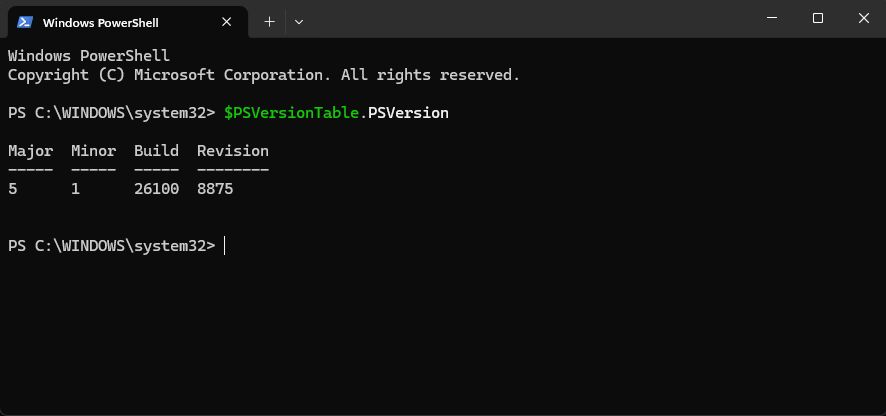

## Step 2 — Identify your account and working directory

Run:

```powershell
whoami
Get-Location
```

The first command identifies the Windows account. The second shows the current directory. Example:

```text
Path
----
C:\WINDOWS\system32
```

The user name and path on your computer may differ.

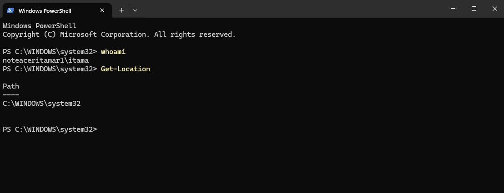

## Step 3 — Create a working directory

Create a `Cloud-Labs` directory under your user profile, enter it, and confirm the location:

```powershell
New-Item -ItemType Directory -Path "$HOME\Cloud-Labs" -Force
Set-Location "$HOME\Cloud-Labs"
Get-Location
```

**Expected result:** The reported path ends in `Cloud-Labs`, for example:

```text
C:\Users\your-user\Cloud-Labs
```

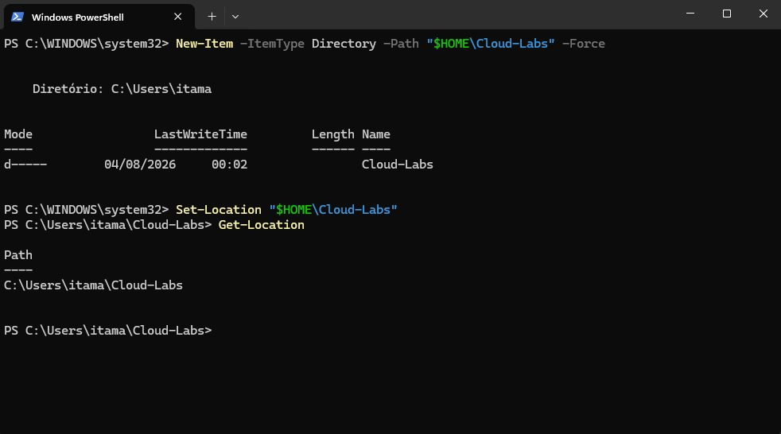

## Step 4 — Check Git

Run:

```powershell
git --version
```

If Git is available, the output should resemble:

```text
git version 2.x.x.windows.x
```

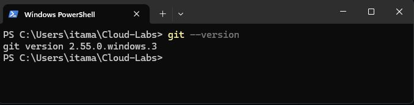

### If Git is not installed

**Option A — WinGet:**

```powershell
winget install --id Git.Git -e --source winget
```

Close and reopen PowerShell, then repeat `git --version`.

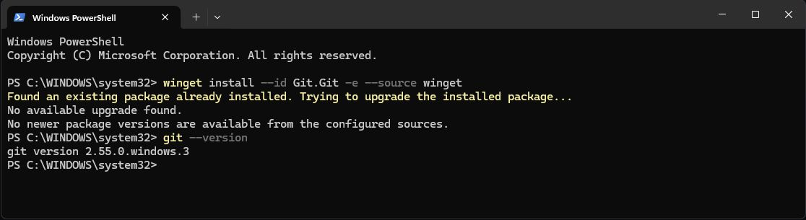

*In the recorded example, WinGet reported that Git was already installed.*

**Option B — Official installer:** Download Git for Windows from [git-scm.com](https://git-scm.com/), use the recommended installation settings, and open a new terminal.

Do not proceed until `git --version` works.

## Step 5 — Check Visual Studio Code

Run:

```powershell
code --version
```

**Expected result:** Version details similar to:

```text
1.xx.x
version-identifier
x64
```

Your installed version and architecture may differ.

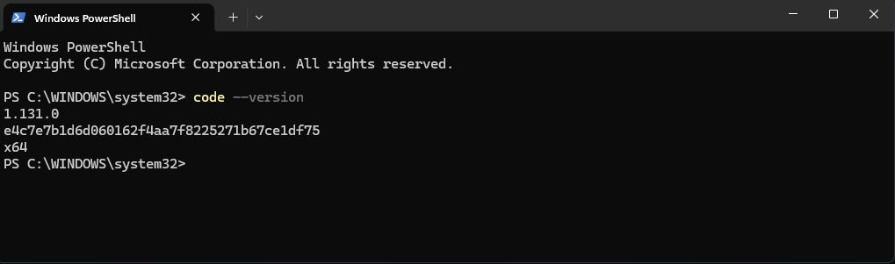

If VS Code is missing, install the stable Windows version from [code.visualstudio.com](https://code.visualstudio.com/). The **User Installer** is suitable for an individual installation. Where available, enable the option to add `code` to `PATH`.

Open a new PowerShell session and retry `code --version`. If the application opens normally but the command is not recognized, restart the terminal or Windows and check again.

## Step 6 — Clone the repository

Return to the working directory:

```powershell
Set-Location "$HOME\Cloud-Labs"
```

Clone the public repository:

```powershell
git clone https://github.com/itamarsb/cloud-infrastructure-operations-lab.git
```

Git should display progress similar to:

```text
Cloning into 'cloud-infrastructure-operations-lab'...
remote: Enumerating objects...
Receiving objects: 100%
Resolving deltas: 100%
```

Enter the repository and verify your location:

```powershell
Set-Location ".\cloud-infrastructure-operations-lab"
Get-Location
```

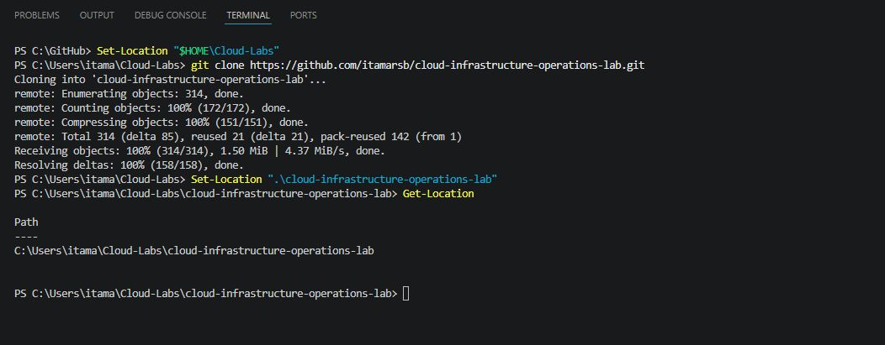

## Step 7 — Check the local repository

List the files:

```powershell
Get-ChildItem
```

You should see project directories such as `labs`, `docs`, `scripts`, and `terraform`, along with files such as `README.md` and `LICENSE`. This is a versioned repository, so the directory listing can change as the project evolves. Hidden files may not appear in a default listing.

Then run:

```powershell
git status
```

For a clean checkout of the `main` branch, the result should resemble:

```text
On branch main
Your branch is up to date with 'origin/main'.

nothing to commit, working tree clean
```

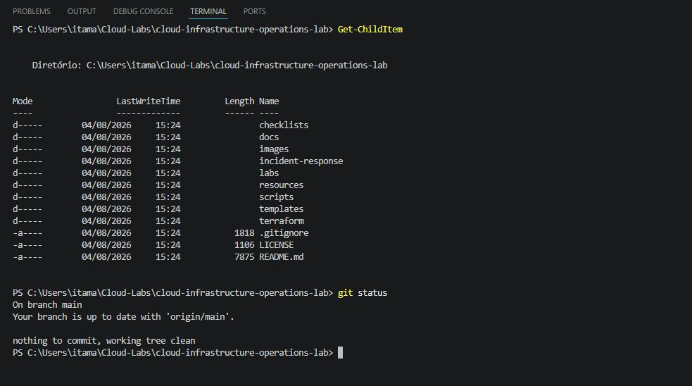

## Step 8 — Check the remote repository

Run:

```powershell
git remote -v
```

**Expected result:**

```text
origin  https://github.com/itamarsb/cloud-infrastructure-operations-lab.git (fetch)
origin  https://github.com/itamarsb/cloud-infrastructure-operations-lab.git (push)
```

These are the configured remote addresses; they do not establish that you have permission to push changes to the upstream repository.

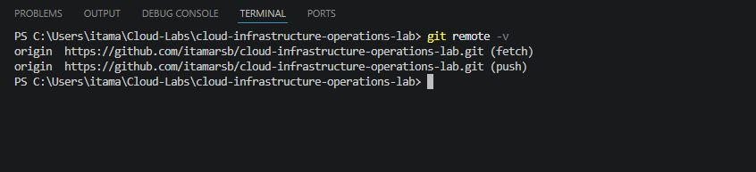

## Step 9 — Open the project in Visual Studio Code

From the repository directory, run:

```powershell
code .
```

The dot represents the current directory. VS Code should open the project and display its files in **Explorer**.

If VS Code prompts you to trust the workspace, review the directory and trust it only if you recognize the repository and its contents.

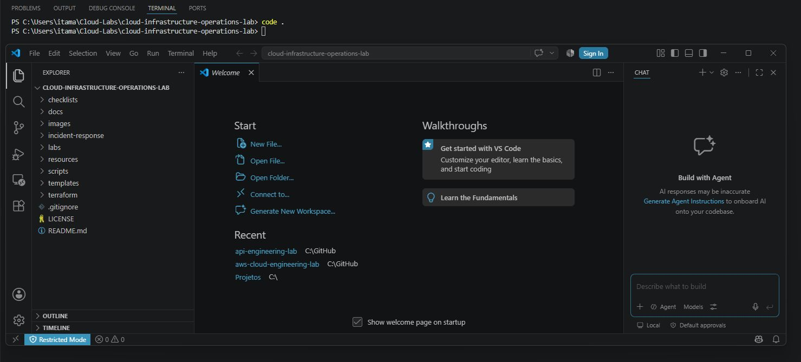

## Step 10 — Explore the project structure

In the VS Code Explorer, locate the following directories:

| Directory | Purpose |
|---|---|
| `docs/` | General documentation and roadmap |
| `labs/` | Hands-on labs |
| `terraform/` | Infrastructure as code |
| `incident-response/` | Incident and recovery documentation |
| `checklists/` | Checklists |
| `resources/` | Supporting material |
| `templates/` | Documentation templates |
| `scripts/` | Supporting scripts |
| `images/` | Images and visual evidence |

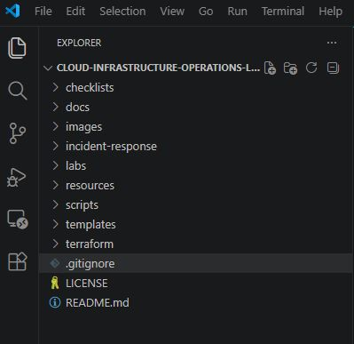

Open `README.md` for the repository overview.

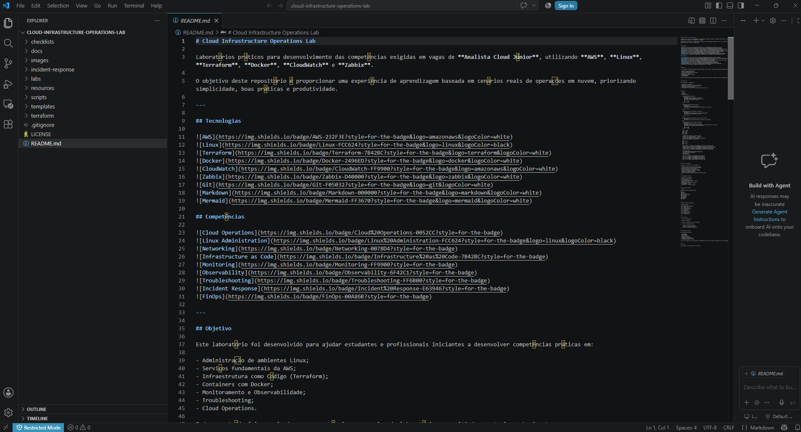

Then open `docs/roadmap.md` and identify the upcoming modules. The roadmap is maintained in Brazilian Portuguese.

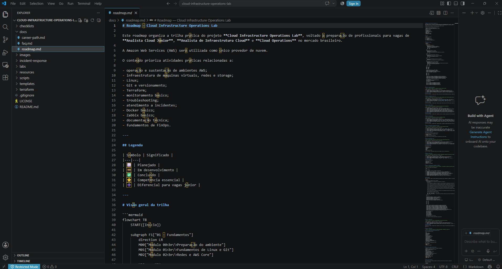

## Step 11 — Use the integrated terminal

In VS Code, choose **Terminal > New Terminal**, or use the shortcut shown in your installation (commonly `Ctrl + Shift + \``).

Confirm that the terminal is operating in the repository directory:

```powershell
Get-Location
git status
```

**Expected result:** The commands work from the integrated PowerShell terminal just as they do from an external PowerShell window. If the default integrated shell is different, select a PowerShell profile before running these commands.

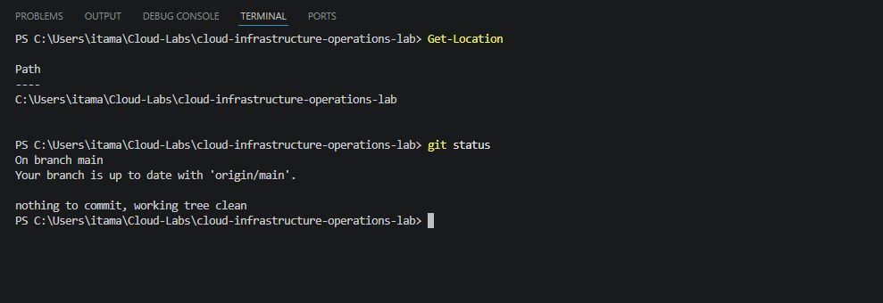

## Step 12 — Record tool versions

Run:

```powershell
git --version
code --version
$PSVersionTable.PSVersion
```

Record the operating system and tool versions in your lab notes or evidence. Example:

```text
Operating system: Windows 11
PowerShell: 7.x
Git: 2.x
Visual Studio Code: 1.x
```

Matching the example versions exactly is not necessary.

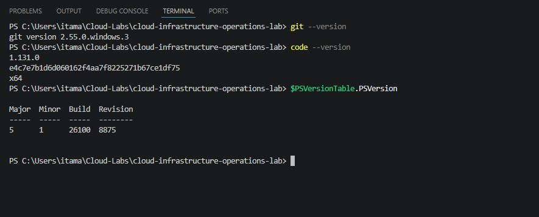

---

## Validation

For a fresh execution, use this checklist to confirm your own results:

- [ ] PowerShell opens and reports its version.
- [ ] `Cloud-Labs` exists.
- [ ] `git --version` succeeds.
- [ ] `code --version` succeeds.
- [ ] The repository has been cloned.
- [ ] Git recognizes the working tree.
- [ ] `git status` runs successfully.
- [ ] `git remote -v` shows the expected origin.
- [ ] VS Code opens the repository.
- [ ] The integrated terminal works.
- [ ] The main repository directories are present.

The screenshots in this repository document a prior lab execution; checking a box here does not claim that the reader has performed the step.

## Evidence

Useful evidence includes the Git and VS Code version output, `git status`, the VS Code Explorer showing the project, and the integrated terminal displaying `Get-Location`.

**Do not publish** passwords, access tokens, private keys, credentials, or personal information in screenshots or logs. This lab does not use AWS credentials.

## Troubleshooting

### Git is not recognized

**Likely cause:** Git is not installed or is missing from `PATH`.

Install Git, close the open terminals, start PowerShell again, and run:

```powershell
git --version
```

### The `code` command is not recognized

**Likely cause:** VS Code was not added to `PATH`, or the terminal was opened before installation.

Reopen PowerShell and retry:

```powershell
code --version
```

If needed, restart Windows or review the VS Code installer settings.

### The repository directory already exists

Git may return:

```text
fatal: destination path 'cloud-infrastructure-operations-lab' already exists and is not an empty directory
```

The repository may already have been cloned. Rather than deleting it or cloning into the same path, enter the existing directory:

```powershell
Set-Location "$HOME\Cloud-Labs\cloud-infrastructure-operations-lab"
git status
```

If you want to update an existing clean checkout, you can use:

```powershell
git pull origin main
```

Review local changes first: pulling into a modified working tree may fail or require conflict resolution.

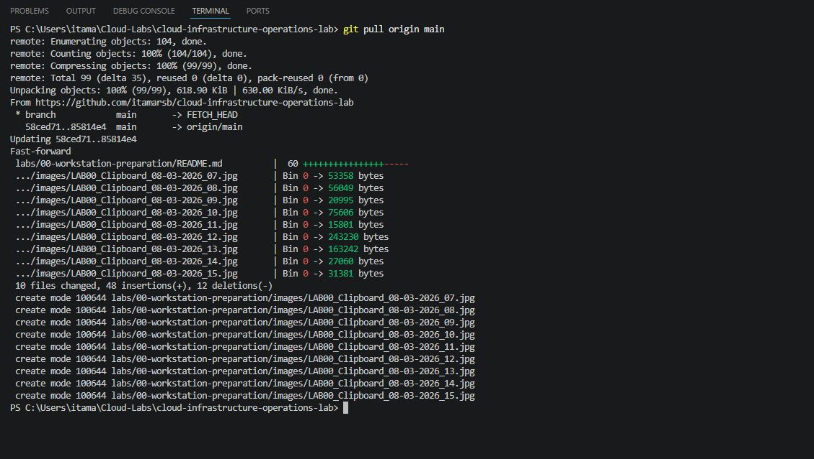

### Cloning fails because of a connection problem

A network interruption or an unavailable GitHub connection may prevent cloning. Start by checking basic connectivity:

```powershell
Test-Connection github.com -Count 4
```

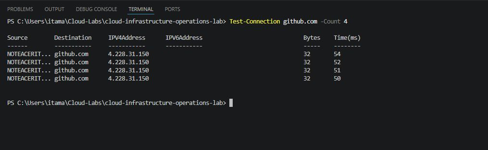

ICMP responses may be blocked even when GitHub HTTPS is reachable. If necessary, check HTTPS connectivity separately before attempting the clone again:

```powershell
git clone https://github.com/itamarsb/cloud-infrastructure-operations-lab.git
```

### VS Code opens the wrong directory

Enter the intended working tree and reopen VS Code:

```powershell
Set-Location "$HOME\Cloud-Labs\cloud-infrastructure-operations-lab"
code .
```

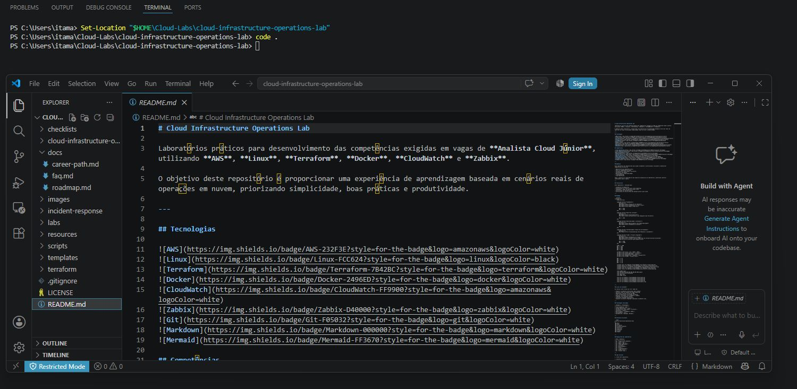

### Git says this is not a repository

The error may resemble:

```text
fatal: not a git repository
```

Check that you are inside the cloned working tree:

```powershell
Set-Location "$HOME\Cloud-Labs\cloud-infrastructure-operations-lab"
git status
```

## Operational context

In Cloud Operations, a working environment supports reading and editing documentation, running operational commands, reviewing changes, maintaining scripts, and keeping technical records under version control. Consistent workstation preparation reduces avoidable setup errors and makes procedures easier to reproduce.

## Cleanup

No AWS resources are created, and no cloud charges are expected. **Cleanup is optional.** Keep the cloned repository if you plan to continue the lab sequence.

**Destructive command — use only if you intentionally want to delete the local checkout.** The following commands remove the repository directory and all files beneath it, including uncommitted changes and locally stored evidence. Confirm the target path and back up anything you need before executing them.

```powershell
Set-Location "$HOME\Cloud-Labs"
Remove-Item ".\cloud-infrastructure-operations-lab" -Recurse -Force
```

Close VS Code first. The deletion does not remove the remote GitHub repository.

## Completion checklist

- [ ] Reviewed the objective and scenario.
- [ ] Verified PowerShell, Git, and VS Code.
- [ ] Created the lab working directory.
- [ ] Cloned the repository and checked its remote.
- [ ] Opened the project and tested the integrated terminal.
- [ ] Reviewed the directory layout.
- [ ] Collected appropriate evidence without exposing secrets.
- [ ] Reviewed common troubleshooting scenarios.
- [ ] Confirmed that no AWS resources were provisioned.

## Lessons learned

This lab introduces basic PowerShell navigation, local directory organization, tool validation, Git cloning and status checks, VS Code's integrated terminal, and a repeatable starting point for subsequent Cloud Operations exercises.

## Expected final layout

```text
Cloud-Labs/
└── cloud-infrastructure-operations-lab/
    ├── checklists/
    ├── docs/
    ├── images/
    ├── incident-response/
    ├── labs/
    ├── resources/
    ├── scripts/
    ├── templates/
    ├── terraform/
    ├── .gitignore
    ├── LICENSE
    └── README.md
```

The repository may also contain newer files, including English documentation.

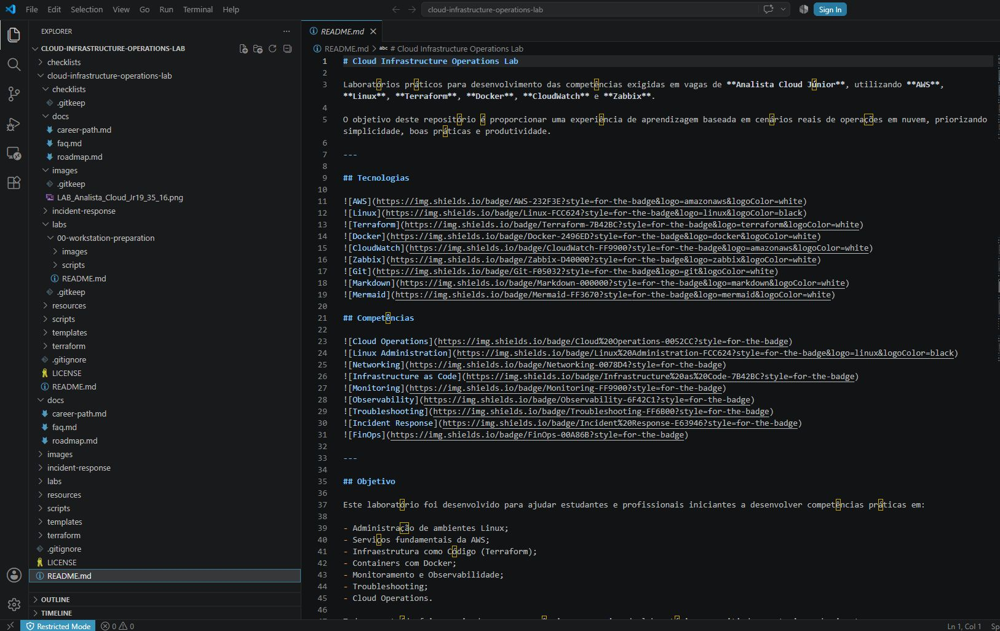

## PowerShell validation script

The `scripts/validate-workstation.ps1` file provides a repeatable set of **read-only checks**. It does not install software, change system settings, create AWS resources, delete files, or perform a login.

From the repository root, run:

```powershell
.\labs\00-workstation-preparation\scripts\validate-workstation.ps1
```

It checks whether:

- The operating system is Windows and PowerShell is version 5 or later.
- Git and the `code` command are available in `PATH`.
- The `Cloud-Labs` directory exists (a missing directory is a warning).
- The script is running from a Git repository.
- The repository name and `origin` correspond to the expected project.
- Required files and directories are present.
- The Git working tree has uncommitted changes.

The output uses three status labels. The original script prints these labels in Portuguese:

```text
[OK]     Check passed
[AVISO]  Warning; not necessarily blocking
[FALHA]  Required check failed
```

A warning about local modifications does not fail the validation. The script returns exit code `0` when there are no failed checks and `1` when at least one required check fails.

These are checks performed by the script; this documentation does not claim that the script was re-executed as part of the translation.

## Next lab

[Lab 01 — Secure AWS Account Configuration](../01-secure-aws-account-configuration/)

---

[Repository overview in English](../../README.en.md) · [Repository overview in Portuguese](../../README.md)
