# Lab 01 — Secure AWS Account Configuration

[**Português (Brasil)**](README.md) · **English**

## Objective

Establish the initial security, account-recovery, and cost-monitoring controls for an AWS account before provisioning cloud infrastructure.

This exercise covers root-user security, multi-factor authentication (MFA), account contact details, AWS Free Tier usage alerts, and a monthly AWS Budget. It is a practical account-preparation exercise, not a complete security baseline for production workloads.

## Scenario

A Cloud Operations team needs to prepare an AWS account for hands-on infrastructure labs. Before deploying instances, networks, or application services, the account owner should secure privileged access, verify recovery contacts, and set up cost visibility.

## At a glance

| Item | Description |
|---|---|
| Level | Beginner |
| Estimated time | 30–45 minutes |
| Expected configuration cost | No infrastructure provisioned; check current AWS pricing and account-plan conditions |
| AWS services | AWS Account Management, IAM, Billing and Cost Management, AWS Budgets |
| Main skill | Initial account security and cost governance |
| Required cleanup | No |

**Important account-plan distinction (2026):** AWS offers Free and Paid account plans for eligible newly created accounts, with different service-access and billing conditions. The Free plan has credit and duration limits; the Paid plan may incur charges beyond eligible credits and offers. Existing accounts may have different entitlements. Always review the plan and billing information shown in your account rather than assuming that every AWS account has the same Free Tier benefits.

Official reference: [AWS Free Tier plans](https://docs.aws.amazon.com/awsaccountbilling/latest/aboutv2/free-tier-plans.html).

## Learning outcomes

After completing this lab, you should be able to:

- Explain why root credentials are reserved for exceptional administrative tasks.
- Review root access keys and protect root sign-in with MFA.
- Check primary and alternate account contacts.
- Understand how account recovery depends on contact information.
- Review AWS Free Tier usage notifications.
- Create a monthly cost budget with actual and forecasted cost alerts.
- Distinguish account-wide settings from Regional resources.
- Record evidence without exposing credentials or personal information.

## Prerequisites

- An active AWS account and an understanding of its billing plan.
- Access to the root-user email address and registered recovery telephone number.
- A supported MFA method; the recorded walkthrough uses a TOTP authenticator app.
- An email inbox monitored for billing and security notifications.
- A current browser and an uninterrupted session.

> [!WARNING]
> Use a trusted, private workstation. Do not sign in as root from a shared or public computer, save root credentials in an untrusted browser, or expose MFA enrollment material.

## Tools

| Tool | Purpose |
|---|---|
| AWS Management Console | Manage account settings |
| MFA authenticator | Provide an additional sign-in factor |
| AWS Billing and Cost Management | Inspect billing settings and costs |
| AWS Budgets | Set up budget thresholds and notifications |

## Workflow overview

This lab does **not** provision EC2, networking, or other application infrastructure. It configures account-level safeguards.

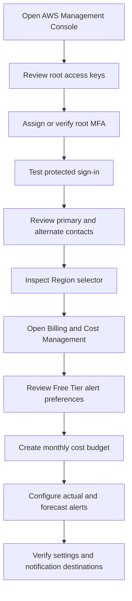

The original Portuguese README retains the more detailed, styled workflow diagram.

---

## Step 1 — Sign in as the account root user

The AWS account root user is created with the account and has highly privileged access. It should be used only for operations that require those privileges.

1. Open the official AWS Management Console sign-in page.
2. Choose **Root user**.
3. Enter the email address associated with the AWS account.
4. Select **Next** and enter the root password.
5. Complete any additional AWS verification prompts.

> [!CAUTION]
> Never share your root password, MFA codes, authenticator QR code, access keys, or recovery information.

**Validation:** Confirm that you can open the account menu in the console.

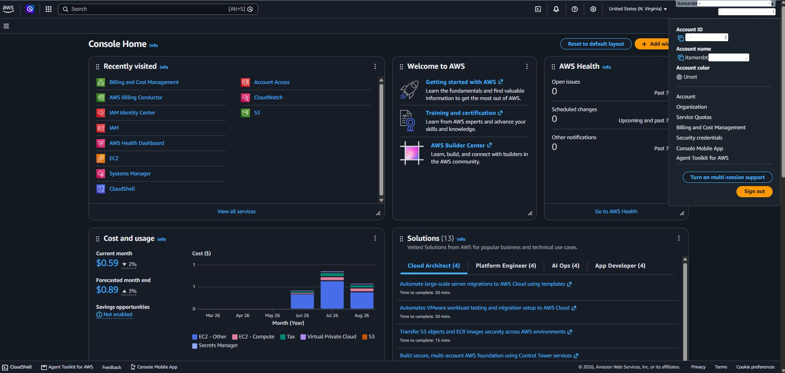

## Step 2 — Review root access keys

Do not use root access keys in automation, applications, or command-line tools.

1. Open the account menu in the upper-right corner.
2. Select **Security credentials**.
3. Find **Access keys**.
4. Verify whether root access keys exist or are active.

**Expected result:** No active root access keys.

If you discover an existing root key, treat it as a security concern. Identify legitimate dependencies and plan its replacement with appropriately scoped credentials before removal. Do not post the key identifier or secret in public evidence.

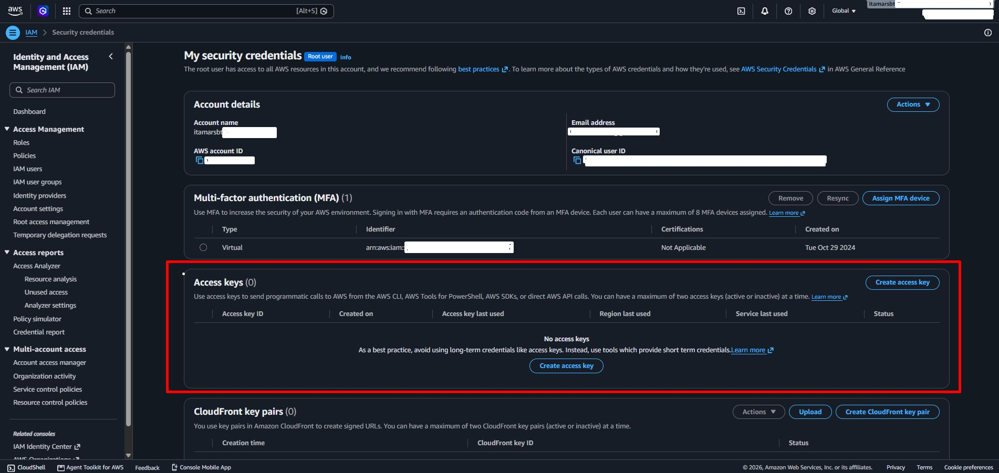

## Step 3 — Enable root-user MFA

MFA adds another verification requirement to the sign-in process. The recorded exercise uses a time-based one-time password (TOTP) authenticator.

1. Under **Security credentials**, find **Multi-factor authentication (MFA)**.
2. Choose **Assign MFA device**, if an appropriate device has not already been configured.
3. Enter a recognizable device label, such as:

```text
root-mfa-primary
```

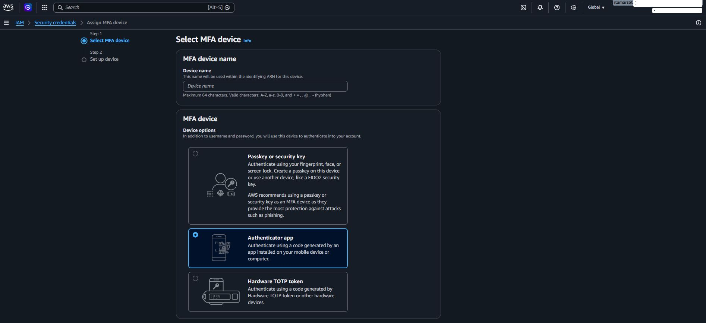

4. Select **Authenticator app** and continue.
5. Open the authenticator app on your phone.
6. Add the AWS account by scanning the QR code shown in the console.
7. Enter two successive authenticator codes, as requested.
8. Complete the enrollment using **Add MFA**, or the equivalent current control.

> [!CAUTION]
> The QR code contains an enrollment secret. Do not photograph it for publication or include it in a GitHub repository.

**Expected result:** An MFA device is listed for the root identity.

**Current security recommendation:** Where available, prefer phishing-resistant authentication methods such as FIDO security keys or passkeys. AWS supports multiple MFA devices for a root user, providing resilience if a primary device becomes unavailable. The use of a TOTP application here reflects the original laboratory procedure; it does not mean TOTP is the strongest available method.

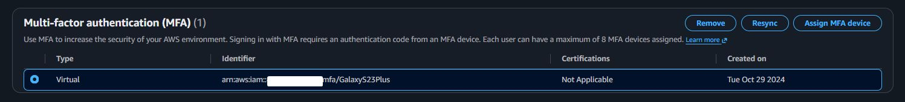

## Step 4 — Test sign-in with MFA

A security control should be verified after configuration.

1. Sign out from the account menu.
2. Sign in again as **Root user**.
3. Provide the password.
4. Complete the MFA challenge with the enrolled device.

**Expected result:** The account requires and accepts the additional authentication factor.

Do not remove a working MFA method after validation. If possible, register and securely maintain another supported factor for recovery.

## Step 5 — Review primary account information

Current account details are essential for recovery, billing communication, and AWS security notifications.

1. Open the account menu and choose **Account**.
2. Locate **Contact information**.
3. Check the name, address, country, telephone number, and other relevant details.
4. If necessary, choose **Edit**, update only the incorrect fields, and save.

**Expected result:** Contact details identify the legitimate account owner and can be used for communication and recovery.

> [!WARNING]
> This screen may reveal personal information. Do not publish an unredacted screenshot of the contact section.

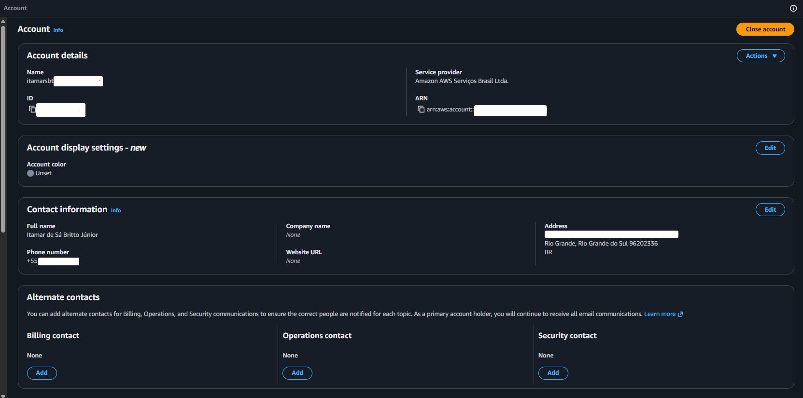

## Step 6 — Configure alternate contacts

AWS supports three alternate contact categories:

| Contact | Purpose |
|---|---|
| Billing | Billing and payment communications |
| Operations | Service and operational notifications |
| Security | Security-related communication |

1. On the **Account** page, find **Alternate contacts**.
2. Review the **Billing**, **Operations**, and **Security** entries.
3. Choose **Edit** for any missing or outdated entry.
4. Enter the appropriate contact details and save.

For a personal lab account, one monitored contact may serve all three roles. In an organization, shared institutional addresses or distribution lists can reduce dependence on a single employee.

**Expected result:** All three categories have current, reachable contacts.

## Step 7 — Review the AWS Region selector

Many AWS resources are Region-specific, while account and billing settings and IAM are account-wide or global services.

1. Locate the Region selector in the AWS console.
2. Open the list of Regions.
3. Find **South America (São Paulo)**:

```text
sa-east-1
```

4. Select this Region as the reference used in the original lab.

Changing the console Region does not move existing infrastructure. For future labs, always confirm the intended Region before creating or looking up resources such as EC2 instances, VPCs, and EBS volumes. Follow any lab-specific Region instructions where they differ.

**Expected result:** **South America (São Paulo)** appears as the selected Region in a Regional console view.

## Step 8 — Open Billing and Cost Management

1. Search the console for:

```text
Billing and Cost Management
```

2. Open the billing console.
3. Locate the available navigation entries, including **Bills**, **Cost Explorer**, **Budgets**, **Free Tier**, and **Billing preferences**.

Console labels and navigation can change. Certain billing views may require activation or time to populate historical data.

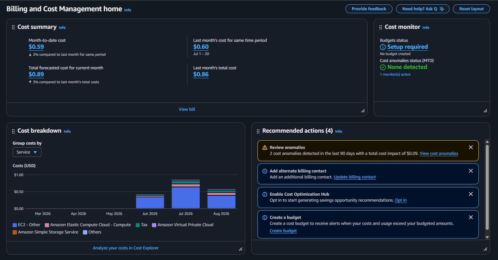

## Step 9 — Review AWS Free Tier usage alerts

AWS Free Tier usage alerts help identify usage approaching eligible free limits. Their applicability depends on the account type and current AWS Free Tier terms.

1. Open **Billing preferences**.
2. Under **Alert preferences**, choose **Edit**.
3. Review **Receive AWS Free Tier usage alerts**, if available for your account.
4. Enable the preference where appropriate.
5. Review or add a monitored recipient email address.
6. Save the change using **Update**.

**Expected result:** The preference and notification destination match the account's eligibility and intended configuration.

Some individual accounts may have these alerts enabled automatically. An alert is a notification, **not a service shutdown or a guaranteed spending limit**.

Official reference: [Billing preferences](https://docs.aws.amazon.com/awsaccountbilling/latest/aboutv2/billing-pref.html).

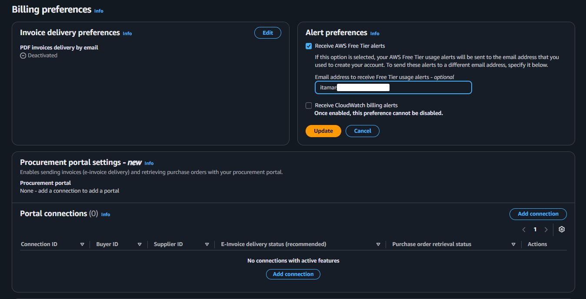

## Step 10 — Create a monthly cost budget

An AWS Budget tracks spending against a selected amount. **It does not impose a hard cap on the account.**

1. In the billing console, open **Budgets**.
2. Choose **Create budget**.
3. Select a monthly **Cost budget**, using a template or manual configuration as offered by the current interface.
4. Enter a descriptive name:

```text
monthly-cloud-lab-budget
```

5. Select **Monthly** and a fixed budget amount.
6. Enter a budget that matches your acceptable lab spending.

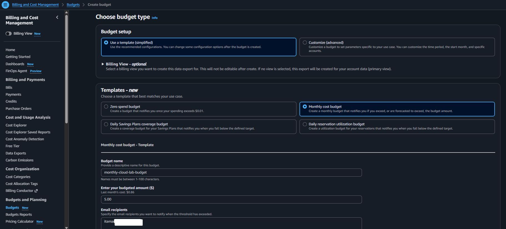

Illustrative amount from the original exercise:

```text
5.00 USD
```

This is a **sample budget value**, not a safe-cost guarantee. Service usage, account plan, taxes, credit applicability, and charges may vary.

7. Keep the scope across all services in the account for this introductory exercise.
8. Proceed to notifications.

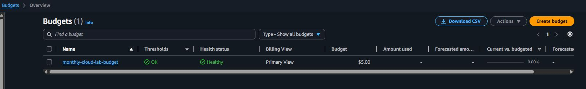

## Step 11 — Configure budget notifications

A simple starting configuration has three thresholds:

| Notification | Measurement | Threshold |
|---|---|---|
| First warning | Actual cost | 50% of budget |
| Second warning | Actual cost | 80% of budget |
| Forecast overrun | Forecasted cost | 100% of budget |

For each threshold:

1. Choose **Add an alert threshold**, or the equivalent console control.
2. Enter the percentage.
3. Select **Actual** or **Forecasted** cost.
4. Supply a monitored email destination.
5. Do not enable automated budget actions for this lab.
6. Review the entries and create the budget.

**Expected result:** The budget appears with its monthly amount and configured notifications. Actual cost and forecast values may be unavailable until AWS has enough billing data.

> [!WARNING]
> AWS Budgets does not automatically stop resources when a configured amount is reached. Notifications are not necessarily instantaneous, and charges may continue to accrue.

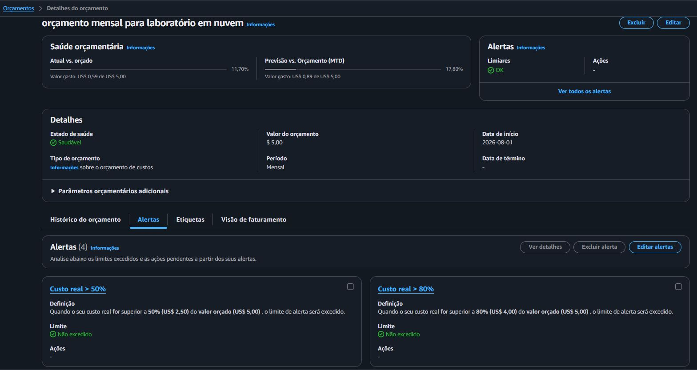

## Step 12 — Check notification delivery

1. Check the inbox associated with the configured notification recipient.
2. Look for relevant AWS messages, if any have been sent.
3. Check spam and filtering rules.
4. For direct AWS Budgets email notifications, no separate Amazon SNS subscription is required.

**Expected result:** The intended destination is configured and accessible.

**Validation limitation:** Creating a budget does not necessarily trigger an immediate notification. Without a notification actually being sent and received, the lab confirms the destination configuration, **not end-to-end email delivery**.

## Step 13 — Review the account configuration

Use the following criteria to evaluate the final setup:

| Control | Target state |
|---|---|
| Root sign-in | MFA enabled and tested |
| Root access keys | No active keys |
| Primary account contact | Current and accurate |
| Billing alternate contact | Configured |
| Operations alternate contact | Configured |
| Security alternate contact | Configured |
| Free Tier alerts | Reviewed and enabled if applicable |
| Monthly cost budget | Created |
| Budget notifications | Configured |
| Reference Region | `sa-east-1`, for the original exercise |

These are validation criteria for the exercise; this English translation does not constitute a new inspection of any AWS account.

---

## Troubleshooting

### An MFA device is already assigned

The account may have been protected during registration or by an earlier administrator.

Review the configured device, confirm it belongs to the legitimate owner, and test sign-in. Do not remove a functional MFA method merely to repeat this exercise.

### Authenticator codes are rejected

Possible causes include an unsynchronized device clock or codes entered out of sequence.

Enable automatic date and time on the authenticator device, wait for a new code, and enter the consecutive codes requested by AWS. If enrollment is incomplete, restart the setup carefully. Do not disable a previously working MFA method unnecessarily.

### The MFA device is lost

Use the official AWS root-user recovery process. Depending on the account, recovery may require access to the registered email address and telephone number.

Do not expose account recovery data or create a replacement account simply to avoid the legitimate recovery process.

### Billing and Cost Management cannot be found

The AWS console layout may have changed. Search for **Billing** or **Billing and Cost Management** using the console search bar.

### Forecasted costs are unavailable

A new or little-used account may not have enough history for a forecast. Confirm the budget and notification settings, then check again after sufficient usage data becomes available. Missing forecast values do not imply zero projected spending.

### A budget notification has not arrived

The threshold may not have been reached, the destination may be incorrect, or the message may have been filtered.

Review the email address and threshold settings. Budget creation itself does not necessarily send a confirmation email, and alert evaluation can take time.

### Unexpected charges appear

1. Open **Bills** to identify the service involved.
2. Review the Region and usage responsible for the charge.
3. Identify any existing resources, subscriptions, or usage outside applicable free limits.
4. Remove unneeded resources only after confirming ownership and dependencies.
5. Document the issue and contact AWS billing support if it remains unexplained.

A selected console Region is not a substitute for checking charges across the entire account.

## Operational relevance

For a junior Cloud Operations analyst, account preparation can involve checking privileged authentication, validating operational and security contacts, reviewing billing notifications, confirming the appropriate AWS Region, and escalating unusual root credentials or unexplained charges.

In a corporate environment, identity and financial policies should be established by authorized owners; an analyst should follow those policies rather than independently changing organization-wide settings.

## Cleanup

This lab does not deploy servers, networking infrastructure, or storage volumes. No infrastructure cleanup is required.

Keep the security and financial controls in place, including root MFA, current contacts, applicable Free Tier notifications, and the monthly budget. These are persistent account safeguards, not temporary test resources.

## Completion checklist

Check each item only after verifying it in the AWS account:

- [ ] Reviewed the root access keys.
- [ ] Verified that no root access keys are active.
- [ ] Configured or confirmed root MFA.
- [ ] Tested the protected sign-in process.
- [ ] Reviewed primary account details.
- [ ] Reviewed all three alternate contacts.
- [ ] Checked the account's Free Tier plan and alerts.
- [ ] Created the monthly cost budget.
- [ ] Configured actual and forecasted cost thresholds.
- [ ] Confirmed notification destinations and recorded validation limitations.
- [ ] Confirmed no temporary cloud infrastructure was created.

## Key takeaways

- The root identity is highly privileged and should not be used for routine operations.
- MFA improves account security; phishing-resistant methods and multiple registered factors can further improve protection and recoverability.
- Correct contact details are important for recovery and security communications.
- Budgets and usage alerts provide visibility, not hard spending limits.
- Billing is account-wide even when many infrastructure resources are Regional.
- Documentation and screenshots must not expose credentials, secrets, MFA enrollment data, or personal identifiers.

## Official AWS references

- [AWS account root user](https://docs.aws.amazon.com/IAM/latest/UserGuide/id_root-user.html)
- [Root user best practices](https://docs.aws.amazon.com/IAM/latest/UserGuide/root-user-best-practices.html)
- [AWS MFA](https://docs.aws.amazon.com/IAM/latest/UserGuide/id_credentials_mfa.html)
- [Root-user MFA setup](https://docs.aws.amazon.com/IAM/latest/UserGuide/enable-mfa-for-root.html)
- [Primary contact details](https://docs.aws.amazon.com/accounts/latest/reference/manage-acct-update-contact-primary.html)
- [Alternate account contacts](https://docs.aws.amazon.com/accounts/latest/reference/manage-acct-update-contact-alternate.html)
- [Free Tier account plans](https://docs.aws.amazon.com/awsaccountbilling/latest/aboutv2/free-tier-plans.html)
- [Free Tier usage tracking](https://docs.aws.amazon.com/awsaccountbilling/latest/aboutv2/tracking-free-tier-usage.html)
- [AWS Budgets](https://docs.aws.amazon.com/cost-management/latest/userguide/budgets-managing-costs.html)
- [Select an AWS Region](https://docs.aws.amazon.com/awsconsolehelpdocs/latest/gsg/select-region.html)

## Next lab

[Lab 02 — AWS CLI Installation and Configuration](../02-aws-cli-installation-and-configuration/)

The next exercise establishes CLI-based access without using root credentials for routine technical work.

---

[English repository overview](../../README.en.md) · [Portuguese repository overview](../../README.md)
