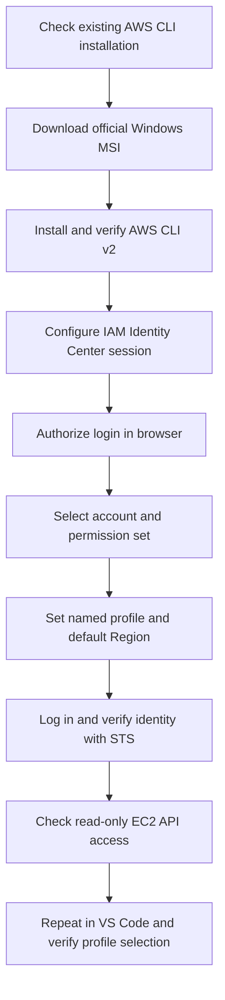
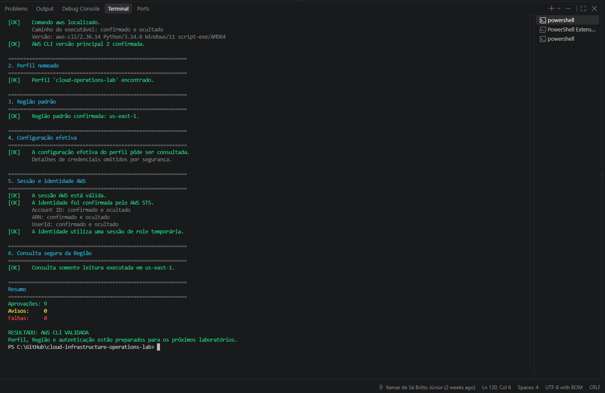

# Lab 02 — AWS CLI Installation and Configuration

[**Português (Brasil)**](README.md) · **English**

## Objective

Install **AWS Command Line Interface (AWS CLI) version 2** on Windows 11, configure a named profile using **AWS IAM Identity Center**, and verify the active identity, default AWS Region, and authenticated API access without using root credentials or storing long-lived access keys in the repository.

The profile used throughout the lab is `cloud-operations-lab`; the default Region for lab resources is `us-east-1`. These are project-specific choices, not universal requirements.

## Scenario

A workstation needs to be prepared for routine Cloud Operations tasks. Basic account safeguards are already in place. The next step is to install the official CLI, authenticate as an authorized individual, establish an explicit account and Region context, and validate that the commands work in both PowerShell and Visual Studio Code.

This foundation supports later work with infrastructure as code, scripting, diagnostics, and automation.

## At a glance

| Item | Details |
|---|---|
| Level | Beginner |
| Estimated duration | 35–50 minutes |
| Expected cloud cost | No infrastructure provisioned |
| Services | AWS CLI, IAM Identity Center, AWS Security Token Service (STS) |
| Operating system | 64-bit Windows 11 and PowerShell |
| Primary skill | CLI installation, federated authentication, and validation |
| Required cleanup | None |

## Learning outcomes

- Install and identify AWS CLI v2, distinguishing it from CLI v1.
- Configure an IAM Identity Center session and named AWS CLI profile.
- Use temporary, federated credentials rather than root access keys.
- Separate the IAM Identity Center Region from the default resource Region.
- Verify the signed-in identity using AWS STS.
- Inspect profiles and configuration safely.
- Check a read-only EC2 API operation and understand authorization failures.
- Repeat validation in the VS Code integrated terminal.
- Protect identity information and local credential caches.

## Prerequisites

- Completion of [Lab 00](../00-workstation-preparation/) and [Lab 01](../01-secure-aws-account-configuration/).
- 64-bit Windows 11, PowerShell, and Visual Studio Code.
- Permission to install software and a working internet connection.
- Access to an AWS access portal and an individual IAM Identity Center user.
- An AWS account assignment and an appropriate permission set.
- MFA, if required by the organization's identity configuration.
- Access to the IAM Identity Center **start URL or issuer URL** and the **Region hosting IAM Identity Center**.

> [!IMPORTANT]
> The main procedure does not require root-user access keys or permanent IAM user access keys. If you do not have an IAM Identity Center assignment, an authorized administrator must provide one; do not bypass that prerequisite.

> [!WARNING]
> Keep authorization URLs, codes, access tokens, access keys, secret keys, session tokens, account identifiers, and the contents of `%UserProfile%\.aws` out of public screenshots and commits. The `config` file can also reveal environment details and should not be published wholesale.

## Tools

| Tool | Purpose |
|---|---|
| PowerShell | Installation and command-line validation |
| AWS CLI v2 | AWS API access and account operations |
| IAM Identity Center | Federated user sign-in and account assignment |
| AWS STS | Verify the caller identity |
| Visual Studio Code | Integrated-terminal validation |
| Web browser | Approve IAM Identity Center authentication |

## Workflow



This lab creates local CLI configuration and token-cache data but does not provision cloud infrastructure.

---

## Step 1 — Check the existing AWS CLI installation

Open PowerShell; elevation is not needed for these checks.

```powershell
aws --version
Get-Command aws -All -ErrorAction SilentlyContinue
```

If AWS CLI is missing, PowerShell may report that `aws` is not recognized. If installed, inspect the version and command path. An output beginning with `aws-cli/1` indicates CLI v1, which can conflict with v2 in `PATH`.

**Evidence:** Capture the version and installed-command checks without exposing unnecessary user-directory details.

## Step 2 — Download the official AWS CLI v2 installer

Set the temporary destination and download the Windows MSI from the official AWS distribution endpoint:

```powershell
$AwsCliInstaller = Join-Path $env:TEMP "AWSCLIV2.msi"

Invoke-WebRequest `
  -Uri "https://awscli.amazonaws.com/AWSCLIV2.msi" `
  -OutFile $AwsCliInstaller

Get-Item $AwsCliInstaller | Select-Object Name, Length, LastWriteTime
```

**Expected result:** A nonempty `AWSCLIV2.msi` file in the Windows temporary directory.

A nonzero file size establishes that a file was downloaded, **not** that the installer is authentic. For higher-assurance installations, verify the MSI signature using Windows' available signature-verification mechanisms and follow the official AWS installation documentation.

Do not commit installation files to Git.

## Step 3 — Install AWS CLI v2

Open the graphical installer from PowerShell:

```powershell
Start-Process msiexec.exe `
  -Wait `
  -ArgumentList "/i `"$AwsCliInstaller`""
```

Approve Windows prompts where appropriate, review the license terms, use the default location unless you have an operational reason to change it, and complete setup.

Close PowerShell and start a new session so it can load any changes to `PATH`.

**Expected result:** The installer reports successful completion.

## Step 4 — Verify the installed version and executable

In a new PowerShell window:

```powershell
aws --version
Get-Command aws | Select-Object Name, CommandType, Source
```

The version output should begin with `aws-cli/2`. A typical path is:

```text
C:\Program Files\Amazon\AWSCLIV2\aws.exe
```

The exact minor version can differ from previously recorded evidence. Confirm that the intended v2 executable is the one being used.

## Step 5 — Find IAM Identity Center sign-in details

1. Sign in to the AWS access portal with your individual user.
2. Complete any required MFA challenge.
3. Find the account assigned for the labs.
4. Open its authorized permission set or role.
5. Review the portal's **Access keys** / programmatic access instructions.
6. Find the IAM Identity Center start URL (or issuer URL) and SSO Region.

The portal's *Access keys* label does not mean that this lab needs you to generate or paste permanent credentials. Use the **IAM Identity Center credentials configuration** information instead of manually copying temporary key material.

**Expected result:** You have identified the SSO URL and Region privately. Do not reproduce actual identifiers or temporary tokens in the README.

## Step 6 — Configure an SSO profile

Run:

```powershell
aws configure sso
```

Provide a descriptive session name:

```text
SSO session name (Recommended): cloud-operations-sso
```

Enter your own portal or issuer URL and the Region where IAM Identity Center is configured:

```text
SSO start URL [None]: <YOUR_SSO_START_URL>
SSO region [None]: <YOUR_SSO_REGION>
SSO registration scopes [sso:account:access]:
```

Accept the displayed `sso:account:access` registration scope by pressing Enter.

**Two different Regions are involved:** The SSO Region identifies the Identity Center instance; `us-east-1` will be the CLI's default Region for the resource-related lab commands. They need not match.

Depending on the installed AWS CLI version, prompt text can differ.

## Step 7 — Authorize AWS CLI in the browser

The AWS CLI starts an interactive browser authorization process.

1. Inspect the URL and confirm that it is associated with the legitimate AWS authentication flow.
2. Sign in as the intended individual user.
3. Review the authorization request and approve it.
4. Return to PowerShell.

**Current AWS CLI behavior:** Starting with AWS CLI v2.22.0, **Proof Key for Code Exchange (PKCE)** is the default authorization flow. PKCE browser authorization must be completed on the same device as the CLI. For device-code authorization, the CLI supports the alternative `--use-device-code` option, for example:

```powershell
aws configure sso --use-device-code
```

Use the device-code option only if that workflow is appropriate for your environment. If automatic browser opening fails, follow the manual browser instructions shown by the CLI for the selected flow.

> [!CAUTION]
> Never publish one-time authorization codes, session tokens, or full temporary authorization URLs.

## Step 8 — Select the AWS account and permission set

After authentication, select the assigned lab account and permission set from the choices presented.

If only one account is available, AWS CLI may choose it automatically. With several accounts or roles, check the intended target carefully.

**Expected result:** The account and permission set match the authorized lab assignment.

Using the wrong account can create operational risk even when authentication itself succeeds.

## Step 9 — Set the Region, output format, and profile name

When the CLI prompts for defaults:

```text
CLI default client Region [None]: us-east-1
CLI default output format [None]: json
CLI profile name [<suggested-name>]: cloud-operations-lab
```

**Expected result:** The CLI reports the profile name and may suggest a command using:

```text
--profile cloud-operations-lab
```

Named profiles make the intended authentication context explicit, but they are not a substitute for verifying the actual AWS identity before sensitive operations.

## Step 10 — List configured profiles

```powershell
aws configure list-profiles
```

**Expected result:** `cloud-operations-lab` appears among the configured profiles. Additional profiles are normal on a workstation that connects to several accounts.

## Step 11 — Inspect the effective profile configuration

```powershell
aws configure list --profile cloud-operations-lab
aws configure get region --profile cloud-operations-lab
```

**Expected Region output:**

```text
us-east-1
```

The SSO configuration is stored in the local AWS configuration files, typically under `%UserProfile%\.aws`. SSO sign-in material is cached locally after authentication. Do not copy these files into the project or publish their contents.

Some configuration-inspection commands can expose more context than expected: review outputs before sharing any evidence.

## Step 12 — Log in using the named profile

```powershell
aws sso login --profile cloud-operations-lab
```

Complete the browser flow if prompted. **Expected result:** Successful IAM Identity Center authentication.

Sessions expire; run the login command again when required. Do not replace temporary sign-in with permanent root keys to work around an expired session.

## Step 13 — Verify the caller with AWS STS

```powershell
aws sts get-caller-identity --profile cloud-operations-lab
```

Example structure with fictional, masked values:

```json
{
  "UserId": "REDACTED",
  "Account": "000000000000",
  "Arn": "arn:aws:sts::000000000000:assumed-role/ROLE/SESSION"
}
```

Check the real result **locally**:

- `Account` identifies the intended AWS account.
- `Arn` corresponds to the expected assumed role associated with the permission set.
- The identity is not the AWS account root user.

The response does not contain secret access keys, but account IDs, ARNs, and user identifiers should be masked before publication.

**Scope of this check:** STS verifies the identity behind the API call; it does not prove the caller has permission to operate every AWS service.

## Step 14 — Verify a read-only API operation in the target Region

```powershell
aws ec2 describe-regions `
  --region us-east-1 `
  --profile cloud-operations-lab `
  --query "Regions[?RegionName=='us-east-1'].RegionName" `
  --output text
```

**Expected result if permitted:**

```text
us-east-1
```

This command queries an API; it does not provision resources.

A denial of `ec2:DescribeRegions` may reflect a deliberately restricted permission set. If STS succeeded but this command is denied, record the authorization limitation rather than granting additional permissions without justification.

## Step 15 — Repeat validation in Visual Studio Code

Open VS Code, then choose **Terminal > New Terminal** and select PowerShell.

```powershell
aws --version
aws sts get-caller-identity --profile cloud-operations-lab
```

**Expected result:** AWS CLI v2 is available and STS returns the authorized caller. Mask identity values in any evidence.

If VS Code was already running during installation, close all its windows and start it again so the integrated terminal inherits the updated `PATH`.

## Step 16 — Use an explicit profile

The lab convention is to specify the profile for individual commands:

```powershell
aws sts get-caller-identity --profile cloud-operations-lab
```

Alternatively, set the environment variable for the current PowerShell session:

```powershell
$env:AWS_PROFILE = "cloud-operations-lab"
aws sts get-caller-identity
```

Remove the variable when it is no longer needed:

```powershell
Remove-Item Env:AWS_PROFILE
```

Explicit options such as `--profile` and `--region` influence which settings a command uses. Environment credentials and other configuration sources may also affect resolution. Before any creation, modification, or deletion, check the identity, Region, and effective configuration.

---

## Final validation

| Check | Expected state |
|---|---|
| AWS CLI | Major version 2 |
| Executable | Expected AWS CLI installation |
| Authentication | IAM Identity Center, individual identity |
| Root user | Not used for CLI work |
| Profile | `cloud-operations-lab` |
| Default resource Region | `us-east-1` |
| Output format | `json` |
| SSO session | Logged in |
| STS | Caller identity checked |
| PowerShell and VS Code | Commands work in both |
| Published evidence | No secrets or unmasked identifiers |

## Troubleshooting

### `aws` is not recognized

Open a fresh PowerShell session, retry `aws --version`, and verify the installation location. If necessary, restart Windows. Also restart any VS Code instance that was open before installation.

### The command uses AWS CLI v1

```powershell
Get-Command aws -All
```

Identify which installation is first on `PATH`. Before uninstalling or migrating v1, check whether existing scripts depend on it.

### The browser does not open for `aws configure sso`

Follow the authorization link shown by the CLI on the **same workstation** when using the default PKCE flow. Alternatively, an approved device-code workflow can be started with `--use-device-code`. Do not share authorization links or codes.

### Invalid SSO request or incorrect SSO URL

Review the start or issuer URL and the **SSO Region**, which may be different from `us-east-1`. Re-run `aws configure sso` using the portal's current programmatic access instructions.

### No accounts or permission sets are available

Confirm that you authenticated with the correct identity and that it has an assignment to the target account. Request the appropriate assignment from an authorized administrator; do not expand privileges just to bypass the error.

### The SSO session has expired

```powershell
aws sso login --profile cloud-operations-lab
```

Then retry the command.

### Unable to locate credentials

Check the profile and sign in again:

```powershell
aws configure list-profiles
aws sso login --profile cloud-operations-lab
aws sts get-caller-identity --profile cloud-operations-lab
```

### AccessDenied

An access-denied response can mean that the caller is authenticated but not authorized for the requested operation. Verify the caller through STS, identify the denied action, and request only the necessary permissions through the approved process.

### Works in PowerShell but not in VS Code

Restart VS Code, open a PowerShell integrated terminal, and check:

```powershell
Get-Command aws
aws --version
```

### Wrong profile or Region

Review the effective AWS environment and profile configuration:

```powershell
Get-ChildItem Env:AWS*
aws configure list --profile cloud-operations-lab
```

**Do not publish the full environment listing:** it may include sensitive values, including credential variables. Inspect the results locally. Remove only settings that you recognize and can safely change.

For commands that require a specific context, explicitly supply `--profile cloud-operations-lab --region us-east-1` and verify identity first.

## Recorded lab evidence

The original lab reports that `validate-aws-cli.ps1` completed with:

| Result | Original recorded value |
|---|---:|
| Passed checks | 9 |
| Warnings | 0 |
| Failures | 0 |

The recorded validation also indicates a temporary assumed-role identity, successful STS verification, and a read-only Regional query. These results describe the **previous laboratory execution**; they were not reproduced as part of this English documentation review.



## Validation script

The repository includes [`scripts/validate-aws-cli.ps1`](scripts/validate-aws-cli.ps1), designed to perform read-only checks. After completing the IAM Identity Center login, run it from the repository root:

```powershell
.\labs\02-aws-cli-installation-and-configuration\scripts\validate-aws-cli.ps1
```

The script supports parameters such as `-ProfileName` and `-ExpectedRegion`, which default to `cloud-operations-lab` and `us-east-1`.

It checks the CLI major version, named profile, configured Region, profile inspection, authenticated STS identity, assumed-role session, and read-only EC2 Region lookup. It deliberately hides the account ID, ARN, and user ID in its normal success output.

Its output labels are in Portuguese:

```text
[OK]     Check passed
[AVISO]  Warning
[FALHA]  Failure
```

Exit code `0` means no required checks failed; exit code `1` means at least one failure. An unsuccessful EC2 read-only check can produce a warning even when the STS identity is valid.

**Audit note:** A successful assumed-role ARN is consistent with federated access but is not by itself proof that the session originated from IAM Identity Center. Review the profile configuration and assignment as well. This script was read, not executed, during translation.

## Cleanup

No AWS infrastructure is created, so infrastructure cleanup is not required. The local CLI configuration and sign-in caches may remain available for later labs.

To log out of cached IAM Identity Center sessions when appropriate:

```powershell
aws sso logout
```

This clears cached IAM Identity Center access tokens for the local CLI environment; do not equate it with revoking every underlying organization-wide session or changing permissions.

If the installer path variable remains defined in the same PowerShell session, the downloaded MSI can optionally be removed:

```powershell
Remove-Item $AwsCliInstaller -ErrorAction SilentlyContinue
```

If that variable is no longer defined, resolve and verify the installer path before removing the file.

**Do not delete the entire `%UserProfile%\.aws` directory as routine cleanup.** It may contain shared CLI and SDK configuration.

## Completion checklist

- [ ] Confirmed AWS CLI v2 and the executable path.
- [ ] Obtained authorized IAM Identity Center access.
- [ ] Created the named SSO profile.
- [ ] Set the lab's default Region and JSON output.
- [ ] Completed browser authentication.
- [ ] Verified identity and account using AWS STS.
- [ ] Confirmed a read-only API request or documented the authorization limitation.
- [ ] Repeated the checks from the VS Code integrated terminal.
- [ ] Checked effective profile selection.
- [ ] Reviewed all captured evidence for sensitive information.

## Lessons learned

This lab introduces a practical approach to federated CLI authentication, account/Region context, verification using STS, profile selection, and initial troubleshooting. Keeping long-lived credentials out of source control and clearly recording the active identity are foundational habits for Cloud Operations, DevOps, and SRE work.

## Official references

- [AWS CLI installation and updates](https://docs.aws.amazon.com/cli/latest/userguide/getting-started-install.html)
- [Getting started with AWS CLI](https://docs.aws.amazon.com/cli/latest/userguide/getting-started-quickstart.html)
- [IAM Identity Center authentication](https://docs.aws.amazon.com/cli/latest/userguide/cli-configure-sso.html)
- [AWS CLI configuration files](https://docs.aws.amazon.com/cli/latest/userguide/cli-configure-files.html)
- [AWS STS get-caller-identity](https://docs.aws.amazon.com/cli/latest/reference/sts/get-caller-identity.html)
- [Migrating AWS CLI v1 to v2](https://docs.aws.amazon.com/cli/latest/userguide/cliv2-migration.html)

## Next lab

[Lab 03 — Infrastructure Tools Installation](../03-infrastructure-tools-installation/)

The following exercise installs and validates infrastructure tools, including Terraform and the AWS Systems Manager Session Manager Plugin.

---

[English repository overview](../../README.en.md) · [Portuguese repository overview](../../README.md)
