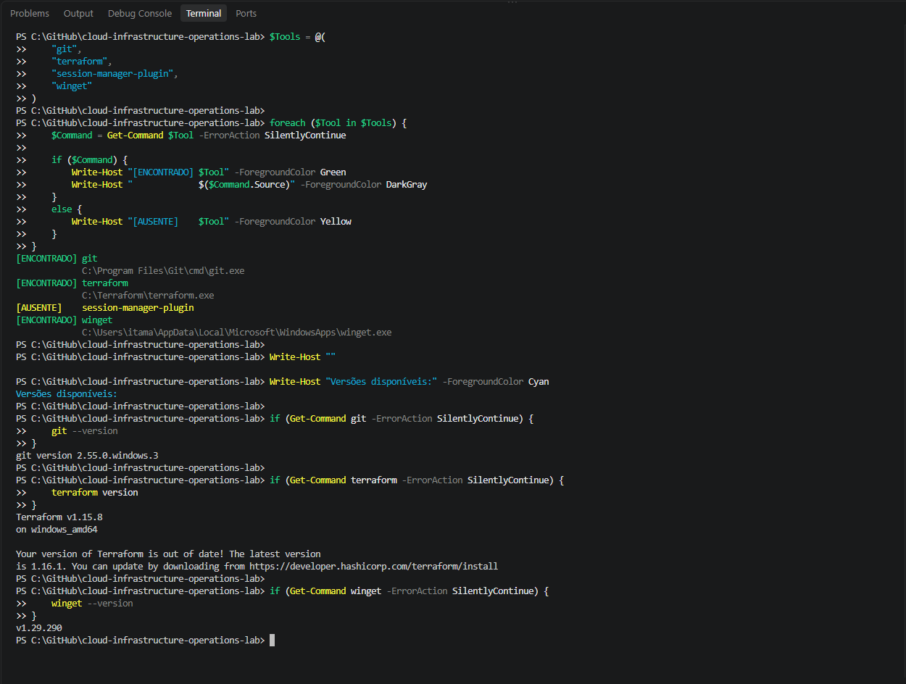
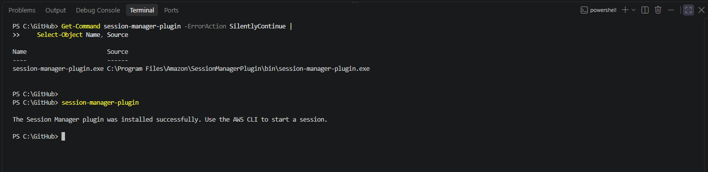
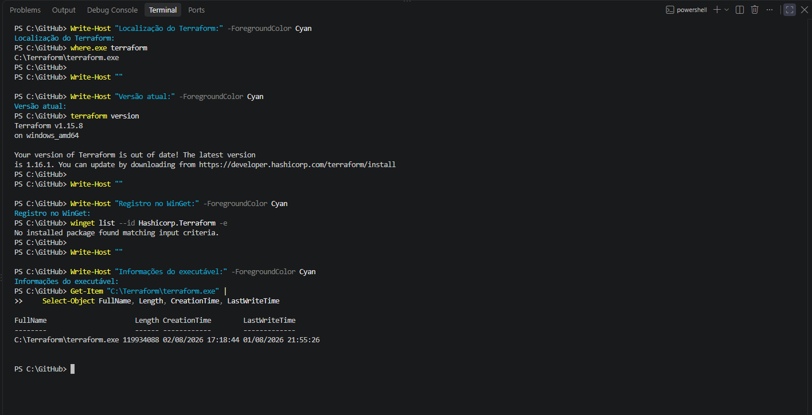
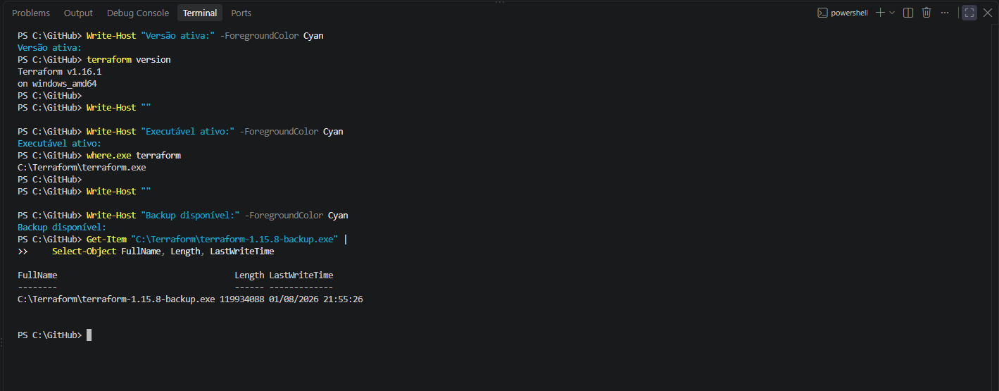
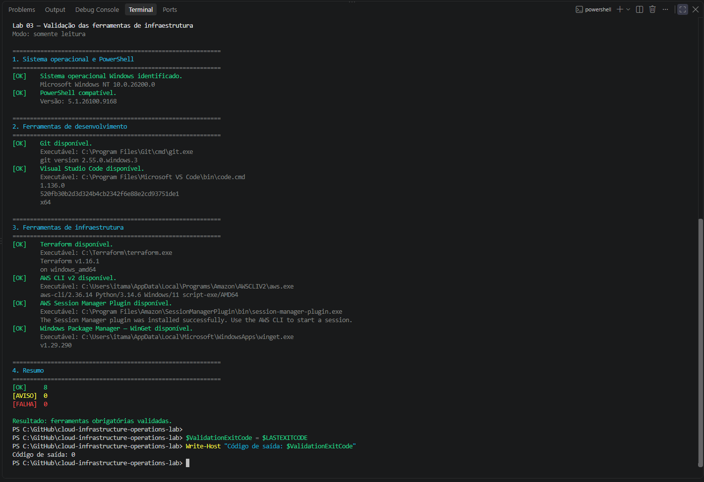

# Lab 03 — Infrastructure Tools Installation

[**Português (Brasil)**](README.md) · **English**

## Objective

Prepare and validate the local infrastructure tooling required by later exercises in the **Cloud Infrastructure Operations Lab** repository.

This document records a completed Windows workstation maintenance exercise: an inventory of existing tools, installation of the AWS Systems Manager Session Manager Plugin, a controlled Terraform upgrade, and a final read-only validation.

The exact versions and measured results below describe the **recorded execution**, not universal requirements or claims that the same checks were rerun during translation.

## Lab overview

| Item | Recorded configuration |
|---|---|
| Operating system | Windows 11 |
| Shell | Windows PowerShell 5.1 |
| Level | Beginner |
| AWS infrastructure | None provisioned |
| AWS usage cost | No AWS resources or charges generated by the recorded exercise |
| Validation script | [`scripts/validate-infrastructure-tools.ps1`](scripts/validate-infrastructure-tools.ps1) |
| Lab status | Completed (recorded execution) |

## Tools and recorded versions

| Tool | Version observed | Purpose |
|---|---|---|
| Git | 2.55.0 | Source control |
| Visual Studio Code | 1.136.0 | Editing and integrated terminal |
| Terraform | 1.16.1 | Infrastructure as code |
| AWS CLI | 2.36.14 | AWS command-line operations |
| Session Manager Plugin | Installed; executable located | AWS Systems Manager session support |
| WinGet | 1.29.290 | Windows package management |
| Windows PowerShell | 5.1.26100.9168 | Commands and validation |

These are versions captured for this lab. They are **not** a recommendation to downgrade a newer, supported installation. The validation script intentionally checks for Terraform `1.16.1` because that was the exercise's target version.

---

## 1. Initial tool inventory

The initial inventory found that Git, Terraform, WinGet, PowerShell, and Visual Studio Code were already available.

Two changes were required:

1. Install the **AWS Systems Manager Session Manager Plugin**.
2. Update Terraform from **1.15.8** to **1.16.1**.

The existing environment was documented before either change. This provides a baseline against which to verify installation and upgrade outcomes.



## 2. Install the Session Manager Plugin

The Windows Session Manager Plugin was obtained from an official AWS distribution endpoint and installed locally.

The recorded executable path was:

```text
C:\Program Files\Amazon\SessionManagerPlugin\bin\session-manager-plugin.exe
```

The `session-manager-plugin` command responded successfully, confirming that the local plugin executable could be located and launched.

For a new installation, follow the [official AWS Windows installation instructions](https://docs.aws.amazon.com/systems-manager/latest/userguide/install-plugin-windows.html), which provide the current installer and supported setup procedure.

**Validation scope:** Locating and running the plugin establishes that the local component is installed. It does not, by itself, demonstrate that a Systems Manager session to an EC2 instance has been established.



## 3. Controlled Terraform upgrade

The workstation initially used a standalone Terraform executable:

```text
C:\Terraform\terraform.exe
```

Terraform was not managed through WinGet, and the installed version was `1.15.8`.



Before replacing the executable, the exercise applied the following controls:

1. Downloaded Terraform `1.16.1` from the official HashiCorp release distribution.
2. Obtained the corresponding published checksums file.
3. Calculated the local SHA-256 digest of the downloaded archive.
4. Compared the calculated digest against the published expected checksum.
5. Preserved a backup of the previous executable.
6. Replaced the executable in a controlled manner.
7. Verified the active version and executable path.

The recorded checksum comparison matched:

```text
5C6C6D8FEDF56CE29C55F0C1FC91DE3C259F42C2D220A28E827B5B60FD47BFA1
```

The previous Terraform executable was retained at:

```text
C:\Terraform\terraform-1.15.8-backup.exe
```

The post-upgrade check reported **Terraform 1.16.1 for Windows AMD64**.

**Integrity and provenance:** A matching hash verifies that the downloaded artifact matches the expected digest. It does not independently authenticate the source of that digest. For a more rigorous software supply-chain procedure, verify the publisher's signed checksums and their authenticity according to HashiCorp's official guidance.

If reproducing this exercise with a different Terraform release, use the checksum published for **that specific release and architecture**. Do not reuse the digest above for another file.



## 4. Run the validation script

The repository includes [`validate-infrastructure-tools.ps1`](scripts/validate-infrastructure-tools.ps1). Its purpose is to inspect the local environment, without installing or uninstalling software.

The script checks:

- Windows operating system and PowerShell compatibility.
- Git and Visual Studio Code.
- Terraform, expecting version `1.16.1`.
- AWS CLI v2.
- AWS Systems Manager Session Manager Plugin.
- Windows Package Manager (WinGet).

It uses command discovery and version checks; it does **not** authenticate to AWS, create resources, edit `PATH`, or change system configuration.

### Command used in the recorded exercise

From the repository root, the original procedure uses:

```powershell
Set-ExecutionPolicy `
    -Scope Process `
    -ExecutionPolicy Bypass

.\labs\03-infrastructure-tools-installation\scripts\validate-infrastructure-tools.ps1

Write-Host "Exit code: $LASTEXITCODE"
```

**Execution-policy caution:** `Bypass` relaxes PowerShell's execution-policy checks for the current process. It does not permanently change the machine or user execution-policy configuration, but it should not be used casually or to bypass an organization's security restrictions. Inspect the script and use an approved execution policy whenever possible. The script itself is not dependent on disabling security checks.

### Interpretation

The script reports three status categories, retaining their original Portuguese output labels:

```text
[OK]     Passed
[AVISO]  Warning
[FALHA]  Failed
```

Exit code `0` indicates that no required check failed. Exit code `1` indicates at least one failed requirement.

A **warning** can still result in exit code `0`: for example, when a tool responds successfully but its version text differs from the expected pattern. This distinction matters when interpreting automated checks.

**Version-specific validation:** The Terraform check contains a fixed version expectation. A later compatible Terraform release may produce a warning rather than a failed check; review this behavior before reusing the validator in another environment.

## 5. Windows PowerShell 5.1 encoding compatibility

The original script was saved as **UTF-8 with a byte-order mark (BOM)** to support correct parsing of accented characters in Windows PowerShell 5.1.

This encoding adjustment was documented separately in Git history. It addresses compatibility with Windows PowerShell 5.1, whose default handling of UTF-8 files without a BOM differs from newer PowerShell versions.

When editing or replacing the script, retain an encoding compatible with the shell used to execute it.

## 6. Recorded final validation

The completed lab reported:

```text
[OK]     8
[AVISO]  0
[FALHA]  0
```

The script exited with status `0`, indicating that the mandatory tools were available and their checks passed in the recorded workstation environment.



**Evidence scope:** These numbers belong to the original lab execution. The translation and documentation audit did not execute the PowerShell script on the original workstation or revalidate the installed applications.

## 7. Cleanup and retained backup

The recorded procedure removed the temporary installation artifacts:

- Session Manager Plugin installer.
- Terraform `1.16.1` compressed archive.
- Temporary Terraform extraction directory.

The previous Terraform executable was deliberately preserved:

```text
C:\Terraform\terraform-1.15.8-backup.exe
```

No AWS infrastructure was created and no AWS resource cleanup was required.

Before removing temporary files in a new execution, verify their paths and confirm that they are not needed for troubleshooting or rollback.

## Completion record

The original execution documented the following items as complete:

- [x] Initial workstation tool inventory.
- [x] Git and Visual Studio Code verified.
- [x] AWS CLI v2 verified.
- [x] Session Manager Plugin installed.
- [x] Terraform updated to `1.16.1`.
- [x] SHA-256 checksum comparison passed.
- [x] Previous Terraform executable backed up.
- [x] WinGet verified.
- [x] Read-only validation script created.
- [x] Windows PowerShell 5.1 compatibility addressed.
- [x] Validation performed from the VS Code integrated terminal.
- [x] Evidence recorded and temporary installers removed.
- [x] No credentials committed to the repository, as reported by the original record.

These boxes reflect **the documented historical execution**, not checks automatically performed for the reader.

## Operational lessons

This lab demonstrates how a workstation maintenance change can be documented with an initial inventory, a controlled software upgrade, an integrity check, a backup, executable-path verification, read-only automation, and cleanup.

For Cloud Operations and DevOps, the operational value lies in understanding what changed, how it was validated, and what remains available for recovery.

## Notes for reuse

- An executable version check is not an end-to-end integration test.
- The Session Manager Plugin check does not establish AWS session connectivity.
- A successful SHA-256 comparison requires a trustworthy source for the expected checksum.
- Paths reported by tools may expose local user names or organization details; review captured output before publication.
- If tool versions change, review the script's expected version patterns rather than assuming a newer installation has failed.
- Source code and screenshots should not include tokens, credentials, account identifiers, or other sensitive configuration.

## Official references

- [AWS — Install the Session Manager Plugin on Windows](https://docs.aws.amazon.com/systems-manager/latest/userguide/install-plugin-windows.html)
- [HashiCorp — Install Terraform](https://developer.hashicorp.com/terraform/install)
- [HashiCorp — Terraform release downloads](https://releases.hashicorp.com/terraform/)
- [AWS CLI documentation](https://docs.aws.amazon.com/cli/)
- [Git for Windows](https://gitforwindows.org/)
- [Visual Studio Code documentation](https://code.visualstudio.com/docs)
- [Microsoft — Windows Package Manager](https://learn.microsoft.com/windows/package-manager/)

## Next lab

[Lab 04 — Linux File Navigation and Management](../04-linux-file-management/)

The next lab introduces Linux filesystem navigation and basic file-management operations.

---

[English repository overview](../../README.en.md) · [Portuguese repository overview](../../README.md)
