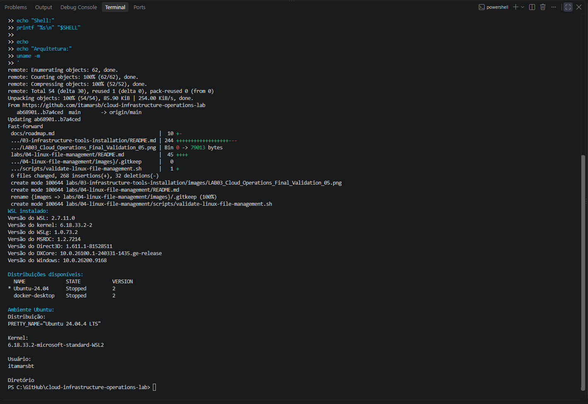
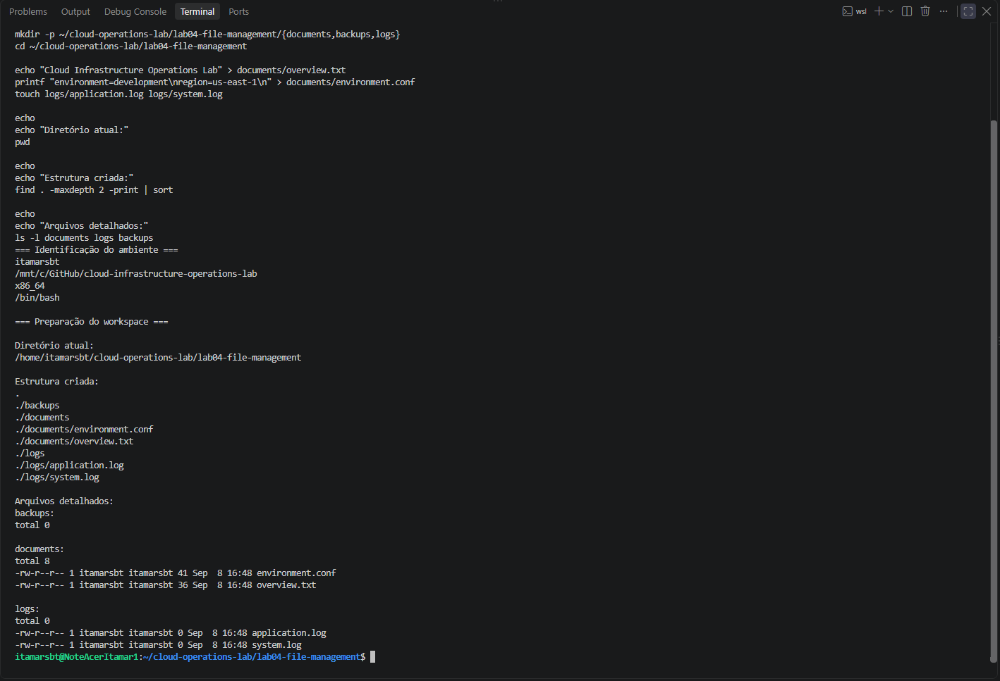
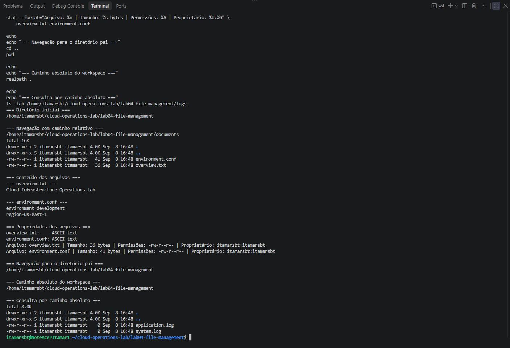
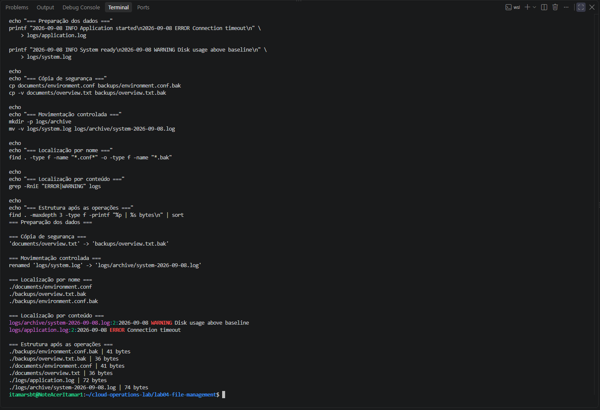
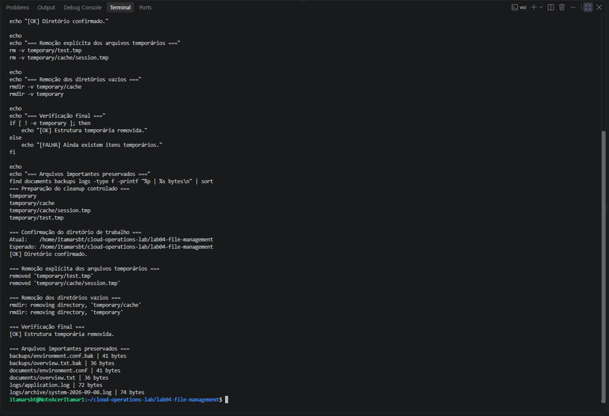
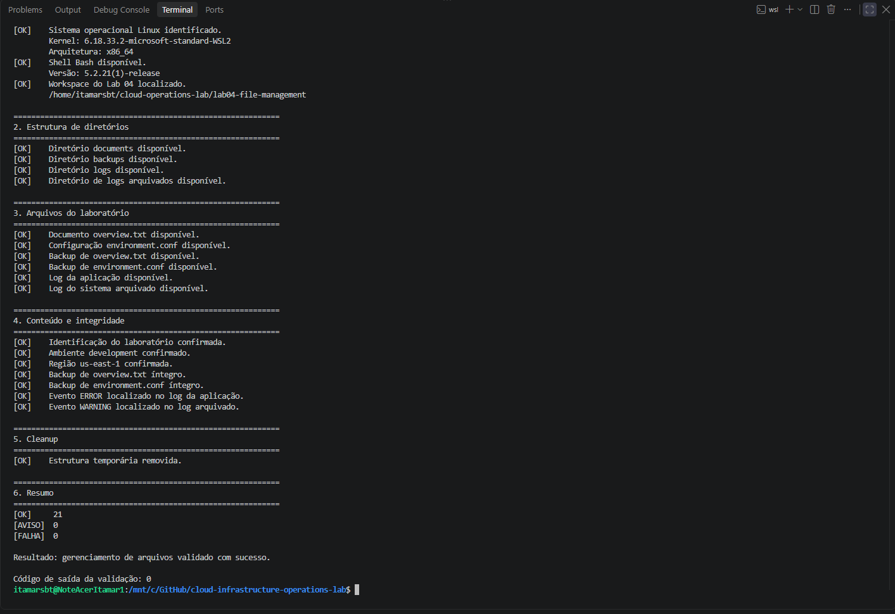

# Lab 04 — Linux File Navigation and Management

[**Português (Brasil)**](README.md) · **English**

## Objective

Practice essential Linux filesystem operations: navigating directories, inspecting files, creating and modifying content, copying and moving files, searching by name and content, and performing controlled cleanup.

The lab also includes a **read-only Bash validation script** that checks the working directory structure, file contents, backup integrity, log entries, and removal of temporary files.

This document describes a completed laboratory execution. Recorded environment versions, filenames, screenshots, and validation results are historical evidence; the commands can be repeated in a suitable Linux environment.

## Recorded environment

| Component | Configuration during execution |
|---|---|
| Host | Windows 11 Pro |
| Linux environment | Windows Subsystem for Linux 2 (WSL 2) |
| Distribution | Ubuntu 24.04.4 LTS |
| Kernel | `6.18.33.2-microsoft-standard-WSL2` |
| Architecture | `x86_64` |
| Shell | Bash `5.2.21` |
| Linux username | `itamarsbt` (recorded workstation) |
| Lab workspace | `/home/itamarsbt/cloud-operations-lab/lab04-file-management` |

The username and absolute path above identify the original execution environment. On another machine, the lab uses the current user's `$HOME` and does not require that same username.

## Skills covered

- Identifying the Linux environment and current account
- Navigating with relative and absolute paths
- Creating directories and files
- Listing and inspecting files, ownership, permissions, and sizes
- Backing up documents with `cp`
- Moving and renaming files with `mv`
- Finding files and searching log contents
- Removing explicitly identified temporary files
- Comparing backups with `cmp`
- Running and interpreting a Bash validation script
- Troubleshooting Windows CRLF versus Unix LF line endings
- Documenting results and checking cleanup

## Project files and workspace

The lab's files in this repository are:

```text
labs/04-linux-file-management/
├── README.md
├── README.en.md
├── images/
│   ├── LAB04_Cloud_Operations_Controlled_Cleanup_05.png
│   ├── LAB04_Cloud_Operations_Copy_Move_Search_04.png
│   ├── LAB04_Cloud_Operations_Final_Validation_06.png
│   ├── LAB04_Cloud_Operations_Linux_Environment_01.png
│   ├── LAB04_Cloud_Operations_Navigation_Inspection_03.png
│   └── LAB04_Cloud_Operations_Workspace_Creation_02.png
└── scripts/
    └── validate-linux-file-management.sh
```

The operational workspace created inside Ubuntu was:

```text
~/cloud-operations-lab/lab04-file-management/
├── backups/
│   ├── environment.conf.bak
│   └── overview.txt.bak
├── documents/
│   ├── environment.conf
│   └── overview.txt
└── logs/
    ├── application.log
    └── archive/
        └── system-2026-09-08.log
```

The workspace was kept in the native Linux filesystem rather than a Windows-mounted path, so Linux permissions, paths, and GNU tools behave as expected.

---

## 1. Verify the Linux environment

In the Ubuntu shell, run:

```bash
whoami
pwd
uname -m
getent passwd "$(whoami)" | cut -d: -f7
```

From **Windows PowerShell**, inspect WSL:

```powershell
wsl --version
wsl --list --verbose
```

The recorded environment showed WSL `2.7.11.0`, Ubuntu `24.04.4 LTS`, WSL 2, `x86_64`, `/bin/bash`, and a non-root Linux user.

Versions and account names on a different machine may vary.



## 2. Prepare the workspace

Create the working directories under the current user's home directory and enter the workspace:

```bash
mkdir -p ~/cloud-operations-lab/lab04-file-management/{documents,backups,logs}

cd ~/cloud-operations-lab/lab04-file-management
```

Create two documents and two initial empty logs:

```bash
echo "Cloud Infrastructure Operations Lab" > documents/overview.txt

printf "environment=development\nregion=us-east-1\n" \
    > documents/environment.conf

touch logs/application.log logs/system.log
```

Inspect the structure:

```bash
find . -maxdepth 2 -print | sort
ls -l documents logs backups
```

**Expected result:** The `documents`, `backups`, and `logs` directories are present, and the initial files have been created.

The `>` redirection **overwrites the target file** if it already exists. Run these setup commands in the intended lab directory, not over files containing work you need to preserve.



## 3. Navigate and inspect files

Use a relative path to enter `documents`:

```bash
cd documents
pwd
ls -lah
```

Read the documents:

```bash
cat overview.txt
cat environment.conf
```

Check file types and metadata:

```bash
file overview.txt environment.conf

stat \
    --format="File: %n | Size: %s bytes | Permissions: %A | Owner: %U:%G" \
    overview.txt environment.conf
```

The displayed English words in the `stat --format` string are presentation labels only; the format specifiers remain unchanged.

Return to the parent directory and print its absolute path:

```bash
cd ..
realpath .
```

The recorded execution inspected the logs directory through this absolute path:

```bash
ls -lah /home/itamarsbt/cloud-operations-lab/lab04-file-management/logs
```

To reproduce the check without depending on that specific username, use:

```bash
ls -lah "$HOME/cloud-operations-lab/lab04-file-management/logs"
```



## 4. Copy, move, and find files

### Populate the example logs

From the workspace root, create the synthetic log entries used by the exercise:

```bash
printf "2026-09-08 INFO Application started\n2026-09-08 ERROR Connection timeout\n" \
    > logs/application.log

printf "2026-09-08 INFO System ready\n2026-09-08 WARNING Disk usage above baseline\n" \
    > logs/system.log
```

These are **deliberately written sample records**, not evidence that a real application experienced a timeout or disk warning.

### Back up the documents

```bash
cp documents/environment.conf backups/environment.conf.bak
cp -v documents/overview.txt backups/overview.txt.bak
```

The files in `documents` remain in place. The `.bak` copies allow content comparison later.

### Archive a log by moving it

```bash
mkdir -p logs/archive

mv -v \
    logs/system.log \
    logs/archive/system-2026-09-08.log
```

This operation moves and renames the file; it does not create a second copy. The date in the filename is part of the recorded exercise.

### Find files by name

```bash
find . \
    -type f -name "*.conf*" \
    -o \
    -type f -name "*.bak"
```

The command finds regular files matching the two filename patterns. For improved clarity if extending the expression with more conditions, group the alternatives explicitly:

```bash
find . -type f \( -name "*.conf*" -o -name "*.bak" \)
```

### Search log contents

```bash
grep -RniE "ERROR|WARNING" logs
```

The recorded search returned:

```text
logs/archive/system-2026-09-08.log:2:2026-09-08 WARNING Disk usage above baseline
logs/application.log:2:2026-09-08 ERROR Connection timeout
```

Here, `-R` searches recursively, `-n` shows line numbers, `-i` ignores case, and `-E` enables extended regular expressions.



## 5. Perform controlled cleanup

Create a disposable directory tree:

```bash
mkdir -p temporary/cache
touch temporary/test.tmp
touch temporary/cache/session.tmp
```

Before deleting anything, verify the current working directory:

```bash
CURRENT_DIRECTORY="$(pwd)"
EXPECTED_DIRECTORY="$HOME/cloud-operations-lab/lab04-file-management"

if [ "$CURRENT_DIRECTORY" != "$EXPECTED_DIRECTORY" ]; then
    echo "[FALHA] Unexpected directory. Cleanup stopped."
    exit 1
fi
```

**Safety note:** This guard checks the current directory string. It does not independently authenticate the files being removed or protect against every path/symlink edge case. Run it in a dedicated Bash session, not by sourcing the commands into a shell whose termination would be problematic.

After the path check succeeds, remove only the named temporary files and directories:

```bash
rm -v temporary/test.tmp
rm -v temporary/cache/session.tmp

rmdir -v temporary/cache
rmdir -v temporary
```

This procedure avoids broad recursive deletion and preserves the `documents`, `backups`, and `logs` trees.



## 6. Run the automated validation

The read-only validator is stored at:

[`scripts/validate-linux-file-management.sh`](scripts/validate-linux-file-management.sh)

It checks the Linux environment, Bash, workspace and directory structure, required files, expected content, the equivalence of backups, and whether the temporary directory was removed.

From the **repository root**, check Bash syntax first:

```bash
bash -n labs/04-linux-file-management/scripts/validate-linux-file-management.sh
```

An exit code of `0` means Bash found no syntax errors. It does **not** establish that the lab data or all runtime dependencies are correct.

Execute the script:

```bash
bash labs/04-linux-file-management/scripts/validate-linux-file-management.sh
```

The historical final execution reported:

```text
[OK]     21
[AVISO]  0
[FALHA]  0

Result: file management validated successfully.
Validation exit code: 0
```

The English summary lines above explain the original Portuguese output; the script itself continues to print Portuguese messages.



### How to interpret the validator

- `[OK]`: the corresponding check passed.
- `[AVISO]`: the check found a non-blocking condition.
- `[FALHA]`: a required check failed.
- Exit code `0`: no failures were counted, **even if warnings exist**.
- Exit code `1`: at least one required check failed.

The script tests for required values using `grep -qE` and compares backup contents using `cmp -s`. It does not prove that the entire configuration file contains *only* the expected lines.

The validator constructs the workspace path from the current Linux user's `$HOME`. If you prepared the workspace under a different account, the validation will not find it there.

**Audit scope:** The script was inspected as source code during this documentation review, not re-executed.

## Troubleshooting — CRLF versus LF line endings

The original execution encountered:

```text
$'\r': command not found
```

The shell script contained Windows-style CRLF line endings, which can interfere with Bash execution.

The local correction used:

```bash
sed -i 's/\r$//' \
    labs/04-linux-file-management/scripts/validate-linux-file-management.sh
```

The first lines were then inspected:

```bash
sed -n '1,3l' \
    labs/04-linux-file-management/scripts/validate-linux-file-management.sh
```

A root-level `.gitattributes` rule was added:

```gitattributes
*.sh text eol=lf
```

This instructs Git to check out shell scripts using LF endings. It helps keep future copies consistent, although existing working-tree files may need to be checked or normalized separately.

## Operational practices demonstrated

- Use a dedicated lab workspace and an ordinary, non-root account.
- Separate documents, backups, and logs.
- Identify the current path before changing or deleting files.
- Preserve original files and verify backup content.
- Use explicit deletion targets rather than broad recursive cleanup.
- Distinguish generated sample logs from actual incidents.
- Combine manual inspection with automated, read-only validation.
- Use clear exit codes and record warning conditions.
- Normalize shell-script line endings across Windows, Git, and Linux environments.
- Review evidence for identifying information before publishing.

## Recorded result

The lab documented successful completion of basic Linux file operations, backup comparison, safe temporary-file removal, and automated verification.

It also documented a real interoperability issue in the development workflow: Windows CRLF line endings being interpreted by Bash inside WSL, followed by a local correction and Git attributes rule.

The result is a record of the original workstation exercise, **not a claim that the current reader's system has already passed**.

## Next lab

[Lab 05 — Linux Users, Groups, and Permissions](../05-linux-users-groups-permissions/)

---

[English repository overview](../../README.en.md) · [Portuguese repository overview](../../README.md)
