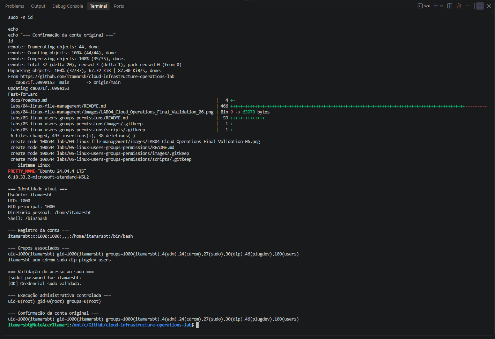
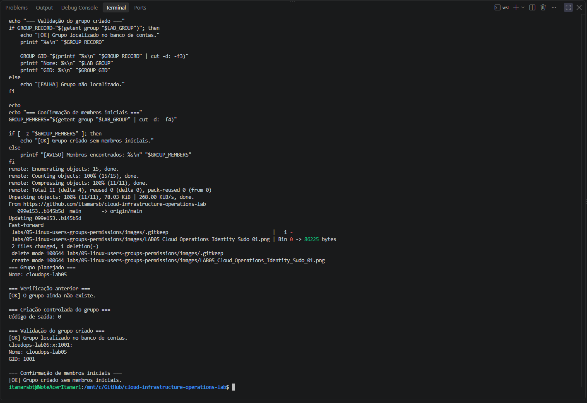
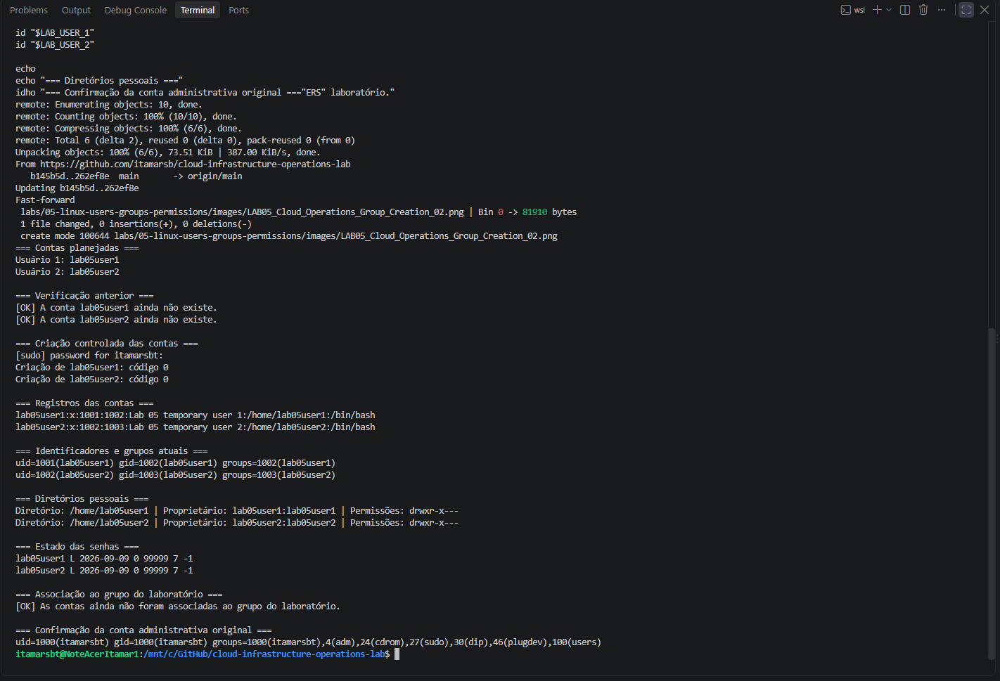
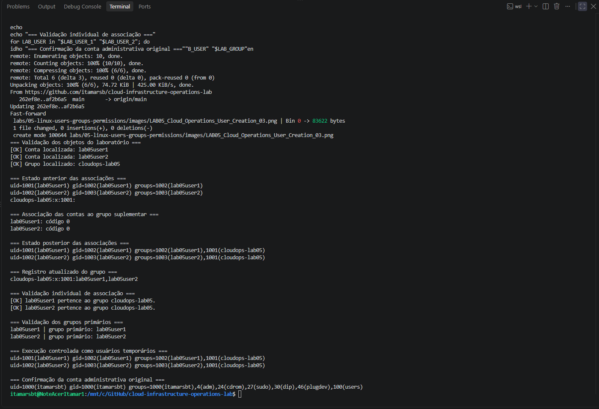
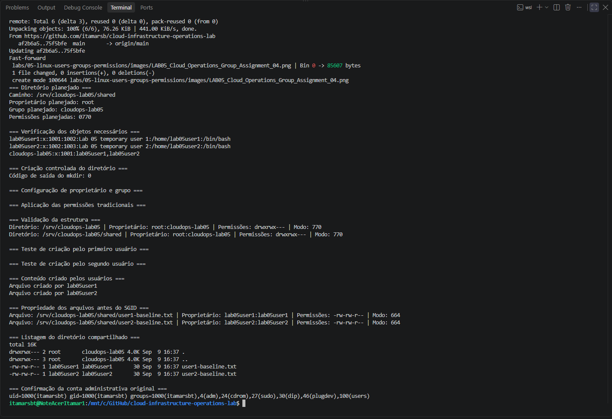
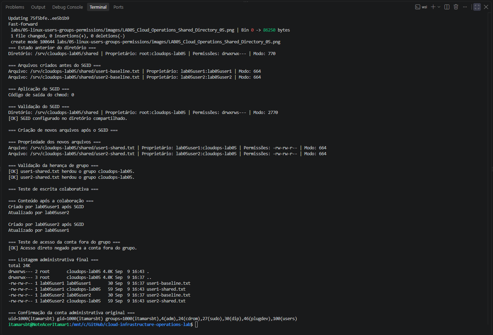
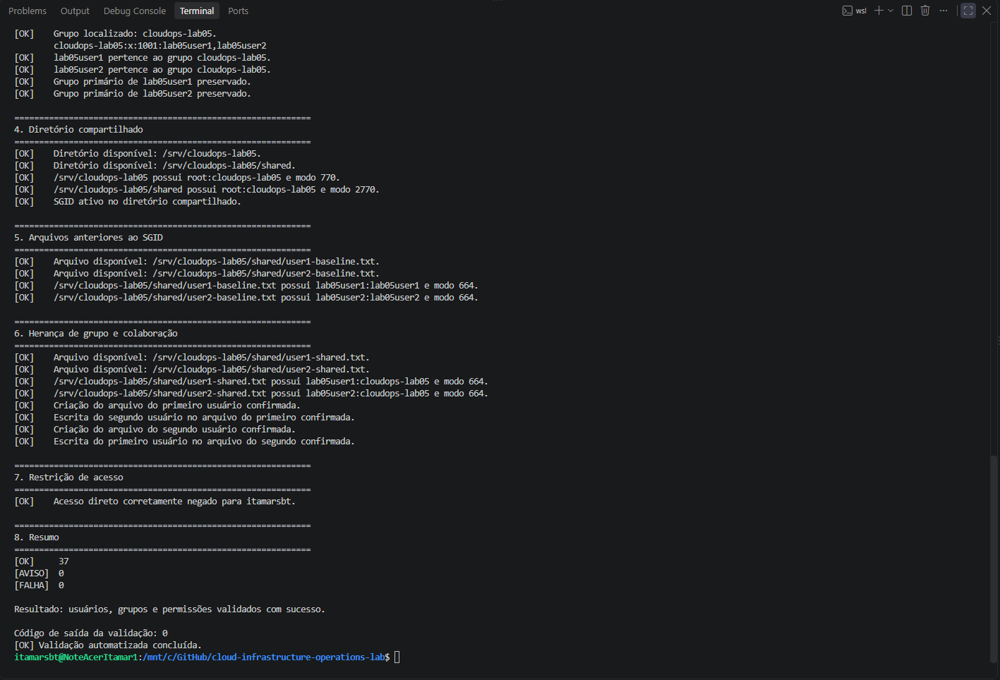
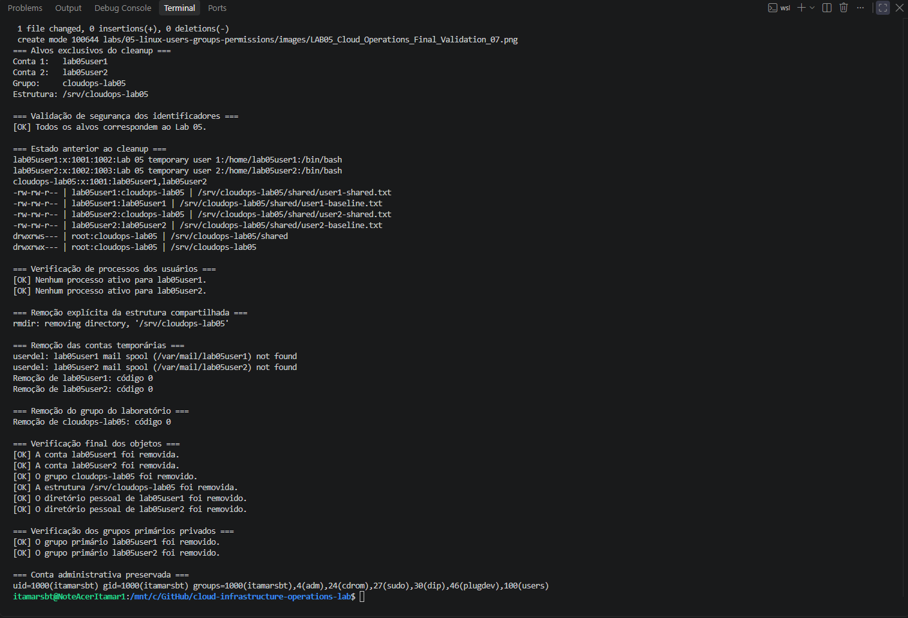

# Lab 05 — Linux Users, Groups, and Permissions

[**Português (Brasil)**](README.md) · **English**

## Overview

This lab documents a hands-on Linux identity and filesystem access-control exercise. Two temporary local user accounts and a dedicated supplementary group were used to build a shared directory, compare file ownership before and after enabling the set-group-ID (SGID) bit, test collaborative writing, verify access restrictions, and clean up the environment.

The lab uses **real local account and permission changes** inside a dedicated Ubuntu/WSL environment. Do not run its administrative commands on a shared or production machine without authorization and a verified rollback plan.

All recorded lab-specific accounts, groups, and directories were removed at the end of the original exercise. This English documentation is based on the existing records and a static review of the validation script; it does not represent a new execution.

## Objective

Configure and validate group-based collaboration using standard Linux users, groups, file ownership, permission modes, and directory SGID.

The activities demonstrate how to:

- Inspect Linux identities, UIDs, GIDs, and supplementary groups.
- Validate and use administrative access through \`sudo\`.
- Create temporary local accounts with locked passwords.
- Add users to a supplementary group without replacing other memberships.
- Set ownership and traditional Unix permission bits.
- Apply SGID to a directory to influence group inheritance.
- Test cross-user collaboration and access denial.
- Run a read-only Bash validation script before cleanup.
- Remove only the designated lab accounts, group, and directory tree.

## Recorded environment

| Component | Original configuration |
|---|---|
| Host operating system | Windows 11 Pro |
| Linux environment | WSL 2 |
| Distribution | Ubuntu 24.04.4 LTS |
| Kernel | \`6.18.33.2-microsoft-standard-WSL2\` |
| Architecture | \`x86_64\` |
| Shell | Bash |
| Administrative user | \`itamarsbt\` |
| Lab group | \`cloudops-lab05\` |
| Temporary users | \`lab05user1\`, \`lab05user2\` |
| Shared directory | \`/srv/cloudops-lab05/shared\` |

The username, kernel, and distribution version are attributes of the original workstation, not universal prerequisites. The commands assume a Linux distribution providing the relevant account-management utilities and GNU core tools.

## Repository structure

\`\`\`text
labs/
└── 05-linux-users-groups-permissions/
    ├── README.md
    ├── README.en.md
    ├── images/
    │   ├── LAB05_Cloud_Operations_Identity_Sudo_01.png
    │   ├── LAB05_Cloud_Operations_Group_Creation_02.png
    │   ├── LAB05_Cloud_Operations_User_Creation_03.png
    │   ├── LAB05_Cloud_Operations_Group_Assignment_04.png
    │   ├── LAB05_Cloud_Operations_Shared_Directory_05.png
    │   ├── LAB05_Cloud_Operations_SGID_Collaboration_06.png
    │   ├── LAB05_Cloud_Operations_Final_Validation_07.png
    │   └── LAB05_Cloud_Operations_Controlled_Cleanup_08.png
    └── scripts/
        └── validate-linux-users-groups-permissions.sh
\`\`\`

## Safety boundaries

The original execution created only the following lab-specific objects:

| Object | Purpose |
|---|---|
| \`cloudops-lab05\` | Supplementary group for collaboration |
| \`lab05user1\` | First temporary user |
| \`lab05user2\` | Second temporary user |
| \`/srv/cloudops-lab05\` | Dedicated exercise directory |
| \`/srv/cloudops-lab05/shared\` | Shared workspace |

The temporary users had no usable password and their commands were executed with \`sudo --user\`. **A locked password prevents password-based authentication but is not, by itself, proof that all possible account access methods are disabled.** Restricting keys, remote access, and alternative authentication paths requires separate controls.

Before creating anything, verify that these names and paths do not already belong to another application or user. Before cleanup, verify that every target belongs exclusively to this lab. The instructions below are a historical record, not authorization to modify an unrelated Linux environment.

---

## 1. Verify identity and administrative access

Inspect the Linux release, kernel, active user, numeric IDs, home directory, shell, and group memberships:

\`\`\`bash
grep '^PRETTY_NAME=' /etc/os-release
uname -r

whoami
id -u
id -g
printf "%s\n" "$HOME"
printf "%s\n" "$SHELL"

getent passwd "$(whoami)"
id
groups
\`\`\`

The original administrative account reported:

- UID \`1000\` and primary GID \`1000\`.
- Home directory \`/home/itamarsbt\`.
- Shell \`/bin/bash\`.
- Membership in the administrative \`sudo\` group.

Administrative access was checked with:

\`\`\`bash
sudo -v
sudo -n id
\`\`\`

The privileged identity check returned:

\`\`\`text
uid=0(root) gid=0(root) groups=0(root)
\`\`\`

A subsequent \`id\` confirmed that the interactive terminal still ran under its original user context. The numeric IDs shown here belong to the recorded environment and may differ on another machine.

## 2. Create the lab group

Check whether the designated group already exists:

\`\`\`bash
getent group cloudops-lab05
\`\`\`

In the original exercise, no existing group used that name. A dedicated group was then created:

\`\`\`bash
sudo groupadd cloudops-lab05
\`\`\`

The recorded group entry was:

\`\`\`text
cloudops-lab05:x:1001:
\`\`\`

The name is \`cloudops-lab05\`, \`1001\` is the assigned GID, and the final empty field indicates no supplementary members listed at that point. GIDs are allocated by the system and must not be assumed to be fixed.

## 3. Create temporary users

The original exercise created two local accounts with home directories, Bash as their shell, and descriptive comment fields:

\`\`\`bash
sudo useradd \
    --create-home \
    --shell /bin/bash \
    --comment "Lab 05 temporary user 1" \
    lab05user1

sudo useradd \
    --create-home \
    --shell /bin/bash \
    --comment "Lab 05 temporary user 2" \
    lab05user2
\`\`\`

Their records were inspected using:

\`\`\`bash
getent passwd lab05user1
getent passwd lab05user2
\`\`\`

Recorded output:

\`\`\`text
lab05user1:x:1001:1002:Lab 05 temporary user 1:/home/lab05user1:/bin/bash
lab05user2:x:1002:1003:Lab 05 temporary user 2:/home/lab05user2:/bin/bash
\`\`\`

Each account received a separate UID, private primary group, home directory, and \`/bin/bash\` shell. The password state was checked with:

\`\`\`bash
sudo passwd --status lab05user1
sudo passwd --status lab05user2
\`\`\`

The reported status \`L\` indicated locked passwords.

Home-directory permissions were recorded as:

\`\`\`text
drwxr-x---
\`\`\`

This mode allows access to the owner and relevant group according to their respective permission bits, while removing permissions for others. Actual access still depends on the complete path and other applicable access controls.

## 4. Add users to the supplementary group

The accounts were added to \`cloudops-lab05\`:

\`\`\`bash
sudo usermod --append --groups cloudops-lab05 lab05user1
sudo usermod --append --groups cloudops-lab05 lab05user2
\`\`\`

The \`--append\` option is important: using \`--groups\` without it can replace existing supplementary group memberships.

The resulting associations were inspected:

\`\`\`bash
id lab05user1
id lab05user2
getent group cloudops-lab05
\`\`\`

Recorded group membership:

\`\`\`text
cloudops-lab05:x:1001:lab05user1,lab05user2
\`\`\`

Their primary groups remained separate:

\`\`\`text
lab05user1 → primary group lab05user1
lab05user2 → primary group lab05user2
\`\`\`

Commands were run under the users' identities without enabling password sign-in:

\`\`\`bash
sudo --user=lab05user1 -- id
sudo --user=lab05user2 -- id
\`\`\`

## 5. Create the shared directory

A dedicated workspace was created under \`/srv\`:

\`\`\`bash
sudo mkdir --parents /srv/cloudops-lab05/shared
\`\`\`

The owner and group were set:

\`\`\`bash
sudo chown root:cloudops-lab05 /srv/cloudops-lab05
sudo chown root:cloudops-lab05 /srv/cloudops-lab05/shared
\`\`\`

Traditional permissions were initially set to \`0770\`:

\`\`\`bash
sudo chmod 0770 /srv/cloudops-lab05
sudo chmod 0770 /srv/cloudops-lab05/shared
\`\`\`

| Class | Permissions |
|---|---|
| Owner | Read, write, execute |
| Group | Read, write, execute |
| Others | None |

Recorded directory representation:

\`\`\`text
drwxrwx--- root:cloudops-lab05
\`\`\`

For a directory, execute permission controls traversal; read permission controls directory entry listing, subject to applicable filesystem and security rules.

### Baseline before SGID

Each user created a file:

\`\`\`bash
sudo --user=lab05user1 -- \
    bash -c 'printf "Arquivo criado por %s\n" "$(whoami)" > /srv/cloudops-lab05/shared/user1-baseline.txt'

sudo --user=lab05user2 -- \
    bash -c 'printf "Arquivo criado por %s\n" "$(whoami)" > /srv/cloudops-lab05/shared/user2-baseline.txt'
\`\`\`

The files initially inherited their creators' primary groups:

\`\`\`text
user1-baseline.txt → lab05user1:lab05user1
user2-baseline.txt → lab05user2:lab05user2
\`\`\`

This provides a baseline for the SGID comparison.

## 6. Enable and test directory SGID

Enable SGID on the shared directory:

\`\`\`bash
sudo chmod 2770 /srv/cloudops-lab05/shared
\`\`\`

The mode changed from \`770\` to \`2770\`:

\`\`\`text
drwxrws--- root:cloudops-lab05
\`\`\`

The \`s\` in the group execute position indicates that SGID is active.

**What SGID changes:** On a typical Linux filesystem, newly created files and subdirectories inherit the directory's group rather than the creator's primary group. SGID **does not, by itself, grant group write access**. Effective collaboration also requires suitable file permission bits, the creation mode, \`umask\`, and any applicable ACLs.

### Create files after SGID

The exercise used \`umask 0002\` while creating two files:

\`\`\`bash
sudo --user=lab05user1 -- \
    bash -c 'umask 0002; printf "Criado por %s após SGID\n" "$(whoami)" > /srv/cloudops-lab05/shared/user1-shared.txt'

sudo --user=lab05user2 -- \
    bash -c 'umask 0002; printf "Criado por %s após SGID\n" "$(whoami)" > /srv/cloudops-lab05/shared/user2-shared.txt'
\`\`\`

The original output showed:

\`\`\`text
user1-shared.txt → lab05user1:cloudops-lab05
user2-shared.txt → lab05user2:cloudops-lab05
\`\`\`

Both new files inherited \`cloudops-lab05\` as their group.

### Verify collaborative writes

The second user appended to the first user's file:

\`\`\`bash
sudo --user=lab05user2 -- \
    bash -c 'printf "Atualizado por %s\n" "$(whoami)" >> /srv/cloudops-lab05/shared/user1-shared.txt'
\`\`\`

The first user appended to the second user's file:

\`\`\`bash
sudo --user=lab05user1 -- \
    bash -c 'printf "Atualizado por %s\n" "$(whoami)" >> /srv/cloudops-lab05/shared/user2-shared.txt'
\`\`\`

Both operations succeeded in the recorded exercise because the accounts shared the supplementary group and the files were group-writable under the selected modes and \`umask\`.

### Verify restricted access

The original administrative account was not a member of \`cloudops-lab05\`. Its ordinary, non-elevated access to the shared directory was denied, while explicitly elevated \`sudo\` access remained possible.

This distinguishes discretionary filesystem permissions from administrative privilege.

## 7. Run the read-only validation script

The script is stored at [\`scripts/validate-linux-users-groups-permissions.sh\`](scripts/validate-linux-users-groups-permissions.sh).

It checks:

- Linux environment and required commands.
- The two temporary accounts, shells, home directories, and locked passwords.
- The shared group and both supplementary memberships.
- Preservation of each user's primary group.
- Directory ownership, group, and permission modes.
- SGID status and ownership of files created before and after SGID.
- Contents of the collaborative test files.
- Denial of ordinary access to the shared directory for an account outside the group.

Check Bash syntax from the repository root:

\`\`\`bash
bash -n labs/05-linux-users-groups-permissions/scripts/validate-linux-users-groups-permissions.sh
\`\`\`

The original syntax check returned \`0\`. A syntax check alone does not prove that the operating environment is correctly configured.

The operational checks require administrative privileges:

\`\`\`bash
sudo bash labs/05-linux-users-groups-permissions/scripts/validate-linux-users-groups-permissions.sh
\`\`\`

The original validation summary was:

\`\`\`text
[OK]     37
[AVISO]  0
[FALHA]  0
\`\`\`

It ended with exit code \`0\`.

### Important limitations of the validator

The script is intended to perform read-only checks of the **pre-cleanup** environment. It cannot be rerun against the original cleaned environment and expected to pass unless the dedicated accounts, group, and test files are recreated.

The negative-access test uses the original non-root user identified through \`SUDO_USER\`. If that user is a group member or the invocation does not provide a suitable original user, the script records a warning instead of demonstrating access denial.

The script returns \`0\` when no failures occurred, **including runs that contain warnings**. Therefore, an exit code of \`0\` does not always mean that all checks, especially the negative-access test, were performed.

The content checks search for expected text, and the mode checks compare the listed attributes. These tests are useful within the laboratory's scope but do not constitute a complete security assessment of a Linux system.

The script has been reviewed as source code during translation; it was not executed again.

## 8. Controlled cleanup

The original cleanup removed the lab-specific users, group, directories, and files after validation.

Before deletion, verify:

1. The two usernames and group name are the intended temporary objects.
2. The entire \`/srv/cloudops-lab05\` tree belongs only to this exercise.
3. No active user processes or unrelated service dependencies rely on these objects.
4. Anything that must be retained has been backed up elsewhere.

> [!CAUTION]
> The following commands modify system accounts and delete files permanently. Do not run them against a production or shared environment, and do not execute them unless you have confirmed the targets. The original exercise used a dedicated lab environment.

### Remove the lab directory contents

\`\`\`bash
sudo find /srv/cloudops-lab05 -depth -mindepth 1 -delete
sudo rmdir /srv/cloudops-lab05
\`\`\`

The \`-mindepth 1\` expression excludes the starting directory itself from deletion by \`find\`, while the nested contents are removed. **This does not make the command harmless:** it recursively deletes the contents of the specified directory. Verify the full path and ownership first.

### Remove the temporary user accounts

\`\`\`bash
sudo userdel --remove lab05user1
sudo userdel --remove lab05user2
\`\`\`

The \`--remove\` option also requests removal of the users' home directories and mail spools as applicable. Verify that those directories contain no unrelated data before running the commands.

Warnings about missing \`/var/mail\` entries can occur for users that never received local mail.

### Remove the dedicated group

\`\`\`bash
sudo groupdel cloudops-lab05
\`\`\`

### Recorded cleanup result

The original post-cleanup checks documented the absence of both temporary users, their private primary groups, their home directories, \`cloudops-lab05\`, and \`/srv/cloudops-lab05\`.

The original administrative account and its memberships were retained.

---

## File ownership before and after SGID

| File | Created | Owner | Group | Mode |
|---|---|---|---|---|
| \`user1-baseline.txt\` | Before SGID | \`lab05user1\` | \`lab05user1\` | \`664\` |
| \`user2-baseline.txt\` | Before SGID | \`lab05user2\` | \`lab05user2\` | \`664\` |
| \`user1-shared.txt\` | After SGID | \`lab05user1\` | \`cloudops-lab05\` | \`664\` |
| \`user2-shared.txt\` | After SGID | \`lab05user2\` | \`cloudops-lab05\` | \`664\` |

This comparison illustrates that enabling SGID affects **newly created objects**, not the group ownership of files that already exist.

## Commands used

| Command | Purpose |
|---|---|
| \`whoami\` | Identify effective user |
| \`id\` | Inspect UID, GID, and memberships |
| \`groups\` | List group memberships |
| \`getent passwd\` | Query user records |
| \`getent group\` | Query group records |
| \`sudo -v\` | Validate administrative credentials |
| \`groupadd\` | Create group |
| \`useradd\` | Create local account |
| \`usermod -aG\` | Append a supplementary group |
| \`passwd -S\` | Query password state |
| \`chown\` | Change owner and group |
| \`chmod\` | Set access bits and special modes |
| \`stat\` | Inspect object metadata |
| \`sudo --user\` | Execute command as another user |
| \`userdel -r\` | Remove a user and associated home files |
| \`groupdel\` | Delete group |
| \`pgrep -u\` | Find processes belonging to a user |

## Concepts explained

**UID and GID.** Linux identifies users and groups through numeric identifiers. The names shown in tools are human-readable mappings of those identifiers.

**Primary and supplementary groups.** An account has a primary group and may have additional group memberships. Supplementary groups can grant access without changing primary group ownership.

**Traditional Unix permissions.** The owner, group, and other classes each have read (\`r\`), write (\`w\`), and execute/traverse (\`x\`) permissions.

**Umask.** The \`umask\` masks out permission bits from the mode requested for a new file or directory. In this exercise, \`0002\` allowed group write permission on files created using ordinary defaults.

**Directory SGID.** The SGID bit makes newly created objects inherit the parent directory's group on conventional Linux filesystems. Group ownership and actual permission to write are distinct concepts.

**Least privilege.** The original administrative account did not receive permanent membership in the collaboration group; privileged tasks were explicitly elevated when necessary.

## Recorded outcome and evidence

The original exercise documented successful creation of temporary identities and their group memberships, group-controlled access, SGID inheritance, collaborative writes, denied access for an outsider account, and complete cleanup.

| Evidence | Recorded result |
|---|---|
| 01 — Linux identity and sudo | Verified |
| 02 — Group creation | Verified |
| 03 — Temporary users | Verified |
| 04 — Supplementary memberships | Verified |
| 05 — Shared directory, mode \`770\` | Verified |
| 06 — SGID and collaboration | Verified |
| 07 — Automated validation | 37 passed, 0 warnings, 0 failures |
| 08 — Cleanup | Recorded as completed |

The screenshots document the original run; they do not verify a later or different system configuration.

## Next lab

[Lab 06 — Linux Processes, Services, and Logs](../06-linux-processes-services-logs/)

---

[English repository overview](../../README.en.md) · [Portuguese repository overview](../../README.md)
