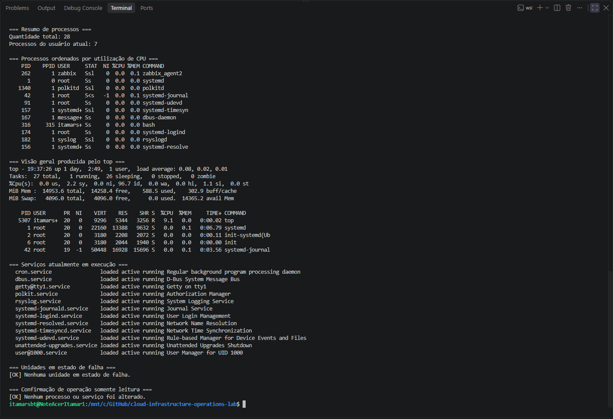
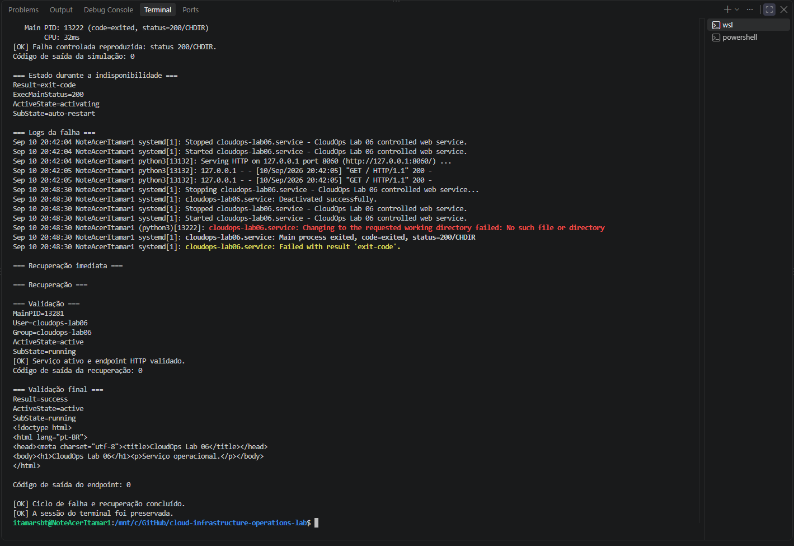

# Lab 06 — Linux Services, Processes, and Logs

[**Português (Brasil)**](README.md) · **English**

## Objective

Deploy and administer a small Linux HTTP service with `systemd`, examine its process and logs, reproduce a controlled configuration failure, and restore normal operation.

The exercise uses a dedicated system account and a Python HTTP server bound to the local loopback interface. It is a **training environment**, not a production-ready web service or an availability benchmark.

The original run is documented with two screenshots. This English edition describes that recorded execution; the commands and services were not rerun during translation.

## Recorded environment

| Component | Configuration |
|---|---|
| Operating system | Ubuntu 24.04 LTS under WSL 2 |
| Service manager | `systemd` |
| Unit | `cloudops-lab06.service` |
| Application | Python HTTP server |
| Local endpoint | `http://127.0.0.1:8060` |
| Working directory | `/srv/cloudops-lab06` |
| Service account | `cloudops-lab06` |
| Management script | [`scripts/manage-lab06-service.sh`](scripts/manage-lab06-service.sh) |

The unit serves static content from `/srv/cloudops-lab06/site`. It listens on `127.0.0.1` rather than a public network interface.

### Prerequisites and scope

Use a dedicated Ubuntu/WSL test environment with `systemd` enabled, Python 3, `curl`, `ss`, and the account-management tools expected by the script. You need permission to use `sudo`.

Before running the lab, confirm that port `8060`, the service name `cloudops-lab06.service`, the system user `cloudops-lab06`, and the directory `/srv/cloudops-lab06` are not used by unrelated workloads.

> [!CAUTION]
> This script changes systemd units and local accounts, writes under `/etc/systemd/system` and `/srv`, deliberately interrupts its own test service, and includes cleanup. Do not execute it on shared or production systems without reviewing the source and validating ownership of every target.

## Scenario

An operations team needs a local application to run as a managed service and remain available after startup. The exercise covers the initial setup, service status and socket inspection, log analysis, failure injection, recovery, endpoint validation, and removal of the lab's resources.

The fault is deliberate: an invalid `WorkingDirectory` setting makes the service fail at startup, producing the `systemd` exit status `200/CHDIR`.

## Service management script

[`manage-lab06-service.sh`](scripts/manage-lab06-service.sh) provides six actions:

| Action | Purpose |
|---|---|
| `setup` | Create the account and unit, enable the service, and start it |
| `inspect` | Inspect status, listening socket, journal entries, and HTTP response |
| `simulate-failure` | Apply an invalid working-directory override and verify the failure |
| `recover` | Remove that override and restart the service |
| `validate` | Confirm service activity and a recognizable local HTTP response |
| `cleanup` | Disable and remove the lab-specific service, files, and account |

### Service configuration

The generated unit uses the following settings:

```ini
[Unit]
Description=CloudOps Lab 06 controlled web service
After=network.target

[Service]
Type=simple
User=cloudops-lab06
Group=cloudops-lab06
WorkingDirectory=/srv/cloudops-lab06/site
ExecStart=/usr/bin/python3 -u -m http.server 8060 --bind 127.0.0.1
Restart=on-failure
RestartSec=3
NoNewPrivileges=true
PrivateTmp=true
ProtectSystem=strict
ProtectHome=true

[Install]
WantedBy=multi-user.target
```

A dedicated account with the `/usr/sbin/nologin` shell is used. The unit includes basic hardening controls:

- `NoNewPrivileges=true` prevents the service and its descendants from gaining new privileges through execution.
- `PrivateTmp=true` provides an isolated temporary-directory view.
- `ProtectSystem=strict` restricts writes to most of the filesystem from the service.
- `ProtectHome=true` prevents ordinary access to protected home directories.
- Binding to `127.0.0.1` restricts the HTTP listener to the local host network namespace.

These settings improve isolation but do **not** make Python's simple HTTP server suitable for production or represent a complete hardening assessment.

## Execution sequence

Run the following commands from the root of the repository, using a **dedicated test environment**.

### 1. Enter the lab directory

```bash
cd labs/06-linux-processes-services-logs
```

### 2. Check script syntax

```bash
bash -n scripts/manage-lab06-service.sh
```

An exit status of `0` indicates that Bash accepted the script's syntax; it does not prove that systemd, file permissions, or service behavior will work.

### 3. Install and start the service

```bash
sudo bash scripts/manage-lab06-service.sh setup
```

The script checks the environment and certain expected account/unit identifiers, creates the service account if necessary, writes a small HTML page and systemd unit, reloads systemd, and enables and starts the service.

The setup action also runs the validation routine at the end.

**Safety limitation:** The ownership checks are not a comprehensive collision or dependency audit. In particular, the script writes the web page and unit at fixed paths. Inspect the workspace and unit before running setup where existing files might be present.

### 4. Inspect the running service

```bash
sudo bash scripts/manage-lab06-service.sh inspect
```

The action collects information similar to:

```bash
systemctl status cloudops-lab06.service
ss -ltnp 'sport = :8060'
journalctl -u cloudops-lab06.service
curl --fail http://127.0.0.1:8060/
```

These tools respectively display service status, the listening socket, recent journal records, and an HTTP response.

### 5. Reproduce a controlled failure

```bash
sudo bash scripts/manage-lab06-service.sh simulate-failure
```

The script creates a systemd drop-in override under:

```text
/etc/systemd/system/cloudops-lab06.service.d/failure.conf
```

It sets an invalid working directory:

```ini
[Service]
WorkingDirectory=/srv/cloudops-lab06/missing
```

After `systemctl daemon-reload` and a restart attempt, the service is expected to fail because the configured working directory does not exist. The script polls the recorded main process exit status and checks that the local HTTP endpoint is unavailable.

**Expected diagnostic:**

```text
status=200/CHDIR
```

This is a deliberate configuration failure in the lab. It is **not** evidence of a production outage.

The unit has `Restart=on-failure` and `RestartSec=3`, so repeated restart attempts may occur while the invalid override remains in place. Do not leave the service intentionally failed after the experiment.

### 6. Recover the service

```bash
sudo bash scripts/manage-lab06-service.sh recover
```

The recovery action checks that the override contains the expected lab setting, removes it, reloads systemd, resets the failed state, and restarts the service.

The script then runs its validation routine to confirm that the service is active and returns the expected HTTP content.

### 7. Validate the restored endpoint

```bash
sudo bash scripts/manage-lab06-service.sh validate
```

The validation checks:

1. Whether the systemd unit is active.
2. Whether `curl` can retrieve `http://127.0.0.1:8060/`, with up to five short attempts.
3. Whether the returned page contains the `CloudOps Lab 06` marker.

A successful result supports the conclusion that **the local test endpoint was responding at the time of the check**. It does not demonstrate continuous availability, external connectivity, performance, or ownership of the listening port independently of other checks.

### 8. Remove the lab resources

```bash
sudo bash scripts/manage-lab06-service.sh cleanup
```

The cleanup action attempts to stop and disable the unit, remove the lab unit and files, remove the associated system account and group, and reload systemd.

> [!WARNING]
> Cleanup removes files and Linux account objects. It is appropriate only if those objects belong exclusively to this experiment. The script verifies some names and markers, but its checks cannot rule out all unexpected files, dependencies, symlinks, or conflicting local resources. Inspect the script and the target directories before executing this action.

---

## Fault diagnosis

The invalid `WorkingDirectory` produces a `systemd` process-startup failure:

```text
status=200/CHDIR
```

The status means that systemd was unable to change to the configured working directory before executing the service process. The cause in this exercise was the intentionally nonexistent path.

During the failure, the local HTTP request stopped succeeding and systemd could attempt automatic restarts. Recovery removed the bad drop-in configuration, reloaded systemd's unit definitions, and restarted the service.

To investigate a similar failure, inspect:

```bash
systemctl status cloudops-lab06.service --no-pager
journalctl -u cloudops-lab06.service --no-pager --lines=30
systemctl cat cloudops-lab06.service
```

These read-only inspection commands help identify active configuration and journal messages. The commands are provided for learning and are not a claim that a new incident was investigated.

## Recorded results

The original lab documented the following outcome:

- The service was installed and enabled under systemd.
- Its process ran under the dedicated `cloudops-lab06` account.
- The loopback HTTP endpoint responded successfully before fault injection.
- An invalid working directory produced the expected `200/CHDIR` diagnostic.
- The service was recovered and the local endpoint responded again.
- The dedicated resources were removed after validation.
- The repository was left without local modifications, according to the original lab record.

These are historical results from the documented execution, not measurements made during this translation.

### Evidence 01 — Environment and process inventory



### Evidence 02 — Failure injection and recovery



## Operational considerations

**Service availability versus local reachability.** `systemctl is-active` and a successful `curl` request verify different aspects of operation. Neither alone proves continuous uptime.

**The failure is reversible only under the expected conditions.** The `recover` action checks the known override before deleting it; unexpected file contents cause recovery to stop.

**Script execution is privileged.** The actions involving unit files, service accounts, and cleanup require `sudo`. Review the source before using it on any machine.

**The script uses fixed names and paths.** Reusing the names in an environment with other workloads may cause collisions, overwrite content, or remove objects that are not exclusively owned by the lab. Use an isolated test instance.

**Logs may contain identifying information.** Review screenshots and exported journal output before publishing them.

## Status

**Completed in the recorded lab execution.** The management script was inspected statically for this documentation review; no services, processes, files, or accounts were changed as part of the translation.

## Next lab

[Lab 07](../07-linux-networking/) continues the Linux operations sequence. Refer to the repository's main lab index for the current title and instructions.

---

[English repository overview](../../README.en.md) · [Portuguese repository overview](../../README.md)
