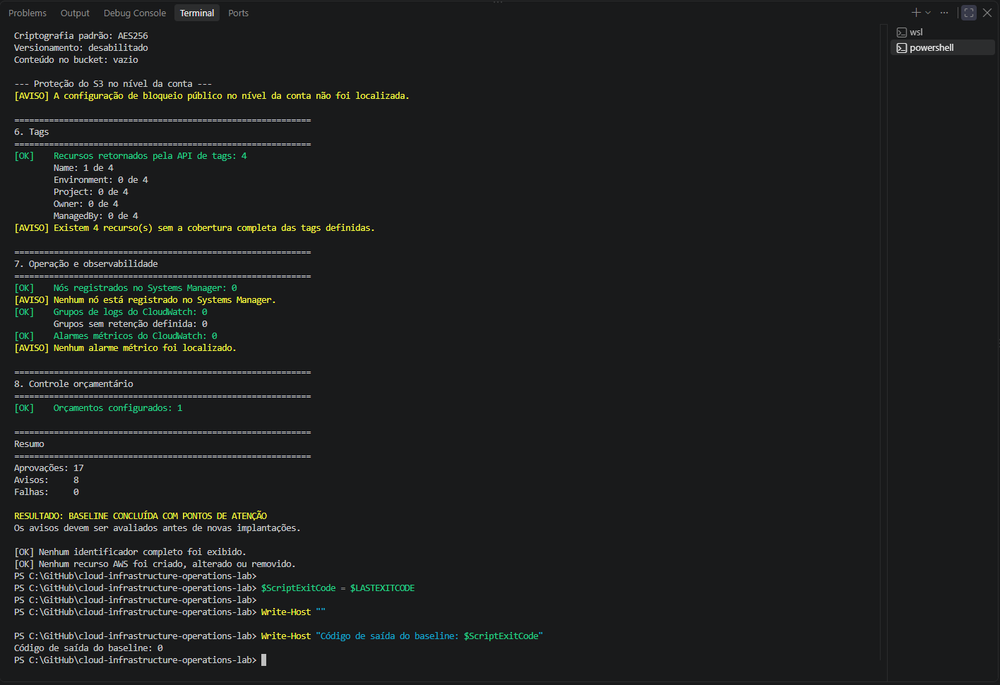

# Lab 07 — AWS Account Operational Baseline

[**Português (Brasil)**](README.md) · **English**

## Objective

Perform a **read-only operational inventory** of an AWS account before deploying additional infrastructure. The baseline covers identity, networking, compute, storage, selected security settings, tags, Systems Manager, CloudWatch, and AWS Budgets.

The purpose is to understand the current state, identify decisions requiring further investigation, and avoid changing resources whose ownership or role is not yet established.

This document preserves the **original recorded results**. The account was not queried again during translation or documentation review.

## Recorded environment

| Component | Original setup |
|---|---|
| Operating system | Windows 11 |
| Terminal | Windows PowerShell 5.1 |
| AWS CLI | 2.36.14 |
| Authentication | AWS IAM Identity Center |
| Profile | `cloud-operations-lab` |
| Reference Region | `us-east-1` |
| Execution mode | Read-only API queries |
| PowerShell script encoding | UTF-8 with BOM |
| Script | [`scripts/test-aws-account-baseline.ps1`](scripts/test-aws-account-baseline.ps1) |

The UTF-8 BOM supports accented Portuguese text in Windows PowerShell 5.1. Profile, Region, and installed version reflect the environment used for the recorded run, not universal requirements.

## Scope

The script queries:

- AWS STS caller identity and local profile Region.
- VPCs, subnets, security groups, Elastic IP addresses, and NAT gateways.
- EC2 instance state and monitoring settings.
- EBS volume inventory, encryption, and provisioned capacity.
- S3 bucket settings, including public access controls, bucket policy status, ACLs, website configuration, object ownership, default encryption, versioning, and whether at least one object is listed.
- Resources returned by the Resource Groups Tagging API.
- AWS Systems Manager managed node inventory.
- CloudWatch Logs log groups and CloudWatch metric alarms.
- AWS Budgets configured for the account.

Most infrastructure queries target `us-east-1`. The S3 bucket listing and bucket-specific checks have different service scopes. **This is not an exhaustive multi-Region, multi-account security assessment.**

## Safety and disclosure

The script is designed around read-only AWS commands. It does not create, modify, delete, or automatically remediate AWS resources.

Its normal reporting avoids full AWS account IDs, ARNs, user IDs, and bucket names. The script still displays operational inventory counts, some settings, dates, the chosen profile and Region, and CLI output. Review screenshots before publication, because these details can also be sensitive.

A read-only inventory is not a guarantee that AWS API calls have no billing implications under every possible account and service configuration. Consult applicable AWS pricing and account conditions.

> [!IMPORTANT]
> Treat every finding as a starting point for review. No resource should be stopped, deleted, encrypted, retagged, or reconfigured solely because this baseline reported a warning.

## Prerequisites

- AWS CLI version 2 installed and available in PowerShell.
- A configured AWS IAM Identity Center profile named `cloud-operations-lab` for the recorded procedure.
- A valid SSO session and sufficient read permissions for the services being inspected.
- A local clone of the repository.

Renew the session when required:

```powershell
aws sso login --profile cloud-operations-lab
```

The exact list of resources returned depends on the authenticated identity's effective permissions. An unsuccessful query must not be interpreted as proof that a resource or security setting does not exist.

## Validate the script syntax

From the repository root, the original procedure uses:

```powershell
Set-Location C:\GitHub\cloud-infrastructure-operations-lab

$ScriptPath = ".\labs\07-aws-account-baseline\scripts\test-aws-account-baseline.ps1"

$Tokens = $null
$ParseErrors = $null

[System.Management.Automation.Language.Parser]::ParseFile(
    (Resolve-Path -LiteralPath $ScriptPath).Path,
    [ref]$Tokens,
    [ref]$ParseErrors
) | Out-Null

Write-Host "Syntax errors: $($ParseErrors.Count)"
```

Recorded result:

```text
Syntax errors: 0
```

Syntax validation confirms parsing only. It does not prove that the AWS queries will succeed or that the inventory is complete.

## Execute the read-only baseline

From the same repository root:

```powershell
$ScriptPath = ".\labs\07-aws-account-baseline\scripts\test-aws-account-baseline.ps1"

& $ScriptPath `
    -ProfileName "cloud-operations-lab" `
    -Region "us-east-1"

$ScriptExitCode = $LASTEXITCODE

Write-Host ""
Write-Host "Baseline exit code: $ScriptExitCode"
```

The original commands used `C:\GitHub\cloud-infrastructure-operations-lab` as the local clone directory. Adjust that path for your workstation.

The script accepts `-ProfileName` and `-Region` parameters. Review the source before executing it with a different account or Region.

## Recorded validation result

<ins>Original baseline execution:</ins>

| Outcome | Count |
|---|---:|
| Passed checks | 17 |
| Warnings | 8 |
| Failures | 0 |
| Exit code | 0 |

Reported status:

```text
BASELINE CONCLUÍDA COM PONTOS DE ATENÇÃO
```

English meaning: **Baseline completed with items requiring attention.**

The script assigns exit code `0` when no required checks fail, **even when warnings are present**. Therefore, exit code `0` does not mean every reviewed setting meets an approved security policy.

The original procedure recorded no infrastructure changes and no full identifiers displayed in its normal report. These are documented historical outcomes; the present review did not repeat AWS API calls or independently attest to the current account state.

### Evidence — consolidated baseline summary



The screenshot documents the original checks and reported total. Detailed visual inspection for potentially sensitive information remains part of the documentation audit.

---

## Anonymized inventory

### Network — `us-east-1`

| Resource | Recorded count |
|---|---:|
| Accessible VPCs | 1 |
| Default VPCs | 1 |
| Subnets | 6 |
| Security groups | 2 |
| Elastic IP addresses | 0 |
| NAT gateways in available or pending state | 0 |

The numbers describe the resources visible to the account identity in the selected Region at the time of the run.

### Compute and block storage — `us-east-1`

| Resource | Recorded value |
|---|---:|
| EC2 instances in the queried nonterminated states | 1 |
| Stopped EC2 instances | 1 |
| EBS volumes | 1 |
| Provisioned EBS capacity | 8 GiB |

The EC2 query explicitly selected `pending`, `running`, `stopping`, and `stopped` states. These counts are not a lifetime history of all instances.

A stopped instance is not inherently misconfigured. Confirm its intended lifecycle and associated storage costs before taking any action.

### Amazon S3

| Check | Recorded result |
|---|---|
| Buckets visible in the listing | 1 |
| All four bucket-level Block Public Access options enabled | No |
| Bucket policy | Not configured or not accessible |
| Public grants found in returned ACL | No |
| Static website hosting | Not configured according to the query result |
| Object ownership | `BucketOwnerPreferred` |
| Default encryption algorithm | `AES256` |
| Versioning | Disabled |
| Objects returned by the limited listing | None |
| Account-level Block Public Access setting | Not located by the query |

The bucket name was intentionally omitted from published results.

**Interpretation limits:** The script sometimes merges distinct outcomes when a call fails. For instance, a missing setting, a denied request, and other AWS API errors may all be displayed as a missing or inaccessible configuration. The website status is similarly reported as not configured when the query fails.

The object check uses `list-objects-v2 --max-keys 1`; a successful response with no keys establishes that no current objects were returned in that limited listing. It is **not** proof that no noncurrent versions or delete markers exist.

S3 public exposure depends on the effective combination of account settings, bucket settings, policies, ACLs, and other access controls. A missing bucket-level block setting is a security-review finding, **not by itself evidence of public accessibility**.

### Tags and operational visibility

| Check | Recorded result |
|---|---:|
| Resources returned by the tagging API | 4 |
| Resources with `Name` tag | 1 of 4 |
| Resources with `Environment` tag | 0 of 4 |
| Resources with `Project` tag | 0 of 4 |
| Resources with `Owner` tag | 0 of 4 |
| Resources with `ManagedBy` tag | 0 of 4 |
| Systems Manager managed nodes reported | 0 |
| CloudWatch Logs log groups | 0 |
| CloudWatch metric alarms | 0 |
| AWS Budgets returned | 1 |

**Tagging coverage limitation:** These four resources are those returned by the Resource Groups Tagging API for the query, not necessarily all AWS resources in the account. Some services and untagged resources may be outside that result set. A missing tag is a gap against this lab's proposed tagging convention, not proof that the resource violates an established corporate standard.

**Observability limitation:** The script counts CloudWatch **metric alarms** in the selected Region. It does not fully assess composite alarms, dashboards, other Regions, externally managed monitoring tools, or whether specific workloads need particular alarms. Similarly, zero Systems Manager managed nodes is not automatically a configuration defect.

## Eight recorded attention items

The original run reported these conditions:

1. One EC2 instance was stopped.
2. Detailed EC2 monitoring was disabled for that instance.
3. One EBS volume was not encrypted.
4. The S3 bucket did not have all four bucket-level Block Public Access settings enabled.
5. Account-level S3 Block Public Access could not be located by the baseline query.
6. Four resources returned by the tagging API lacked complete coverage of the five selected tag keys.
7. No managed nodes were returned by Systems Manager.
8. No CloudWatch metric alarms were returned for the target Region.

These are **observations from a point-in-time inventory**, not automatically eight confirmed security vulnerabilities. Their risk and required action depend on purpose, access controls, application requirements, account permissions, and approved operational policy.

The unencrypted EBS volume and S3 public access settings deserve priority investigation because they may have security implications. Confirm exposure, ownership, and relevant requirements before making changes.

## Next operational decisions

A practical review sequence after this baseline is:

1. Confirm the owner and intended use of the stopped EC2 instance and EBS volume.
2. Review EBS encryption and determine whether migration is necessary and feasible.
3. Inspect S3 Block Public Access at both account and bucket scope, and verify effective permissions rather than inferring public access from one flag.
4. Determine whether the apparently empty bucket is still needed; consider all object versions and dependencies before deletion.
5. Define and apply an appropriate tagging convention for the resources and services actually in scope.
6. Evaluate whether Systems Manager management, CloudWatch alarms, and other monitoring controls are needed for the workloads.
7. Re-run the same baseline after any **separately approved** changes and compare results, retaining the dates and scope of each inventory.

No changes to AWS resources were performed as part of the original baseline or this documentation revision.

## Script behavior and audit notes

The [PowerShell baseline script](scripts/test-aws-account-baseline.ps1) uses AWS CLI read operations and normalizes some blank or invalid responses. It records three classes of output:

```text
[OK]      Passed check
[AVISO]   Condition requiring review
[FALHA]   Required check failed
```

Its overall result is determined from failure and warning totals. A zero process exit code indicates no required failures. It must not be used as an unconditional security-compliance pass.

The S3 policy and settings checks intentionally suppress many detailed error messages from the public report. While that protects sensitive context, it makes absent settings harder to distinguish from insufficient permissions. Future improvements can retain sanitized error categories without exposing bucket identities.

**Review method:** The README and script were inspected statically. No AWS account was accessed, no script was executed, and the screenshot was not examined at full resolution during this translation.

## Conclusion

Lab 07 recorded an anonymized operational inventory with **17 passed checks, 8 warnings, 0 failures, and exit code 0**. The resulting review list supports informed decisions before additional infrastructure deployment.

This assessment is scoped to the resources and permissions available to the original AWS CLI identity at the time of the run. It is not a comprehensive security certification or a statement about the account's present condition.

## Next lab

[Lab 08 — AWS Application Network](../08-aws-application-network/)

---

[English repository overview](../../README.en.md) · [Portuguese repository overview](../../README.md)
