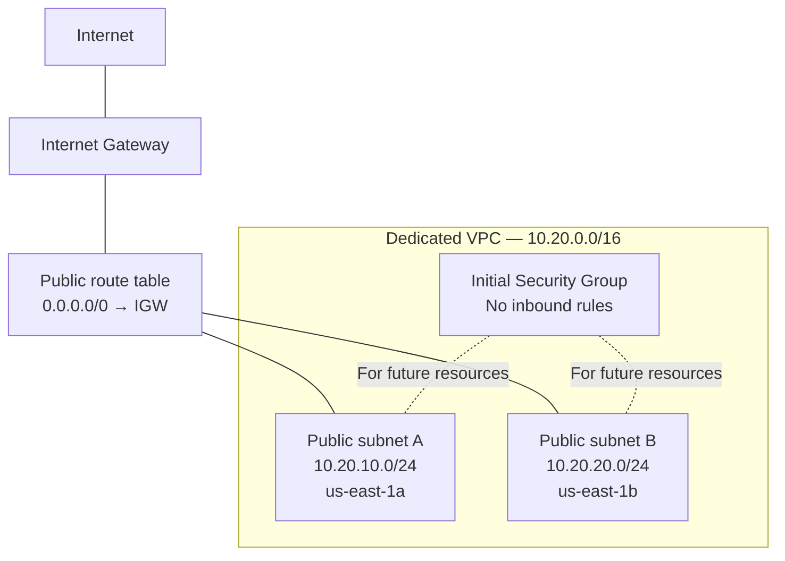
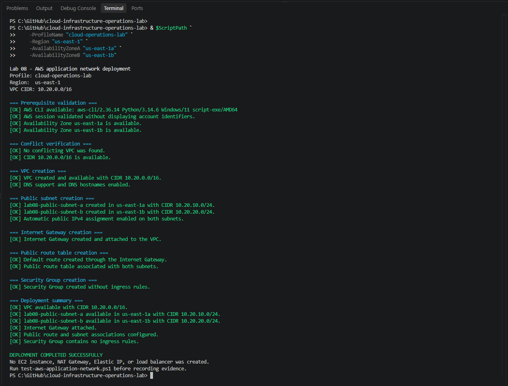
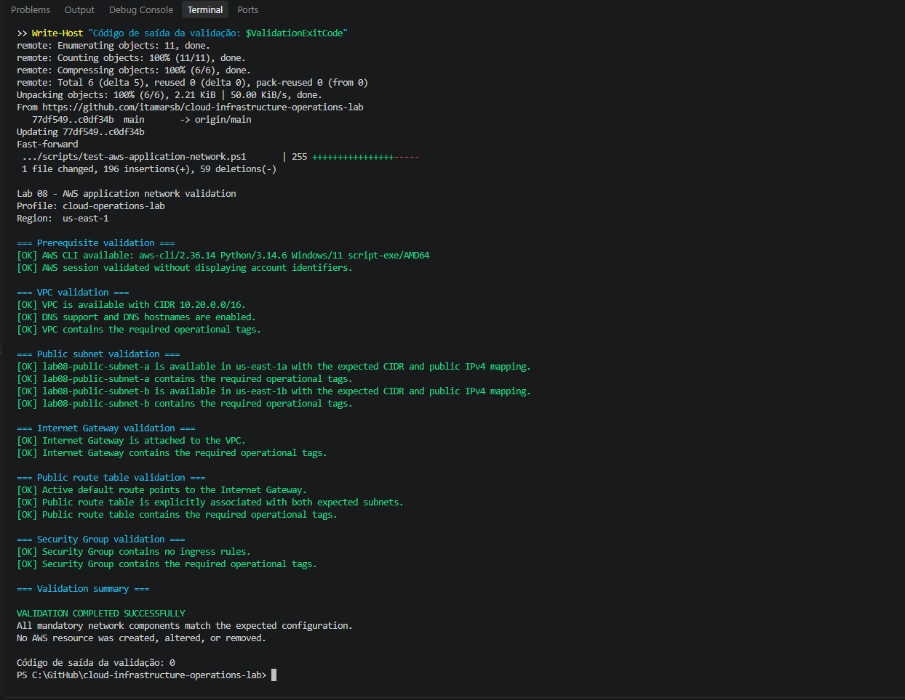
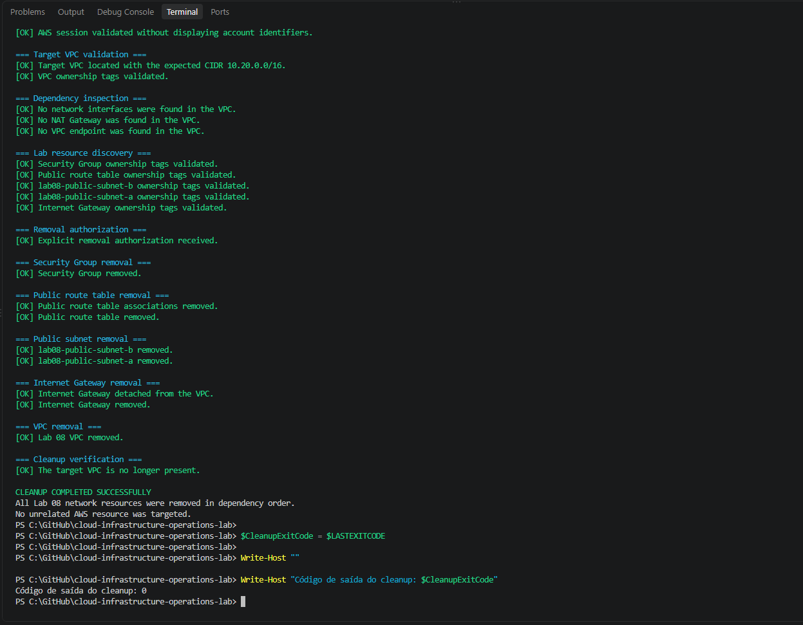

# Lab 08 — AWS Application Network

[**Português (Brasil)**](README.md) · **English**

## Objective

Build, validate, and then remove a dedicated AWS network foundation for subsequent Cloud Infrastructure Operations labs.

The recorded exercise created a VPC with two public subnets in separate Availability Zones, an Internet Gateway, a dedicated public route table, and a Security Group with no inbound rules. It used three independent PowerShell scripts for deployment, validation, and controlled cleanup.

**Execution record:** The network was deployed, validated, and removed during the original lab. This English edition documents that historical run; no AWS operations were performed as part of the translation.

## Scope and prerequisites

The exercise includes account and Region checks, VPC creation, DNS configuration, public subnet creation, Availability Zone separation, routing, initial security controls, resource tags, validation, anonymized evidence, and cleanup.

It **does not** deploy EC2 instances, load balancers, NAT Gateways, Elastic IPs, or SSH access rules.

The recorded environment was:

| Component | Configuration |
|---|---|
| Operating system | Windows 11 |
| Shell | Windows PowerShell 5.1 |
| CLI | AWS CLI v2 |
| Authentication | AWS IAM Identity Center |
| Profile | `cloud-operations-lab` |
| Region | `us-east-1` |
| Provisioning method | AWS CLI invoked from PowerShell |

Before reproducing the lab, ensure that the identity has the appropriate EC2 networking permissions, confirm account and Region, verify cost expectations, and inspect all three scripts. **Deployment and cleanup change real AWS resources and must be used only in an authorized lab account.**

## Initial inspection

The original read-only inspection reported:

| Check | Recorded result |
|---|---|
| Authenticated profile | Confirmed |
| Configured Region | `us-east-1` |
| Available Availability Zones | 6 |
| Existing VPC | Default VPC, `172.31.0.0/16` |
| Proposed CIDR | `10.20.0.0/16`, no matching VPC found in the selected scope |
| Resources changed during inspection | None |

The original evidence did not publish complete AWS account, session, or resource identifiers.

A CIDR not already used by another VPC in a particular account and Region is not necessarily free of **network overlap** with on-premises networks, connected VPCs, or future routing plans. That broader check is outside the recorded script's validation.

## Architecture

| Resource | Recorded configuration |
|---|---|
| VPC | `10.20.0.0/16` |
| Public subnet A | `10.20.10.0/24` |
| Public subnet B | `10.20.20.0/24` |
| Subnet A zone | `us-east-1a` |
| Subnet B zone | `us-east-1b` |
| Internet Gateway | One, attached to the VPC |
| Public route table | One dedicated table |
| Internet route | `0.0.0.0/0` via Internet Gateway |
| Security Group | No inbound rules added |
| NAT Gateway | Not used |
| Planned administrative access for later labs | AWS Systems Manager rather than public SSH |

### Network path



The diagram illustrates the intended routing relationships, **not an actual running application or verified inbound internet connection**.

Both subnets were configured to assign public IPv4 addresses automatically **to eligible resources launched later**. No public IPv4 address was allocated by that subnet setting alone.

A Security Group without inbound rules does not permit unsolicited inbound connections to resources using it. It may still have default outbound rules; a full egress review is outside the stated control.

### Availability Zone identifiers

The recorded account mapped `us-east-1a` to `use1-az1` and `us-east-1b` to `use1-az2`. These mappings should not be assumed for every AWS account. AWS Availability Zone **IDs** are intended to identify the same physical zone across accounts; names may differ depending on the account and Region. See [AWS Availability Zone IDs](https://docs.aws.amazon.com/global-infrastructure/latest/regions/az-ids.html).

## Operational tags

The scripts apply these tags to resources where supported:

| Key | Value |
|---|---|
| `Project` | `cloud-infrastructure-operations-lab` |
| `Environment` | `lab` |
| `Lab` | `08` |
| `ManagedBy` | `aws-cli` |
| `Owner` | `itamarsb` |
| `Name` | Resource-specific name |

These labels support resource discovery, ownership checks, and cleanup safeguards. **Tags alone do not establish legal ownership, authorization to delete, or independence from other resources.**

## Scripts

| Script | Purpose |
|---|---|
| [`deploy-aws-application-network.ps1`](scripts/deploy-aws-application-network.ps1) | Create and configure the application network |
| [`test-aws-application-network.ps1`](scripts/test-aws-application-network.ps1) | Read-only verification of resources, routes, associations, tags, and safeguards |
| [`remove-aws-application-network.ps1`](scripts/remove-aws-application-network.ps1) | Inspect dependencies, require explicit removal authorization, delete in dependency order, and check the result |

These are separate scripts. **Deployment does not automatically clean up partially created resources on failure.** If a command fails partway through, inspect the account and current resources before retrying or authorizing any deletion.

The cleanup script uses the explicit `-ConfirmRemoval` parameter before deleting resources in the normal target-found path. A check without that parameter was recorded as part of the safety test.

## Original execution sequence

The laboratory followed this sequence:

1. Renew the IAM Identity Center session.
2. Verify account, Region, selected Availability Zones, and proposed VPC CIDR.
3. Parse the deployment script to check its PowerShell syntax.
4. Deploy the dedicated VPC and associated network components.
5. Run the independent read-only validation script.
6. Capture anonymized deployment and validation evidence.
7. Check the cleanup script's syntax.
8. Run cleanup **without** removal authorization to exercise the safeguard.
9. Run cleanup with the required explicit authorization.
10. Query AWS to confirm the Lab 08 VPC is no longer present.
11. Record the final cleanup evidence.

### Working with the scripts

From the repository root, open the [scripts directory](scripts/) and inspect the full source before use. Typical invocation for a deployment with the documented defaults is:

```powershell
.\labs\08-aws-application-network\scripts\deploy-aws-application-network.ps1
```

For a separate read-only check:

```powershell
.\labs\08-aws-application-network\scripts\test-aws-application-network.ps1
```

The removal script is [`remove-aws-application-network.ps1`](scripts/remove-aws-application-network.ps1). Review its parameters, discovered resource IDs, dependencies, and deletion scope before supplying `-ConfirmRemoval`. Do not treat a sample cleanup command as a substitute for an environment-specific pre-deletion review.

The exact initial account inspection and historical execution transcript remain documented in the [Portuguese README](README.md).

## Deployment results

The original deployment reported successful creation of:

- One dedicated VPC with `10.20.0.0/16`.
- DNS resolution support and DNS hostnames enabled.
- Two public subnets in different Availability Zones, with automatic public IPv4 assignment enabled.
- One Internet Gateway attached to the VPC.
- One public route table with a default IPv4 route via that gateway.
- Explicit route-table associations for both public subnets.
- A Security Group without ingress rules.
- Operational tags identifying the lab resources.

The original independent validation finished with exit code `0`. This result describes the checks implemented by that validator; it does not establish that all possible networking, exposure, or organizational security controls were tested.

### Evidence 01 — Network deployment



The original capture documents VPC/subnet creation, DNS settings, Internet Gateway attachment, public routing, security group initialization, and the absence of application compute resources in the deployment procedure.

### Evidence 02 — Independent validation



The validation described in the README checked VPC CIDR, DNS attributes, two distinct zones, public IPv4 assignment settings, Internet Gateway attachment, the default route, subnet-to-route-table associations, Security Group ingress rules, and operational tags.

This is **configuration validation**, not a demonstration of actual packet flow from an EC2 instance or a production-grade network security assessment.

## Cleanup and dependencies

The original cleanup was executed after the validation and evidence collection. The recorded deletion order was:

1. Security Group.
2. Explicit route-table associations.
3. Dedicated public route table.
4. Both lab subnets.
5. Internet Gateway detachment.
6. Internet Gateway deletion.
7. Dedicated VPC deletion.

The cleanup script includes checks for identity markers and selected dependencies before deletion, as well as an explicit `-ConfirmRemoval` gate. It also checks for network interfaces, NAT Gateways, VPC endpoints, and unexpected subnets in the target VPC.

**Limitations:** These checks are useful safeguards but cannot guarantee the complete absence of external dependencies or unrelated objects. The final VPC check uses the expected resource name; a successful query is evidence that the matching VPC was no longer returned, rather than an independent exhaustive audit of the entire AWS account.

### Evidence 03 — Controlled network cleanup



The original cleanup ended with exit code `0` and reported that the target VPC was no longer present. No AWS cleanup was performed during this documentation review.

## Security considerations

- No EC2 instances were created and no SSH ingress was configured.
- The initial Security Group had no inbound rules.
- Network routes and subnet attributes prepare a future application deployment; they do not create application endpoints.
- The scripts identify resources using specific values and tags, but these controls must be supplemented with an independent review before destructive changes.
- Future EC2 management through Systems Manager requires appropriate IAM permissions, an SSM Agent, and functional network connectivity to the required endpoints; selecting SSM as a goal does not automatically make instances manageable.
- Anonymized evidence should still be checked for account information, resource identifiers, IP addresses, and sensitive environment details.

## Cost considerations

The lab deliberately avoided NAT Gateways, Elastic IPs, running EC2 instances, and load balancers. The basic VPC, route table, subnets, Internet Gateway, and Security Group do not have the same standing hourly charges as those optional resources.

The recorded exercise expected no AWS charges from this short-lived network-only deployment. **This is not a general guarantee of zero cost**: future public IPv4 addresses, services, and data transfers may be billable. In particular, enabling automatic public IPv4 assignment on a subnet does not itself allocate an address, but a later EC2 launch with a public IPv4 address can incur hourly address charges. Consult the current [Amazon VPC pricing](https://aws.amazon.com/vpc/pricing/) before repeating or extending the exercise.

## Original completion record

- [x] Dedicated lab directory and scripts prepared.
- [x] Account, Region, CIDR, and Availability Zones inspected.
- [x] VPC and public networking components deployed.
- [x] Configuration validated independently.
- [x] Deployment and validation screenshots recorded.
- [x] Removal gate checked without authorization.
- [x] Cleanup explicitly authorized.
- [x] Lab VPC absence checked after cleanup.
- [x] Cleanup evidence recorded.

These checked items summarize the **recorded historical execution**, not tasks automatically completed for another reader.

## Conclusion

Lab 08 documents an end-to-end AWS network exercise: pre-deployment inspection, a dedicated multi-AZ VPC topology, independent configuration validation, anonymized evidence, and controlled removal.

The original execution reported that no Lab 08 resources remained after cleanup. The translation and static script review did not recheck the current AWS account or modify any infrastructure.

## Next lab

[Lab 09 — AWS EC2 and Systems Manager](../09-aws-ec2-systems-manager/)

---

[English repository overview](../../README.en.md) · [Portuguese repository overview](../../README.md)
