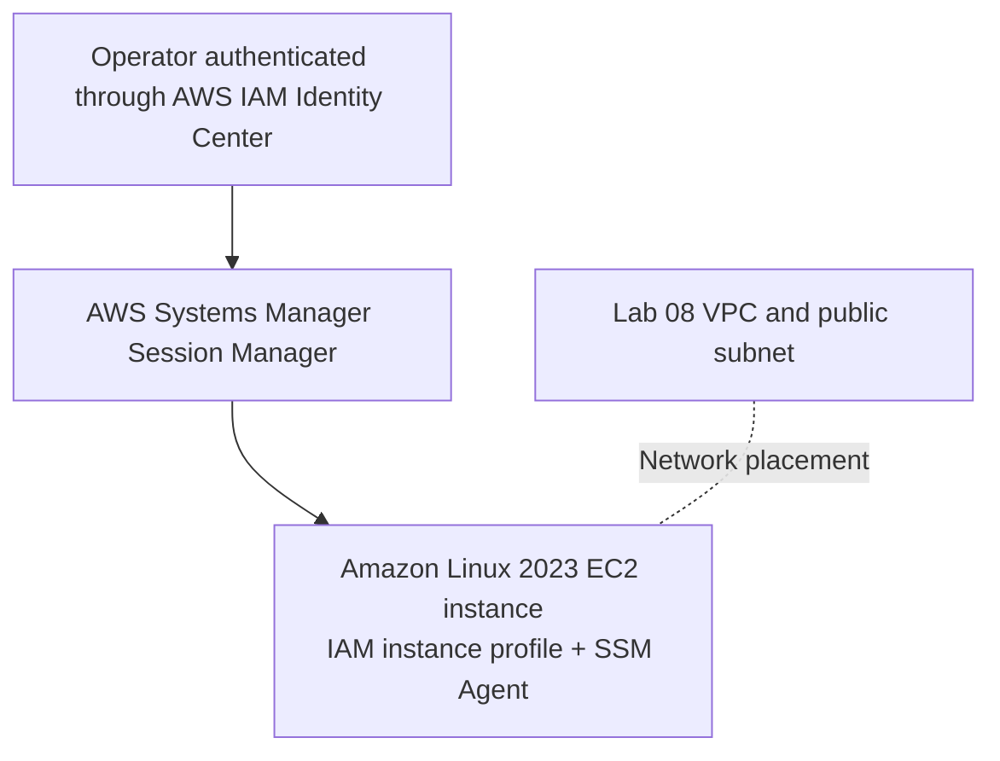
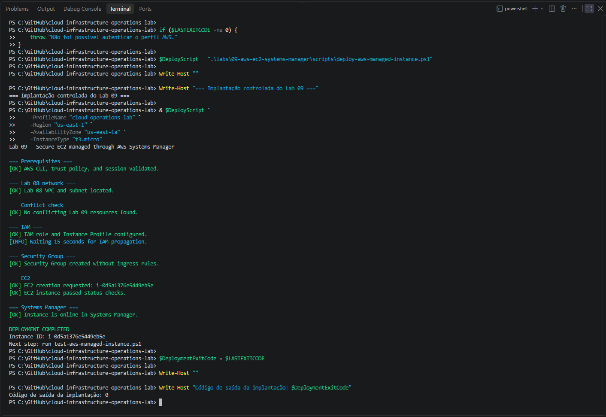
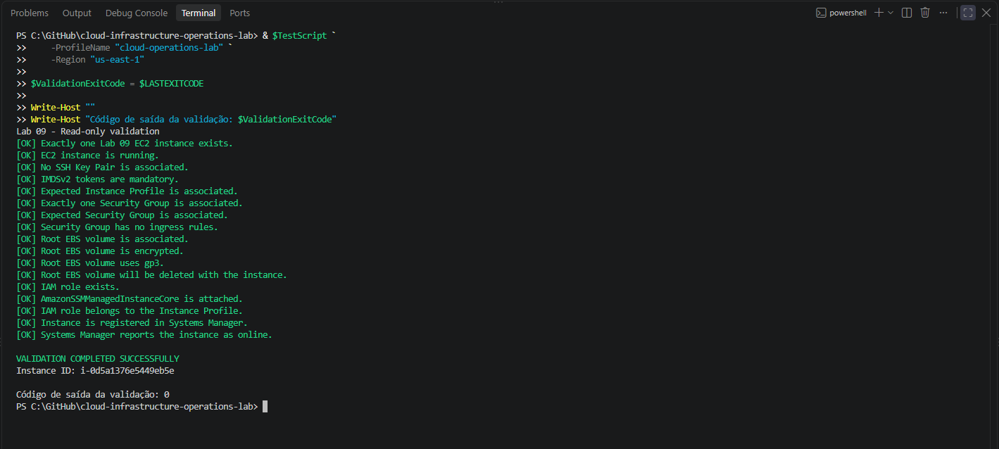
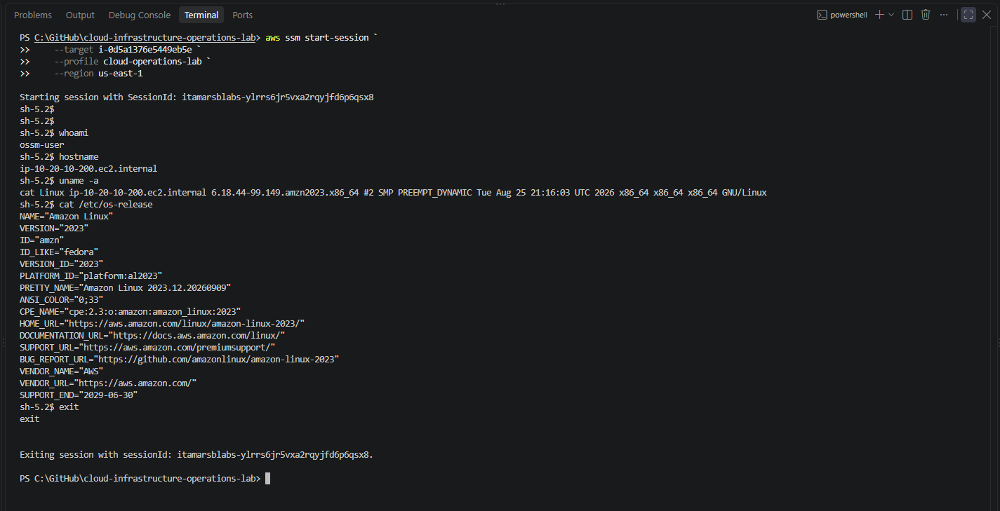
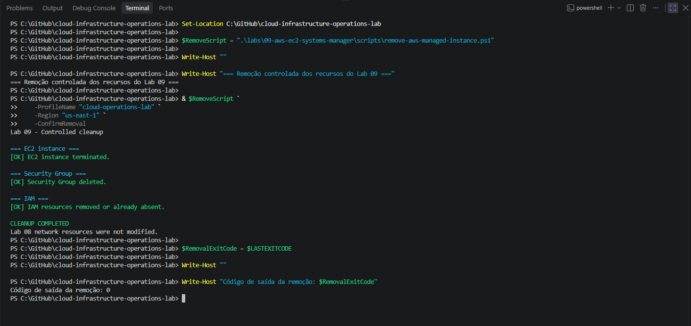

# Lab 09 — Amazon EC2 Managed with AWS Systems Manager

[**Português (Brasil)**](README.md) · **English**

## Objective

Deploy an Amazon EC2 instance that can be managed through **AWS Systems Manager Session Manager** without an SSH key pair, inbound administrative ports, or an inbound rule in its Security Group.

The original exercise covered the full Cloud Operations cycle: provisioning, independent read-only validation, an interactive management session, controlled resource removal, and post-cleanup checks. This is a record of a completed lab, not a claim that the AWS account was accessed again during this translation.

## Architecture and recorded configuration

Lab 09 temporarily reused the dedicated VPC and public subnet established in **Lab 08**.



| Component | Recorded setting |
|---|---|
| AWS Region | `us-east-1` |
| Availability Zone | `us-east-1a` |
| VPC | `lab08-application-vpc` |
| Subnet | `lab08-public-subnet-a` |
| EC2 name tag | `lab09-managed-instance` |
| Instance type | `t3.micro` |
| Operating system | Amazon Linux 2023 |
| Administrative access | Systems Manager Session Manager |
| Security Group | No inbound rules |
| EC2 key pair | None |
| IAM role | `lab09-ec2-ssm-role` |
| Instance profile | `lab09-ec2-ssm-instance-profile` |
| Managed policy | `AmazonSSMManagedInstanceCore` |
| Instance metadata | IMDSv2 required |
| Root storage | Encrypted 8 GiB `gp3` EBS volume |
| Public IPv4 address | Assigned for outbound communication with public AWS service endpoints during the exercise |

The instance was launched without a NAT Gateway or VPC endpoints. Its public IPv4 address, Internet Gateway routing, and Security Group egress capabilities provided a path toward public AWS service endpoints. **The address does not imply that inbound administration from the Internet was permitted.**

Systems Manager requires functioning network reachability to the relevant service endpoints, an operational SSM Agent, appropriate instance permissions, and authorization for the human operator. Using Session Manager does not eliminate the need to review egress, session policies, and audit controls.

## What this exercise demonstrates

- Obtaining an Amazon Linux 2023 AMI ID from an AWS-managed public Systems Manager parameter.
- Creating an EC2 IAM role and instance profile rather than placing long-lived AWS credentials inside the instance.
- Attaching the `AmazonSSMManagedInstanceCore` managed policy for SSM-managed instance functionality.
- Launching an EC2 instance with an enforced IMDSv2 token requirement.
- Configuring a Security Group without inbound rules or port 22 access.
- Encrypting the root EBS volume and configuring deletion on instance termination.
- Checking EC2 and Systems Manager state independently.
- Opening and closing a Session Manager shell.
- Removing Lab 09 resources while retaining the Lab 08 networking foundation.

The lab did **not** provision an application, database, NAT Gateway, VPC endpoint, Elastic IP, load balancer, or SSH key pair.

## Repository files

```text
labs/09-aws-ec2-systems-manager/
├── README.md
├── README.en.md
├── images/
│   ├── lab09-deployment-success.png
│   ├── lab09-read-only-validation.png
│   ├── lab09-session-manager.png
│   └── lab09-post-cleanup-validation.png
├── policies/
│   └── ec2-ssm-trust-policy.json
└── scripts/
    ├── deploy-aws-managed-instance.ps1
    ├── test-aws-managed-instance.ps1
    └── remove-aws-managed-instance.ps1
```

| File | Purpose |
|---|---|
| [Deployment script](scripts/deploy-aws-managed-instance.ps1) | Create IAM resources, the dedicated Security Group, and the EC2 instance |
| [Validation script](scripts/test-aws-managed-instance.ps1) | Inspect the resulting configuration with read-only AWS API calls |
| [Cleanup script](scripts/remove-aws-managed-instance.ps1) | Terminate the instance and remove the Lab 09 Security Group and IAM resources |
| [IAM trust policy](policies/ec2-ssm-trust-policy.json) | Allow the EC2 service principal to assume the instance role |

The trust policy specifies `ec2.amazonaws.com` as its principal and `sts:AssumeRole` as the allowed action. It does **not** grant an operator permission to start Session Manager sessions; that authorization is managed separately.

---

## Prerequisites and safety

Before reproducing the exercise, verify:

1. Windows PowerShell 5.1 or PowerShell 7 and AWS CLI v2 are available.
2. The `cloud-operations-lab` profile is configured and authorized through IAM Identity Center.
3. The Lab 08 VPC and target public subnet exist in `us-east-1`.
4. The Session Manager Plugin is installed on the local workstation if sessions are started through the CLI.
5. The executing identity has the required EC2, IAM, Systems Manager, and related read/write permissions.
6. No unrelated instance, role, instance profile, Security Group, or application uses the fixed Lab 09 resource names.

Renew the IAM Identity Center session if necessary:

```powershell
aws sso login --profile cloud-operations-lab
```

**Risk boundary:** The deployment and cleanup scripts modify real AWS resources. Use only an authorized testing account and review their source first. A deployment failure can leave some resources in place because the script does **not** provide automatic transactional rollback.

## 1. Deploy the managed instance

From the repository root:

```powershell
$DeployScript = ".\labs\09-aws-ec2-systems-manager\scripts\deploy-aws-managed-instance.ps1"

& $DeployScript `
    -ProfileName "cloud-operations-lab" `
    -Region "us-east-1" `
    -AvailabilityZone "us-east-1a" `
    -InstanceType "t3.micro"
```

The recorded deployment performs the following operations:

1. Validates the AWS CLI, IAM Identity Center session, and the trust-policy file.
2. Finds the Lab 08 VPC and subnet.
3. Checks for some conflicting resources with expected names.
4. Creates an IAM role and instance profile with the SSM managed policy.
5. Creates the instance Security Group without inbound rules.
6. Resolves an Amazon Linux 2023 AMI ID and launches EC2 with IMDSv2 and encrypted EBS.
7. Waits for EC2 status checks and for the node to appear **Online** in Systems Manager.

The AMI is resolved from:

```text
/aws/service/ami-amazon-linux-latest/al2023-ami-kernel-default-x86_64
```

This parameter can point to a newer AMI on a later date. For strict reproducibility, record the resolved AMI ID and release information for every actual execution; the historical README does not supply a fixed AMI ID.

The root volume settings in the script request an **8 GiB `gp3` EBS volume**, encryption enabled, and `DeleteOnTermination=true`. The metadata options require IMDSv2 tokens.

### Recorded deployment evidence



The original deployment reported exit code `0`, successful EC2 status checks, and an **Online** managed node in Systems Manager.

**Operational note:** The script includes waits for AWS IAM propagation and managed-node registration. A timeout or partial provisioning failure does not by itself prove that nothing was created. Inspect the current resources before attempting cleanup or another deployment.

## 2. Run independent read-only validation

From the repository root:

```powershell
$TestScript = ".\labs\09-aws-ec2-systems-manager\scripts\test-aws-managed-instance.ps1"

& $TestScript `
    -ProfileName "cloud-operations-lab" `
    -Region "us-east-1"
```

The separate validation script checks:

- A uniquely identified EC2 instance in the expected scope.
- A running EC2 instance.
- No associated EC2 key pair.
- Required IMDSv2 tokens.
- The expected instance profile.
- Exactly one attached Security Group, with no ingress rules.
- The expected root EBS volume, encryption, `gp3` type, and deletion-on-termination setting.
- Existence of the IAM role and its association with the instance profile.
- Attachment of `AmazonSSMManagedInstanceCore`.
- A managed-node registration reported as **Online** by Systems Manager.

### Recorded validation evidence



All recorded checks passed and the validation script exited with code `0`.

**Scope of validation:** These checks establish selected configuration attributes at the time of the original run. They do not provide a complete EC2 security assessment, prove that the operating system has no other access paths, or guarantee ongoing SSM connectivity. A Security Group without ingress rules does not necessarily have restricted outbound rules.

## 3. Access the instance with Session Manager

Query the running instance ID using the recorded `Name` tag:

```powershell
$InstanceId = aws ec2 describe-instances `
    --profile cloud-operations-lab `
    --region us-east-1 `
    --filters `
        "Name=tag:Name,Values=lab09-managed-instance" `
        "Name=instance-state-name,Values=running" `
    --query "Reservations[0].Instances[0].InstanceId" `
    --output text `
    --no-cli-pager
```

Confirm that the query returned **exactly one expected instance** before beginning a session. A tag alone is not a secure proof of ownership, and a missing or ambiguous query result should stop the procedure.

Start the session:

```powershell
aws ssm start-session `
    --profile cloud-operations-lab `
    --region us-east-1 `
    --target $InstanceId
```

Inside the instance, inspect its identity and operating system:

```bash
whoami
hostname
uname -a
cat /etc/os-release
```

Close the interactive session:

```bash
exit
```

### Recorded session evidence



The original session opened under the `ssm-user` account on Amazon Linux 2023 and was closed normally. It did not require an SSH key pair, port 22, or an inbound Security Group rule.

**Security consideration:** Session Manager permissions, optional session logging, audit configuration, and the effective privileges of the session user require separate review. Avoid presenting a successful session as proof that all administrative access is fully hardened or audited.

## 4. Controlled resource cleanup

From the repository root:

```powershell
$RemoveScript = ".\labs\09-aws-ec2-systems-manager\scripts\remove-aws-managed-instance.ps1"

& $RemoveScript `
    -ProfileName "cloud-operations-lab" `
    -Region "us-east-1" `
    -ConfirmRemoval
```

**Warning:** This action terminates an EC2 instance and deletes AWS IAM and networking-related resources. Verify the target account, Region, resource IDs, ownership, data-retention needs, and dependencies independently before authorizing it.

The script carries out the recorded cleanup sequence:

1. Find and terminate the Lab 09 EC2 instance.
2. Wait for instance termination.
3. Delete the dedicated Lab 09 Security Group.
4. Remove the IAM role from its instance profile.
5. Delete the instance profile.
6. Detach the managed policy from the IAM role.
7. Delete the IAM role.

The cleanup requires `-ConfirmRemoval` and uses `Lab=09` and `Owner=itamarsb` tags to check the instance, Security Group, and existing IAM resources. Those checks are useful safeguards, but **matching tags and names are not by themselves proof that a resource has no external dependencies**.

The cleanup intentionally does **not** delete the VPC or subnet created for Lab 08.

### Recorded cleanup evidence



The original cleanup returned code `0`, followed by checks showing that the managed instance, its Security Group, IAM role, and instance profile were removed while the Lab 08 network remained.

## 5. Recorded final state

| Item | Post-cleanup result |
|---|---:|
| Active Lab 09 instances | `0` |
| Lab 09 Security Groups | `0` |
| Lab 09 IAM roles | `0` |
| Lab 09 instance profiles | `0` |
| Lab 08 VPC | `1` |
| Lab 08 public subnet A | `1` |

These values describe the **original post-cleanup verification**. They are not claims about the account's current state.

The root EBS volume was configured with `DeleteOnTermination=true`. This setting specifies expected deletion behavior when the instance terminates, but a complete post-cleanup storage audit would separately verify the absence of any remaining volumes or snapshots.

## Operational and security considerations

**No inbound SSH:** The configuration avoids SSH key pairs and ingress rules, reducing exposure of a common administrative pathway. It does not remove the need for IAM governance or secure SSM access.

**Least privilege:** `AmazonSSMManagedInstanceCore` provides common managed-node permissions; the human operator's permission to call `ssm:StartSession` is a separate concern.

**Instance metadata:** Requiring IMDSv2 is a useful defense, not a guarantee against every credential-access technique.

**Availability and identity:** An `Online` Systems Manager registration is a point-in-time status, not a continuous service-level objective.

**Network access:** A public IPv4 address enabled access to public AWS service endpoints under the original networking arrangement. Public IPv4 addressing can incur charges even when administrative ingress is blocked.

**Cleanup and reproducibility:** EC2 instance termination is not a reversible rollback of data. Review the root volume's lifecycle, any attached storage, logs, and IAM dependencies before removal. Repeating this exercise later may select a different Amazon Linux AMI.

## Cost considerations

The lab used one `t3.micro` instance, an 8 GiB `gp3` EBS root volume, and a public IPv4 address. EC2 compute, EBS storage, and public IPv4 addressing can each be billable depending on the account's eligibility, usage duration, and pricing conditions.

No NAT Gateway was used. Short duration and cleanup help reduce ongoing expense, but do not establish that the exercise was universally free. Review current [Amazon EC2 pricing](https://aws.amazon.com/ec2/pricing/), [Amazon EBS pricing](https://aws.amazon.com/ebs/pricing/), and [VPC/public IPv4 pricing](https://aws.amazon.com/vpc/pricing/) before reproducing it.

## Conclusion

The original Lab 09 demonstrated managed EC2 provisioning, independent configuration checks, an interactive Session Manager session without inbound SSH, and controlled resource removal while retaining the Lab 08 network.

This English documentation was prepared by inspecting the repository files. **No AWS calls, installations, Session Manager sessions, or cleanup operations were performed as part of the review.**

## Next lab

[Lab 10 — Linux Web Service](../10-linux-web-service/)

---

[English repository overview](../../README.en.md) · [Portuguese repository overview](../../README.md)
