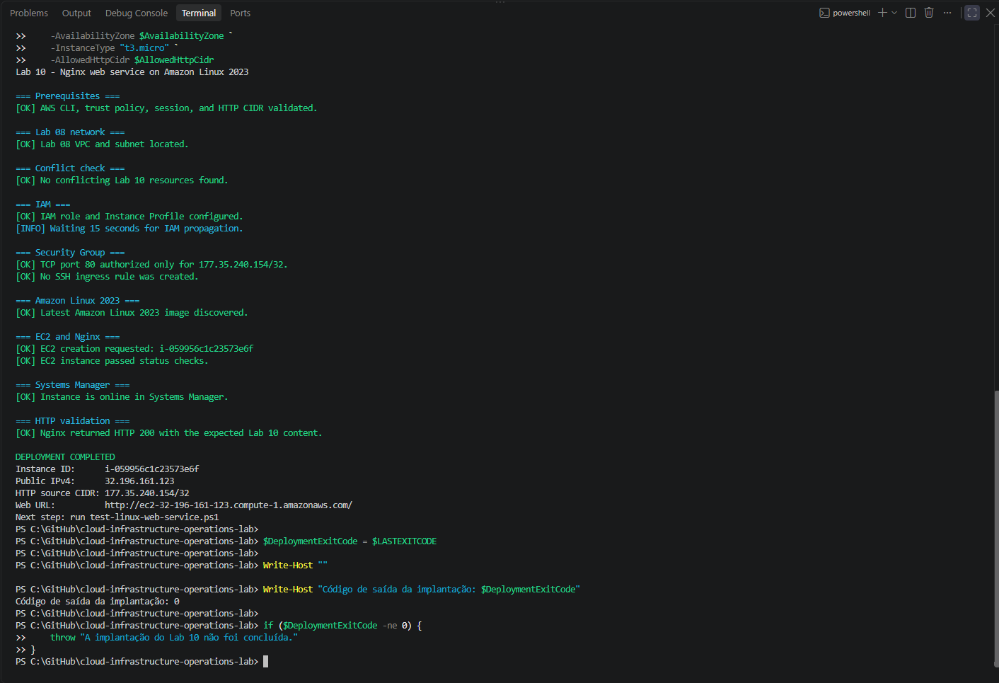
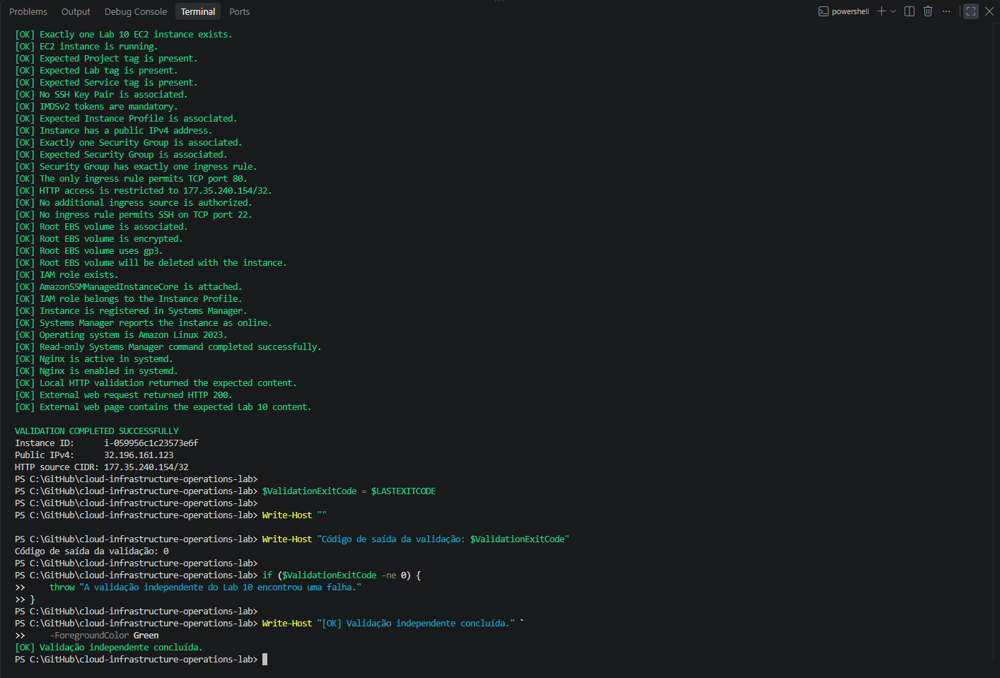
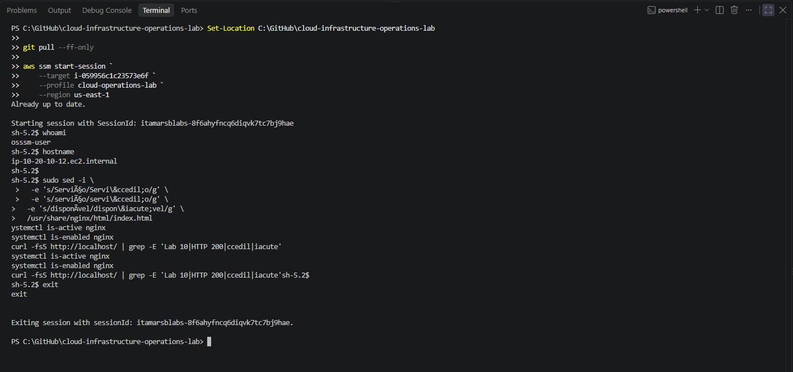
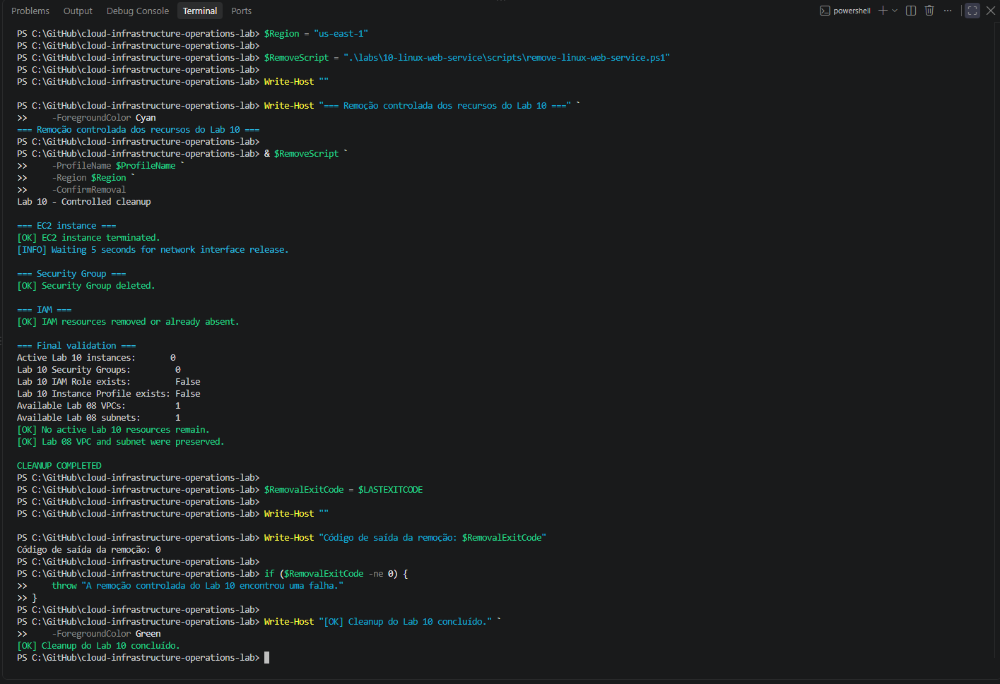
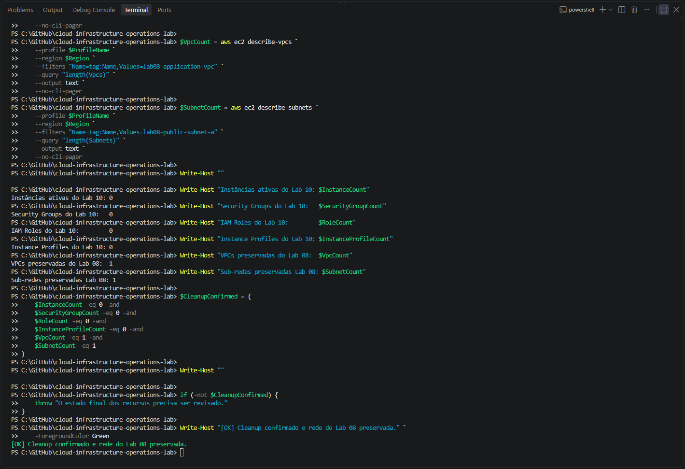

# Lab 10 — Nginx Web Service on Amazon Linux

[**Português (Brasil)**](README.md) · **English**

## Objective

Deploy, operate, validate, and remove an Nginx web service on an Amazon Linux 2023 EC2 instance. The exercise combines Linux service management through **systemd**, restricted HTTP access, AWS Systems Manager administration without SSH, independent checks, and controlled cleanup.

The original lab temporarily reused the VPC and public subnet from **Lab 08**. All deployment, service, validation, and cleanup results described here belong to that historical execution. No AWS resources or Linux services were accessed or changed during this documentation review.

## Recorded architecture

The operator's browser reached an EC2-hosted Nginx page over TCP port 80. Its Security Group allowed the HTTP connection only from the operator's authorized public IPv4 address using a `/32` CIDR.

```text
Operator browser (authorized IPv4 /32)
            |
            | HTTP TCP 80 — unencrypted
            v
Lab 10 Security Group
            |
            v
Amazon Linux 2023 EC2
    ├── Nginx
    ├── systemd
    └── SSM Agent

Administrative path:
IAM Identity Center operator → Systems Manager Session Manager → EC2
```

| Component | Recorded configuration |
|---|---|
| Region / Availability Zone | `us-east-1` / `us-east-1a` |
| VPC | `lab08-application-vpc` |
| Public subnet | `lab08-public-subnet-a` |
| EC2 name | `lab10-linux-web-server` |
| Instance type | `t3.micro` |
| Operating system | Amazon Linux 2023 |
| Web server / service manager | Nginx / `systemd` |
| Web protocol | HTTP on TCP `80`, no TLS |
| HTTP source | One authorized public IPv4 address, `/32` |
| Security Group | `lab10-linux-web-sg` |
| Administrative access | Systems Manager Session Manager; no SSH |
| EC2 key pair | None |
| IAM role | `lab10-ec2-ssm-role` |
| Instance profile | `lab10-ec2-ssm-instance-profile` |
| Instance policy | `AmazonSSMManagedInstanceCore` |
| Instance metadata | IMDSv2 required |
| Root volume | Encrypted EBS `gp3`, 8 GiB, delete on termination |

The following were **not** deployed: NAT Gateway, VPC endpoints, Elastic IP, load balancer, Auto Scaling Group, TLS certificate, DNS domain, database, or SSH key pair.

This architecture was a short-lived learning exercise. HTTP without TLS offers **no transport encryption** for browser-to-server content, even when a Security Group restricts the source IP.

## Repository contents

```text
labs/10-linux-web-service/
├── README.md
├── README.en.md
├── images/
│   ├── lab10-deployment-success.png
│   ├── lab10-read-only-validation.png
│   ├── lab10-http-validation.png
│   ├── lab10-session-manager.png
│   ├── lab10-cleanup-success.png
│   └── lab10-post-cleanup-validation.png
├── policies/
│   └── ec2-ssm-trust-policy.json
└── scripts/
    ├── deploy-linux-web-service.ps1
    ├── test-linux-web-service.ps1
    └── remove-linux-web-service.ps1
```

| File | Responsibility |
|---|---|
| [Deployment script](scripts/deploy-linux-web-service.ps1) | Create IAM resources, Security Group, EC2, bootstrap Nginx, and test HTTP |
| [Validation script](scripts/test-linux-web-service.ps1) | Inspect infrastructure, SSM, service state, and HTTP responses |
| [Cleanup script](scripts/remove-linux-web-service.ps1) | Remove Lab 10 resources while retaining Lab 08 networking |
| [EC2 trust policy](policies/ec2-ssm-trust-policy.json) | Allow the EC2 service principal to assume the instance IAM role |

The trust policy includes `ec2.amazonaws.com` as a trusted service principal. The instance policy does not independently authorize the human operator to start Session Manager sessions.

## Scope and operational safeguards

The recorded lab performed the following:

- Obtained an Amazon Linux 2023 AMI using the AWS-managed SSM public parameter.
- Created an IAM role, instance profile, and dedicated Security Group.
- Allowed HTTP port 80 only from the chosen `/32` IPv4 source; did not add SSH ingress.
- Launched EC2 without a key pair, with mandatory IMDSv2 and encrypted `gp3` root storage.
- Installed Nginx and deployed a static HTML page with EC2 User Data.
- Enabled and started Nginx using `systemd`.
- Verified the response from the instance and from the external operator's workstation.
- Used SSM to check service state and to open an interactive administrative session.
- Terminated the EC2 instance and deleted Lab 10-specific IAM and Security Group resources.
- Verified that the expected Lab 08 VPC and subnet remained.

**Safety:** The deployment and cleanup scripts perform real AWS mutations and can incur charges. Review account, Region, target names, resource IDs, security rules, dependencies, and data-retention requirements before executing them. A partially completed deployment may need manual inspection and recovery; it is not automatically rolled back.

## Prerequisites

- Windows PowerShell 5.1 or PowerShell 7.
- AWS CLI v2 and a configured `cloud-operations-lab` profile.
- IAM Identity Center authentication.
- Session Manager Plugin for interactive CLI sessions.
- The Lab 08 VPC and target public subnet in `us-east-1`.
- Working outbound connectivity from EC2 to required AWS services and the package installation sources.
- A public IPv4 address from which the operator's HTTP request will originate.
- Appropriate EC2, IAM, Systems Manager, and related permissions.

Renew the session as needed:

```powershell
aws sso login --profile cloud-operations-lab
```

For repeatability, record the AMI ID resolved at deployment time: the public parameter can point to a different AMI on a later date.

## 1. Identify the operator's public IPv4 address

The recorded procedure used a public address lookup service:

```powershell
$PublicIp = (
    Invoke-RestMethod `
        -Uri "https://checkip.amazonaws.com" `
        -TimeoutSec 15
).Trim()

$AllowedHttpCidr = "$PublicIp/32"
```

This value was supplied to the deployment and validation scripts rather than hardcoded in the repository.

For illustration, a documentation-only address looks like:

```text
203.0.113.10/32
```

The example belongs to a documentation IPv4 range and **must not** be copied as a real authorization source. A `/32` rule covers one IPv4 address, which limits the permitted source but does not authenticate individual users or encrypt HTTP traffic. NAT, VPNs, proxies, or IP changes can cause the actual request source to differ from the detected address.

Treat the real public IP as potentially identifying information when publishing terminal output.

## 2. Deploy the web service

Run from the repository root:

```powershell
$DeployScript = ".\labs\10-linux-web-service\scripts\deploy-linux-web-service.ps1"

& $DeployScript `
    -ProfileName "cloud-operations-lab" `
    -Region "us-east-1" `
    -AvailabilityZone "us-east-1a" `
    -InstanceType "t3.micro" `
    -AllowedHttpCidr $AllowedHttpCidr
```

The script checks the session and selected network, rejects some existing-resource conflicts, creates the IAM role/profile and Security Group, resolves the Amazon Linux 2023 AMI, and launches the instance.

EC2 User Data installs Nginx, prepares the lab's static page, and enables and starts the service. The script waits for EC2 health and the managed node to become available in Systems Manager, then performs an initial HTTP request from the operator's workstation.

The Security Group allows inbound TCP 80 from the authorized IPv4 CIDR. **No inbound TCP 22 rule is configured**, and no key pair is attached. The instance's outbound connectivity remains relevant for Systems Manager and software installation.

The deployment reported exit code `0` and an HTTP `200` response with content identifying Lab 10.



### User Data encoding

The deployment script writes a temporary EC2 User Data file in **UTF-8 without BOM**, passing it to AWS CLI with the `fileb://` scheme. This supports consistent Linux shell-script interpretation during instance bootstrap. The script removes the temporary file during normal processing of that stage.

The HTML uses entities for certain accented Portuguese characters so browser rendering does not rely on a particular interpretation of terminal or shell encoding.

## 3. Independently validate the installation

Run:

```powershell
$TestScript = ".\labs\10-linux-web-service\scripts\test-linux-web-service.ps1"

& $TestScript `
    -ProfileName "cloud-operations-lab" `
    -Region "us-east-1" `
    -AllowedHttpCidr $AllowedHttpCidr
```

The recorded validation checked:

- Exactly one expected EC2 instance was found and running, with expected tags.
- No EC2 key pair was attached.
- IMDSv2 was required.
- The expected instance profile and managed IAM policy were configured.
- A single Security Group and a single HTTP ingress rule matched TCP 80 and the expected `/32` IPv4 source.
- No inbound SSH rule was present.
- The EBS root volume was encrypted, used `gp3`, and was marked for deletion on termination.
- Systems Manager reported the instance online.
- Nginx was active and enabled under `systemd`.
- The instance served the expected content over local HTTP.
- An HTTP request from the operator's workstation returned status `200` and the expected Lab 10 content.

### Read-only scope: an important distinction

The validation script is **non-provisioning**: it does not deliberately create or delete EC2, IAM, or networking infrastructure. However, it uses **SSM Run Command** to issue commands such as `systemctl is-active`, `systemctl is-enabled`, and a local `curl` check inside the instance. These individual checks inspect state, but `ssm:SendCommand` is **not purely a passive AWS read API**. A Run Command invocation also creates command-execution records and requires appropriate SSM permissions.

Therefore, "read-only validation" in this laboratory means the **intended operations do not modify the application or infrastructure**, not that every underlying AWS API call is a `Describe` or `Get`.


The original validator completed with exit code `0`. That result confirms the implemented checks passed in the recorded run, not continuous service availability or comprehensive security compliance.

## 4. Test the HTTP endpoint

The original application was accessed through the EC2 public address on TCP port 80. The browser and the independent validator confirmed a successful response and content identifying the lab.



The browser's **"Not secure"** indication is consistent with the use of HTTP without TLS. The `/32` ingress restriction limits the allowed network origin, but it does not make the HTTP connection encrypted. Do not send credentials or sensitive information through this test page.

A single HTTP `200` response verifies **point-in-time reachability and content**, not high availability, reliability over time, or broad Internet accessibility.

## 5. Access the instance through Session Manager

The original administrator opened a Session Manager session without SSH:

```powershell
aws ssm start-session `
    --target ID_DA_INSTANCIA `
    --profile cloud-operations-lab `
    --region us-east-1
```

Replace `ID_DA_INSTANCIA` with the actual ID of the intended EC2 instance, after verifying its identity. Inside the session:

```bash
whoami
hostname
systemctl is-active nginx
systemctl is-enabled nginx
curl -fsS http://localhost
exit
```

The original session reported the `ssm-user` context, active and enabled Nginx service status, and the expected local page response.



Session Manager removes the need for inbound SSH in this topology. It does not automatically provide a complete privileged-access governance, session recording, or least-privilege configuration. Those controls require separate consideration.

## 6. Remove Lab 10 resources

After recording evidence and verifying that no data needs to be retained, the cleanup was run with explicit authorization:

```powershell
$RemoveScript = ".\labs\10-linux-web-service\scripts\remove-linux-web-service.ps1"

& $RemoveScript `
    -ProfileName "cloud-operations-lab" `
    -Region "us-east-1" `
    -ConfirmRemoval
```

The cleanup script terminates the instance, deletes the dedicated Security Group, removes the role's instance-profile association, deletes the instance profile, detaches the managed role policy, and deletes the IAM role.

**Destructive operation:** The `-ConfirmRemoval` switch is a safeguard, but not a substitute for reviewing the current AWS account, the exact resource IDs and their dependencies. Tags and names can be reused or changed. Instance termination and EBS deletion may permanently remove data.

The Lab 08 VPC and public subnet were explicitly intended to remain intact.



## 7. Verify the final state

The original cleanup procedure and a separate post-cleanup check documented:

| Resource | Recorded final count |
|---|---:|
| Active Lab 10 EC2 instances | `0` |
| Lab 10 Security Groups | `0` |
| Lab 10 IAM roles | `0` |
| Lab 10 instance profiles | `0` |
| Lab 08 VPC | `1` |
| Lab 08 public subnet A | `1` |



These results refer to the original run. They are not a live audit of today's account, nor an exhaustive inventory of snapshots, backup images, or resources outside the lab's discovery filters.

## Troubleshooting recorded during the lab

### Systems Manager Run Command parameter serialization

During an early independent validation attempt, the `commands` parameter sent to Systems Manager was serialized incorrectly.

The script was adjusted to write the command parameters to a temporary **UTF-8 file without BOM**, then submit the JSON document through AWS CLI. The recorded subsequent execution succeeded.

This issue concerned how the client serialized a remote command, not an observed Nginx outage.

### Accented characters in the HTTP page

The first version of the page displayed some Portuguese accented characters incorrectly. The HTML was adjusted to use character entities, such as:

```html
&ccedil;
&iacute;
```

The change avoided encoding ambiguity across Windows PowerShell, EC2 User Data, the Linux shell, and the browser. The script in this repository contains the resulting implementation.

## Security and cost considerations

**Network exposure:** HTTP was restricted to one source IPv4 address, but remained unencrypted. The HTTP service must not be presented as a production HTTPS deployment.

**Administrative controls:** No SSH key pair or inbound port 22 was used. Systems Manager access still depends on IAM identity permissions, agent health, networking, and authorization.

**Instance protection:** IMDSv2 and encrypted EBS improve security, but do not guarantee that the whole workload is secure.

**AMI and reproducibility:** The public Amazon Linux 2023 parameter can resolve to a newer AMI in later runs. Record the resolved image ID when reproducibility matters.

**Costs:** The `t3.micro` instance, EBS storage, public IPv4 address, and applicable network transfers may be billed. There was no NAT Gateway. Removing resources limits ongoing charges but does not guarantee a zero-cost execution.

**Evidence:** The original deployment and validation scripts can display resource IDs, public IP addresses, source CIDRs, and hostnames. Inspect all screenshots before republishing them or treating them as fully anonymized.

## Recorded success criteria

The original lab documented completion of the following activities:

- [x] One Amazon Linux 2023 EC2 instance was deployed.
- [x] No EC2 key pair was attached.
- [x] IMDSv2 was required.
- [x] Root EBS storage was encrypted and used `gp3`.
- [x] The IAM role, instance profile, and `AmazonSSMManagedInstanceCore` policy were configured.
- [x] The instance registered as online in Systems Manager.
- [x] No SSH ingress rule was added.
- [x] HTTP TCP 80 ingress was restricted to the specified operator IPv4 `/32`.
- [x] Nginx was active and enabled through `systemd`.
- [x] Local and external HTTP checks returned expected content.
- [x] Session Manager administrative access was demonstrated.
- [x] Deployment, validation, and cleanup evidence was recorded.
- [x] Lab 10 resources were removed.
- [x] Post-cleanup checks were recorded.
- [x] The Lab 08 VPC and subnet were retained.

The check marks summarize **historical execution**, not tasks already completed by a new reader.

## Conclusion

The lab demonstrated a short-lived Nginx service deployment on Amazon Linux 2023 with restricted inbound HTTP, administration through Session Manager, automated operational checks, documented troubleshooting, and controlled cleanup.

No scripts, evidence, AWS services, EC2 instances, or other infrastructure were changed as part of the English documentation review.

## Next lab

[Lab 11 — AWS Storage and Recovery](../11-aws-storage-recovery/)

---

[English repository overview](../../README.en.md) · [Portuguese repository overview](../../README.md)
