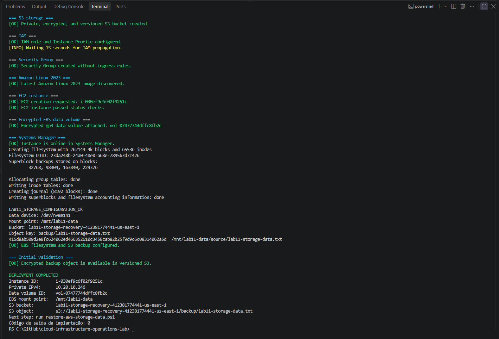
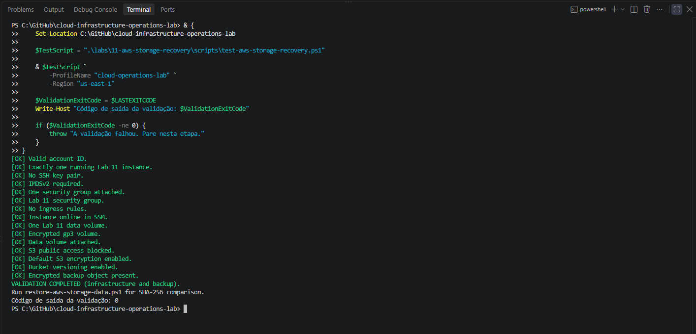
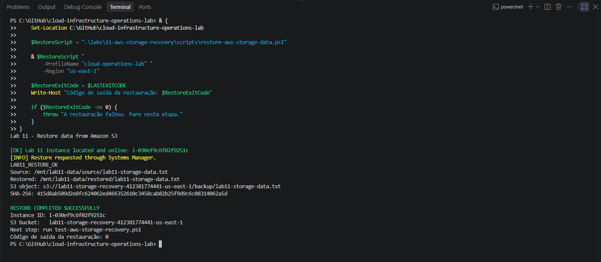
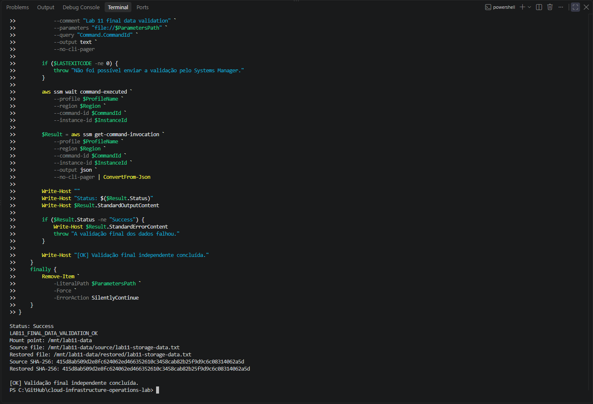
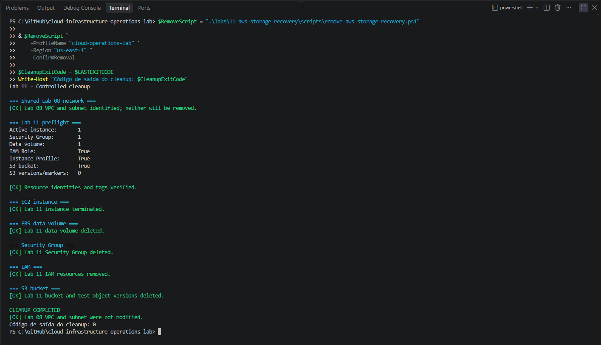
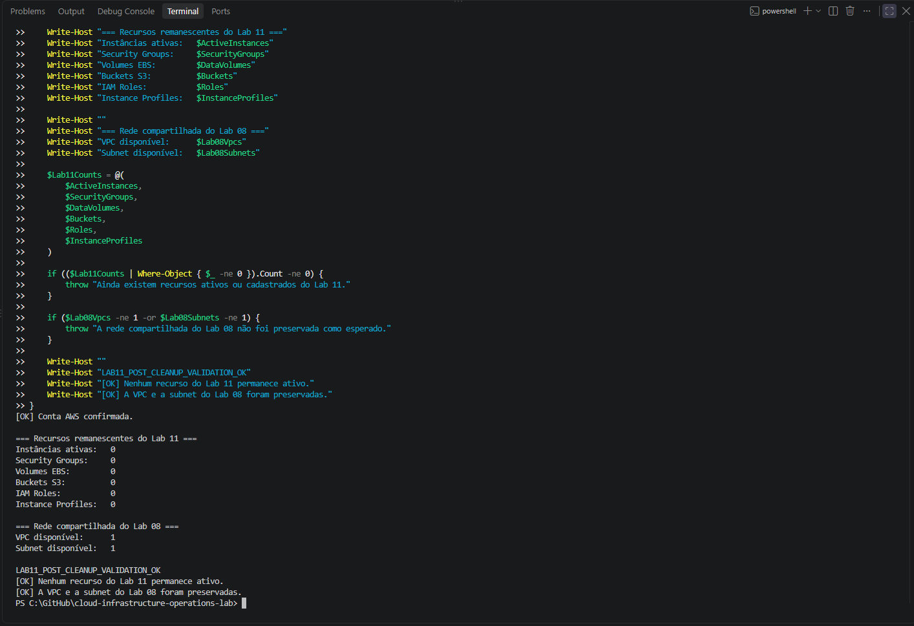
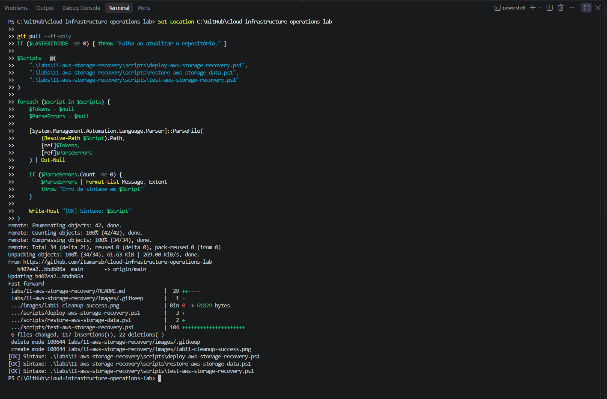
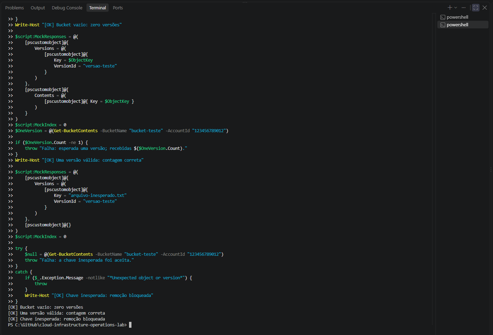

# Lab 11 — Storage and Recovery with Amazon EBS and S3

[**Português (Brasil)**](README.md) · **English**

## Overview and objective

This lab documents a completed storage-and-recovery exercise involving an **additional encrypted Amazon EBS volume**, a **private versioned Amazon S3 bucket**, and a temporary **Amazon Linux 2023 EC2 instance** managed through AWS Systems Manager.

The workflow creates a test file on the EBS volume, calculates its SHA-256 digest, uploads a backup copy to S3, restores it to a different directory, and compares the digest of the recovered file against the original.

The original execution also included independent infrastructure checks, local syntax and mocked S3 cleanup tests, controlled resource removal, and verification that the shared Lab 08 network remained available.

**Evidence boundary:** This English documentation is based on the recorded lab and static inspection of the committed scripts and policy files. It does not represent a new AWS deployment, restore, integrity test, or cleanup.

## Architecture

The exercise temporarily reused the VPC and public subnet from [Lab 08](../08-aws-application-network/).

```text
Operator authenticated through AWS IAM Identity Center
                      |
                      v
           AWS Systems Manager
                      |
                      v
        Amazon Linux 2023 EC2 instance
                      |
           +----------+-----------+
           |                      |
     Root EBS volume      Additional EBS volume
                              /mnt/lab11-data
                                   |
                          source/lab11-storage-data.txt
                                   |
                              SHA-256 digest
                                   |
                            Upload to Amazon S3
                           (private, versioned)
                                   |
                            Controlled download
                                   |
                         restored/lab11-storage-data.txt
                                   |
                         SHA-256 comparison
```

The original test compared the source file with a recovered copy on the **same attached EBS data volume**, but in a separate directory. This proves the success of that file-level recovery workflow under the recorded conditions. It is **not** a demonstration of recovery after complete EBS volume loss, instance loss, or an AWS Availability Zone failure.

## Recorded environment and components

| Component | Original configuration |
|---|---|
| Region / Availability Zone | `us-east-1` / `us-east-1a` |
| VPC | `lab08-application-vpc` |
| Public subnet | `lab08-public-subnet-a` |
| EC2 name | `lab11-storage-instance` |
| EC2 instance type | `t3.micro` |
| Operating system | Amazon Linux 2023 |
| Security Group | `lab11-storage-sg`, no ingress rules |
| IAM role | `lab11-ec2-storage-role` |
| Instance profile | `lab11-ec2-storage-instance-profile` |
| Systems Manager policy | `AmazonSSMManagedInstanceCore` |
| Additional EBS volume | Encrypted `gp3`, 1 GiB |
| Data volume name | `lab11-storage-data-volume` |
| Mount point | `/mnt/lab11-data` |
| S3 bucket | Name derived from AWS account ID and Region |
| S3 public access | Bucket-level Block Public Access controls enabled |
| S3 default encryption | SSE-S3 (`AES256`) |
| S3 versioning | Enabled |
| File integrity check | SHA-256 |
| Administration | AWS Systems Manager; no EC2 key pair or inbound SSH |

No NAT Gateway, VPC endpoint, Elastic IP, load balancer, database, DNS domain, or public S3 access configuration was intentionally provisioned by this lab.

The bucket naming convention includes the **AWS account identifier**. Avoid copying unredacted bucket names, EC2 IDs, private IP addresses, SSM command output, or credentials into public documentation.

## Repository structure

```text
labs/11-aws-storage-recovery/
├── README.md
├── README.en.md
├── images/
│   ├── lab11-local-syntax-validation.png
│   ├── lab11-local-s3-mock-tests.png
│   ├── lab11-deployment-success.png
│   ├── lab11-storage-validation.png
│   ├── lab11-restore-success.png
│   ├── lab11-final-data-validation.png
│   ├── lab11-cleanup-success.png
│   └── lab11-post-cleanup-validation.png
├── policies/
│   ├── ec2-ssm-trust-policy.json
│   └── s3-storage-policy-template.json
└── scripts/
    ├── deploy-aws-storage-recovery.ps1
    ├── restore-aws-storage-data.ps1
    ├── test-aws-storage-recovery.ps1
    └── remove-aws-storage-recovery.ps1
```

| File | Purpose |
|---|---|
| [Deployment script](scripts/deploy-aws-storage-recovery.ps1) | Provision EC2, IAM, S3, and EBS; prepare test data and upload the backup |
| [Infrastructure validation](scripts/test-aws-storage-recovery.ps1) | Inspect EC2, EBS, SSM, S3 protection, encryption, versioning, and backup object |
| [Restore script](scripts/restore-aws-storage-data.ps1) | Download the backup and verify recovered data with SHA-256 |
| [Cleanup script](scripts/remove-aws-storage-recovery.ps1) | Delete only the identified Lab 11 resources after authorization and safeguards |
| [EC2 trust policy](policies/ec2-ssm-trust-policy.json) | Permit the EC2 service principal to assume the instance role |
| [S3 access policy template](policies/s3-storage-policy-template.json) | Limit instance S3 actions to the lab bucket and deny requests without secure transport |

The S3 policy template grants selected bucket-listing operations and object read/write actions against the generated bucket. Its explicit `aws:SecureTransport=false` deny protects this role's access path from unencrypted S3 requests; it is not a substitute for independently reviewing every principal and bucket policy.

## Prerequisites and safety

The original workstation used Windows PowerShell 5.1 or PowerShell 7, AWS CLI v2, an IAM Identity Center profile named `cloud-operations-lab`, and the Session Manager Plugin. The expected Lab 08 VPC and subnet had to exist in `us-east-1`.

The AWS identity also required permissions to manage EC2 instances and EBS, IAM roles/profiles and policies, the S3 bucket, and Systems Manager command execution.

To renew the local AWS session:

```powershell
aws sso login --profile cloud-operations-lab
```

**Safety warning:** Deployment, restore, and cleanup are **not all read-only**. The scripts create cloud resources, format a new data volume, write files, upload to S3, download data, and ultimately terminate or delete resources. Use only an authorized laboratory account; verify resource ownership, target Region, cost exposure, dependencies, and retention requirements before executing destructive operations.

The deployment script does not guarantee automatic rollback if provisioning fails midway. Stop and inspect the cloud account before retrying or authorizing cleanup.

## File-level backup and restore path

The original file layout was:

| Purpose | Path or key |
|---|---|
| Source file | `/mnt/lab11-data/source/lab11-storage-data.txt` |
| Source checksum file | `/mnt/lab11-data/source/lab11-storage-data.sha256` |
| Backup object key | `backup/lab11-storage-data.txt` |
| Restored file | `/mnt/lab11-data/restored/lab11-storage-data.txt` |

The file-level integrity rule was:

```text
SHA-256(original file) == SHA-256(restored file)
```

The comparison detects differences in the bytes of the two files with very high confidence. It does **not** independently prove the authenticity of the original source, prevent a malicious actor from modifying both files and the reference digest, or establish a tested recovery-time objective (RTO) or recovery-point objective (RPO).

The original design did not use EBS snapshots as its recovery mechanism. It used an S3 object backup and an attached EBS volume.

## Security controls

### Private S3 bucket

The script enabled the following bucket-level S3 Block Public Access settings:

- `BlockPublicAcls`
- `IgnorePublicAcls`
- `BlockPublicPolicy`
- `RestrictPublicBuckets`

A correctly configured bucket-level block is an important defense, but effective access should also be considered against account-level controls, IAM identities, bucket policies, and organizational restrictions.

### Encryption and versioning

The exercise configured an encrypted EBS `gp3` data volume, S3 default server-side encryption using `AES256` (SSE-S3), versioning for the backup bucket, and secure S3 transport through AWS CLI and the instance access policy.

Encryption at rest and HTTPS in transit address different aspects of data protection. Neither replaces access authorization, backup-retention policy, or secure handling of the source file.

### Instance access

The EC2 instance used a dedicated role and instance profile, `AmazonSSMManagedInstanceCore`, required IMDSv2, and a Security Group without ingress rules. Administrative interactions used Systems Manager rather than an SSH key pair or public port 22.

Systems Manager still requires a functional agent, reachable service endpoints, and appropriately scoped operator permissions.

### Persistent mounting

The deployment automation created an `ext4` filesystem on the **additional lab EBS volume**, mounted it under `/mnt/lab11-data`, and recorded the filesystem UUID in `/etc/fstab` with `nofail`.

Formatting is destructive to any existing filesystem on the selected device. On EC2, device paths and NVMe presentation can vary, so identifying the correct attached volume is a critical precondition before running any formatting command. The `nofail` option prevents a missing data volume from automatically blocking boot but does not make its data available.

## Operational workflow

The original procedure used four PowerShell scripts, run separately from the repository root.

### 1. Deploy storage and create the backup

```powershell
$DeployScript = ".\labs\11-aws-storage-recovery\scripts\deploy-aws-storage-recovery.ps1"

& $DeployScript `
    -ProfileName "cloud-operations-lab" `
    -Region "us-east-1" `
    -AvailabilityZone "us-east-1a" `
    -InstanceType "t3.micro"
```

The script:

1. Verified the AWS session and Lab 08 network.
2. Checked for conflicting lab resources.
3. Created the S3 bucket with Block Public Access, default encryption, versioning, and tags.
4. Created the EC2 role/profile with a lab-bucket access policy and Systems Manager permissions.
5. Created a Security Group without ingress rules and launched the managed EC2 instance.
6. Created an encrypted `gp3` EBS data volume and attached it to the instance.
7. Used Systems Manager to configure the filesystem, mount point, source file, and SHA-256 checksum.
8. Uploaded the backup object to S3 and confirmed its existence and encryption settings.

The requested additional data volume in the recorded run was **1 GiB**. A parameter in the deployment script allows a volume size between 1 and 16 GiB; changing it changes the resource and cost characteristics.



The original run documented successful provisioning of the encrypted data volume and versioned S3 backup. This is not an indication that those resources still exist.

### 2. Validate infrastructure and backup configuration

```powershell
$TestScript = ".\labs\11-aws-storage-recovery\scripts\test-aws-storage-recovery.ps1"

& $TestScript `
    -ProfileName "cloud-operations-lab" `
    -Region "us-east-1"
```

The validation script uses AWS read queries to check that:

- One expected EC2 instance is running, without an EC2 SSH key pair.
- IMDSv2 tokens are required and the dedicated Security Group has no ingress.
- The managed node is online in Systems Manager.
- The additional EBS volume exists, is encrypted, uses `gp3`, and is attached to the intended EC2 instance.
- All four S3 bucket Block Public Access flags are enabled.
- S3 default encryption reports `AES256`.
- Bucket versioning is enabled.
- A nonempty encrypted backup object is reported at the expected key.

**Important scope distinction:** This script validates infrastructure and object metadata. It does not itself perform the restored-file SHA-256 comparison. That is a separate step, executed through the restore script and a later independent data check.



The infrastructure validation completed with exit code `0` in the original run.

### 3. Restore the backed-up file

```powershell
$RestoreScript = ".\labs\11-aws-storage-recovery\scripts\restore-aws-storage-data.ps1"

& $RestoreScript `
    -ProfileName "cloud-operations-lab" `
    -Region "us-east-1"
```

The restore script requires a uniquely identified running Lab 11 EC2 instance online in Systems Manager. It sends a remote command that:

1. Confirms the data volume is mounted and the expected source/checksum files exist.
2. Refuses to overwrite an existing restored destination file.
3. Checks that the current source digest matches its recorded checksum.
4. Downloads the S3 object to a temporary file in the restore directory.
5. Calculates the downloaded file's SHA-256 digest and compares it with the expected value.
6. Moves the verified file into the final restored path and checks its digest again.

The script waits for the Systems Manager command to complete and requires a recorded success marker.



The original restoration completed with exit code `0`. Because the source and reference digest remained on the same volume, the test demonstrates file-copy recovery under the documented conditions, **not recovery with only the S3 backup available after loss of the original storage device**.

### 4. Independently check the data

After restoration, a separate Systems Manager-based check documented the mount point, the original file, the recovered file, and equality of the two SHA-256 digests.



This was a recorded independent operational check. No such remote command was rerun as part of translating the README.

### 5. Remove the lab resources

The original cleanup was authorized explicitly:

```powershell
$RemoveScript = ".\labs\11-aws-storage-recovery\scripts\remove-aws-storage-recovery.ps1"

& $RemoveScript `
    -ProfileName "cloud-operations-lab" `
    -Region "us-east-1" `
    -ConfirmRemoval
```

The script checks the expected Lab 11 resource names, tags, selected IAM associations, and S3 contents before deletion. It then removes the EC2 instance, additional data volume, dedicated Security Group, lab IAM resources, and the versioned S3 bucket, preserving the Lab 08 network.

**S3 deletion requires special care:** Enabling versioning means that permanently deleting the bucket requires addressing all object versions and delete markers, not just deleting the currently visible object. The script inspects `list-object-versions` and `list-objects-v2`, rejects unexpected keys, and imposes a safety cap on the versions it will handle.

This protection is designed around a small, controlled lab bucket. It should not be generalized to a large or actively changing versioned bucket. Pagination, concurrent writers, incomplete listings, and external retention controls require separate treatment before any production-grade cleanup process.

The script's `-ConfirmRemoval` switch is an explicit authorization guard; it does not make deletion reversible. Verify current resource IDs, backups, dependencies, and the correct account before executing it.



### 6. Verify the post-cleanup state

After cleanup, the original independent checks recorded zero remaining Lab 11 resources and confirmed that the Lab 08 VPC and public subnet were still available.



These checks describe the **historical post-cleanup state**, not a new inventory of the current account.

## Local tests and troubleshooting evidence

Before the AWS run, the original exercise included two local checks.

### PowerShell syntax validation

The PowerShell parser accepted the deployment, restore, and validation scripts after the repository updates.



A successful parser check verifies syntax, not runtime integration with AWS. The README does not represent this screenshot as a new validation.

### Mocked S3 cleanup tests

Local mock responses were used to exercise S3 bucket-inspection logic, including an empty response, a recognized object version, and rejection of an unexpected key. **No real S3 calls occurred during these local mock tests.**



These tests provide evidence of selected branches in the cleanup logic, but they are not equivalent to a full integration test against a live, versioned S3 bucket with pagination and concurrent writes.

## Recorded success criteria

The original documentation identified these 22 conditions:

1. Exactly one expected running EC2 instance.
2. Amazon Linux 2023 as the operating system.
3. No attached EC2 key pair.
4. IMDSv2 required.
5. No Security Group ingress.
6. The instance online in Systems Manager.
7. One dedicated additional EBS volume.
8. The EBS volume encrypted.
9. The volume using `gp3`.
10. The volume attached to the instance.
11. The filesystem mounted at `/mnt/lab11-data`.
12. The original test file present.
13. Exactly one dedicated S3 bucket.
14. Public access blocked.
15. Default bucket encryption enabled.
16. Bucket versioning enabled.
17. The backup object present.
18. The restored file present.
19. Recovered and original SHA-256 digests equal.
20. Independent infrastructure validation exited with code `0`.
21. Lab 11-specific resources removed.
22. Lab 08 VPC and subnet preserved.

These are the historical completion criteria and recorded results, **not a checklist already completed on another user's account**.

## Cost and lifecycle considerations

EC2 compute, a public IPv4 address, EBS storage, S3 storage, object versions, requests, and applicable data transfers may be billable. The lab used a `t3.micro` instance, one additional 1 GiB EBS volume, a small S3 test object, and no NAT Gateway.

A small test file and short-lived resources reduce exposure but do not guarantee zero charges. In particular, old versions in a versioned S3 bucket can continue to consume storage if they are not permanently removed.

The original completion record states that the Lab 11 resources were cleaned up. Do not treat that historical record as a current billing or resource inventory.

## Technical limitations and recommended follow-up

**Data integrity:** SHA-256 equality validates the bytes of the recovered file against the stored reference; it is not proof of backup authenticity or defense against correlated compromise of source and checksum.

**Recovery scope:** Recovery from an S3 object to another directory on the same EBS volume is a useful functional test. A fuller disaster-recovery exercise would restore to a fresh host or volume after deliberately making the source unavailable.

**S3 protections:** Block Public Access, SSE-S3, versioning, and bucket-scoped IAM policies address different risks. Versioning alone is not an immutable backup-retention mechanism; additional retention controls would be required for that objective.

**Destructive operations:** Creating a filesystem can destroy prior data. Cleanup permanently deletes versioned objects and AWS resources. The target device and all resource dependencies must be verified.

**Evidence and privacy:** The deployment scripts can output instance IDs, private IP addresses, volume IDs, and the S3 bucket name derived from the account ID. Screenshots should undergo visual inspection before being considered fully anonymized.

**Execution limits:** The scripts were reviewed as source code, not run against the user's AWS account during this documentation update.

## Conclusion

Lab 11 recorded a completed lifecycle of EBS preparation, a protected S3 backup, file-level restoration, SHA-256 verification, independent infrastructure inspection, local mock tests, and controlled cleanup while preserving the shared Lab 08 network.

The English edition clarifies the difference between **storage configuration**, **backup-object availability**, **data-integrity verification**, and **full disaster recovery**, without changing the original evidence or reporting a new execution.

## Next lab

[Lab 12 — AWS Application Availability](../12-aws-application-availability/)

---

[English repository overview](../../README.en.md) · [Portuguese repository overview](../../README.md)
