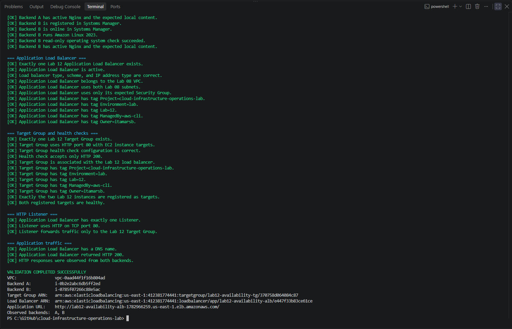
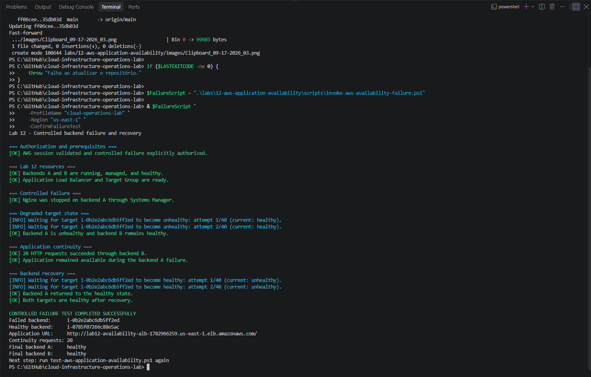
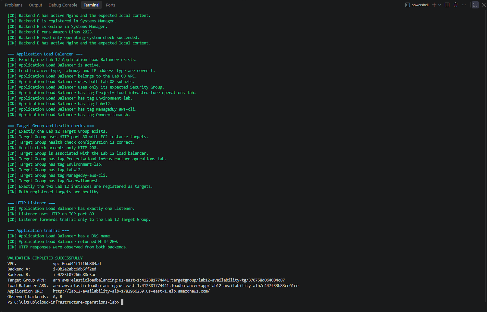
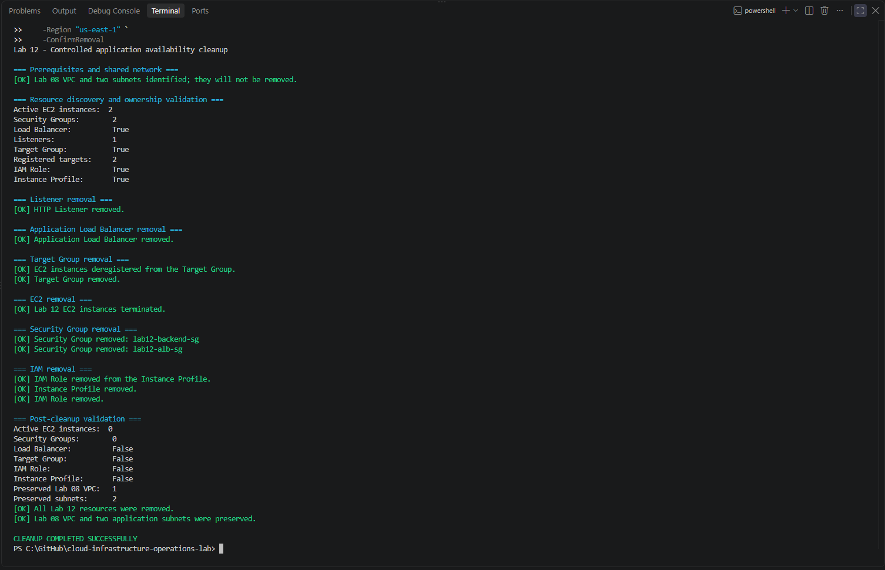
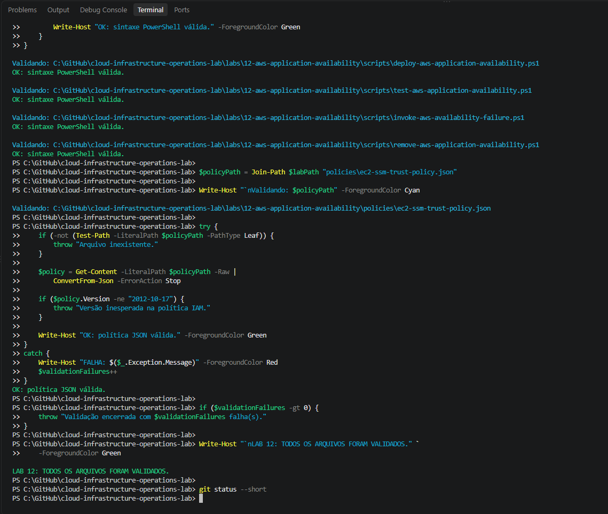

# Lab 12 — Application Availability with an AWS Application Load Balancer

[**Português (Brasil)**](README.md) · **English**

## Objective

Deploy and validate a web application distributed across **two AWS Availability Zones**, with Nginx running on two Amazon EC2 instances behind an **Application Load Balancer (ALB)**.

The original lab exercised target health checks, independent validation, a controlled backend service failure, continuity through the remaining healthy backend, recovery, and cleanup. Both EC2 instances were administered through AWS Systems Manager rather than SSH.

**Evidence scope:** All operational results in this document are from the recorded exercise. The repository scripts were reviewed statically for this English edition; no AWS resources, services, or workloads were started, stopped, queried, or deleted during the translation.

## Recorded outcome

The original execution documented that:

- Two Nginx backends were deployed in `us-east-1a` and `us-east-1b`.
- Requests through the ALB returned HTTP `200` and responses identifying both backend A and backend B were observed.
- Both registered targets initially reached `healthy`.
- Nginx was intentionally stopped on backend A through Systems Manager.
- The target group then reported backend A as `unhealthy`, while backend B stayed `healthy`.
- **Twenty consecutive HTTP requests** were served successfully by backend B during the measured failure window.
- Nginx on backend A was restarted and both targets returned to `healthy`.
- An independent validation was run again after recovery.
- Lab 12 resources were removed while the Lab 08 VPC and its two public subnets were preserved.

This is evidence of **application continuity during the observed controlled-failure test**, not proof of a specific uptime percentage, a measured recovery-time objective, zero request failures throughout the entire transition, or resilience against complete Availability Zone loss.

## Architecture

The lab reused the dedicated VPC and two public subnets created in [Lab 08](../08-aws-application-network/).

```text
Internet
   |
   v
Public Application Load Balancer
   |
   v
HTTP listener :80
   |
   v
Target group — HTTP GET /health
   |
   +--- EC2 + Nginx — backend A — us-east-1a
   |
   +--- EC2 + Nginx — backend B — us-east-1b

Separate administrative path:
AWS IAM Identity Center → AWS Systems Manager → EC2 backends
```

The ALB is internet-facing. The backend Security Group allows inbound TCP port `80` **only from the ALB Security Group**. This separates the public application entry point from direct HTTP ingress to the EC2 backends.

The backends are nevertheless located in the Lab 08 public subnets and have outbound networking for their operational dependencies. Restricting inbound Security Group rules does not mean the instances are hosted in private subnets.

### Recorded components

| Component | Configuration |
|---|---|
| Region | `us-east-1` |
| VPC | `lab08-application-vpc` |
| Public subnet A | `lab08-public-subnet-a` |
| Public subnet B | `lab08-public-subnet-b` |
| Availability Zones | `us-east-1a` and `us-east-1b` |
| EC2 backend A | `lab12-availability-instance-a` |
| EC2 backend B | `lab12-availability-instance-b` |
| Instance types | Two `t3.micro` instances |
| Operating system | Amazon Linux 2023 |
| Web server | Nginx |
| ALB Security Group | `lab12-alb-sg` |
| Backend Security Group | `lab12-backend-sg` |
| IAM role | `lab12-ec2-availability-role` |
| Instance profile | `lab12-ec2-availability-instance-profile` |
| Instance IAM policy | `AmazonSSMManagedInstanceCore` |
| Load balancer | `lab12-availability-alb` |
| Target group | `lab12-availability-tg` |
| Listener | HTTP, TCP port `80` |
| Health-check endpoint | `GET /health` |
| Administrative access | AWS Systems Manager |
| SSH key pairs | Not used |
| IMDS | IMDSv2 required |
| Root EBS storage | Encrypted `gp3` |

### HTTP and security boundaries

The ALB Security Group permits HTTP on TCP `80` from the public IPv4 Internet in the recorded configuration. The backends accept HTTP on TCP `80` only when sourced from the ALB Security Group. No inbound SSH rule or EC2 key pair was added.

These controls restrict access paths, but **HTTP is not encrypted**. The lab did not deploy an HTTPS listener, TLS certificate, or production-grade identity controls for its public web endpoint. Do not send sensitive information through this test service.

The `AmazonSSMManagedInstanceCore` policy supports managed-node operations; human access permissions to Systems Manager are separately governed by IAM.

### Operational tags

The original scripts applied these values where supported:

| Tag | Value |
|---|---|
| `Project` | `cloud-infrastructure-operations-lab` |
| `Environment` | `lab` |
| `Lab` | `12` |
| `ManagedBy` | `aws-cli` |
| `Owner` | `itamarsb` |
| `Name` | Resource-specific name |

Tags assist with identifying lab resources and checking cleanup targets; they are **not sufficient proof of exclusive ownership or lack of dependencies**.

## Files in this lab

```text
labs/12-aws-application-availability/
├── README.md
├── README.en.md
├── images/
│   ├── Clipboard_09-17-2026_01.png
│   ├── Clipboard_09-17-2026_03.png
│   ├── Clipboard_09-17-2026_04.png
│   ├── Clipboard_09-17-2026_05.png
│   └── Clipboard_09-17-2026_06.png
├── policies/
│   └── ec2-ssm-trust-policy.json
└── scripts/
    ├── deploy-aws-application-availability.ps1
    ├── test-aws-application-availability.ps1
    ├── invoke-aws-availability-failure.ps1
    └── remove-aws-application-availability.ps1
```

| File | Purpose |
|---|---|
| [Deployment script](scripts/deploy-aws-application-availability.ps1) | Create the EC2/IAM/security resources, target group, ALB, and HTTP listener |
| [Validation script](scripts/test-aws-application-availability.ps1) | Inspect networking, security, EC2, managed nodes, service health, targets, listener, and HTTP traffic |
| [Failure and recovery script](scripts/invoke-aws-availability-failure.ps1) | Stop Nginx on backend A, observe failover, then recover and validate |
| [Cleanup script](scripts/remove-aws-application-availability.ps1) | Remove Lab 12 infrastructure and verify the Lab 08 network is preserved |
| [IAM trust policy](policies/ec2-ssm-trust-policy.json) | Allow EC2 to assume the instance role |

## Prerequisites and operating precautions

The recorded environment used Windows PowerShell 5.1 or PowerShell 7, AWS CLI v2, the Session Manager Plugin, and an IAM Identity Center profile named `cloud-operations-lab`.

The Lab 08 VPC and **both** public subnets had to exist in `us-east-1`, with sufficient AWS permissions for EC2, Elastic Load Balancing, IAM, and Systems Manager operations.

Authenticate when necessary:

```powershell
aws sso login --profile cloud-operations-lab
```

**Warning:** Deployment and cleanup change real AWS infrastructure and may incur charges. The failure script intentionally interrupts one of the two web services. Run only in an authorized test environment, inspect scripts and current resource IDs, and avoid sharing the ALB endpoint with production traffic.

A failed deployment does not guarantee automatic rollback. Verify partial resources and dependencies before any rerun or cleanup.

## Execution workflow

### 1. Deploy the application infrastructure

From the repository root:

```powershell
$DeployScript = ".\labs\12-aws-application-availability\scripts\deploy-aws-application-availability.ps1"

& $DeployScript `
    -ProfileName "cloud-operations-lab" `
    -Region "us-east-1" `
    -AvailabilityZoneA "us-east-1a" `
    -AvailabilityZoneB "us-east-1b" `
    -InstanceType "t3.micro"
```

The deployment script discovers the Lab 08 network, verifies selected conflicts, creates the IAM and Security Group resources, launches two Amazon Linux 2023 backends, and configures Nginx and the `/health` endpoint.

It then creates the target group, registers both instances, creates the internet-facing ALB and HTTP listener, waits for targets to reach `healthy`, and checks an application response through the load balancer.

The Nginx health endpoint returns the expected `healthy` text, and the target group uses an HTTP health check with a successful status-code matcher. A target health check establishes that the configured endpoint responded correctly at check time; it does not test all user journeys or downstream dependencies.

The deployment resolves the Amazon Linux 2023 AMI through an AWS-managed Systems Manager parameter. A later run may select a newer image, so capturing the resolved AMI ID is important for exact reproducibility.

### 2. Run independent application validation

```powershell
$TestScript = ".\labs\12-aws-application-availability\scripts\test-aws-application-availability.ps1"

& $TestScript `
    -ProfileName "cloud-operations-lab" `
    -Region "us-east-1"
```

The original validation checked:

- The expected VPC and two public subnets.
- ALB and backend Security Groups, including ingress rules and absence of SSH.
- Two EC2 backends, IMDSv2 settings, encrypted `gp3` root volumes, IAM role/profile, and Systems Manager connectivity.
- Nginx and local `/health` behavior through Systems Manager commands.
- ALB, listener, target group, registered target health, and HTTP responses.
- Evidence that successful application responses came from **both backend A and backend B**.

**Read-only terminology:** This validator is designed to avoid deliberately changing deployed infrastructure, but it uses **Systems Manager Run Command** to execute local inspection commands on instances. It is therefore not a strictly AWS `Describe`/`Get`-only workflow. Its local commands check state; the `ssm:SendCommand` API itself initiates remote execution and creates command records.



The original validation found both targets healthy and observed HTTP `200` responses from A and B.

### 3. Perform a controlled backend failure

```powershell
$FailureScript = ".\labs\12-aws-application-availability\scripts\invoke-aws-availability-failure.ps1"

& $FailureScript `
    -ProfileName "cloud-operations-lab" `
    -Region "us-east-1" `
    -ConfirmFailureTest
```

The `-ConfirmFailureTest` switch explicitly authorizes an intentional service interruption. The script requires the expected backend instances and two healthy targets before proceeding.

Its failure sequence is:

1. Use Systems Manager to run `systemctl stop nginx` on backend A.
2. Confirm that Nginx has stopped.
3. Wait for the target group's health assessment to change backend A to `unhealthy`.
4. Check that backend B remains `healthy`.
5. Send **20 consecutive HTTP requests** through the ALB.
6. Require successful HTTP results identifying backend B for those requests.
7. Restart Nginx on backend A.
8. Wait for A to return to `healthy` and verify B remains `healthy`.

The script uses `-DisableKeepAlive` for the HTTP requests, a compatibility adjustment made during the original PowerShell troubleshooting.



#### What the 20 successful requests establish

All 20 requests in the recorded test succeeded through backend B **after backend A was marked unhealthy**. This demonstrates that the ALB could continue routing traffic to the remaining healthy target in that test window.

It does **not** measure a full availability percentage, prove there were no transient errors between stopping Nginx and the target being marked unhealthy, or confirm continuity through simultaneous backend or Availability Zone failures.

The exercise tests **service failure on one EC2 instance**, not loss of an entire AWS Availability Zone.

#### Failure recovery safeguard

The script attempts to restart Nginx on backend A and restore its healthy status. If an error occurs after the failure has been introduced, a `finally` block makes an additional **mandatory recovery attempt**.

That attempt is a safety measure, **not a guarantee of recovery**: if Systems Manager connectivity, the instance, or the service cannot be reached, the original script instructs the operator to restore Nginx manually before continuing.

### 4. Validate again after recovery

```powershell
& $TestScript `
    -ProfileName "cloud-operations-lab" `
    -Region "us-east-1"
```

The original second execution verified that the application infrastructure, both Nginx backends, and the target group had returned to the expected healthy state.



### 5. Clean up Lab 12

```powershell
$RemoveScript = ".\labs\12-aws-application-availability\scripts\remove-aws-application-availability.ps1"

& $RemoveScript `
    -ProfileName "cloud-operations-lab" `
    -Region "us-east-1" `
    -ConfirmRemoval
```

Cleanup requires explicit authorization and checks the intended Lab 12 resources before removing them. The script removes the HTTP listener, ALB, target registrations and target group, EC2 instances, dedicated Security Groups, instance profile, and IAM role, with dependency ordering and selected retry logic.

The VPC and **both** public subnets from Lab 08 are excluded from deletion. The original final checks reported the absence of Lab 12-specific resources and the continued presence of the shared network.

**Destructive operation:** Names, tags, expected settings, and `-ConfirmRemoval` provide safeguards but are not substitutes for checking actual ownership, service dependencies, retained data, and target identifiers. Terminating EC2 instances and deleting associated resources cannot be treated as reversible cleanup.



## Local checks and troubleshooting

### PowerShell syntax and IAM trust-policy validation

Before cloud operations, the original documentation reports that the four PowerShell scripts passed local syntax checks and the IAM trust policy was parsed as valid JSON.



A syntax check demonstrates that a file can be parsed; it does not prove that API calls, permissions, timing, resource discovery, or cleanup will succeed.

### HTTP connection-header behavior in PowerShell 5.1

During HTTP verification, PowerShell 5.1 rejected a combination of `Keep-Alive` and `Close` connection handling. The scripts were adjusted to use the native `-DisableKeepAlive` parameter.

Remote response processing was also adjusted to normalize carriage-return characters before checking backend identity. The historical validation then observed HTTP `200` and responses from both backends.

These changes are recorded as already incorporated in the original scripts; they were not reimplemented during this documentation review.

## Recorded success criteria

The original lab reported completion of all of the following:

- [x] Two EC2 instances deployed in different Availability Zones.
- [x] Amazon Linux 2023 and Nginx operational on both backends.
- [x] No EC2 key pairs; IMDSv2 required.
- [x] Encrypted `gp3` root EBS volumes.
- [x] Systems Manager administration available.
- [x] ALB and backend Security Groups separated.
- [x] No inbound SSH rules.
- [x] ALB associated with both public subnets.
- [x] Both targets reported healthy before fault injection.
- [x] HTTP listener forwarded to the expected target group.
- [x] HTTP `200` response through the ALB.
- [x] Successful responses observed from backend A and backend B.
- [x] Health checks detected the controlled failure.
- [x] Application continuity observed during the failed-backend test window.
- [x] Backend recovered and both targets returned to healthy.
- [x] Independent validation passed again after recovery.
- [x] Lab 12-specific resources removed.
- [x] Lab 08 VPC and two public subnets preserved.

These are **historical completion marks**, not tasks already completed for a new reader.

## Cost, security, and availability limits

**Costs:** The test temporarily used two `t3.micro` instances, encrypted EBS storage, public IPv4 addressing, and an ALB. These components and applicable data transfer can incur AWS charges. No NAT Gateway or Elastic IP was created. The original cleanup reduced ongoing exposure, but does not prove zero accumulated cost.

**Availability:** Two healthy targets in separate Availability Zones are useful building blocks for resilience. This exercise tested stopping Nginx on **one** backend. It did not simulate a complete zone outage, perform sustained load testing, report response-time distributions, or quantify RTO/RPO and availability objectives.

**Exposure:** Public HTTP on port 80 was allowed to the ALB. Restricting backend ingress to the ALB Security Group reduces direct reachability, but does not provide application-layer authentication, TLS, or comprehensive hardening.

**SSM and IAM:** Managed administrative access avoids SSH but still requires careful operator permissions, agent connectivity, and logging choices.

**Evidence privacy:** Deployment scripts can print resource identifiers, ARNs, and the ALB URL. Review screenshots at full resolution for sensitive information before external redistribution.

**Audit boundary:** The source code was read; no AWS operations were rerun to check the current state of the account.

## Conclusion

Lab 12 documented the deployment of two Nginx backends behind an AWS Application Load Balancer, independent configuration and traffic validation, a controlled service failure with 20 successful requests served by the remaining backend, restoration of the failed service, and cleanup that preserved Lab 08 networking.

The results demonstrate a concrete operational availability pattern under the **observed test conditions**, without implying a production service-level guarantee.

## Next lab

[Lab 13 — AWS Application Troubleshooting](../13-aws-application-troubleshooting/)

---

[English repository overview](../../README.en.md) · [Portuguese repository overview](../../README.md)
