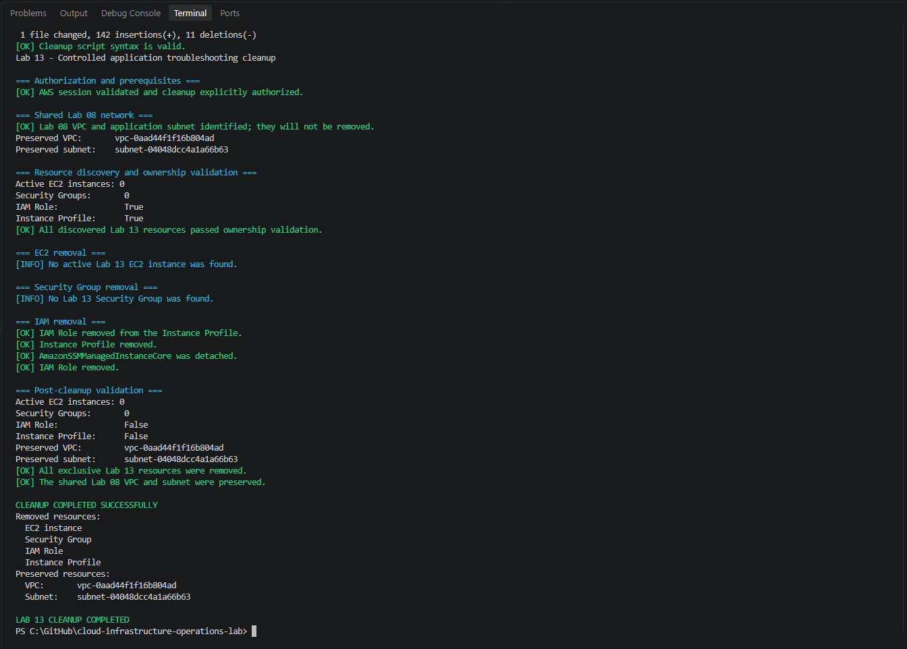

# Lab 13 — Troubleshooting an Unavailable Nginx Application

[**Português (Brasil)**](README.md) · **English**

## Objective

Investigate and recover an intentionally unavailable Nginx web application on Amazon Linux 2023 running in Amazon EC2.

The exercise starts with a healthy service, injects an invalid Nginx configuration, confirms the resulting outage, collects diagnostic evidence from five operational layers, restores the working configuration, verifies recovery, and removes its temporary AWS infrastructure.

The investigation is deliberately separated from the recovery operation. **A successful diagnosis does not mean the application is healthy**: it means the expected cause of the controlled incident was identified.

This guide preserves the recorded historical results. No AWS infrastructure, Nginx configuration, or Systems Manager session was accessed or changed during this documentation review.

## Scenario and investigation model

The expected sequence is:

```text
Healthy Nginx application
          |
          v
Working configuration backed up
          |
          v
Invalid directive introduced
          |
          v
nginx -t fails; service restart fails
          |
          v
Web application unavailable
          |
          v
Structured diagnosis (no corrective changes)
          |
          v
Configuration error identified
          |
          v
Known-good configuration restored
          |
          v
Nginx starts; local and public endpoints recover
          |
          v
Independent validation and controlled cleanup
```

The investigation examines five layers:

| Layer | Diagnostic question | Representative commands |
|---|---|---|
| Service | Is Nginx active or failed? | `systemctl is-active nginx`, `systemctl status nginx --no-pager` |
| Process | Does an Nginx process exist? | `pgrep -a nginx` |
| Port | Is anything listening on TCP 80? | `ss -lntp` |
| Configuration | Is the Nginx configuration valid? | `nginx -t` |
| Logs | What error explains the failure? | `journalctl -u nginx --no-pager` |

Local HTTP checks of `/` and `/health` provide additional confirmation of application state.

## Architecture and recorded components

The lab temporarily reused the VPC and one public subnet from [Lab 08](../08-aws-application-network/).

```text
HTTP client
     |
     v
Lab 13 Security Group — inbound TCP 80 restricted to operator IPv4
     |
     v
EC2 — Amazon Linux 2023 — Nginx
     |
     +-- /        Application landing page
     +-- /health  Health endpoint

Separate administration:
IAM Identity Center operator → AWS Systems Manager → EC2
```

| Component | Original configuration |
|---|---|
| AWS Region | `us-east-1` |
| Availability Zone | `us-east-1a` |
| Shared VPC | `lab08-application-vpc` |
| Shared subnet | `lab08-public-subnet-a` |
| EC2 name | `lab13-troubleshooting-instance` |
| Instance type | `t3.micro` |
| Operating system | Amazon Linux 2023 |
| Web server | Nginx |
| Security Group | `lab13-troubleshooting-sg` |
| IAM role | `lab13-ec2-troubleshooting-role` |
| Instance profile | `lab13-ec2-troubleshooting-instance-profile` |
| Managed IAM policy | `AmazonSSMManagedInstanceCore` |
| Web traffic | TCP `80`, HTTP |
| Health endpoint | `/health` |
| Administrative access | AWS Systems Manager |
| EC2 key pair | None |
| Instance metadata | IMDSv2 required |
| Root EBS volume | Encrypted `gp3` |

The lab did not create an Application Load Balancer, Target Group, Auto Scaling Group, NAT Gateway, VPC endpoint, Elastic IP, database, DNS domain, or TLS certificate.

**Security boundary:** The absence of SSH does not make an HTTP endpoint private or encrypted. The deployment script uses a specified HTTP source CIDR or discovers the operator's public IPv4 address and appends `/32`. Review the actual Security Group rule and source IP before running it. This is a short-lived, non-production HTTP test.

## Repository files

```text
labs/13-aws-application-troubleshooting/
├── README.md
├── README.en.md
├── images/
│   ├── Clipboard_09-18-2026_07.png
│   ├── Clipboard_09-18-2026_08.png
│   └── lab13-cleanup-success.png
├── policies/
│   └── ec2-ssm-trust-policy.json
└── scripts/
    ├── deploy-aws-application-troubleshooting.ps1
    ├── invoke-aws-application-failure.ps1
    ├── diagnose-aws-application-failure.ps1
    ├── recover-aws-application-service.ps1
    ├── test-aws-application-troubleshooting.ps1
    └── remove-aws-application-troubleshooting.ps1
```

| Script | Operational responsibility |
|---|---|
| [Deployment](scripts/deploy-aws-application-troubleshooting.ps1) | Create the temporary instance, IAM role/profile and Security Group; install Nginx in a healthy state |
| [Healthy-state validation](scripts/test-aws-application-troubleshooting.ps1) | Check infrastructure, host/service condition and HTTP response |
| [Controlled failure injection](scripts/invoke-aws-application-failure.ps1) | Back up the configuration, insert an invalid directive and make Nginx unavailable |
| [Diagnosis](scripts/diagnose-aws-application-failure.ps1) | Gather evidence of the expected failure without fixing the service |
| [Service recovery](scripts/recover-aws-application-service.ps1) | Restore the backed-up configuration and verify Nginx recovery |
| [Cleanup](scripts/remove-aws-application-troubleshooting.ps1) | Delete Lab 13 resources and verify that Lab 08 networking remains |
| [IAM trust policy](policies/ec2-ssm-trust-policy.json) | Allow EC2 to assume the instance IAM role |

The three image files are the actual evidence inventory. There is no basis for inventing additional per-step screenshot paths where the README does not reference them.

## Prerequisites

- Windows PowerShell 5.1 or PowerShell 7.
- AWS CLI v2.
- Configured IAM Identity Center profile `cloud-operations-lab`.
- Session Manager Plugin for local interactive access where needed.
- Lab 08 VPC and `lab08-public-subnet-a` available in `us-east-1`.
- Permissions to manage EC2, IAM and Systems Manager.
- Authorization to temporarily interrupt this specific test application.

Renew the session if necessary:

```powershell
aws sso login --profile cloud-operations-lab
```

**Important:** Deployment, failure injection, recovery and cleanup change real resources or service state and can incur AWS charges. Do not run the failure script against a production or shared application. Verify account, Region, exact instance identity, resource ownership and data retention before any action.

## 1. Deploy the healthy application

From the repository root:

```powershell
$DeployScript = ".\labs\13-aws-application-troubleshooting\scripts\deploy-aws-application-troubleshooting.ps1"

& $DeployScript `
    -ProfileName "cloud-operations-lab" `
    -Region "us-east-1" `
    -AvailabilityZone "us-east-1a" `
    -InstanceType "t3.micro"
```

The deployment locates the Lab 08 network, checks selected resource conflicts, creates the instance role and profile, creates a dedicated HTTP Security Group, resolves an Amazon Linux 2023 AMI, launches the EC2 instance and configures Nginx with the application page and `/health` endpoint.

The script can also accept an `-AllowedHttpCidr` value. When omitted, it attempts to discover the workstation's public IPv4 address using `https://checkip.amazonaws.com` and authorize the corresponding source. IP discovery does not guarantee that a browser or later request will use the same public source address, especially through VPNs, proxies or changing networks.

The deployment checks instance registration in Systems Manager and the expected HTTP content. The original lab reported a healthy initial state.

**Repeatability note:** The Amazon Linux 2023 AMI is selected via an AWS-managed SSM public parameter; subsequent executions can resolve a newer image. A provisioning failure may leave partial AWS resources because the deployment is not transactional.

## 2. Validate the healthy state

```powershell
$TestScript = ".\labs\13-aws-application-troubleshooting\scripts\test-aws-application-troubleshooting.ps1"

& $TestScript `
    -ProfileName "cloud-operations-lab" `
    -Region "us-east-1"
```

The validator examines the expected VPC, subnet, Security Group, EC2 instance, IAM settings, encrypted root volume, Systems Manager registration and service/HTTP behavior. The initial execution established that Nginx and both HTTP endpoints worked before fault injection.

The script includes an SSM remote-command mechanism to check the host, so **“independent validation” does not mean it uses only passive AWS Describe/Get APIs**. It is intended to inspect the service, not to deploy or repair it.

A successful test here establishes a point-in-time healthy state, not an ongoing availability guarantee.

## 3. Introduce the controlled configuration failure

```powershell
$FailureScript = ".\labs\13-aws-application-troubleshooting\scripts\invoke-aws-application-failure.ps1"

& $FailureScript `
    -ProfileName "cloud-operations-lab" `
    -Region "us-east-1" `
    -ConfirmFailureInjection
```

This script requires explicit `-ConfirmFailureInjection` authorization. Before changing anything, it verifies the intended running instance and SSM status, checks the initial Nginx health, and ensures that pre-existing failure artifacts do not indicate another unresolved test.

The fault is injected by:

1. Backing up the existing Nginx lab configuration.
2. Appending an intentionally invalid directive to the test configuration.
3. Checking that `nginx -t` fails as expected.
4. Attempting the controlled service restart and observing the failure.
5. Confirming that the Nginx process and TCP port 80 listener are unavailable.
6. Repeating external HTTP checks until the expected unavailability is observed.

The invalid configuration is the **injected cause**. The resulting failed restart, missing Nginx process and missing listener are consequences of that controlled change.

The injection script **does not automatically restore Nginx** after a successful injection. The service remains intentionally unavailable until the separately authorized recovery procedure is run.

If the injection fails partway through, inspect the host before attempting recovery; do not assume the application is still healthy.

## 4. Diagnose the failure without repairing it

```powershell
$DiagnosisScript = ".\labs\13-aws-application-troubleshooting\scripts\diagnose-aws-application-failure.ps1"

& $DiagnosisScript `
    -ProfileName "cloud-operations-lab" `
    -Region "us-east-1"
```

This step is designed to **collect and interpret evidence rather than apply a fix**. It inspects service state, running processes, TCP listening sockets, Nginx configuration, journal entries, local HTTP responses and the existence of the backup and failure marker.

Representative diagnostics are:

```bash
systemctl is-active nginx
systemctl is-failed nginx
systemctl status nginx --no-pager
pgrep -a nginx
ss -lntp
nginx -t
journalctl -u nginx --no-pager
curl --fail --silent --show-error http://127.0.0.1/
curl --fail --silent --show-error http://127.0.0.1/health
```

During the injected outage, several of these commands are **expected to return failures**. The diagnosis preserves and interprets those failures as evidence, rather than treating every nonzero command exit as an unexpected crash of the investigative workflow.

In this scenario, the expected signature includes a failed Nginx configuration test, a failed/inactive service, no relevant process, no TCP 80 listener and log evidence connecting the failed restart to the invalid directive.

**Interpret the result carefully:** The diagnostic script may report `DIAGNOSIS COMPLETED SUCCESSFULLY` while the web application remains **down**. Its successful result means the expected failure was identified. Recovery must still happen in the next step.

The diagnostic commands inspect host state through SSM Run Command, which creates a remote command invocation. They are non-remediating by intent, but not exclusively passive AWS API calls.

## 5. Restore the Nginx service

```powershell
$RecoveryScript = ".\labs\13-aws-application-troubleshooting\scripts\recover-aws-application-service.ps1"

& $RecoveryScript `
    -ProfileName "cloud-operations-lab" `
    -Region "us-east-1" `
    -ConfirmRecovery
```

The `-ConfirmRecovery` switch expressly authorizes the corrective change.

The script identifies the expected instance, requires a backup and failure marker, and checks the failing pre-recovery state. It then restores the saved configuration, verifies it with `nginx -t`, restarts Nginx, checks its process and listener, and validates local `/` and `/health` responses.

After recovery checks succeed, it removes the temporary configuration artifacts used for the controlled incident and checks the public HTTP endpoint.

**Safety:** The script validates the restored configuration before restarting. If recovery fails partway through, inspect the backup and service state before repeating it. Do not delete troubleshooting evidence prematurely.

## 6. Validate the recovered application

```powershell
& $TestScript `
    -ProfileName "cloud-operations-lab" `
    -Region "us-east-1"
```

The recorded post-recovery execution returned to a healthy application state, including the Nginx service and the expected HTTP endpoints.

This independent check helps compare **before**, **during**, and **after** the controlled incident. It is not a sustained load or availability test and does not establish an SLA, SLI or SLO.

## 7. Clean up the temporary infrastructure

```powershell
$RemoveScript = ".\labs\13-aws-application-troubleshooting\scripts\remove-aws-application-troubleshooting.ps1"

& $RemoveScript `
    -ProfileName "cloud-operations-lab" `
    -Region "us-east-1" `
    -ConfirmRemoval
```

The cleanup script verifies selected identity, tag, ownership and dependency information before termination and deletion. It removes Lab 13's EC2 instance, Security Group, IAM role and instance profile while preserving the shared Lab 08 VPC and subnet.

**Destructive operation:** Terminating EC2 and deleting associated resources is not a reversible recovery step. Matching names, tags and an explicit switch help guard the workflow but cannot replace independent confirmation of current AWS resources and dependencies.

The original post-cleanup record reported:

| Resource | Recorded final state |
|---|---|
| Active Lab 13 EC2 instances | `0` |
| Lab 13 Security Groups | `0` |
| Lab 13 IAM role | Absent |
| Lab 13 instance profile | Absent |
| Shared Lab 08 VPC | Preserved |
| Shared Lab 08 subnet | Preserved |



The underlying Portuguese README publishes specific VPC and subnet identifiers in its historical result section. This English edition deliberately does **not** repeat those identifiers, and their presence in the original document has been registered for separate privacy review. The cleanup evidence also requires a full-resolution inspection before its anonymization can be confirmed.

## Historical evidence inventory

The repository contains three image files:

| Evidence | File |
|---|---|
| Original execution screenshot | [`Clipboard_09-18-2026_07.png`](images/Clipboard_09-18-2026_07.png) |
| Original execution screenshot | [`Clipboard_09-18-2026_08.png`](images/Clipboard_09-18-2026_08.png) |
| Recorded cleanup | [`lab13-cleanup-success.png`](images/lab13-cleanup-success.png) |

The two clipboard images are linked without assigning undocumented step-by-step contents to either one. Their presence was verified in the repository, but detailed visual interpretation remains pending.

## Success criteria

The original project defined 29 success conditions covering the complete workflow:

- Correct Lab 08 network discovery and a unique Lab 13 instance.
- Amazon Linux 2023, no key pair, required IMDSv2, encrypted `gp3` root EBS and SSM Online state.
- Initially active Nginx, TCP 80 listener, and working application and health endpoints.
- Controlled creation of a configuration backup and insertion of invalid syntax.
- An expected `nginx -t` failure, failed restart, lost process/listener and unavailable HTTP endpoint.
- A diagnostic report that identifies service, process, port, configuration and journal evidence **without remediation**.
- A separately authorized configuration restoration and successful `nginx -t`, service restart and HTTP validation.
- Independent post-recovery validation.
- Removal of Lab 13 resources and retention of the Lab 08 VPC and subnet.

The Portuguese README records these tasks as completed in the original execution. The list here does not imply that a new execution or account validation has occurred.

## Operational lessons and limitations

**Diagnosis before action.** Service state, process inventory, listening sockets, configuration validation and logs together provide stronger incident evidence than restarting Nginx blindly.

**Causality.** The failure was deliberately introduced by invalid Nginx syntax. Reproducing this known scenario does not prove the same troubleshooting logic will identify every real-world incident.

**No auto-recovery guarantee.** Unlike a failover demonstration that restores a failed service within the same script, this lab intentionally separates fault injection, diagnosis and explicit recovery. An operator should not leave the test instance in a failed state.

**Security.** HTTP port 80 is not protected with TLS. The source IP restriction and absence of SSH reduce specific exposure but do not make the entire instance or application production hardened.

**IAM and SSM.** Systems Manager administrative access depends on operator IAM policies, managed-node permissions, agent health and network access. Run Command invocations may also generate command metadata and audit-relevant events.

**Reproducibility.** The Amazon Linux 2023 AMI is selected dynamically. Versions, transient IAM propagation, network state and SSM timing can affect later runs.

**Costs.** The original lab used one `t3.micro` instance, root EBS storage and a public IPv4 address. Those resources and applicable transfer can be billable even when cleanup occurs later. No ALB, NAT Gateway or Elastic IP was created.

**Evidence privacy.** Scripts can print EC2 IDs, VPC/subnet IDs, public IPv4 addresses and resource names. Review original Markdown and screenshots before public sharing.

## Conclusion

Lab 13 demonstrates an operational sequence of healthy-state validation, deliberately induced Nginx configuration failure, structured non-remediating diagnosis, separately authorized service recovery, independent revalidation and cleanup of temporary AWS resources.

The original lab reported a successful end-to-end execution and preservation of the shared Lab 08 network. This English document is an editorial and static technical review, not an additional experiment.

## Next lab

[Lab 14 — AWS Disk Utilization](../14-aws-disk-utilization/)

---

[English repository overview](../../README.en.md) · [Portuguese repository overview](../../README.md)
