# Lab 14 — Disk Utilization and Log Growth on AWS

[**Português (Brasil)**](README.md) · **English**

## Objective

Diagnose and mitigate a controlled disk-capacity incident on an Amazon Linux 2023 EC2 instance without intentionally filling its root filesystem.

The exercise uses a dedicated, encrypted **2 GiB Amazon EBS `gp3` volume** mounted at `/var/log/lab14`. It generates test log files until utilization becomes elevated, investigates the filesystem without remediating it, compresses and retains a bounded set of test files, validates recovery, and removes the temporary AWS resources.

The work demonstrates a Cloud Operations investigation across six complementary dimensions: filesystem capacity, utilization percentage, inode consumption, largest directories and files, open but deleted files, and log growth and retention.

**Evidence scope:** This guide documents the **original completed execution** and a static review of the repository. No EC2 instance, filesystem, script, or AWS resource was accessed or modified during preparation of this English README.

## Recorded results

| Indicator | Original observation |
|---|---:|
| Dedicated log volume | Encrypted `gp3`, 2 GiB |
| Initial usage state | Healthy |
| Healthy threshold | Strictly below `60%` |
| Elevated threshold | From `80%` |
| Configured safety maximum | `88%` |
| Requested pressure target | `82%` |
| Observed peak after pressure | `85%` |
| Controlled pressure files | `24` |
| Potentially recoverable file space | Approximately `1.50 GiB` |
| Inode utilization | `1%` |
| Open deleted files reported | `0` |
| Utilization after mitigation | `57%` |
| Post-mitigation usage state | Healthy |
| Cleanup | Completed in the original run |
| Shared Lab 08 network | Preserved in the original run |

The observed **85%** is not a typographical substitute for the requested **82%**. The script uses capacity information reported by `df`, accounts for the usable capacity of `ext4`, and writes in bounded increments. Percentages can differ from a requested calculation because of filesystem accounting, allocation overhead, and integer rounding. What matters for the recorded safety check is that the observed result remained **below the configured 88% ceiling**.

The `88%` threshold is a precaution chosen for the lab, **not an AWS or Linux guarantee that no applications will fail below that value**. In production, reserve requirements and acceptable utilization depend on filesystem characteristics and workload behavior.

## Architecture

The exercise temporarily reused the VPC and public subnet built in [Lab 08](../08-aws-application-network/).

```text
AWS IAM Identity Center operator
              |
              v
       AWS Systems Manager
              |
              v
  Amazon Linux 2023 EC2 instance
              |
              +-- Encrypted root EBS volume
              |   (not intentionally filled)
              |
              +-- Dedicated encrypted gp3 EBS volume — 2 GiB
                       |
                       v
                  /var/log/lab14
                       |
                       +-- generated/
                       |      lab14-pressure-*.log
                       |
                       +-- archive/
                              lab14-pressure-*.log.gz
```

| Component | Recorded configuration |
|---|---|
| Region | `us-east-1` |
| Availability Zone | `us-east-1a` |
| Shared VPC | `lab08-application-vpc` |
| Shared subnet | `lab08-public-subnet-a` |
| EC2 name | `lab14-disk-utilization-instance` |
| Instance type | `t3.micro` |
| Operating system | Amazon Linux 2023 |
| Root EBS | Encrypted `gp3` |
| Dedicated log EBS | Encrypted `gp3`, 2 GiB |
| Log mount point | `/var/log/lab14` |
| Filesystem | `ext4` |
| Generated files directory | `/var/log/lab14/generated` |
| Compressed archive directory | `/var/log/lab14/archive` |
| IAM role | `lab14-ec2-disk-utilization-role` |
| Instance profile | `lab14-ec2-disk-utilization-instance-profile` |
| Security Group | `lab14-disk-utilization-sg`; no inbound rules |
| Managed policy | `AmazonSSMManagedInstanceCore` |
| Administration | AWS Systems Manager; no SSH key pair |
| Instance metadata | IMDSv2 required |

No ALB, Target Group, Auto Scaling Group, NAT Gateway, VPC endpoint, Elastic IP, database, TLS certificate or inbound SSH rule was intentionally created by the lab.

## Repository files

The lab contains six PowerShell scripts and one IAM trust policy:

| File | Purpose |
|---|---|
| [`deploy-aws-disk-utilization.ps1`](scripts/deploy-aws-disk-utilization.ps1) | Create temporary AWS resources, attach and format the log volume, configure persistent mounting |
| [`test-aws-disk-utilization.ps1`](scripts/test-aws-disk-utilization.ps1) | Independently validate AWS configuration, mount identity, and an expected usage state |
| [`invoke-aws-disk-pressure.ps1`](scripts/invoke-aws-disk-pressure.ps1) | Generate bounded test files with an explicit confirmation gate |
| [`diagnose-aws-disk-utilization.ps1`](scripts/diagnose-aws-disk-utilization.ps1) | Examine capacity, inodes, large files, deleted-open files and recent journal events without remediation |
| [`mitigate-aws-disk-utilization.ps1`](scripts/mitigate-aws-disk-utilization.ps1) | Compress, verify and retain selected lab-generated files |
| [`remove-aws-disk-utilization.ps1`](scripts/remove-aws-disk-utilization.ps1) | Remove dedicated Lab 14 resources while protecting Lab 08 networking |
| [`ec2-ssm-trust-policy.json`](policies/ec2-ssm-trust-policy.json) | Allow the EC2 service principal to assume the instance role |

The [`images/`](images/) directory contains **15 screenshots**, all referenced in the evidence section below.

## Operating safeguards

**Dedicated filesystem.** Test pressure was directed only to `/var/log/lab14/generated`. This reduced the risk of filling the root volume, disrupting operating-system functions, or losing Systems Manager access.

**Explicit authorization.** Three different operations require different confirmation parameters:

| Action | Authorization |
|---|---|
| Generate disk pressure | `-ConfirmDiskPressure` |
| Compress, retain and remove test logs | `-ConfirmMitigation` |
| Terminate/delete AWS lab resources | `-ConfirmRemoval` |

**Mount and device identity.** The deployment script checks the attached data device and refuses to format a device that appears mounted or already contains a filesystem. This is an important precaution because `mkfs.ext4` destroys the previous filesystem contents. EC2 Nitro instances can expose EBS volumes through NVMe paths whose names differ from requested device mappings.

**Bounded writes.** The pressure script checks the dedicated mount, effective capacity, existing utilization and the available margin below its safety ceiling before writing further chunks. A live filesystem is still subject to concurrent writes, allocation overhead and measurement changes, so a threshold is **not** a hard safety guarantee.

**Data retention.** The mitigation verifies each compressed archive before removing its original. A limited archive count is a data-retention decision: records beyond that policy may be permanently deleted.

**AWS isolation.** The instance had no EC2 key pair or inbound Security Group rules. Management was via SSM; this requires appropriate IAM, an operational agent and functioning outbound connectivity.

## Prerequisites

- Windows PowerShell 5.1 or PowerShell 7 and AWS CLI v2.
- IAM Identity Center profile `cloud-operations-lab` and appropriate EC2, EBS, IAM and Systems Manager permissions.
- The Lab 08 VPC and `lab08-public-subnet-a` in `us-east-1`.
- Session Manager Plugin for interactive local CLI sessions.
- Bash through WSL for the recorded local checks of embedded shell commands.

Renew authentication:

```powershell
aws sso login --profile cloud-operations-lab
```

To verify the selected identity:

```powershell
aws sts get-caller-identity `
    --profile cloud-operations-lab `
    --region us-east-1 `
    --no-cli-pager
```

Identity queries can return account identifiers; review terminal screenshots before publication.

**Warning:** These scripts operate on real AWS resources, including a destructive filesystem-formatting step, deliberate disk pressure, removal of test data and eventual AWS cleanup. Inspect their source and the target account before execution. Never point the experiment at a production filesystem or any volume that holds data requiring retention.

## Recorded execution sequence

The original lab followed the sequence below from the repository root.

### 1. Deploy the instance and dedicated volume

```powershell
$DeployScript = ".\labs\14-aws-disk-utilization\scripts\deploy-aws-disk-utilization.ps1"

& $DeployScript `
    -ProfileName "cloud-operations-lab" `
    -Region "us-east-1" `
    -AvailabilityZone "us-east-1a" `
    -InstanceType "t3.micro" `
    -DataVolumeSizeGiB 2
```

The deployment script created the lab instance and IAM/SG resources, created an additional encrypted `gp3` volume, attached it, and used SSM to prepare `ext4` and mount it at `/var/log/lab14`. Persistent mounting was configured by filesystem UUID.

The script verifies the mount, expected lab marker, filesystem type and initial usage; in the original run, the volume started below the 60% healthy threshold.

The AMI is resolved using an AWS-managed Amazon Linux 2023 Systems Manager parameter. A later run may use a newer AMI, so the exact AMI ID should be recorded for reproducibility.

### 2. Check the initial healthy state

```powershell
$TestScript = ".\labs\14-aws-disk-utilization\scripts\test-aws-disk-utilization.ps1"

& $TestScript `
    -ProfileName "cloud-operations-lab" `
    -Region "us-east-1" `
    -ExpectedUsageState "Healthy" `
    -HealthyUsageMaximumPercent 60 `
    -ElevatedUsageMinimumPercent 80 `
    -SafetyUsageMaximumPercent 88
```

The validator inspects EC2, IAM, encrypted EBS volumes, the Systems Manager managed node, the mount point and expected directories. It accepts a healthy phase only when the measured utilization is **below** 60%.

The validation is non-remediating by intent, but includes **SSM Run Command** to inspect the instance. It therefore initiates a remote command and is not entirely a sequence of passive AWS `Describe`/`Get` APIs.

### 3. Generate controlled disk pressure

```powershell
$PressureScript = ".\labs\14-aws-disk-utilization\scripts\invoke-aws-disk-pressure.ps1"

& $PressureScript `
    -ProfileName "cloud-operations-lab" `
    -Region "us-east-1" `
    -TargetUsagePercent 82 `
    -SafetyUsageMaximumPercent 88 `
    -ChunkSizeMiB 64 `
    -ConfirmDiskPressure
```

The pressure script verifies ownership tags and the dedicated EBS attachment before running its remote write workload. It uses the available capacity reported by `df`, not merely the nominal 2 GiB EBS size.

The recorded calculation was:

```bash
USABLE_BYTES=$(( USED_BYTES + AVAILABLE_BYTES ))
TARGET_BYTES=$(( (USABLE_BYTES * TARGET_PERCENT) / 100 ))
SAFETY_BYTES=$(( (USABLE_BYTES * (SAFETY_PERCENT - 1)) / 100 + 1 ))
BYTES_REQUIRED=$(( TARGET_BYTES - USED_BYTES ))
SAFETY_MARGIN=$(( SAFETY_BYTES - USED_BYTES ))
```

The `USED_BYTES + AVAILABLE_BYTES` approximation excludes space reserved by `ext4` and unavailable for ordinary writes. The safety calculation also deliberately leaves margin below the configured percentage.

The script checks capacity before each write, creates files only in the controlled generated directory and verifies the reported state after writing. The original requested target was 82%, while the **observed** level was **85%**, below 88%.

### 4. Validate the elevated state

```powershell
& $TestScript `
    -ProfileName "cloud-operations-lab" `
    -Region "us-east-1" `
    -ExpectedUsageState "Elevated" `
    -HealthyUsageMaximumPercent 60 `
    -ElevatedUsageMinimumPercent 80 `
    -SafetyUsageMaximumPercent 88
```

The validator confirmed the elevated state for the original exercise. The phase-specific state matters: an elevated-utilization check that passes does **not** mean the disk has recovered.

The pressure generator and validator use slightly different safety comparisons in code: the pressure generator requires the final percentage to remain **strictly below** its maximum, whereas the validator's upper-bound check accepts a percentage **at or below** its configured maximum. This should be harmonized in a future script revision; the observed 85% was below both interpretations of the configured 88% ceiling.

### 5. Perform a non-remediating diagnosis

```powershell
$DiagnosisScript = ".\labs\14-aws-disk-utilization\scripts\diagnose-aws-disk-utilization.ps1"

& $DiagnosisScript `
    -ProfileName "cloud-operations-lab" `
    -Region "us-east-1" `
    -HealthyUsageMaximumPercent 60 `
    -ElevatedUsageMinimumPercent 80 `
    -SafetyUsageMaximumPercent 88 `
    -LargestFileCount 10
```

The diagnosis inspected the filesystem through Systems Manager without deleting, compressing or changing the log data.

#### Filesystem capacity

```bash
lsblk -f
findmnt /var/log/lab14
df -hT /var/log/lab14
df -B1 /var/log/lab14
```

The recorded `ext4` volume had approximately **1.90 GiB** of filesystem capacity and **1.78 GiB** of space usable under the accounting selected for the experiment, reaching **85%** utilization.

Nominal EBS size, filesystem capacity, `df` used-plus-available capacity, and displayed percentage are distinct quantities. Differences are expected from filesystem metadata, reserved blocks and rounding.

#### Inode usage

```bash
df -i /var/log/lab14
```

The reported inode consumption was **1%**. This indicated that the incident was primarily a **byte-capacity pressure** exercise rather than inode exhaustion.

#### Largest files and directories

```bash
du -x -h --max-depth=2 /var/log/lab14
find /var/log/lab14 -xdev -type f -printf '%s %TY-%Tm-%Td %TH:%TM %p\n'
```

The original diagnosis identified **24 controlled pressure files**, nominally about **64 MiB each**, accounting for approximately **1.50 GiB** of potentially recoverable data.

“Potentially recoverable” describes the size of identified test data before mitigation. It is **not** the amount of space proven to have been reclaimed after compression, because some archived content was intentionally retained.

#### Deleted files still held open

```bash
lsof +L1
```

The original inventory recorded **0** deleted-but-open files. This means that particular condition was **not** contributing to the observed pressure in the inspected environment. The implementation also examines process file descriptors under `/proc`; such inspection may be limited by privileges, process lifetime and visibility.

When a process keeps a deleted file open, unlinking its directory entry may not release occupied blocks until the relevant file descriptor closes. This must be distinguished from ordinary large log files on disk.

#### Mount configuration and journal

```bash
mountpoint /var/log/lab14
findmnt --verify
journalctl --since '-30 minutes' --no-pager
```

These checks recorded the mount status, persistent configuration and recent operating-system and Systems Manager events. A valid `fstab` entry does not guarantee the volume will always be available or mounted during every subsequent boot.

The diagnosis reported the elevated state and its contributing files without applying a fix.

### 6. Mitigate through compression and retention

```powershell
$MitigationScript = ".\labs\14-aws-disk-utilization\scripts\mitigate-aws-disk-utilization.ps1"

& $MitigationScript `
    -ProfileName "cloud-operations-lab" `
    -Region "us-east-1" `
    -HealthyUsageMaximumPercent 60 `
    -SafetyUsageMaximumPercent 88 `
    -RetainedArchiveCount 5 `
    -ConfirmMitigation
```

The mitigation script verifies the lab resource identity, dedicated mount and real directory paths, then selects only matching test files:

```text
/var/log/lab14/generated/lab14-pressure-*.log
/var/log/lab14/archive/lab14-pressure-*.log.gz
```

Its intended sequence is:

1. Identify a controlled source file.
2. Compress it into a temporary archive.
3. Check archive validity with `gzip -t`.
4. Compare decompressed bytes against the source with `cmp`.
5. Promote the validated archive.
6. Remove the original only after verification.
7. Apply the configured maximum retained archive count.
8. Synchronize writes and measure disk use again.
9. Confirm the resulting filesystem usage is below the healthy threshold.

The original run reduced utilization from **85% to 57%**.

**Retention warning:** Keeping only five archives can entail permanent deletion of other generated test files or archives. The scripts constrain paths and filenames, but their strategy must not be applied indiscriminately to real production logs with compliance, audit or forensic retention requirements.

The compression check proves that a newly created archive reproduces the corresponding source file at that moment. It does not independently demonstrate durable off-host backups or data immutability.

### 7. Validate the recovered healthy state

```powershell
& $TestScript `
    -ProfileName "cloud-operations-lab" `
    -Region "us-east-1" `
    -ExpectedUsageState "Healthy" `
    -HealthyUsageMaximumPercent 60 `
    -ElevatedUsageMinimumPercent 80 `
    -SafetyUsageMaximumPercent 88
```

The original post-mitigation check confirmed:

- The expected EC2 and EBS resources with correct tags and encryption.
- The SSM-managed instance online.
- A mounted `ext4` data filesystem with the expected UUID and directory layout.
- **57%** disk utilization, classified as `Healthy`.
- Preservation of the intended AWS infrastructure during the mitigation step.

This is a point-in-time recovery check, not continuous monitoring or a formal capacity forecast.

### 8. Clean up Lab 14

```powershell
$RemoveScript = ".\labs\14-aws-disk-utilization\scripts\remove-aws-disk-utilization.ps1"

& $RemoveScript `
    -ProfileName "cloud-operations-lab" `
    -Region "us-east-1" `
    -ConfirmRemoval
```

After explicit authorization and resource-identity checks, the script terminates the EC2 instance, waits for the dedicated EBS volume to become detachable/deletable, deletes that volume, removes the Security Group and IAM resources, and checks the resulting state.

The VPC and subnet created in Lab 08 were deliberately excluded from removal. The original cleanup reported that all Lab 14-specific AWS resources were absent and the shared network was preserved.

**Destructive operation:** EC2 termination, EBS deletion, IAM removal and log deletion can be irreversible. Tags, fixed names and `-ConfirmRemoval` are safeguards, not proof of exclusive ownership or data-retention compliance. Verify dependencies and ensure no evidence or logs must be retained before cleanup.

The README also describes a safe second cleanup run. This is a **documented historical observation of the lab's idempotency behavior**, not a formal proof of idempotence under every partial-failure or concurrency condition.

## Evidence from the original execution

All 15 image paths below exist in the repository. The captions summarize the assertions made in the original README; **the images were not separately inspected at full resolution** in this documentation review.

<details>
<summary>Local checks and deployment (images 01–06)</summary>

### 01 — Initial local validation

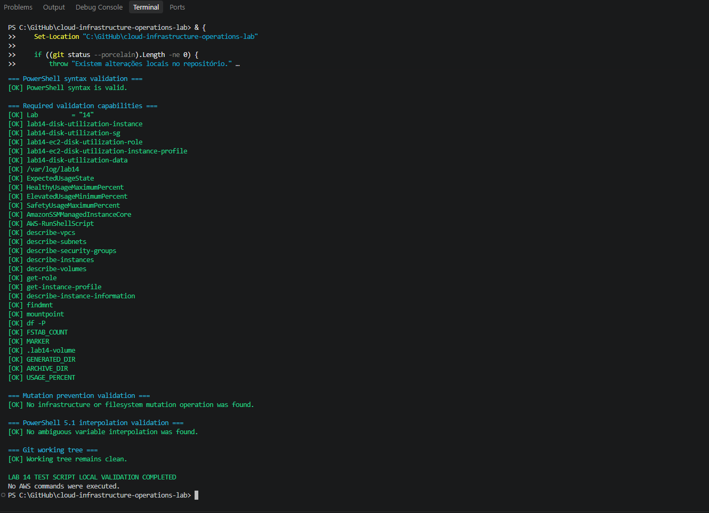

The record covers initial local inspection of the available lab components.

### 02 — AWS resource deployment

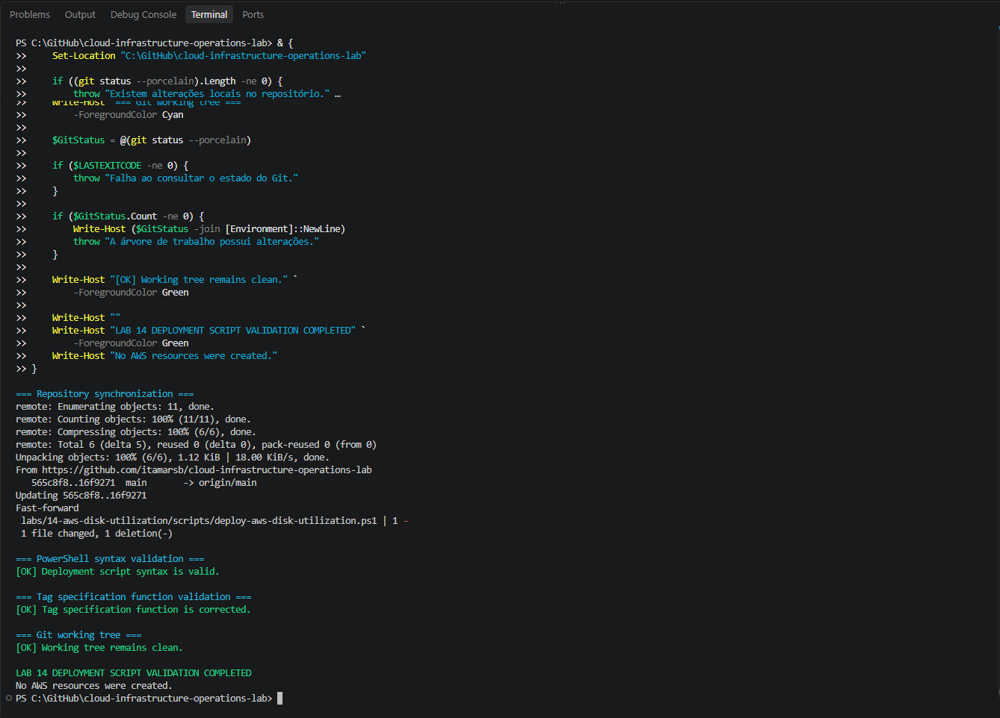

The record documents creation of the test instance, data volume and associated AWS resources.

### 03 — Dedicated log filesystem

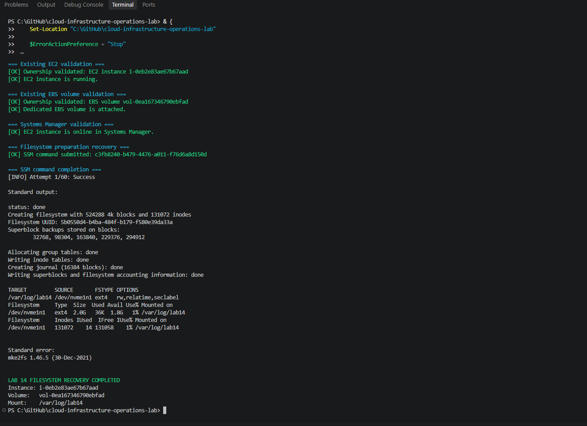

The record covers `ext4`, `/var/log/lab14` and UUID-based mounting.

### 04 — Independent infrastructure validation

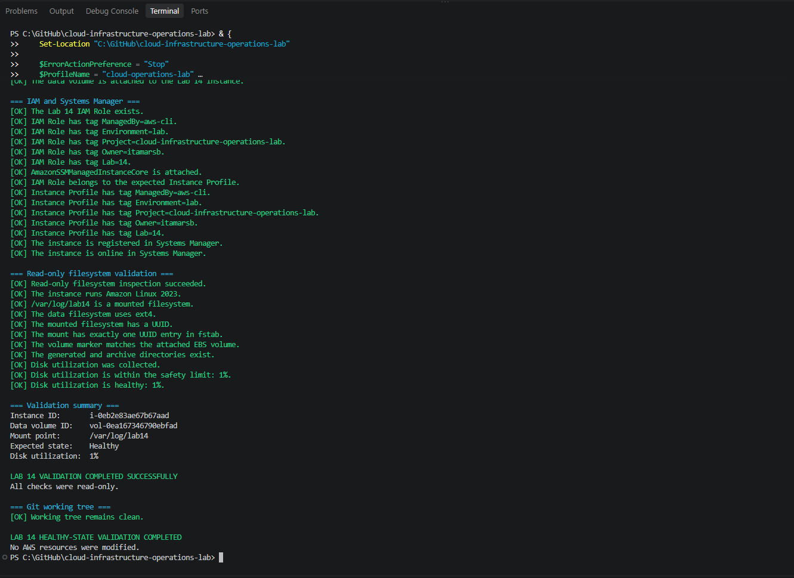

The record documents security, ownership, volume and Systems Manager checks.

### 05 — Initial healthy state

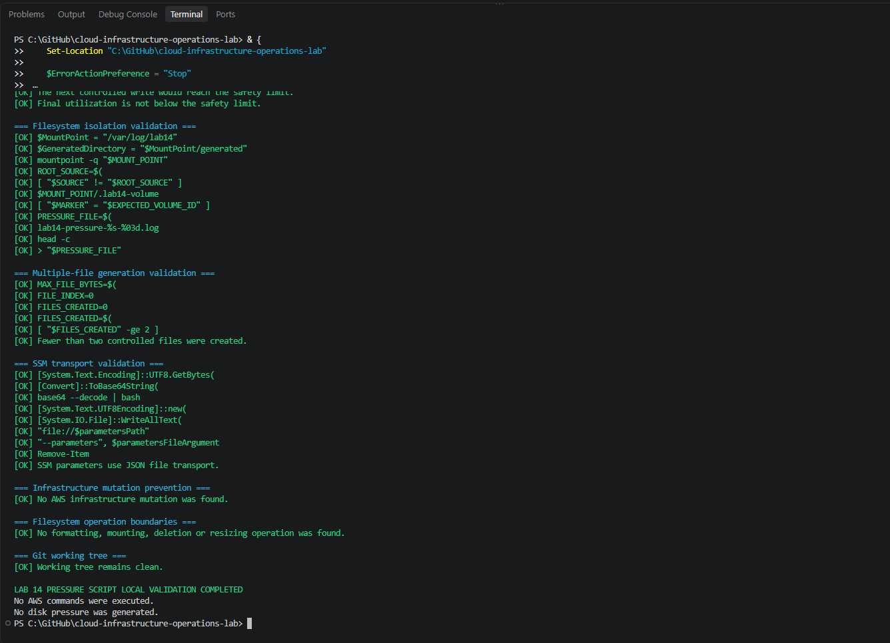

The record shows the expected state before applying pressure.

### 06 — Initial pressure safeguards

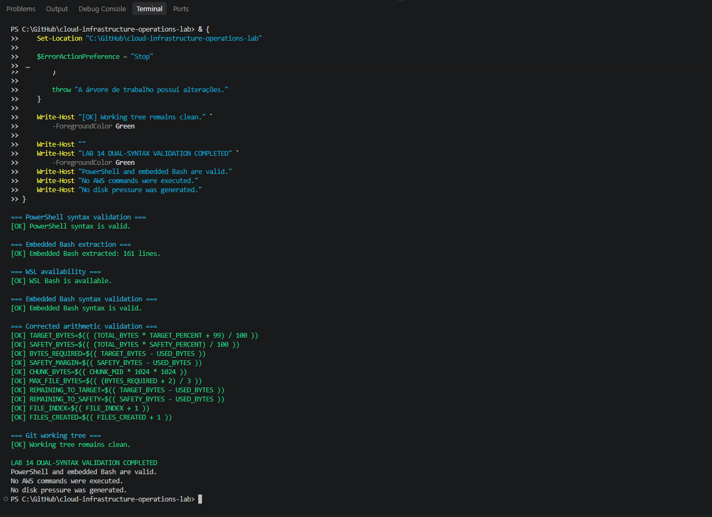

The record describes checks performed before the controlled writes.

</details>

<details>
<summary>Disk-pressure diagnosis and mitigation (images 07–13)</summary>

### 07 — Embedded Bash validation

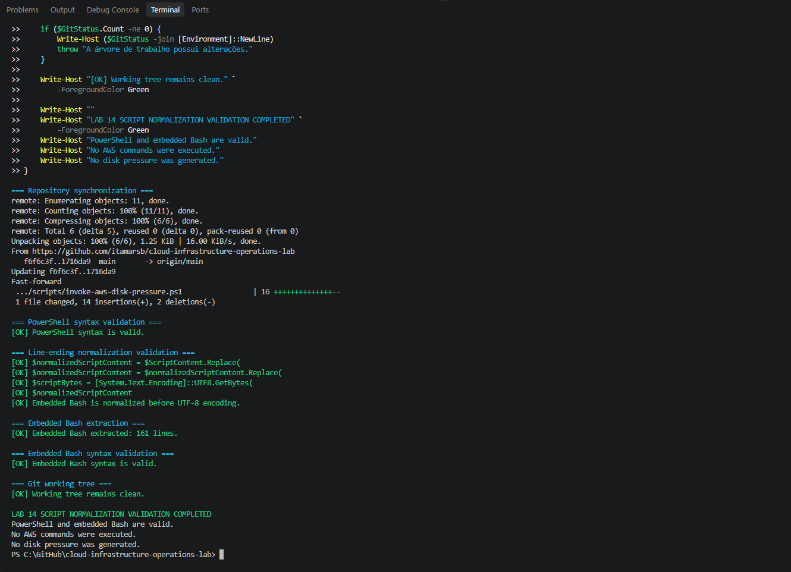

The original work includes checks of PowerShell parsing, embedded Bash syntax and line endings for SSM transport.

### 08 — Usable-capacity calculation

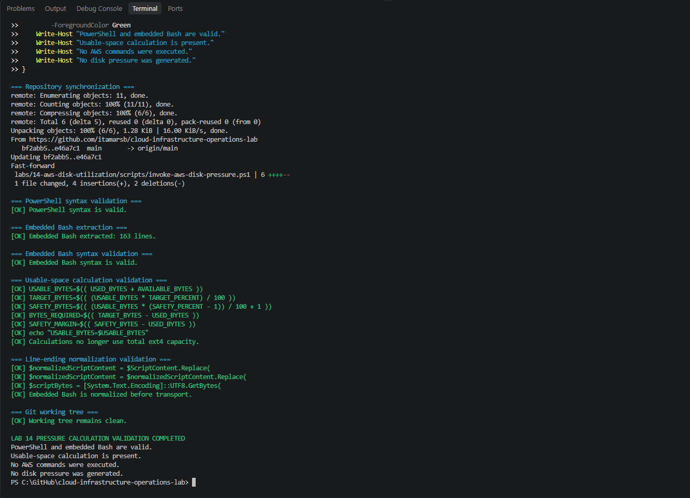

The record documents use of `USED_BYTES + AVAILABLE_BYTES` in place of the nominal filesystem size.

### 09 — Elevated state diagnosis

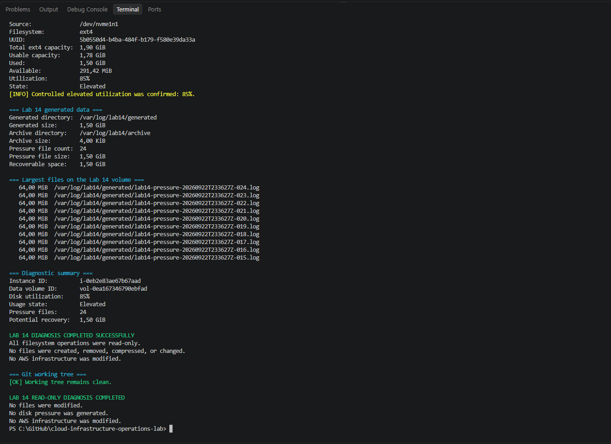

The diagnosis identified controlled pressure files and potentially recoverable space.

### 10 — Extended diagnostic checks

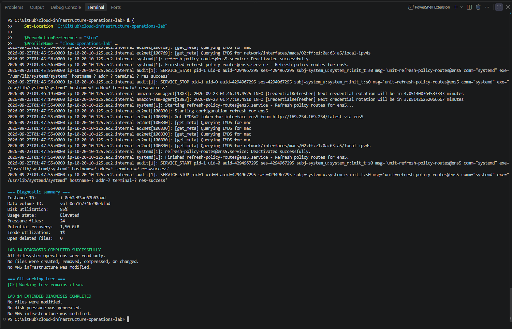

The recorded inspection includes disk usage, inodes, file size, process descriptors and recent system events.

### 11 — Mitigation sequence checks

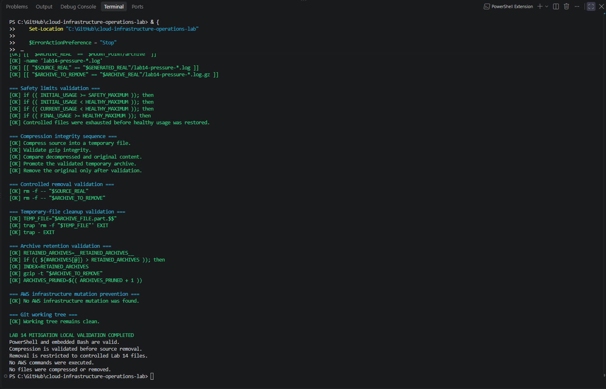

The record describes temporary compression, verification, promotion and bounded retention.

### 12 — Controlled mitigation

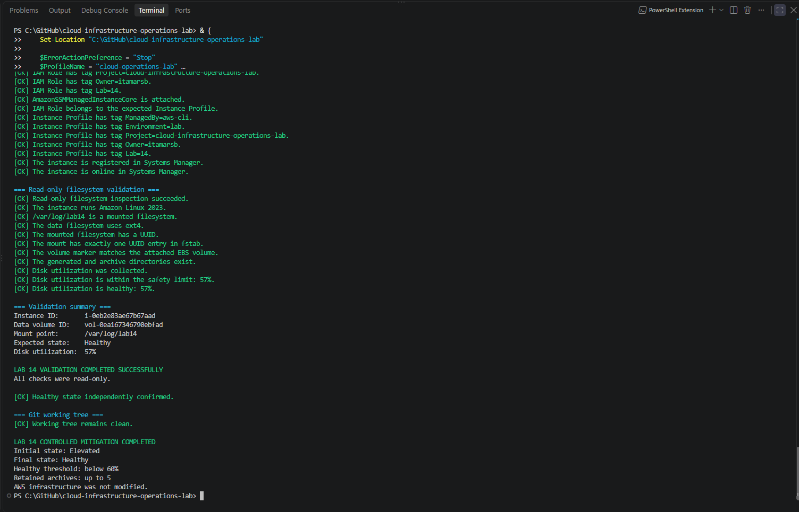

The original mitigation processed controlled files and reduced disk consumption.

### 13 — Healthy state after mitigation

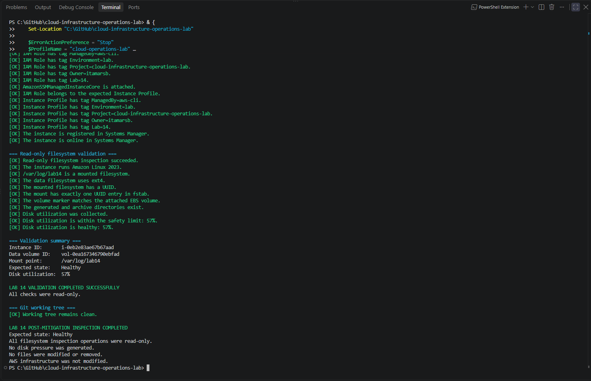

The original check recorded **57%** usage and `Healthy`.

</details>

<details>
<summary>Cleanup checks and completion (images 14–15)</summary>

### 14 — Cleanup safety validation

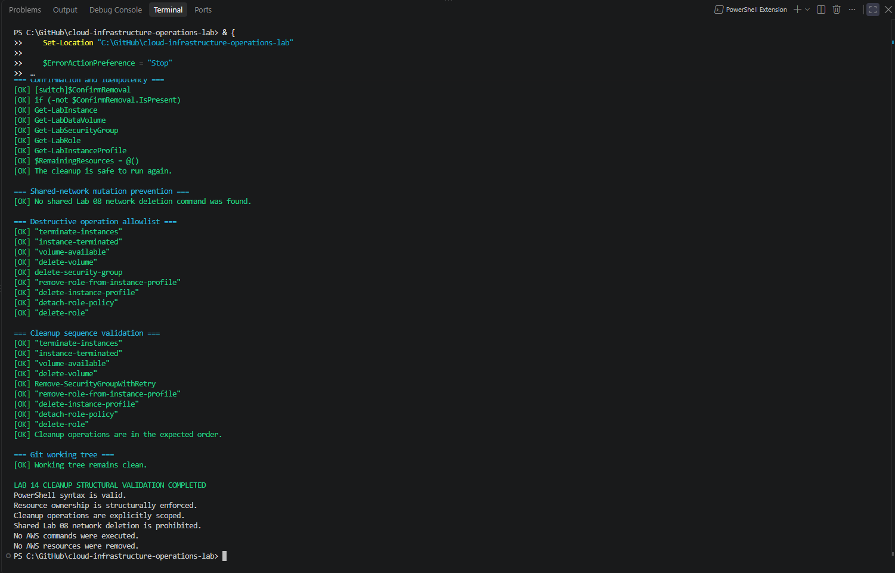

The record describes structural checks before destructive actions.

### 15 — AWS cleanup and shared network preservation

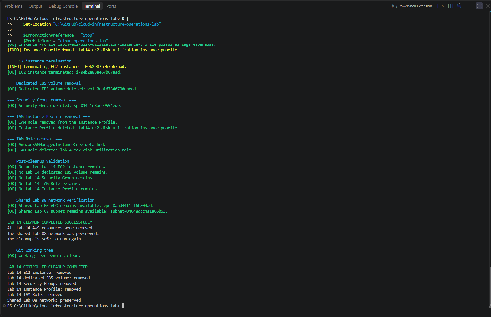

The record documents removal of Lab 14 resources and retention of the Lab 08 VPC and subnet.

</details>

## Recorded acceptance criteria

The original lab specifies 28 conditions covering the end-to-end workflow. They include the expected shared network, one Amazon Linux 2023 instance, no key pair, mandatory IMDSv2, encrypted EBS root and data volumes, a 2 GiB `gp3` log volume, `ext4` and UUID mounting, SSM registration, healthy initial use, pressure above 80% but below the configured ceiling, diagnosis of byte and inode usage and open deleted files, non-remediating investigation, controlled log compression and integrity checks, recovered usage below 60%, independent validation, cleanup and shared network preservation.

It also records a clean Git working tree as part of the execution workflow. That is a **repository hygiene observation**, not an AWS resource safety control.

All recorded completion marks describe the historical lab. They do not attest to the state of a current AWS account.

## Costs, technical limits and recommended follow-up

**Costs:** The recorded work used one `t3.micro` EC2 instance, a public IPv4 address, an EBS root volume and an additional 2 GiB EBS data volume. These can incur charges for compute, address use, storage and applicable data transfer. The original cleanup reduces future usage but does not erase charges already accrued.

**Filesystem isolation:** A dedicated volume limits blast radius but does not eliminate risks to the host, SSM agent or applications. If the volume or mount is misidentified, formatting or writing can affect the wrong filesystem. Confirm exact device identity before reproducing the procedure.

**Threshold semantics:** The pressure script enforces strictly below 88%, while a validator accepts a measured value at 88%. Align these policies before treating the scripts as a uniform safety boundary.

**Diagnostic success:** An elevated-use diagnosis that completes successfully confirms the investigation, not restoration of healthy capacity. Mitigation and post-mitigation validation are separate operations.

**Logs and retention:** The exercise generated artificial files rather than a sustained production logging stream. Filesystem-level compression and retention should not be confused with an established logging pipeline, central backup, legal-hold policy or long-term capacity management.

**SSM calls:** Non-remediating host checks use SSM Run Command. These are remote command invocations, even when the individual Linux commands do not change files.

**Evidence privacy:** Deployment and diagnostic outputs can contain instance IDs, EBS volume IDs, private/public IP addresses, filesystem paths and IAM names. Screenshots require visual inspection before being treated as anonymized.

**Future checks:** For a fuller operations runbook, consider monitoring disk and inode trends over time, assessing write-rate growth, testing retention against realistic logs, verifying cloud metrics/alerts, and validating disaster recovery separately from local compression.

## Conclusion

Lab 14 documents a controlled storage-capacity incident isolated to a dedicated EBS filesystem: utilization reached **85%**, the diagnosis identified **24** generated pressure files and **1.50 GiB** of potential recovery, and the mitigation reduced utilization to **57%**, followed by independent validation and AWS cleanup.

The English guide preserves the technical evidence while distinguishing recorded outcomes from current live state and retaining the limitations of the simulated incident.

## Next lab

[Lab 15 — AWS Connectivity Troubleshooting](../15-aws-connectivity-troubleshooting/)

---

[English repository overview](../../README.en.md) · [Portuguese repository overview](../../README.md)
