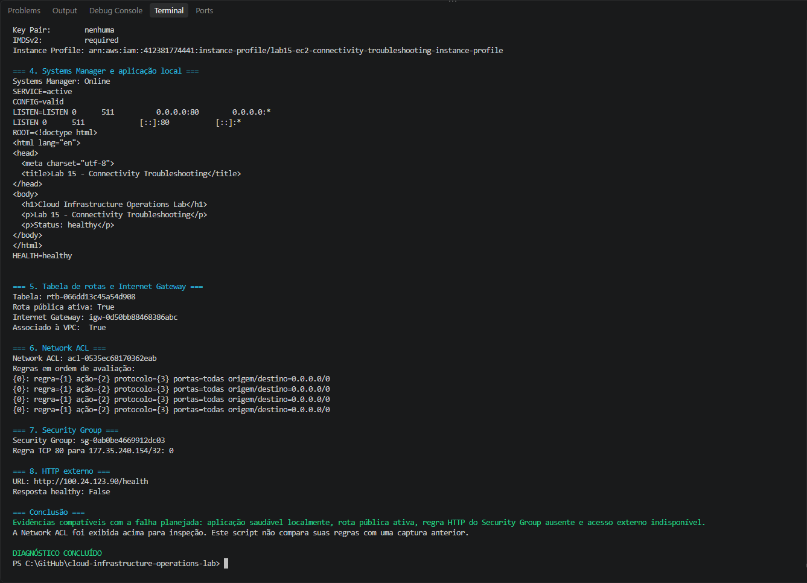
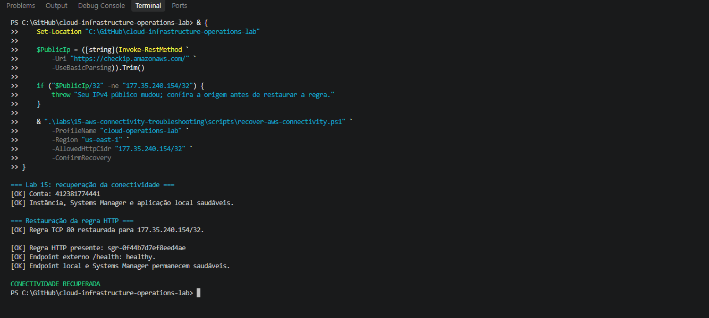
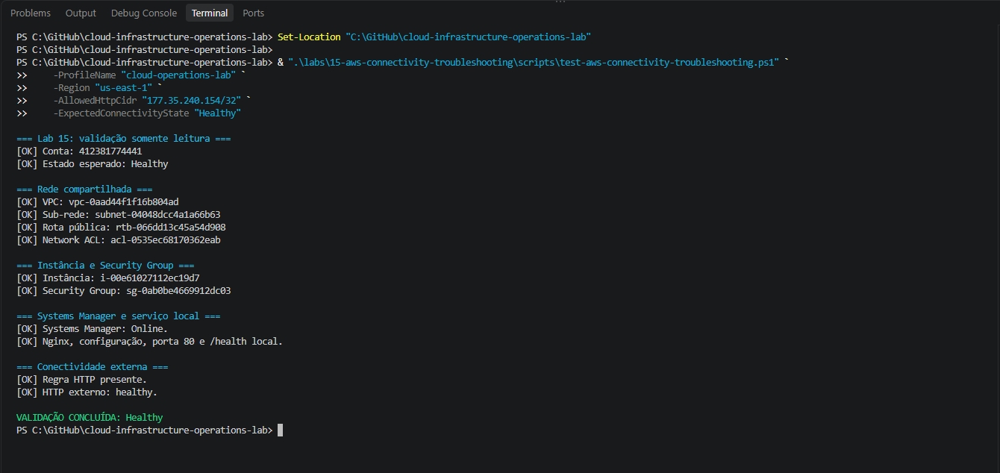
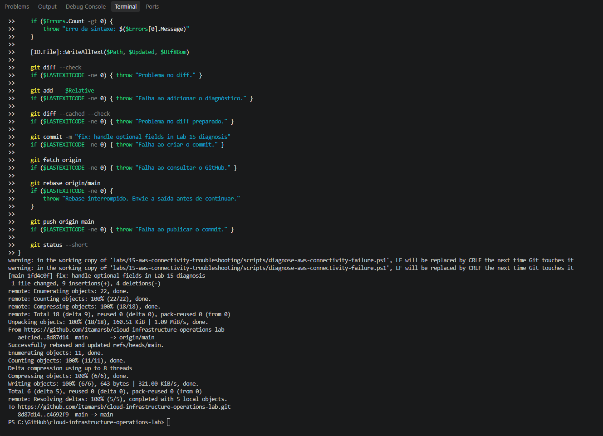
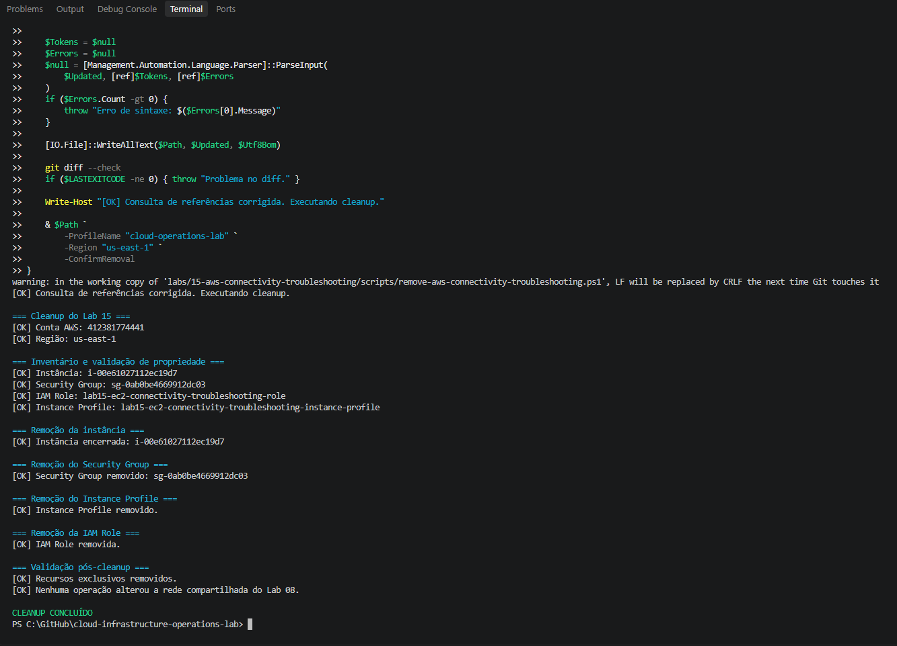
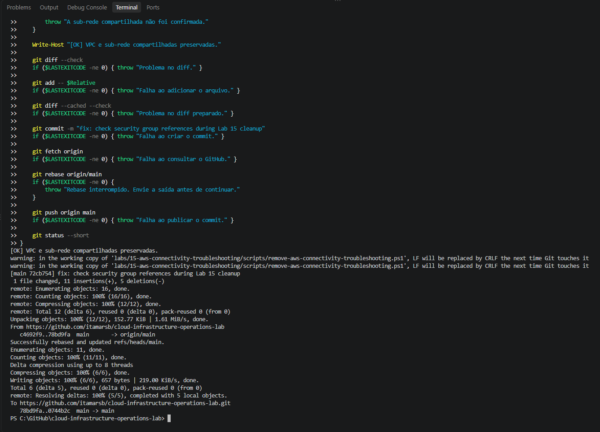

# Lab 15 — AWS Connectivity Troubleshooting

[**Português (Brasil)**](README.md) · **English**

## Objective and outcome

Investigate an Amazon EC2 instance whose Nginx application remains healthy on the host but becomes unreachable over public HTTP after a **controlled Security Group ingress change**.

The original exercise distinguished application health from network reachability, revoked an authorized TCP port 80 rule, diagnosed the failure without repairing it, restored the exact intended access, and removed the temporary Lab 15 resources while preserving the shared Lab 08 network.

**Original completion date:** September 25, 2026. This English documentation is based on the historical execution and a static review of the committed scripts. **No AWS service, EC2 instance, Security Group, or HTTP endpoint was accessed or modified during the translation.**

### Recorded sequence

```text
EC2 running; Nginx and public /health healthy
                  |
                  v
Revoke the authorized HTTP ingress rule
                  |
                  v
Local Nginx /health stays healthy
but external HTTP becomes unavailable
                  |
                  v
Read-only-intent diagnosis of application,
routing, Internet Gateway, Network ACL, Security Group
                  |
                  v
Restore the intended TCP 80 ingress rule
                  |
                  v
Local and public /health healthy
                  |
                  v
Remove lab-only resources; preserve Lab 08 network
```

The incident was a **network access problem rather than an Nginx process or configuration failure**. A successful local health check could not establish that the external client had a valid path through the AWS security controls.

## Architecture

The lab temporarily reused the VPC and public subnet created in [Lab 08](../08-aws-application-network/).

```text
Authorized HTTP client
        |
        v
Internet Gateway and public route (Lab 08)
        |
        v
Network ACL (Lab 08)
        |
        v
Dedicated Lab 15 Security Group
  -- TCP 80 from authorized /32 IPv4 --
        |
        v
Amazon Linux 2023 EC2 instance
        |
        +-- Nginx
        +-- / and /health

Independent administration:
IAM Identity Center → AWS Systems Manager → EC2
```

The diagram is a simplified troubleshooting path, not a packet capture or a complete representation of AWS's stateful Security Group and stateless Network ACL evaluations.

| Component | Recorded configuration |
|---|---|
| AWS Region | `us-east-1` |
| Shared VPC | `lab08-application-vpc` |
| Shared subnet | `lab08-public-subnet-a` |
| EC2 name | `lab15-connectivity-troubleshooting-instance` |
| EC2 type / OS | `t3.micro`, Amazon Linux 2023 |
| Web service | Nginx, TCP port `80` |
| Application endpoints | `/` and `/health` |
| Security Group | `lab15-connectivity-troubleshooting-sg` |
| HTTP source | Operator's public IPv4 address as a `/32` CIDR |
| IAM role | `lab15-ec2-connectivity-troubleshooting-role` |
| Instance profile | `lab15-ec2-connectivity-troubleshooting-instance-profile` |
| Instance policy | `AmazonSSMManagedInstanceCore` |
| Administrative access | Systems Manager without an EC2 SSH key pair |
| Instance metadata | IMDSv2 required |
| Root EBS | Encrypted `gp3` |

The original README records complete AWS account and resource identifiers, a route table, a Network ACL, and a historic operator IPv4 address. Those values are **deliberately not reproduced in this English edition**, because they are not required to understand or repeat the procedure. The original text and screenshots still require a separate disclosure review.

The historical EC2 instance and dedicated Security Group were removed. The operator's `/32` source from that run **must not be reused** without checking the current public IPv4 address and authorization context.

## Source files and evidence

The repository contains six scripts, one IAM trust policy, and ten image files.

| Script | Purpose |
|---|---|
| [`deploy-aws-connectivity-troubleshooting.ps1`](scripts/deploy-aws-connectivity-troubleshooting.ps1) | Create and inspect the initial healthy instance and network setup |
| [`test-aws-connectivity-troubleshooting.ps1`](scripts/test-aws-connectivity-troubleshooting.ps1) | Validate an expected `Healthy`, `Failed` or `Any` connectivity state |
| [`invoke-aws-connectivity-failure.ps1`](scripts/invoke-aws-connectivity-failure.ps1) | Revoke the specific authorized HTTP ingress rule |
| [`diagnose-aws-connectivity-failure.ps1`](scripts/diagnose-aws-connectivity-failure.ps1) | Inspect application and network evidence without remediation |
| [`recover-aws-connectivity.ps1`](scripts/recover-aws-connectivity.ps1) | Restore the authorized TCP 80 ingress rule |
| [`remove-aws-connectivity-troubleshooting.ps1`](scripts/remove-aws-connectivity-troubleshooting.ps1) | Remove Lab 15 resources and confirm absence |
| [`ec2-ssm-trust-policy.json`](policies/ec2-ssm-trust-policy.json) | Permit the EC2 service to assume its IAM role |

No scripts or evidence images were changed by this editorial review.

## Prerequisites and safe operating boundaries

- AWS CLI v2 and Windows PowerShell 5.1 or PowerShell 7.
- The `cloud-operations-lab` profile authenticated through AWS IAM Identity Center.
- Required permissions for EC2, IAM and AWS Systems Manager.
- The Lab 08 VPC/subnet present in `us-east-1`, with expected public routing.
- Systems Manager connectivity from the managed node and the required IAM access for the operator.
- A current, authorized source IPv4 address for direct HTTP testing.
- `curl.exe` for direct requests that explicitly bypass an HTTP proxy.

**Authorization and impact:** Deployment and cleanup modify AWS infrastructure. The failure script intentionally changes network accessibility. Recovery changes a Security Group rule. Use only an authorized test account and never inject this fault into an active production service.

An accessible public HTTP endpoint on TCP 80 does not provide TLS encryption. A `/32` source restriction is a network-layer control, not user authentication or confidentiality.

### Establish the session and current client source

The historical workflow began with:

```powershell
aws sso login --profile cloud-operations-lab

aws sts get-caller-identity `
    --profile cloud-operations-lab `
    --region us-east-1
```

Confirm that the resulting account and Region are appropriate before proceeding.

Identify the current outbound public IPv4 address:

```powershell
$PublicIp = (
    [string](Invoke-RestMethod `
        -Uri "https://checkip.amazonaws.com/" `
        -UseBasicParsing)
).Trim()

$ParsedIp = $null
if (
    -not [Net.IPAddress]::TryParse(
        $PublicIp,
        [ref]$ParsedIp
    ) -or
    $ParsedIp.AddressFamily -ne
        [Net.Sockets.AddressFamily]::InterNetwork
) {
    throw "A valid public IPv4 address was not detected."
}

$AllowedHttpCidr = "$PublicIp/32"
$Scripts = ".\labs\15-aws-connectivity-troubleshooting\scripts"
```

A public IP lookup shows the egress address visible to the lookup service; it does not guarantee that every later HTTP request follows the same route or public source address, especially when a proxy or VPN is involved. Check the actual client path.

## 1. Deploy and establish the healthy baseline

```powershell
& "$Scripts\deploy-aws-connectivity-troubleshooting.ps1" `
    -ProfileName "cloud-operations-lab" `
    -Region "us-east-1" `
    -AvailabilityZone "us-east-1a" `
    -InstanceType "t3.micro" `
    -AllowedHttpCidr $AllowedHttpCidr

& "$Scripts\test-aws-connectivity-troubleshooting.ps1" `
    -ProfileName "cloud-operations-lab" `
    -Region "us-east-1" `
    -AllowedHttpCidr $AllowedHttpCidr `
    -ExpectedConnectivityState "Healthy"
```

The deployment created one managed EC2 instance, a dedicated Security Group, an IAM role and an instance profile. The application ran Nginx and exposed `/` and `/health` through HTTP.

### A recorded complication: the first HTTP probe failed

The original deployment's first public HTTP check failed. This was **not** treated as proof of a failed AWS provisioning or a broken Nginx service. Subsequent investigation found that a direct `curl.exe` request bypassing the configured proxy reached `/health` with **HTTP 200** and the expected `healthy` response.

The adjusted independent validator returned `Healthy`. **No second deployment was performed.**

This distinction is operationally important: a failed client request can originate from a proxy or local client environment, even while EC2, Nginx and AWS network configuration remain healthy. Do not change infrastructure until the observation path is understood.

The scripts use a direct request pattern similar to:

```powershell
curl.exe --noproxy "*" --fail --silent --show-error `
    "http://INSTANCE_PUBLIC_IPV4/health"
```

Replace the placeholder only after independently verifying the intended instance's current address. This is a diagnostic example, not a claim that any instance is currently running.

## 2. Revoke the HTTP rule and validate the failed state

```powershell
& "$Scripts\invoke-aws-connectivity-failure.ps1" `
    -ProfileName "cloud-operations-lab" `
    -Region "us-east-1" `
    -AllowedHttpCidr $AllowedHttpCidr `
    -ConfirmConnectivityFailure

& "$Scripts\test-aws-connectivity-troubleshooting.ps1" `
    -ProfileName "cloud-operations-lab" `
    -Region "us-east-1" `
    -AllowedHttpCidr $AllowedHttpCidr `
    -ExpectedConnectivityState "Failed"
```

The `-ConfirmConnectivityFailure` switch explicitly authorizes the change. The script identifies the expected Lab 15 EC2 instance and Security Group, validates tags and conditions, and uses the AWS CLI to **revoke the specific TCP 80 ingress rule**, identified by its current Security Group rule ID.

After the change, the historical checks established:

- The EC2 instance remained `running`.
- Systems Manager remained available.
- Nginx, the local TCP 80 listener and the local `/health` endpoint remained healthy.
- The authorized HTTP ingress rule was absent.
- Direct public HTTP no longer returned the expected healthy response.

This is a controlled **connectivity failure**, not an application process failure.

The original log also recorded a later PowerShell caller-side `throw` associated with checking `$LASTEXITCODE` after a PowerShell script. The script had already displayed its controlled-failure confirmation, and the separate state validator reported `Failed`. Distinguish that caller-side error from whether the network fault had actually been introduced.

**Failure-state validation is not recovery:** A validator that successfully confirms `Failed` establishes that the expected negative condition exists. It does not indicate that the service is externally accessible.

## 3. Diagnose the network path without changing it

```powershell
& "$Scripts\diagnose-aws-connectivity-failure.ps1" `
    -ProfileName "cloud-operations-lab" `
    -Region "us-east-1" `
    -AllowedHttpCidr $AllowedHttpCidr
```

The original diagnosis correlated several independent observations:

| Layer | Recorded result | Interpretation |
|---|---|---|
| EC2 | `running` | The instance was operating |
| Systems Manager | `Online` | Administrative reachability remained |
| Nginx | `active`, configuration valid | The web service itself was healthy |
| Local TCP 80 | Listening | The expected local socket existed |
| Local `/health` | `healthy` | The endpoint worked on the instance |
| Public route | Active | The subnet had a route toward an Internet Gateway |
| Internet Gateway | Attached | Gateway attachment was present |
| Security Group | Expected HTTP ingress rule missing | The deliberately changed access control |
| External HTTP | Not healthy | The authorized client could not reach the endpoint |

The Network ACL was **listed for inspection**. The diagnosis did **not** compare its entries with a recorded baseline or prove the NACL was unchanged throughout the incident. The evidence supports the planned Security Group root cause because the ingress rule was deliberately revoked and later restored, while the local service remained healthy.

The diagnosis uses SSM Run Command to inspect the host, as well as AWS describe/list operations. It is **non-remediating by intent**, but `ssm:SendCommand` initiates remote execution; therefore this workflow is not composed exclusively of passive AWS read API calls.

The script deliberately does **not** reauthorize HTTP. Recovery is a separate, explicitly approved operation.

## 4. Restore external connectivity and revalidate

```powershell
& "$Scripts\recover-aws-connectivity.ps1" `
    -ProfileName "cloud-operations-lab" `
    -Region "us-east-1" `
    -AllowedHttpCidr $AllowedHttpCidr `
    -ConfirmRecovery

& "$Scripts\test-aws-connectivity-troubleshooting.ps1" `
    -ProfileName "cloud-operations-lab" `
    -Region "us-east-1" `
    -AllowedHttpCidr $AllowedHttpCidr `
    -ExpectedConnectivityState "Healthy"
```

The recovery script requires the explicit `-ConfirmRecovery` switch, rechecks the intended instance and local service health, and authorizes **only the expected inbound TCP 80 rule** from the approved source CIDR.

In the original run, the re-created Security Group rule received a **different rule ID** from the one deleted. This is expected when a rule is removed and a new one is created; the rule's intended protocol, port and source define the relevant logical access condition. Do not assume that a restored rule retains its original AWS identifier.

The external `/health` endpoint again returned `healthy`. The independent validator completed with `Healthy`.

Restoring the rule does not prove end-to-end health for every possible external source: the experiment tested the authorized client and its chosen route.

## 5. Clean up the lab-only AWS resources

```powershell
& "$Scripts\remove-aws-connectivity-troubleshooting.ps1" `
    -ProfileName "cloud-operations-lab" `
    -Region "us-east-1" `
    -ConfirmRemoval
```

The cleanup requires `-ConfirmRemoval`, checks discovered resource identity and selected dependencies, terminates the temporary instance, and deletes the dedicated Security Group, instance profile and IAM role. It does **not** remove the Lab 08 VPC or shared subnet.

In the original exercise, independent read queries after cleanup verified that the VPC and subnet remained present and correctly related.

For a later reproduction, first discover the **current**, expected Lab 08 resource IDs in the authorized AWS account. Do not copy the historical IDs from the Portuguese README into new deletion or verification commands.

**Destructive-action warning:** Tags, names and a confirmation switch reduce mistakes but are not proof that a resource is unused or can be safely removed. Review exact IDs, attachments, IAM relationships, retention needs and the account/Region before executing cleanup. A partially failed cleanup can require a new inventory before it is retried.

## Historical evidence

All **10 screenshot files** referenced here exist in the repository. Their interpretation below follows the original README; this documentation update did not open them individually for full-resolution visual examination.

### Initial preparation and baseline

These four files are retained as historical evidence of early preparation and validation. The repository does not assign a more specific independent outcome to every one of them:

- [Initial screenshot](images/Clipboard_09-23-2026_16.png)
- [Preparation 01](images/Clipboard_09-24-2026_01.png)
- [Preparation 02](images/Clipboard_09-24-2026_02.png)
- [Preparation 03](images/Clipboard_09-24-2026_03.png)

### Controlled failure



The original record associates this evidence with the missing HTTP rule and external failure.

### Read-only-intent diagnosis



The original record associates this evidence with a healthy local service and absent expected Security Group rule.

### Recovery



The original record documents restored network access and a healthy external response.

### Independent post-recovery validation



The original validator confirmed `Healthy`.

### Controlled cleanup



The original cleanup reported that Lab 15-only resources had been removed.

### Shared-network preservation



The recorded read queries confirmed the shared VPC and subnet remained present.

## Technical findings and limitations

### Application health is not client reachability

A running EC2 instance, healthy Nginx service, local TCP listener and successful loopback request cannot establish that an external client can reach the instance. Ingress rules, routing, gateways, NACLs, client proxies and the actual source address must be considered separately.

### Avoid attributing every failed HTTP request to AWS networking

The initial deployment showed why proxy-aware client diagnostics matter. A failed PowerShell web request alone did not establish the underlying cause. The later direct `curl.exe --noproxy "*"` request provided different evidence, helping distinguish client proxy behavior from server/network state.

### Security Group and Network ACL checks have different scopes

Security Groups are stateful resource-level network controls, while VPC Network ACLs are stateless subnet-level controls. This lab intentionally changed the Security Group rule, **not** the NACL. The script inspected NACL entries but did not provide a complete before/after comparison or packet-level trace.

### Validation modes must be interpreted correctly

The `test-aws-connectivity-troubleshooting.ps1` script accepts `Healthy`, `Failed` or `Any`.

- `Healthy` expects the authorized rule and successful public HTTP.
- `Failed` expects the authorized rule to be absent and public HTTP not to be healthy, while local service checks remain valid.
- `Any` records the state without requiring a particular external HTTP outcome.

A successful `Failed` validation is **confirmation of a fault condition**, not a pass for service availability.

### Authorization and reproducibility

The scripts distinguish `-ConfirmConnectivityFailure`, `-ConfirmRecovery` and `-ConfirmRemoval` as separate actions. The client source CIDR, resource IDs and dynamically resolved Amazon Linux AMI may change between executions. The IAM role's SSM managed policy does not by itself grant the human operator session permissions.

### Costs, security and evidence privacy

The temporary `t3.micro` EC2 instance, its EBS root volume and public IPv4 address can generate AWS charges. The recorded test used no ALB, NAT Gateway, or Elastic IP. Deleting resources does not undo charges accrued during use.

HTTP on port 80 was unencrypted. No SSH key pair or inbound SSH rule was used, but those controls alone do not represent complete production-grade hardening.

The Portuguese README contains actual historical account, network and source-IP identifiers, and AWS command outputs may disclose additional values. Review and redact such details before republishing screenshots or discussing the environment in public material.

## Conclusion

Lab 15 recorded a completed **Healthy → Failed → diagnosis → recovery → Healthy → cleanup** cycle. By removing and restoring one controlled HTTP ingress rule, it demonstrated that a healthy EC2-hosted application can be externally unreachable because of network access controls.

The English edition preserves the original test and troubleshooting lessons without treating the recorded values as live state or asserting that any new AWS operation occurred.

## Next lab

[Lab 16 — AWS Systems Manager Troubleshooting](../16-aws-systems-manager-troubleshooting/)

---

[English repository overview](../../README.en.md) · [Portuguese repository overview](../../README.md)
