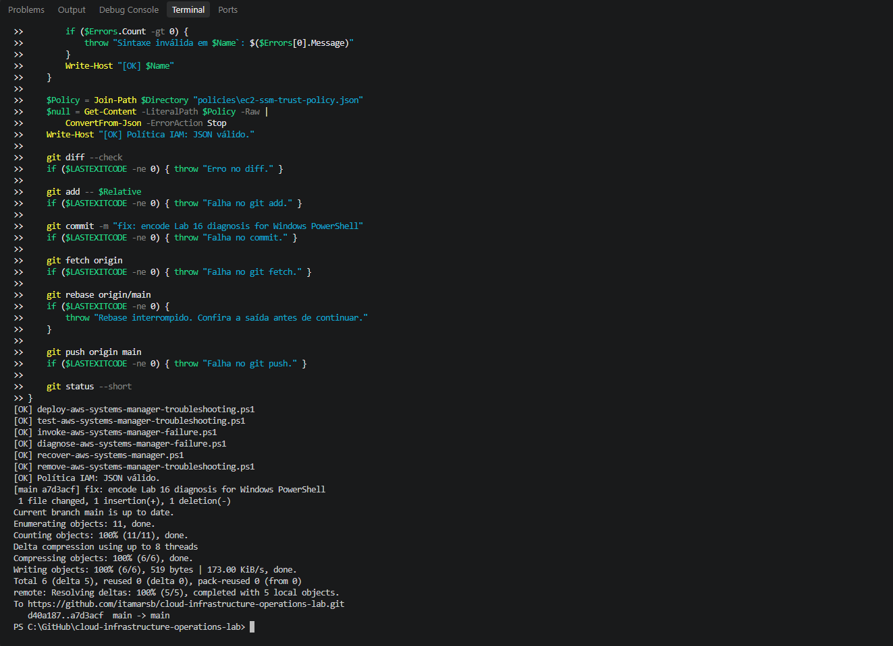
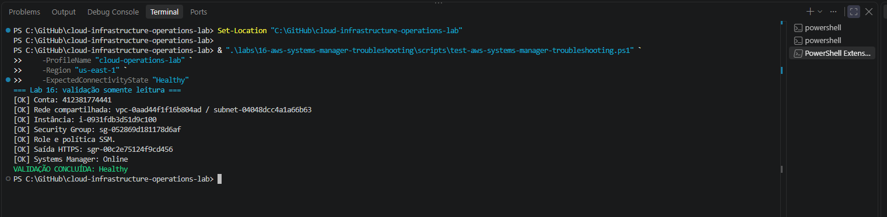
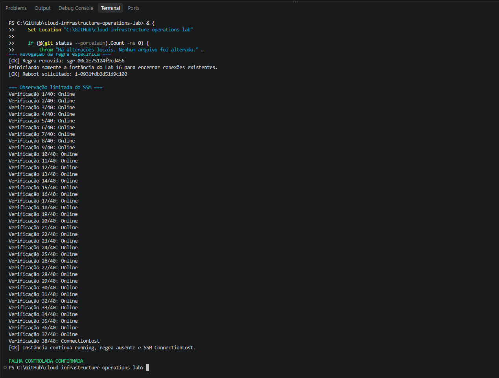
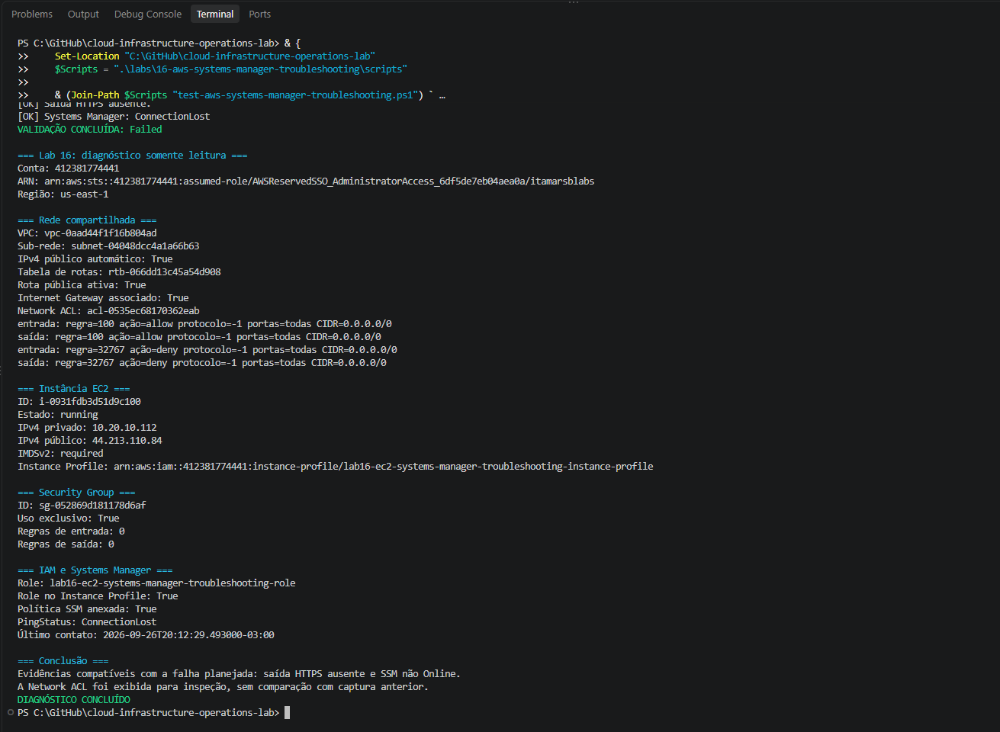
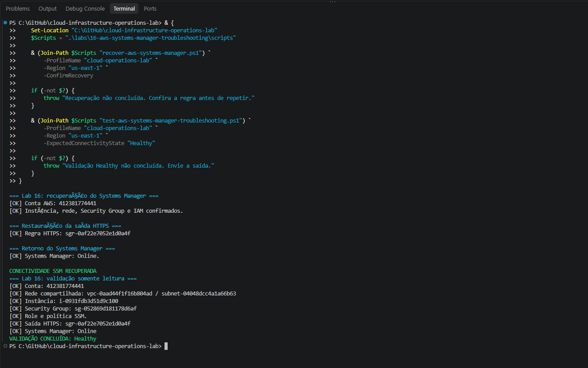
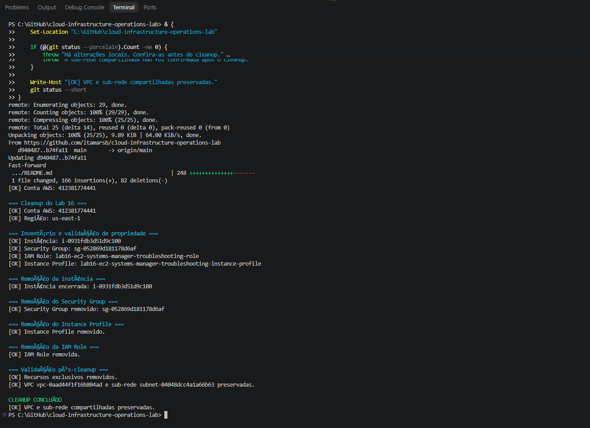

# Lab 16 — Troubleshooting AWS Systems Manager Connectivity

[**Português (Brasil)**](README.md) · **English**

## Overview

This lab investigates an Amazon EC2 instance that remains **`running`** while its AWS Systems Manager managed-node status changes from **`Online`** to **`ConnectionLost`**.

The controlled incident removes the dedicated instance Security Group's only outbound HTTPS rule. A first attempt did not reproduce the desired failure within the observation window, so the script restored connectivity. A second attempt also rebooted **only the Lab 16 instance** to close existing connections, after which Systems Manager reported `ConnectionLost`. The team then diagnosed the condition through AWS control-plane APIs, restored the egress rule without relying on SSM, verified the node was online again, and cleaned up temporary resources.

**Recorded result:** The original exercise was completed. This English edition is based on static inspection of the committed scripts, README, IAM policy, and screenshot inventory. **No new AWS operations or instance reboot were performed during this review.**

## What the incident demonstrates

An EC2 instance's lifecycle state is separate from its ability to communicate with Systems Manager. A host may remain `running` without an operational SSM management channel.

This exercise specifically tested **loss of required outbound connectivity** through the instance's dedicated Security Group. It did not intentionally remove the instance role, stop the SSM Agent, change the shared VPC, or cause a full host outage.

The investigation distinguishes:

- **EC2 lifecycle:** Was the expected instance running?
- **Managed-node registration:** Did Systems Manager report `Online` or `ConnectionLost`?
- **Network path:** Were a public route, Internet Gateway, and the expected Security Group egress present?
- **IAM:** Were the dedicated instance profile, role, and `AmazonSSMManagedInstanceCore` policy configured?
- **Recovery independence:** Could connectivity be restored using the EC2 API while SSM itself was unavailable?

## Architecture and recorded configuration

The lab temporarily reused the public network from [Lab 08](../08-aws-application-network/).

```text
AWS IAM Identity Center operator
                 |
                 v
           AWS control plane
             /         \
            v           v
      Amazon EC2     AWS Systems Manager
          |           managed-node status
          v
   Dedicated Lab 16 Security Group
      No inbound rules
      Outbound HTTPS TCP 443
          |
          v
   Lab 08 public subnet
          |
          v
   Shared routing / Internet Gateway
          |
          v
   Public AWS service endpoints
```

The test temporarily removed the outbound TCP 443 permission and then rebooted the **dedicated** EC2 instance. No shared route table, Network ACL, subnet, VPC, or Internet Gateway was intentionally changed.

| Component | Recorded configuration |
|---|---|
| Region | `us-east-1` |
| CLI profile | `cloud-operations-lab` |
| Shared VPC | Lab 08 VPC |
| Shared subnet | Lab 08 public subnet A |
| EC2 instance | Dedicated Lab 16 instance, `t3.micro` |
| Operating system | Amazon Linux 2023 |
| Security Group ingress | No inbound rules |
| Expected egress | TCP `443` to `0.0.0.0/0` |
| IAM identity | Dedicated role and instance profile |
| Managed policy | `AmazonSSMManagedInstanceCore` |
| Administrative path | AWS Systems Manager, without SSH or a key pair |
| Metadata service | IMDSv2 required |
| Root storage | EC2 EBS volume |

The original Portuguese README includes specific account, instance, VPC, subnet, Security Group, and Security Group rule identifiers. They are not repeated in this English document because the procedure can be understood and reproduced by discovering **current** authorized resources instead.

**Network design limitation:** Egress TCP 443 to `0.0.0.0/0` is appropriate to the documented controlled experiment but is broader than an endpoint-restricted production design. For an actual private network architecture, evaluate Systems Manager VPC interface endpoints, required endpoint security groups, DNS, IAM and other network dependencies before removing public internet access. The lab did **not** create VPC endpoints.

## Scripts and policy

| File | Role |
|---|---|
| [Deployment script](scripts/deploy-aws-systems-manager-troubleshooting.ps1) | Create the dedicated EC2, IAM and Security Group resources; wait for SSM `Online` |
| [State validator](scripts/test-aws-systems-manager-troubleshooting.ps1) | Verify the `Healthy` or `Failed` state with AWS API queries |
| [Failure-injection script](scripts/invoke-aws-systems-manager-failure.ps1) | Revoke the exact egress rule, reboot the lab instance, and observe `ConnectionLost` |
| [Diagnosis script](scripts/diagnose-aws-systems-manager-failure.ps1) | Inspect EC2, routing, NACL, Security Group, IAM, and SSM without changing resources |
| [Recovery script](scripts/recover-aws-systems-manager.ps1) | Reauthorize HTTPS using EC2 APIs; wait for SSM `Online` |
| [Cleanup script](scripts/remove-aws-systems-manager-troubleshooting.ps1) | Delete dedicated resources and retain the Lab 08 network |
| [EC2 trust policy](policies/ec2-ssm-trust-policy.json) | Permit the EC2 service principal to assume its instance role |

The script directory has six PowerShell files. The IAM trust policy names `ec2.amazonaws.com` and allows `sts:AssumeRole`; it is not itself a grant of permission for human operators to start SSM sessions or mutate AWS network controls.

## Preconditions and safeguards

The original environment used Windows PowerShell 5.1, AWS CLI v2 and AWS IAM Identity Center with the `cloud-operations-lab` profile. The Lab 08 VPC and public subnet must exist in `us-east-1` for an authorized reproduction.

A new operator must verify the selected account, Region, temporary resource names, role permissions, instance ownership and any running workloads **before** proceeding.

```powershell
aws sso login --profile cloud-operations-lab

aws sts get-caller-identity `
    --profile cloud-operations-lab `
    --region us-east-1
```

**Disruptive operation:** The failure script deliberately removes a network rule and reboots the test EC2 instance. A reboot can interrupt workloads and active sessions. Run this procedure only on a dedicated, non-production instance whose interruption has been explicitly authorized.

The scripts use separate confirmation switches for fault injection, recovery and cleanup. These flags are useful gates, but **do not substitute for resource-ID, account, dependency or data-retention checks**.

## Historical execution: what happened

| Phase | Recorded observation |
|---|---|
| Deployment | Dedicated EC2 created; SSM `Online` |
| Initial validation | `Healthy`; expected IAM and HTTPS egress verified |
| First injection attempt | Egress revoked; SSM stayed `Online` across **24 checks**; inconclusive |
| First attempt recovery | Script restored HTTPS egress and healthy state was revalidated |
| Second injection attempt | Egress revoked; **Lab 16 EC2 rebooted** |
| Confirmation | SSM changed to `ConnectionLost` on **check 38 of 40** |
| Failed-state validation | EC2 `running`, no expected egress, SSM `ConnectionLost` |
| Diagnosis | Public route, Internet Gateway, IAM permissions present; dedicated Security Group had no egress |
| Recovery | HTTPS egress recreated through EC2 API; SSM returned `Online` |
| Final validation | `Healthy` confirmed independently |
| Cleanup | Lab 16 resources deleted; shared Lab 08 VPC and subnet preserved |

The first attempt **must not** be presented as a confirmed incident. The successful fault demonstration is the **second** attempt, after rebooting the dedicated instance.

### Why the first attempt was inconclusive

The initial fault script revoked outbound TCP 443, but Systems Manager remained `Online` for all 24 observations in the original test window. The rule was restored rather than leaving the instance with an unverified failure condition.

One plausible explanation is that already established connections or their tracked state were temporarily preserved. The lab's records do **not** independently prove this explanation or establish a general timeout for every SSM Agent and AWS network condition.

Rebooting the isolated instance in the revised procedure ended existing host connections and created a stronger test of the post-reboot outbound rule configuration. The status transition was then observed late in the 40-check window—**at 38/40**. Do not assume the same timing on another account or instance.

## 1. Deploy a dedicated managed instance

From the repository root, after reviewing the script and confirming the Lab 08 dependencies:

```powershell
$Scripts = ".\labs\16-aws-systems-manager-troubleshooting\scripts"

& (Join-Path $Scripts "deploy-aws-systems-manager-troubleshooting.ps1") `
    -ProfileName "cloud-operations-lab" `
    -Region "us-east-1" `
    -AvailabilityZone "us-east-1a" `
    -InstanceType "t3.micro"
```

The script checks the shared network and the existing-resource inventory, creates the IAM role/profile, provisions a dedicated Security Group with no ingress and the single expected HTTPS egress rule, launches the EC2 instance and waits for it to be running and recognized as `Online` by Systems Manager.

The original deployment was followed by a successful initial state validation.

The image is resolved using the Amazon Linux 2023 public SSM AMI parameter. That parameter may return a different AMI during a later execution; record the resolved AMI ID when exact reproducibility matters.

**Partial-failure caution:** Deployment does not guarantee a transactional rollback. Inspect the current resource inventory after any error before trying again.

## 2. Validate the baseline as Healthy

```powershell
& (Join-Path $Scripts "test-aws-systems-manager-troubleshooting.ps1") `
    -ProfileName "cloud-operations-lab" `
    -Region "us-east-1" `
    -ExpectedConnectivityState "Healthy"
```

The validator checks selected EC2, VPC, IAM, Security Group and Systems Manager properties through AWS control-plane queries. In `Healthy` mode, it requires the expected outbound HTTPS rule and exactly one managed-node record marked `Online`.

The original initial validation encountered a comparison problem involving the instance profile. The script was corrected to compare the **complete expected ARN** for the AWS account and profile name. The validator subsequently passed **without another deployment**.

A successful `Healthy` result is a point-in-time registration and configuration check. It does not by itself prove successful execution of an SSM Run Command or interactive Session Manager session, nor does it establish continuous availability.

## 3. Inject the network failure

```powershell
& (Join-Path $Scripts "invoke-aws-systems-manager-failure.ps1") `
    -ProfileName "cloud-operations-lab" `
    -Region "us-east-1" `
    -ConfirmFailure
```

The script requires `-ConfirmFailure`, checks the dedicated resource identities, the original egress rule and a baseline SSM `Online` state, then:

1. Revokes the expected outbound TCP 443 rule by Security Group rule ID.
2. Confirms that the expected egress permission is absent.
3. **Reboots only the dedicated Lab 16 EC2 instance**.
4. Polls the SSM managed-node status up to **40 times**, with delays between checks.
5. Requires `ConnectionLost` while the instance remains `running` and the rule remains absent.

The reboot is a deliberate part of the **final** recorded test procedure, added after the first, non-rebooting attempt proved inconclusive.

### Failure-path safeguard

If a failure occurs after the egress mutation but before the script confirms its intended `ConnectionLost` result, the script **attempts to restore HTTPS egress automatically**. That recovery attempt may itself fail—for example, due to authorization or API errors—and is **not a guarantee**.

After a confirmed failure, the script intentionally leaves the restriction in place for the separate diagnosis and recovery stages.

**Never run the injection script on a shared or production instance.** Restoring SSM access may require EC2 API permissions from outside the affected instance.

## 4. Validate and diagnose the failed state

```powershell
& (Join-Path $Scripts "test-aws-systems-manager-troubleshooting.ps1") `
    -ProfileName "cloud-operations-lab" `
    -Region "us-east-1" `
    -ExpectedConnectivityState "Failed"

& (Join-Path $Scripts "diagnose-aws-systems-manager-failure.ps1") `
    -ProfileName "cloud-operations-lab" `
    -Region "us-east-1"
```

The independent validator's `Failed` mode requires both **absence of the expected HTTPS egress rule** and **`ConnectionLost`** for the selected managed node. The original verification also confirmed that the EC2 instance was still `running`.

The diagnostic script examined:

- Instance state, expected tags, public IPv4 and IMDSv2.
- Lab 08 public route and Internet Gateway association.
- Network ACL entries from the shared subnet.
- Dedicated Security Group with no ingress and no outbound rule.
- IAM role, instance profile and managed policy association.
- Systems Manager managed-node connection status.

The Network ACL was inspected, but **not compared against a previously recorded baseline**. Its existence and inspection should not be represented as proof that no NACL change could ever explain an unrelated incident.

The diagnosis used the accessible AWS control-plane APIs. It did **not** attempt SSM Run Command or Session Manager through the managed node while that node was offline. This distinction is essential: the recovery path must not depend on the very connectivity that the exercise has broken.

The script describes the findings as **compatible with the planned failure**. An observed `ConnectionLost` condition can have other causes in real systems, including agent, host, network, credential, endpoint or IAM problems.

Also note that the diagnosis script can complete its inspection even if the intended failure signature is not fully present, reporting an inconclusive result. A successful diagnostic-script completion is not equivalent to a confirmed `Failed` validation.

## 5. Recover through the Amazon EC2 API

```powershell
& (Join-Path $Scripts "recover-aws-systems-manager.ps1") `
    -ProfileName "cloud-operations-lab" `
    -Region "us-east-1" `
    -ConfirmRecovery
```

The recovery script verifies the target account/resources and uses the **EC2 Security Group API**, not a command executed through the disconnected SSM managed node, to restore outbound TCP 443 toward `0.0.0.0/0`.

It then inspects the Security Group for the expected rule and polls Systems Manager until the selected instance returns to `Online` or the recovery observation window expires.

The historical recovery created a new Security Group rule with a **new ID**, then observed `Online` and completed successfully. A recreated rule is not expected to reuse the old rule ID.

**Limit of this recovery:** It repairs the specific missing egress condition introduced by the lab. It cannot be assumed to fix every `ConnectionLost` incident, such as a stopped SSM Agent, missing IAM permissions or an unavailable AWS endpoint.

## 6. Independently revalidate Healthy

```powershell
& (Join-Path $Scripts "test-aws-systems-manager-troubleshooting.ps1") `
    -ProfileName "cloud-operations-lab" `
    -Region "us-east-1" `
    -ExpectedConnectivityState "Healthy"
```

The original post-recovery validation confirmed the restored outbound HTTPS rule and SSM `Online`.

This is a useful infrastructure and managed-node status check, not an end-to-end transcript of a new interactive management session.

## 7. Clean up the temporary resources

```powershell
& (Join-Path $Scripts "remove-aws-systems-manager-troubleshooting.ps1") `
    -ProfileName "cloud-operations-lab" `
    -Region "us-east-1" `
    -ConfirmRemoval
```

The cleanup script checks resource tags, names and selected relationships, terminates the dedicated EC2 instance, deletes its Security Group, removes its instance profile and IAM role, and verifies that the shared Lab 08 VPC and subnet remain present.

The original record explicitly states that **an instance belonging to a different repository was outside the Lab 16 cleanup scope**. The script was designed to target only Lab 16 resources.

**Destructive-operation warning:** EC2 termination and IAM/SG deletion are not reversible rollbacks. Fixed names, tags and confirmation switches help but do not prove that all current dependencies have been identified. An incomplete cleanup requires renewed inventory and manual review before retrying.

## Original evidence and troubleshooting notes

The six screenshot files below were confirmed in the repository. Their descriptions follow the original README; they were **not individually interpreted at full resolution** for this translation.

### 1. Windows PowerShell encoding and syntax validation



The original diagnostic script initially showed an unterminated-string parsing error in Windows PowerShell. It was saved using UTF-8 with BOM for compatibility with the Windows PowerShell 5.1 environment. Subsequent parsing of all six scripts and validation of the IAM trust-policy JSON were recorded as successful.

This is an encoding and parsing concern, not proof that the diagnosis could reach AWS.

### 2. Initial healthy-state validation



The initial validator incorrectly rejected the instance profile; the comparison was corrected to use the complete expected ARN and the existing deployment was then successfully validated.

### 3. Second failure attempt and confirmed ConnectionLost



The first attempt remained inconclusive. The revised procedure revoked HTTPS and rebooted the Lab 16 instance; `ConnectionLost` was seen at check **38/40**.

### 4. Failed-state validation and read-only diagnosis



The recorded state was EC2 `running`, expected HTTPS egress absent and SSM `ConnectionLost`, with route, gateway and IAM information available for diagnosis.

### 5. Recovery and independent Healthy validation



The outbound HTTPS rule was restored through EC2 APIs, then the managed node returned to `Online`.

### 6. Cleanup and Lab 08 network preservation



The historical cleanup removed Lab 16-only resources while preserving the shared VPC and subnet.

## Operational considerations

### Connection tracking and delayed status transitions

Revoking outbound access may not immediately break an already established communication channel, and Systems Manager state transitions are not guaranteed to occur on a fixed schedule. The original first attempt remained inconclusive even after 24 checks, whereas the rebooting procedure observed `ConnectionLost` only at 38/40. This outcome illustrates the importance of polling time windows and explicit inconclusive states.

### Separate instance state from management state

EC2 `running` is not equivalent to SSM `Online`. SSM managed-node availability is only one dimension of the health of a host, agent and network.

### Recovery without relying on the failed dependency

The central recovery technique is to use the EC2 control-plane API to correct the Security Group while the managed node cannot accept SSM remote commands. The same operational principle applies to troubleshooting broken remote-management paths.

### Distinguish status checks from full access checks

An instance appearing `Online` does not guarantee that every Session Manager session, Run Command operation, agent update or other management workflow will succeed. Such functions require their own validation when they are within scope.

### IAM and network controls

The `AmazonSSMManagedInstanceCore` policy and EC2 trust policy support the instance's managed-node identity; the human operator needs separate authorization. For production networks, assess SSM endpoints and least-privilege egress rather than treating unrestricted outbound HTTPS as the only valid architecture.

### Reproducibility and billing

The Amazon Linux 2023 AMI is discovered dynamically. A later run may select a newer release; record its AMI ID for reproducibility.

The original exercise temporarily used a `t3.micro` instance, EBS storage and a public IPv4 address, all of which may incur AWS charges. Deleting them does not retroactively remove accumulated costs.

### Historical identifiers and evidence privacy

The original README publishes complete account and AWS resource identifiers. This English edition omits them where unnecessary, but the source and screenshots should be checked before claiming full anonymization. The historical resource IDs should **not** be copied into a new deployment or cleanup procedure.

## Conclusion

Lab 16 documents a realistic dependency failure: an EC2 instance remained running while its Systems Manager communication was lost after the dedicated outbound HTTPS path was removed and the host rebooted. Diagnosis through the AWS control plane identified the expected missing egress condition. Recovery through the EC2 API restored connectivity without requiring an already broken SSM session.

The distinction between an **inconclusive first attempt**, a **confirmed second attempt**, and **independent post-recovery validation** is preserved throughout this document.

## Next lab

[Lab 17 — AWS Controlled Update](../17-aws-controlled-update/)

---

[English repository overview](../../README.en.md) · [Portuguese repository overview](../../README.md)
