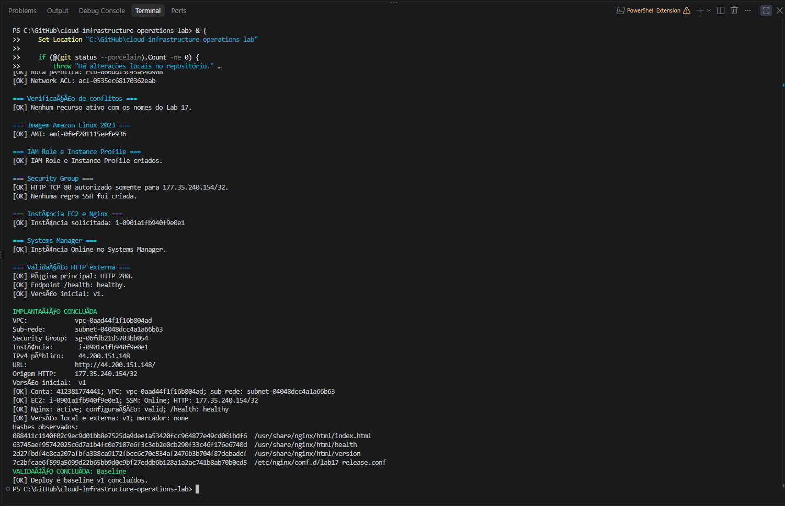
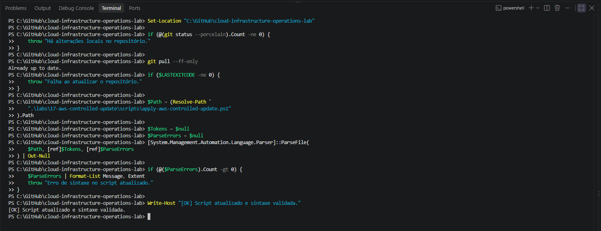
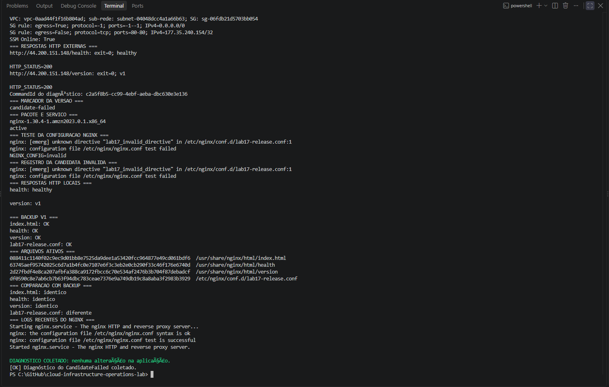
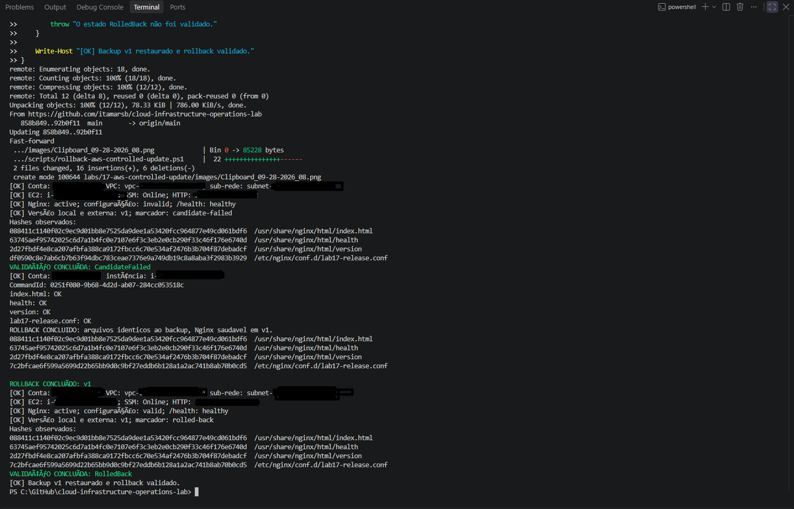
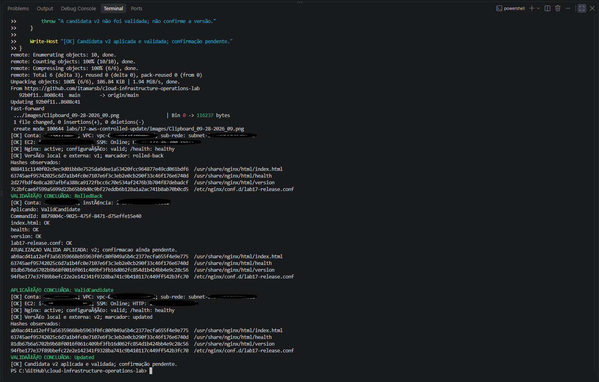
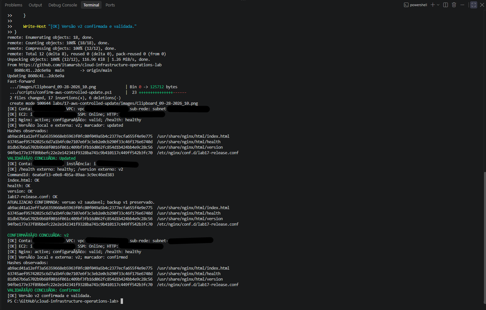
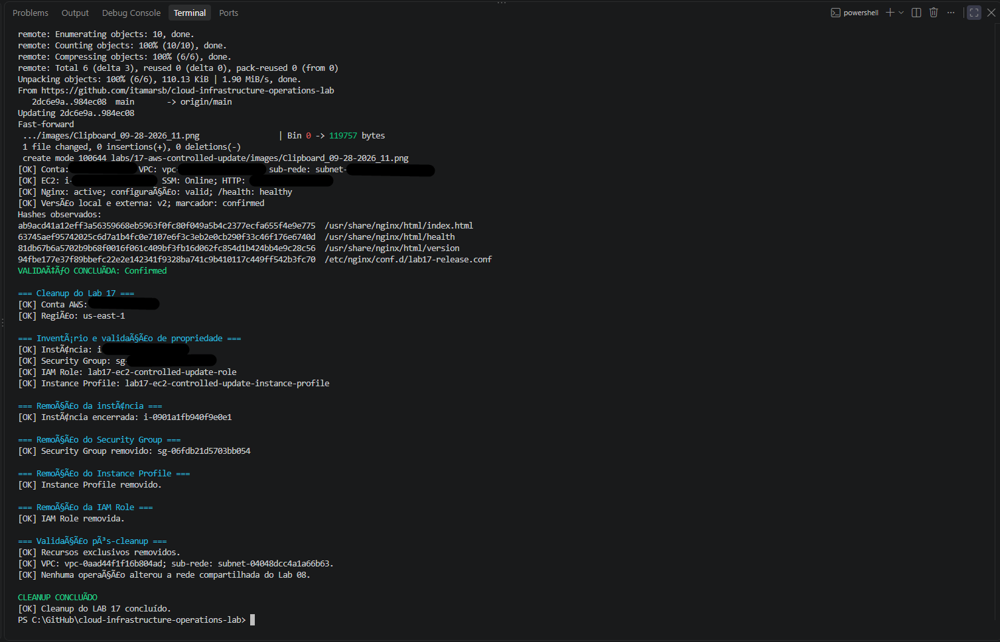

# Lab 17 — Controlled Application Update and Rollback on AWS

[**Português (Brasil)**](README.md) · **English**

## Overview

This lab documents a controlled application-release workflow on an Amazon Linux 2023 EC2 instance running Nginx. The exercise begins with a healthy **v1 baseline**, introduces a deliberately invalid Nginx configuration, diagnoses the rejected candidate, restores v1 from a verified backup, deploys a valid **v2**, confirms it, and removes the temporary AWS resources.

The central operational lesson is that **a rejected configuration candidate did not bring down the running application**. The test of the invalid configuration failed, but the existing Nginx process continued serving v1 because the invalid configuration was not successfully loaded.

**Recorded outcome:** The original lab completed the end-to-end workflow and cleanup. The English edition is based on a static review of the committed README, scripts, IAM policy, and seven evidence files. It is not a new AWS execution or a verification of currently running infrastructure.

## Release lifecycle

```text
Healthy baseline: v1
    |
    v
Save and verify a v1 backup
    |
    v
Apply invalid configuration candidate
    |
    +-- nginx -t fails
    +-- Nginx remains active
    +-- HTTP continues serving v1
    |
    v
Diagnose candidate-failed state
    |
    v
Restore four files from v1 backup
    |
    +-- nginx -t succeeds
    +-- hashes and file contents match baseline
    +-- v1 remains healthy
    |
    v
Apply valid candidate v2
    |
    +-- validate configuration and reload Nginx
    +-- local and external /version report v2
    |
    v
Confirm v2
    |
    +-- health and version rechecked
    +-- original v1 backup preserved
    |
    v
Remove Lab 17-specific AWS resources
```

This was a **single-instance application update**. It did not demonstrate a blue/green deployment, a rolling deployment across multiple nodes, a load balancer, or zero downtime under production traffic. The available evidence supports the recorded Nginx and HTTP behavior during the test.

## Environment and architecture

The lab reused the VPC and public subnet from [Lab 08](../08-aws-application-network/).

```text
Authorized HTTP client (operator IPv4 /32)
                  |
                  v
        Dedicated Security Group
                  |
                  v
    Amazon Linux 2023 EC2 + Nginx
          |              |
          |              +-- /health  -> healthy
          |              +-- /version -> v1 or v2
          |
          +-- /usr/share/nginx/html/
          +-- /etc/nginx/conf.d/lab17-release.conf
          +-- /var/lib/lab17/
                 +-- backup-v1/
                 +-- state

Administration:
IAM Identity Center operator → Systems Manager Run Command → EC2
```

| Component | Recorded configuration |
|---|---|
| Region | `us-east-1` |
| CLI profile | `cloud-operations-lab` |
| Shared network | Lab 08 VPC and public subnet |
| Instance | Dedicated EC2 running Amazon Linux 2023 |
| Instance type | `t3.micro` |
| Web service | Nginx, HTTP on TCP `80` |
| HTTP source | Authorized operator public IPv4, `/32` |
| EC2 Security Group | Dedicated Lab 17 Security Group |
| Instance role | `lab17-ec2-controlled-update-role` |
| Instance profile | `lab17-ec2-controlled-update-instance-profile` |
| Managed IAM policy | `AmazonSSMManagedInstanceCore` |
| Administration | Systems Manager; no SSH key pair |
| Release endpoints | `/`, `/health`, `/version` |

The original Portuguese README includes complete AWS account, VPC, subnet, instance, Security Group and public IPv4 identifiers, as well as a historic operator CIDR. Those identifiers are not needed for the English procedure and have been deliberately omitted here. A new deployment must discover its own current resource identifiers.

**HTTP security:** Restricting port 80 to a `/32` source does not encrypt browser traffic. The exercise did not deploy an HTTPS listener or TLS certificate; it is not a production-ready deployment design.

## Source files

| File | Purpose |
|---|---|
| [Deploy](scripts/deploy-aws-controlled-update.ps1) | Create EC2/IAM/SG resources and establish v1 |
| [Validate](scripts/test-aws-controlled-update.ps1) | Independently check the expected release state |
| [Apply update](scripts/apply-aws-controlled-update.ps1) | Introduce a failed candidate or deploy the valid v2 candidate |
| [Diagnose](scripts/diagnose-aws-controlled-update.ps1) | Inspect Nginx, release state, backup, checksums and HTTP |
| [Rollback](scripts/rollback-aws-controlled-update.ps1) | Restore four v1 files and verify their contents |
| [Confirm](scripts/confirm-aws-controlled-update.ps1) | Confirm v2 after health, version and backup checks |
| [Cleanup](scripts/remove-aws-controlled-update.ps1) | Remove only Lab 17 infrastructure |
| [EC2 trust policy](policies/ec2-ssm-trust-policy.json) | Allow EC2 to assume its instance IAM role |

The [evidence directory](images/) contains seven screenshots from the original run.

## Release-state semantics

The validator recognizes five states:

| Expected state | Version returned | Nginx configuration | Lab release marker |
|---|---|---|---|
| `Baseline` | `v1` | Valid | `none` |
| `CandidateFailed` | `v1` | Invalid on disk | `candidate-failed` |
| `RolledBack` | `v1` | Valid | `rolled-back` |
| `Updated` | `v2` | Valid | `updated` |
| `Confirmed` | `v2` | Valid | `confirmed` |

The validator checks both local and external application responses, Nginx status, the configuration test result, and the recorded state marker.

A successful `CandidateFailed` validation proves that the **expected controlled failure state was reproduced**, not that the new release succeeded. Similarly, an `Updated` state means v2 is deployed but has **not yet been formally confirmed**.

### Files tracked during release and rollback

The lab backs up and compares these four files:

```text
/usr/share/nginx/html/index.html
/usr/share/nginx/html/health
/usr/share/nginx/html/version
/etc/nginx/conf.d/lab17-release.conf
```

The v1 backup is stored under `/var/lib/lab17/backup-v1/`, together with a `SHA256SUMS` manifest.

During the invalid candidate stage, the original record shows that the three web files remained unchanged and **only the Nginx configuration file differed**. After rollback, the four files were checked against the backup and their SHA-256 digests matched the recorded v1 baseline.

SHA-256 equality is strong evidence of byte-for-byte content consistency against the chosen reference. It does **not** independently attest that the reference backup is authentic or protected from modification by a privileged attacker. This backup also resides on the same instance; it is not an off-instance disaster-recovery backup.

## Prerequisites and operating safeguards

- Windows PowerShell 5.1 or PowerShell 7.
- AWS CLI v2 and a configured `cloud-operations-lab` IAM Identity Center profile.
- The Lab 08 VPC and public subnet available in `us-east-1`.
- Permission to provision EC2/IAM networking and execute Systems Manager Run Command.
- A current public IPv4 address authorized to reach HTTP port 80.
- A dedicated non-production instance suitable for deliberate configuration changes.

Authenticate and discover the current HTTP source:

```powershell
aws sso login --profile cloud-operations-lab

$Lab = ".\labs\17-aws-controlled-update\scripts"
$PublicIp = (curl.exe --noproxy "*" -fsS https://checkip.amazonaws.com).Trim()

if ($LASTEXITCODE -ne 0) {
    throw "Could not determine the current public IPv4 address."
}

$ParsedIp = $null
if (
    -not [Net.IPAddress]::TryParse($PublicIp, [ref]$ParsedIp) -or
    $ParsedIp.AddressFamily -ne
        [Net.Sockets.AddressFamily]::InterNetwork
) {
    throw "The detected source is not a valid public IPv4 value."
}

$AllowedHttpCidr = "$PublicIp/32"
$env:AWS_CLI_FILE_ENCODING = "UTF-8"
```

A public IP lookup can differ from the source address used by later application traffic if VPN, NAT or proxy routing changes. The source must be rechecked before authorizing any ingress rule.

**Security and safety:** Update, rollback, confirmation and cleanup scripts make real changes. Never run them on a production instance or against resources owned by other projects. Check the account, instance identity, selected role/profile, current release marker and dependencies before running a destructive or potentially disruptive operation.

## Reproducing the recorded procedure

Run each step separately and stop if a check fails. The historical AWS resources were removed, so the commands below require a new authorized deployment.

### 1. Deploy and validate baseline v1

```powershell
& (Join-Path $Lab "deploy-aws-controlled-update.ps1") `
    -AllowedHttpCidr $AllowedHttpCidr

& (Join-Path $Lab "test-aws-controlled-update.ps1") `
    -AllowedHttpCidr $AllowedHttpCidr `
    -ExpectedReleaseState Baseline
```

The deployment creates the temporary infrastructure, installs/configures Nginx, and serves the initial application. The baseline validation requires Nginx to be active, `nginx -t` valid, `/health` healthy, and `/version` returning `v1`.

The deployment selects Amazon Linux 2023 through an AWS-managed public SSM AMI parameter; a later run can select a newer image. Record the resolved AMI ID when repeatable conditions matter.

### 2. Introduce the deliberately invalid candidate

```powershell
& (Join-Path $Lab "apply-aws-controlled-update.ps1") `
    -ReleaseMode FailedCandidate `
    -ConfirmUpdate

& (Join-Path $Lab "test-aws-controlled-update.ps1") `
    -AllowedHttpCidr $AllowedHttpCidr `
    -ExpectedReleaseState CandidateFailed
```

The update script first establishes or checks the v1 backup. It then writes the intentionally invalid Nginx directive `lab17_invalid_directive` into `/etc/nginx/conf.d/lab17-release.conf` and verifies that `nginx -t` rejects it.

**Crucial distinction:** The running Nginx service is not deliberately stopped during this failed-candidate test, and the invalid configuration is **not successfully reloaded**. Thus, the original HTTP responses continued to serve **v1**, even while the on-disk configuration failed validation.

The recorded release marker became `candidate-failed`.

### 3. Diagnose the rejected candidate

```powershell
& (Join-Path $Lab "diagnose-aws-controlled-update.ps1")
```

The diagnostic script inspects the running service and configuration without repairing either one. It checks:

- Nginx process/service state.
- The failed `nginx -t` output and saved candidate error log.
- Local and external `/health` and `/version`.
- The `backup-v1` manifest and `sha256sum -c SHA256SUMS` result.
- File-content comparison between the current web/configuration files and the v1 backup.
- The Lab 17 release state.

The original diagnosis identified the invalid directive as the cause of candidate rejection and showed that only the on-disk configuration file differed from the backup.

The script uses SSM Run Command to execute non-remediating host checks. It does not perform only passive AWS `Describe`/`Get` API operations; issuing a remote command itself creates an SSM command record.

**A diagnostic report does not roll back the release.** The next operation must be separately authorized.

### 4. Restore the verified v1 baseline

```powershell
& (Join-Path $Lab "rollback-aws-controlled-update.ps1") `
    -ConfirmRollback

& (Join-Path $Lab "test-aws-controlled-update.ps1") `
    -AllowedHttpCidr $AllowedHttpCidr `
    -ExpectedReleaseState RolledBack
```

The rollback script verifies `SHA256SUMS` within `backup-v1`, restores all four tracked files, reruns `nginx -t`, reloads or starts Nginx as necessary, and compares each restored file to the backup using `cmp`.

Local `/health` and `/version` checks must return `healthy` and `v1`. When restoration is verified, the state marker becomes `rolled-back`.

The original record contains matching v1/rollback SHA-256 digests for all four files. This demonstrates a controlled return to the known v1 file set, not an automatic rollback service or an external backup strategy.

### 5. Apply and validate the valid v2 candidate

```powershell
& (Join-Path $Lab "apply-aws-controlled-update.ps1") `
    -ReleaseMode ValidCandidate `
    -ConfirmUpdate

& (Join-Path $Lab "test-aws-controlled-update.ps1") `
    -AllowedHttpCidr $AllowedHttpCidr `
    -ExpectedReleaseState Updated
```

The valid candidate requires the backed-up v1 baseline and a permitted release state. It installs the v2 content, validates Nginx configuration, reloads the service, and checks `/health` and `/version` locally.

The independent validator then checks external HTTP as well. In the recorded run, both local and external `/version` reported **v2**, the application was healthy, and the state marker was `updated`.

This is a point-in-time release check, not proof of a zero-error deployment over sustained traffic.

### 6. Confirm v2 and retain the rollback baseline

```powershell
& (Join-Path $Lab "confirm-aws-controlled-update.ps1") `
    -AllowedHttpCidr $AllowedHttpCidr `
    -ConfirmUpdate

& (Join-Path $Lab "test-aws-controlled-update.ps1") `
    -AllowedHttpCidr $AllowedHttpCidr `
    -ExpectedReleaseState Confirmed
```

The confirmation script checks the public v2 endpoints, validates that the original v1 backup manifest is intact, checks local Nginx health and configuration, and changes the release marker from `updated` to `confirmed`.

The v1 backup is **not deleted by confirmation**. The original independent test then verified the `Confirmed` state.

A confirmation marker is a recorded lifecycle decision. It does not create redundancy, automated health monitoring, or rollback orchestration on its own.

### 7. Clean up Lab 17 resources

```powershell
& (Join-Path $Lab "remove-aws-controlled-update.ps1") `
    -ConfirmRemoval
```

The cleanup script checks the intended AWS resources and explicit authorization before terminating the EC2 instance and removing the dedicated Security Group, instance profile and IAM role.

The Lab 08 VPC and subnet are shared dependencies and are **not** deleted. The original record reports that Lab 17-only resources were absent after cleanup and that the shared network was preserved.

**Destructive operation:** Instance termination can delete the instance's local backup and release-state evidence. Preserve anything required for review before cleanup. Resource names, tags and confirmation switches reduce risk, but cannot substitute for checking actual AWS identities and dependencies.

## Historical validation and checksums

The original README includes Systems Manager Run Command identifiers for five stages: the failed candidate, diagnosis, rollback, v2 update and v2 confirmation. It also records SHA-256 digests of the four tracked files for v1 and the confirmed v2.

Those identifiers and checksums are **historical execution records**, not parameters for future commands. Use the current command ID returned by each new SSM execution when diagnosing failures or possible retries.

The original SHA-256 comparisons support the following observations:

| File | During failed candidate | After rollback | Confirmed v2 |
|---|---|---|---|
| `index.html` | Same as v1 backup | Same as v1 | Changed |
| `health` | Same as v1 backup | Same as v1 | Unchanged |
| `version` | Same as v1 backup | Same as v1 | Changed |
| `lab17-release.conf` | Invalid and different from v1 | Same as v1 | Changed |

An unchanged `health` file is consistent with the simple `healthy` endpoint continuing to respond in both releases; it does not prove functional correctness of all application behavior.

## Evidence from the recorded execution

The seven files listed below exist in the repository. Their descriptions follow the original README, and they have **not** been independently inspected at full image resolution during this review.

### Baseline v1



The baseline confirms the expected initial Nginx and application version in the historical run.

### Script preparation and syntax check



The original exercise included changes for PowerShell/AWS CLI parameter encoding and normalization of shell-script line endings.

### Invalid candidate and diagnosis



The configuration was rejected while the running Nginx instance continued serving v1.

### Verified rollback



Four files matched the backup after the v1 rollback.

### Application update to v2



The original run verified v2 locally and through HTTP.

### Confirmation



The confirmation stage retained the v1 backup and recorded the `confirmed` marker.

### Cleanup



The historical cleanup removed the lab's exclusive AWS resources and retained shared networking.

## Troubleshooting lessons

### Windows encoding and Linux line endings

The original Run Command integration initially encountered problems when sending `--parameters file://` JSON through Windows PowerShell. An embedded shell script also contained a CRLF line ending in the `#!/bin/sh` interpreter line, preventing execution in Linux.

The recorded implementation was adjusted to prepare correctly encoded temporary command payloads, normalize remote-script line endings to LF, and capture `Command.CommandId` without printing a large `send-command` response.

A successful local parser check does not prove correct AWS command execution; the remote command status and actual instance state must also be confirmed.

### Avoid blind retries

SSM Run Command is a remote execution service, not a transaction coordinator. If a client times out or loses the response, the command may still have executed on the instance. Record the returned `CommandId`, inspect its invocation and the release marker, and only then decide whether a retry or rollback is safe.

### Do not confuse config rejection with running-service failure

The failed candidate demonstrated `nginx -t` rejecting an invalid on-disk configuration, but the existing process continued serving v1. Calling this an application outage would misstate the outcome.

### Rollback is local to this test instance

The backup and release-state marker are stored on the same machine. The workflow does not provide recovery from instance or root-volume loss. Also, the current scripts do not implement a fully atomic multi-file release transaction; partial failure states require careful diagnosis.

## Security, cost and scope limitations

- **Security:** No inbound SSH key was used, but HTTP on TCP 80 remained unencrypted and restricted by source IPv4. Operators need appropriately scoped IAM permissions for Run Command and EC2/IAM changes.
- **Availability:** This lab used a single EC2/Nginx server and did not measure continuous uptime, response-time distributions, error budgets, rollback RTO or fleet-level deployment resilience.
- **Persistence:** The local v1 backup is useful for rollback while the instance exists. It is not a protected off-host recovery copy.
- **Reproducibility:** The Amazon Linux 2023 AMI is resolved dynamically and may change between runs.
- **Cost:** A `t3.micro` EC2 instance, EBS root storage and public IPv4 address can incur charges; cleanup does not undo accumulated costs.
- **Privacy:** The Portuguese README contains full AWS account/resource identifiers, a historical public instance IPv4 and client CIDR, SSM command IDs and digests. Inspect that file and the screenshot pixels before asserting that all evidence is anonymized.
- **Audit boundary:** No AWS operations, source-script edits or screenshot edits were carried out during this documentation update.

## Conclusion

Lab 17 documents a controlled **v1 baseline → invalid candidate → diagnosis → verified rollback → v2 update → confirmation → cleanup** sequence.

Its most important operational result is the distinction between a **configuration candidate rejected before reload** and an outage of the running service. The recorded rollback restored the four v1 files, and the valid update and confirmation established healthy v2 responses under the test conditions.

## Next lab

[Lab 18 — AWS Application Backup and Restore](../18-aws-application-backup-restore/)

---

[English repository overview](../../README.en.md) · [Portuguese repository overview](../../README.md)
