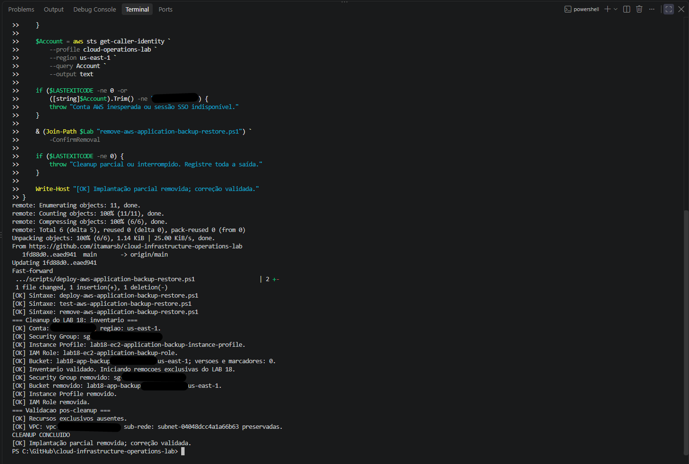
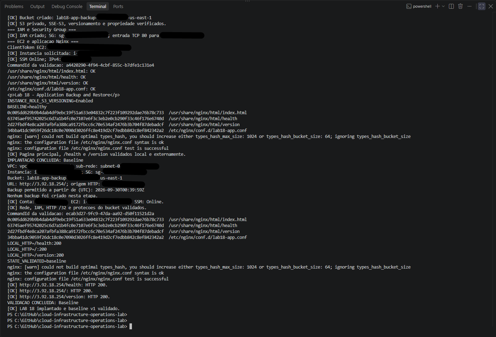
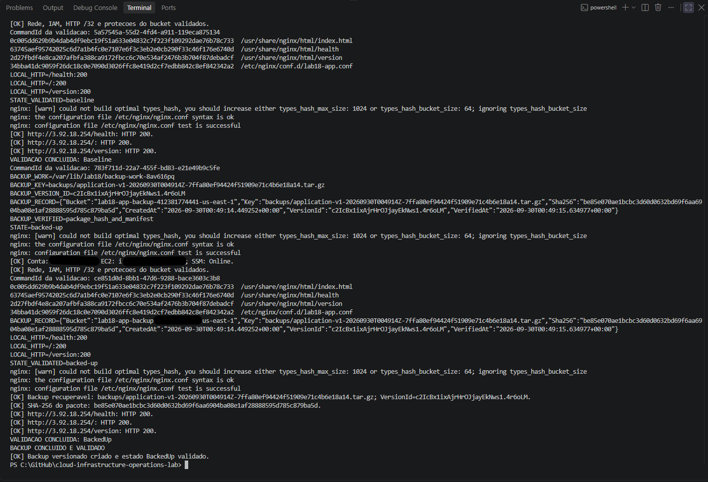
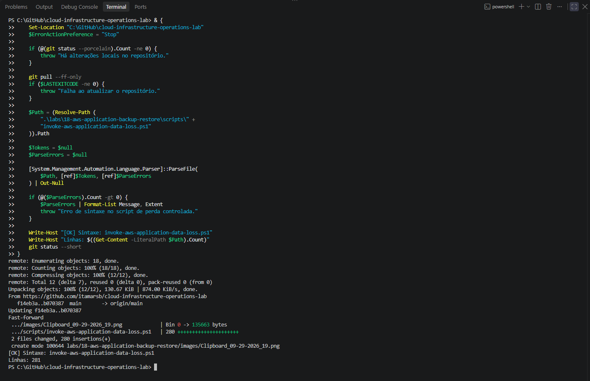
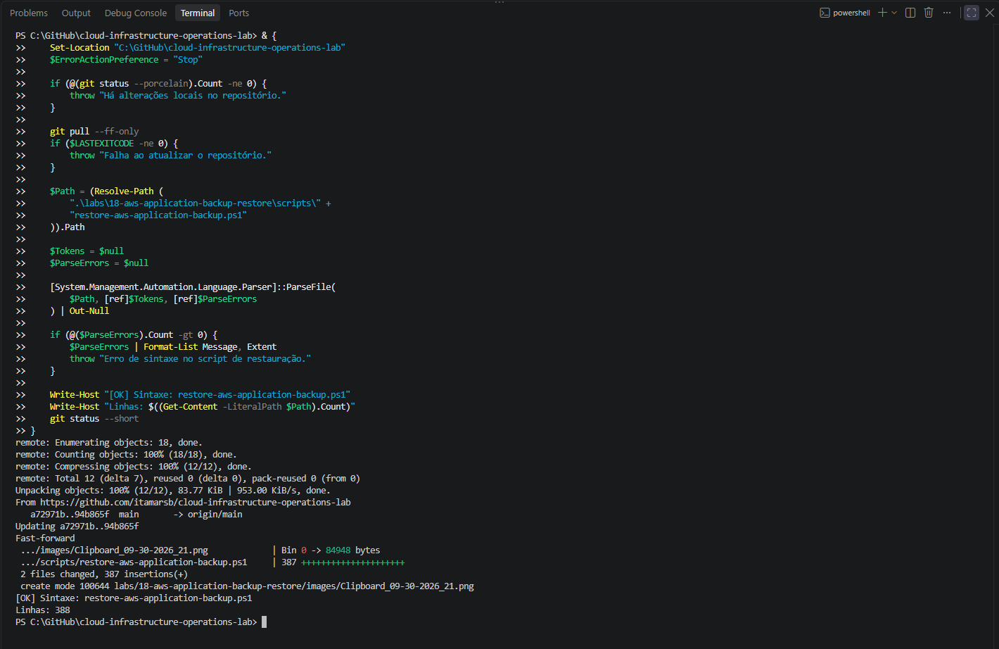
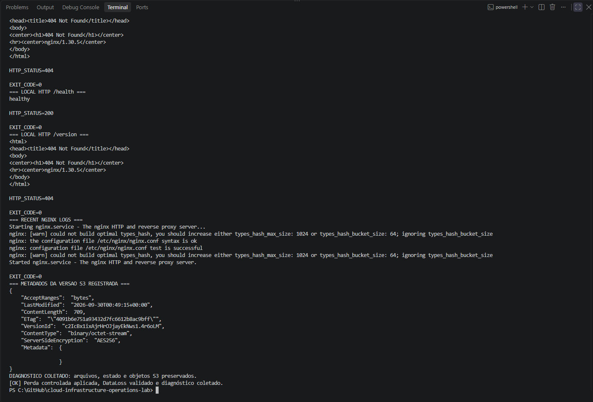
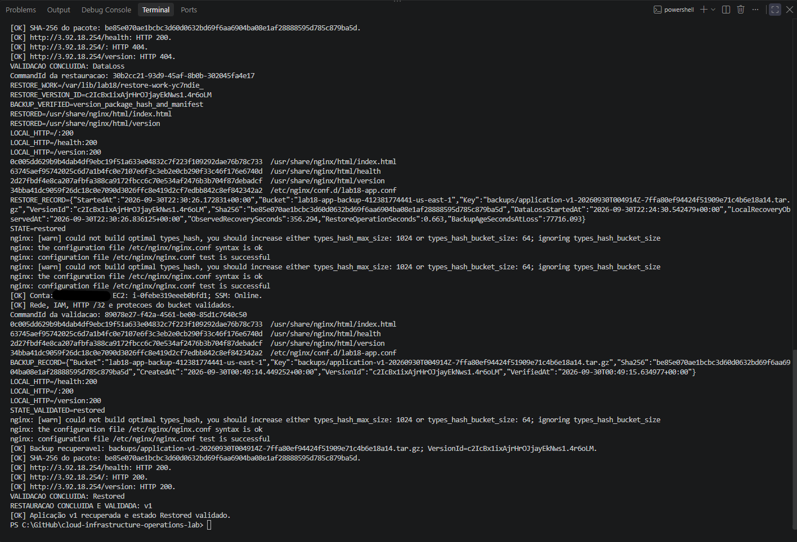
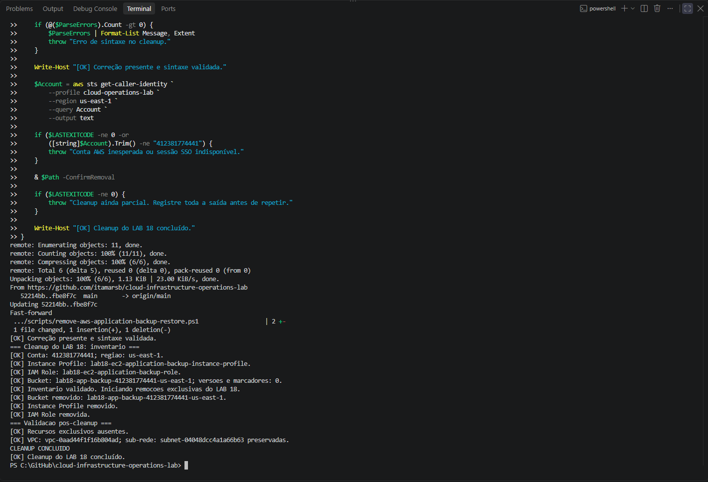

# Lab 18 — Application Backup and Restore with Amazon S3

[**Português (Brasil)**](README.md) · **English**

## Overview

This lab documents a completed **file-level recovery of an Nginx application** on Amazon EC2. A private, encrypted, versioned Amazon S3 bucket held a verified application backup. After two active application files were deliberately deleted, the workflow downloaded the **recorded S3 object version**, validated the archive and its SHA-256 manifest, restored only the missing files, and checked local and external HTTP responses.

The original exercise was completed on **September 30, 2026**. The lab-specific AWS resources were subsequently removed while the shared Lab 08 network was retained.

**Evidence boundary:** This English edition is based on the original README and static review of the seven PowerShell scripts, two IAM policy files, and 13 repository image files. No AWS operations, restoration commands, or infrastructure changes were performed during the documentation review.

## Recorded outcome

The workflow confirmed that:

- Four application files were present in the healthy `v1` baseline and their SHA-256 values were recorded.
- A five-member `.tar.gz` archive was uploaded to a private, versioned S3 bucket and retrieved by its **specific `VersionId`** for integrity verification.
- The controlled fault deleted **`index.html` and `version` only**.
- The application root `/` and `/version` returned HTTP **404**, while Nginx remained active and `/health` still returned **200** and `healthy`.
- Two missing files were restored from the verified archive.
- All four protected files matched the original baseline after recovery.
- Local and external HTTP checks confirmed the expected `v1` application content.
- The dedicated EC2, root EBS, IAM resources, Security Group and S3 bucket were removed during cleanup.

This experiment demonstrates **recoverability of specified static application files**, not restoration of an EC2 image, a lost EBS volume, an entire host or a database with concurrent transactions.

## Relationship to earlier labs

[Lab 11 — Storage and Recovery](../11-aws-storage-recovery/) exercised file recovery between EBS and S3. The present lab restores files at **active Nginx application paths** and validates the resulting HTTP behavior.

[Lab 17 — Controlled Update](../17-aws-controlled-update/) examined a rejected configuration candidate and a local v1 rollback. Lab 18 introduces a different fault: **loss of application files after a verifiable S3 backup has been created**.

## Architecture

```text
Authorized operator (HTTP source IPv4 /32)
                 |
                 v
     Dedicated EC2 Security Group
                 |
                 v
     Amazon Linux 2023 EC2 + Nginx
       |                  |
       |                  +-- /        index.html
       |                  +-- /health  health
       |                  +-- /version version
       |
       +-- /etc/nginx/conf.d/lab18-app.conf
       +-- /var/lib/lab18/baseline.sha256
       +-- /var/lib/lab18/ backup metadata
                 |
                 | HTTPS / AWS CLI with instance role
                 v
         Private Amazon S3 bucket
         - Block Public Access
         - SSE-S3 (AES256)
         - Versioning enabled
         - Bucket owner enforced
         - Object key + explicit VersionId

Control plane:
IAM Identity Center → Systems Manager Run Command → EC2
```

| Component | Recorded configuration |
|---|---|
| Region | `us-east-1` |
| AWS CLI profile | `cloud-operations-lab` |
| Shared VPC and subnet | Lab 08 network |
| Instance | Amazon Linux 2023 EC2, `t3.micro` |
| Web service | Nginx on HTTP TCP 80 |
| Allowed HTTP source | Operator IPv4 as a `/32` CIDR |
| SSH access | No EC2 key pair and no inbound SSH rule |
| Management | AWS Systems Manager Run Command |
| IAM | Dedicated EC2 role and instance profile |
| Root EBS | Encrypted `gp3`, delete on termination |
| Backup storage | Dedicated private S3 bucket |
| Backup controls | Versioning, SSE-S3, Block Public Access, owner enforcement |
| Backup authentication | Instance role with bucket-scoped permissions |
| Integrity reference | SHA-256 of baseline files and backup package |

The original README contains an actual AWS account number, a historical operator IP and an account-derived S3 bucket name. These values are intentionally omitted from the English instructions; they are not needed to reproduce the exercise and should not be treated as current resources.

No NAT Gateway, Elastic IP, load balancer, EC2 SSH key pair or SSH ingress was provisioned for this lab.

## Repository inventory

| File | Responsibility |
|---|---|
| [Deployment script](scripts/deploy-aws-application-backup-restore.ps1) | Provision EC2, IAM, Security Group and bucket; publish baseline v1 |
| [State validator](scripts/test-aws-application-backup-restore.ps1) | Check `Baseline`, `BackedUp`, `DataLoss`, or `Restored` |
| [Backup creator](scripts/create-aws-application-backup.ps1) | Package four files, upload the archive, retrieve the recorded version and verify integrity |
| [Controlled data loss](scripts/invoke-aws-application-data-loss.ps1) | Remove only two selected active application files |
| [Diagnosis](scripts/diagnose-aws-application-data-loss.ps1) | Inspect files, hashes, service, HTTP, journal and S3 metadata without remediation |
| [Restore](scripts/restore-aws-application-backup.ps1) | Retrieve the exact S3 version and restore the two missing files |
| [Cleanup](scripts/remove-aws-application-backup-restore.ps1) | Delete Lab 18-only resources, including versioned S3 data |
| [EC2 trust policy](policies/ec2-ssm-trust-policy.json) | Allow the EC2 service principal to assume the instance role |
| [S3 access policy](policies/s3-application-backup-policy-template.json) | Allow selected backup actions and deny insecure S3 transport |

The [`images/`](images/) directory contains **13 files**. The original README directly describes nine of them; all 13 are linked or embedded in the evidence section below without inventing descriptions for the four additional files.

### S3 IAM permissions

The instance policy grants `s3:GetBucketVersioning` for the lab bucket and `s3:PutObject` and `s3:GetObjectVersion` for objects under `backups/*`. It also contains an explicit `Deny` for requests using `aws:SecureTransport=false`.

The instance policy **does not grant S3 object deletion**. Cleanup is performed from the authorized operator context rather than by a broad deletion permission on the instance role.

This distinction applies to the configured IAM policy's scope. Other principals, bucket policies, or administrative identities must be reviewed separately; the instance-role policy does not prove the entire account is least-privilege.

## Protected files and archive format

| Active path | Purpose | Controlled loss |
|---|---|---|
| `/usr/share/nginx/html/index.html` | Main application page | **Deleted** |
| `/usr/share/nginx/html/health` | Health response `healthy` | Retained |
| `/usr/share/nginx/html/version` | Version response `v1` | **Deleted** |
| `/etc/nginx/conf.d/lab18-app.conf` | Nginx application configuration | Retained |

The backup archive contains **exactly five regular files with no directory components**:

```text
index.html
health
version
lab18-app.conf
manifest.sha256
```

The original baseline is recorded at `/var/lib/lab18/baseline.sha256`. The backup metadata records the S3 bucket, object key, `VersionId`, package SHA-256 and timestamps.

During restore, the code checks the requested S3 object version, the reported SSE-S3 setting, the complete package SHA-256 digest, member names and count, regular-file types, size bounds, the internal manifest and each member's contents before writing the two missing active files.

The exact-version selection avoids silently taking whatever object happens to be latest. Nonetheless, SHA-256 matching a local reference cannot independently authenticate that reference if both the source metadata and stored backup were compromised. Versioning alone is not immutable retention.

## State model and HTTP observations

| State | `/` | `/health` | `/version` | Interpretation |
|---|---|---|---|---|
| `Baseline` | HTTP 200, Lab 18 page | 200, `healthy` | 200, `v1` | Four baseline files valid |
| `BackedUp` | HTTP 200 | 200, `healthy` | 200, `v1` | Verified S3 version recorded |
| `DataLoss` | **404** | 200, `healthy` | **404** | Two active files missing; Nginx still running |
| `Restored` | HTTP 200, Lab 18 page | 200, `healthy` | 200, `v1` | Four final file hashes match baseline |

**Operational lesson:** An endpoint returning `healthy` does not automatically demonstrate application availability. During this test, `/health` remained healthy while two user-facing application paths failed. Health checks should be designed to represent the actual critical dependencies and behavior of a service.

The independent validation script checks local application state and external HTTP, not just the existence of the S3 object.

## Reproducing the recorded workflow

The original lab ran under Windows PowerShell 5.1, AWS CLI, `curl.exe`, IAM Identity Center and Systems Manager in `us-east-1`. It also used Linux `python3`, `tar`, `sha256sum`, `flock` and the AWS CLI on the EC2 instance.

**Before running any script:** Confirm the AWS account, Region, Lab 08 network, IAM permissions, resource dependencies, current public IPv4, S3 costs and data-retention requirements. The scripts contain an **expected AWS account ID** and are not automatically portable to a different account merely by changing the CLI profile.

### 1. Authenticate and determine the current HTTP source

```powershell
aws sso login --profile cloud-operations-lab

$Lab = ".\labs\18-aws-application-backup-restore\scripts"
$PublicIp = (curl.exe --noproxy "*" -fsS https://checkip.amazonaws.com).Trim()

if ($LASTEXITCODE -ne 0) {
    throw "Unable to determine the current public IPv4 address."
}

$ParsedIp = $null
if (
    -not [Net.IPAddress]::TryParse($PublicIp, [ref]$ParsedIp) -or
    $ParsedIp.AddressFamily -ne
        [Net.Sockets.AddressFamily]::InterNetwork
) {
    throw "The detected address is not IPv4."
}

$AllowedHttpCidr = "$PublicIp/32"
$env:AWS_CLI_FILE_ENCODING = "UTF-8"
```

The original workflow also checked that the Git worktree was clean, updated the repository with `git pull --ff-only` and validated script syntax. These are preparation and reproducibility checks, not substitutes for AWS resource inspection.

The `/32` value restricts a source IPv4 but does not guarantee the same source will be used through VPN, NAT or proxy paths. The application uses unencrypted HTTP on TCP 80; do not send sensitive data through it.

### 2. Deploy and validate the Baseline

```powershell
& (Join-Path $Lab "deploy-aws-application-backup-restore.ps1") `
    -AllowedHttpCidr $AllowedHttpCidr

& (Join-Path $Lab "test-aws-application-backup-restore.ps1") `
    -AllowedHttpCidr $AllowedHttpCidr `
    -ExpectedState Baseline
```

Deployment creates a private S3 bucket with versioning, SSE-S3, Block Public Access and owner controls. It also creates the dedicated EC2, IAM and Security Group resources, configures Nginx, records the baseline manifest and checks the application endpoints.

The deployment script sets a **15-minute not-before window after enabling versioning**. The backup step refuses to proceed until the recorded window has passed. This is an explicit consistency precaution in the historical automation, not an AWS guarantee or a mandatory delay for every possible S3 workflow.

The original first deployment encountered an EC2 CLI parameter problem: its instance creation arguments were adjusted from `--min-count`/`--max-count` to `--count 1`. The partial deployment was removed before the successful rerun.

**Partial provisioning:** A failed deployment can leave bucket, IAM or EC2 resources. Verify the actual account inventory before retrying.

### 3. Create and validate the backup

```powershell
& (Join-Path $Lab "create-aws-application-backup.ps1") `
    -AllowedHttpCidr $AllowedHttpCidr

& (Join-Path $Lab "test-aws-application-backup-restore.ps1") `
    -AllowedHttpCidr $AllowedHttpCidr `
    -ExpectedState BackedUp
```

The backup script requires a healthy baseline. On the instance, it uses a lock to prevent overlapping Lab 18 operations, verifies the four original files against their baseline hashes, and constructs the five-member archive.

It uploads the package to S3, requires a valid returned `VersionId`, then **downloads that version** to confirm the object metadata, encrypted storage and package integrity. It also checks archive contents before recording the verified backup.

State and pending-operation records help prevent blind repetition of uncertain operations. If a remote command times out or the response is lost, inspect the `CommandId`, pending record and S3 version rather than uploading a second backup automatically.

The local validation for `BackedUp` checks that the registered backup is recoverable by its specific S3 version.

### 4. Introduce controlled data loss

```powershell
& (Join-Path $Lab "invoke-aws-application-data-loss.ps1") `
    -AllowedHttpCidr $AllowedHttpCidr `
    -ConfirmDataLoss

& (Join-Path $Lab "test-aws-application-backup-restore.ps1") `
    -AllowedHttpCidr $AllowedHttpCidr `
    -ExpectedState DataLoss
```

**Destructive operation:** The script intentionally deletes only `index.html` and `version` from the dedicated test application. It does not delete the `health` file, Nginx configuration or S3 backup.

The test must demonstrate the expected partial failure: Nginx stays active, `/health` remains `healthy`, while `/` and `/version` return **HTTP 404**.

An explicit `-ConfirmDataLoss` gate is required. The data-loss operation leaves a recorded failure state for diagnosis and later recovery. Do not run it against production data or retry it without inspecting the actual state.

### 5. Diagnose without restoring

```powershell
& (Join-Path $Lab "diagnose-aws-application-data-loss.ps1")
```

The diagnostic script inspects application files, hashes, local and external HTTP, Nginx status, journal information and the recorded S3 version metadata. It is **non-remediating by intent**: it does not restore the missing files or intentionally modify the stored backup.

It does, however, use **SSM Run Command**, which initiates remote execution. This is not a workflow composed solely of passive AWS `Describe`/`Get` APIs.

Record the findings and SSM `CommandId` before starting a state-changing restore. A diagnostic script finishing successfully does **not** mean the application has recovered.

### 6. Restore the exact backed-up object version

```powershell
& (Join-Path $Lab "restore-aws-application-backup.ps1") `
    -AllowedHttpCidr $AllowedHttpCidr `
    -ConfirmRestore

& (Join-Path $Lab "test-aws-application-backup-restore.ps1") `
    -AllowedHttpCidr $AllowedHttpCidr `
    -ExpectedState Restored
```

The restore script first validates that the application is in the intended `DataLoss` state. It then requires the recorded backup key and `VersionId`, downloads the exact version, and verifies the package's hash, safe member structure and manifest.

Only the two missing active application files are restored. The script verifies the resulting four-file baseline, checks the Nginx configuration and service state, confirms the local HTTP responses, and invokes a separate `Restored` validation that also checks the external HTTP endpoints.

It records pending and completed restore metadata to guard against blind retries and ambiguous partial completion.

A successful restore requires **both** integrity checks and application behavior checks. Merely retrieving an S3 object does not prove that the application is back in service.

## Recovery timing: interpreting the measurements

The original lab recorded these UTC observations and intervals:

| Measurement | Recorded value |
|---|---|
| Backup created | September 30, 2026, 00:49:14 UTC |
| Data loss began | September 30, 2026, 22:24:30 UTC |
| Local recovery observed | September 30, 2026, 22:30:26 UTC |
| Observed end-to-end interval | **356.294 seconds** — 5 min 56.294 sec |
| Remote Python restore operation | **0.663 seconds** |
| Backup age at data loss | **77,716.093 seconds** — 21 h 35 min 16.093 sec |

These are **three different measurements**:

- **Observed recovery interval:** From the recorded loss to the local HTTP confirmation, including investigation, commands and operator waiting time.
- **Remote restore duration:** The measured Python segment on the instance, including download, validation, writing and local confirmation. It excludes the full PowerShell workflow, SSM waiting and other preparatory/post-check steps.
- **Backup age:** Time since the backup was made when the loss was injected. This is *not* a measured amount of data loss. In the recorded experiment, the four recovered file digests matched the baseline.

The 0.663-second figure must not be advertised as the complete incident recovery time. Likewise, the backup's age must not be mislabeled as an observed RPO. These single-run measurements do **not establish production RTO or RPO objectives**.

## 7. Clean up the AWS lab resources

```powershell
& (Join-Path $Lab "remove-aws-application-backup-restore.ps1") `
    -ConfirmRemoval
```

The cleanup script checks ownership tags and expected resource associations, terminates the EC2 instance, verifies the root EBS volume lifecycle, permanently deletes the eligible S3 object versions and delete markers, removes the bucket, and removes the dedicated Security Group, instance profile and IAM role.

The original exercise reported a partial cleanup when S3 version deletion was submitted with `Quiet=true`. A successful operation returned an empty response, while the PowerShell JSON parser expected content. The script was adjusted to `Quiet=false` so the response could be validated.

The cleanup was subsequently resumed after confirming that no versions or delete markers remained, and the bucket and remaining IAM resources were removed.

**Versioned S3 cleanup is destructive.** Permanently deleting a specified object version is different from merely placing a delete marker over the latest version. Before running cleanup, verify bucket ownership, the complete object-version inventory, multipart uploads, resource scope, retention requirements and any concurrent writers. A failed or partial cleanup requires renewed inspection; never assume a single command removed every version.

The Lab 08 VPC and subnet were intentionally preserved, and resources belonging to other projects were excluded.

## Historical evidence

The repository contains **13 images**. Nine are explicitly assigned to stages by the original README. Four additional images are linked below without claiming unverified contents. No screenshot pixels were inspected at full resolution during this review.

### Four additional historical images

The following images exist but are not individually characterized in the original evidence table:

- [Additional image 13](images/Clipboard_09-29-2026_13.png)
- [Additional image 14](images/Clipboard_09-29-2026_14.png)
- [Additional image 15](images/Clipboard_09-29-2026_15.png)
- [Additional image 18](images/Clipboard_09-29-2026_18.png)

### Partial-deployment cleanup



The first unsuccessful provisioning attempt was followed by removal of its partial resources.

### Deployment and baseline



### Verified versioned backup



### Script syntax checks






These screenshots were described as local syntax checks, not as proof of new integration execution.

### Controlled loss and diagnosis



### Successful restore



### Final cleanup



## Technical and security limitations

**Partial application recovery:** The test restored two deleted files in a running instance. It did not simulate complete loss of the host, corrupted EBS, database recovery, or concurrent transactional writes.

**Archive safety:** The restore implementation checks the exact member set, member types, size limits and hashes before writing. Those protections are meaningful for this known package format, but are not a generic approval to extract arbitrary untrusted tar archives.

**Backup durability and retention:** A private encrypted versioned bucket is useful; it is not the same as Object Lock, cross-account backup, cross-region replication or a tested retention schedule. The original cleanup permanently removed the backup and its versions.

**IAM and security:** The instance's S3 actions are bucket/key limited; other IAM identities need separate assessment. HTTP ingress was restricted to a source IPv4 `/32`, but HTTP itself was unencrypted.

**Timing and state:** The original single-run timings do not establish reliable recovery targets or statistical recovery performance. SSM Run Command can complete remotely despite a client timeout, so pending state and current command status must be checked before retries.

**Account portability:** Several scripts include a fixed expected AWS account ID and restrict the Region to `us-east-1`. A different authorized account requires deliberate parameter and policy review, not a simple profile substitution.

**Costs:** EC2 compute, EBS root storage, public IPv4 addressing, S3 storage and retained object versions, requests and data transfer may incur AWS charges. Cleanup does not retroactively eliminate prior charges.

**Evidence privacy:** The Portuguese README publishes a complete AWS account ID, backup bucket/key/version identifiers, timestamps, hashes and a historical public source IPv4. Screenshots and terminal outputs require a disclosure check before full anonymization can be claimed.

## Conclusion

Lab 18 documented a successful **Baseline → BackedUp → DataLoss → Restored → cleanup** workflow. A recorded S3 object version and validated archive enabled recovery of the two missing active application files. The final data matched the original four-file baseline and local/external HTTP checks confirmed application behavior.

The English edition preserves the original outcomes while distinguishing **integrity verification**, **restored HTTP functionality**, and **measured operational recovery timing** from broader production disaster-recovery guarantees.

## Next lab

[Lab 19 — Terraform Essential Workflow](../19-terraform-essential-workflow/)

---

[English repository overview](../../README.en.md) · [Portuguese repository overview](../../README.md)
