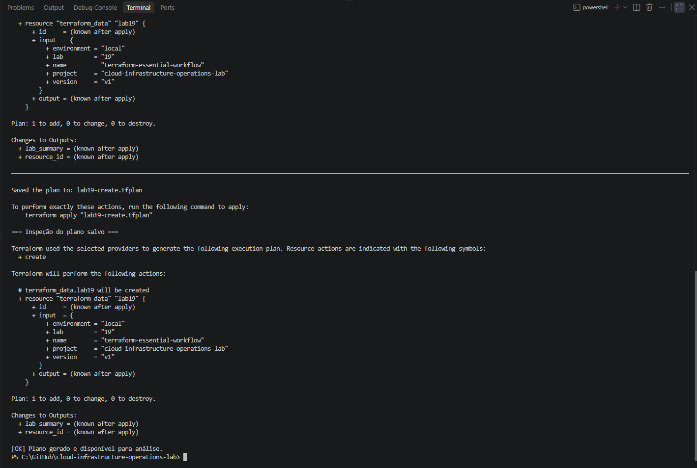
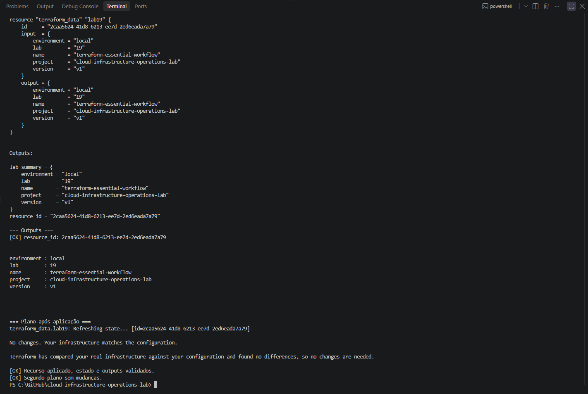
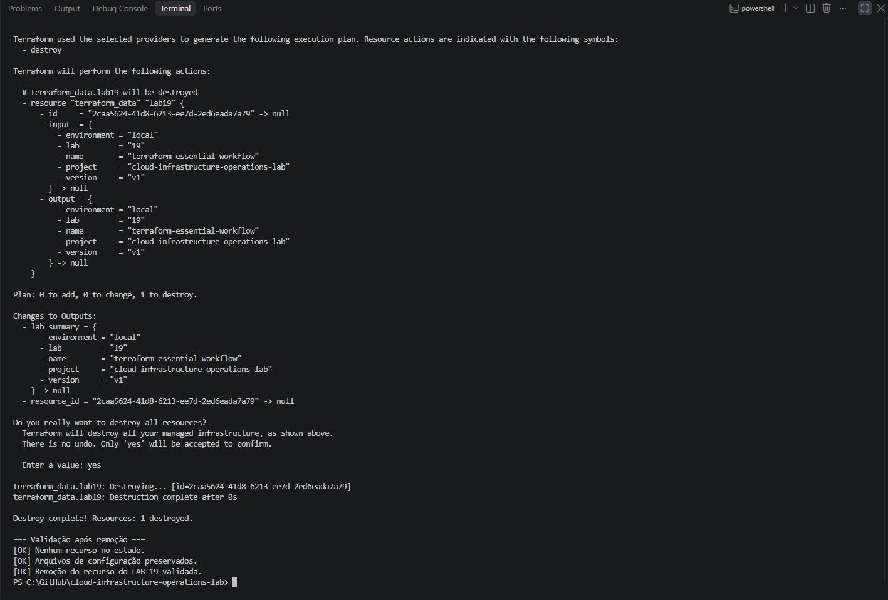

# Lab 19 — Essential Terraform Workflow

[**Português (Brasil)**](README.md) · **English**

## Overview

This lab demonstrates the core Terraform workflow through a **local-only** exercise using the built-in `terraform_data` resource. It covers initialization, formatting, configuration validation, plan generation, review and application of a saved plan, state and output inspection, a second plan without changes, resource destruction, and post-destroy verification.

**Recorded outcome:** The original execution successfully created one `terraform_data.lab19` object, inspected its state and outputs, observed a subsequent no-change plan, destroyed the managed object, and confirmed the Terraform state contained no resources afterward. The three configuration files remained in place.

**Scope boundary:** `terraform_data` is a Terraform-managed object that does not correspond to an EC2 instance, S3 bucket, or other AWS resource. This exercise **did not use AWS credentials or provision cloud infrastructure**. The description below is based on a static review of the committed Terraform files, the Portuguese README, and the screenshot inventory; Terraform was not executed during preparation of this English edition.

## Learning objectives

By completing the recorded workflow, a practitioner can understand how to:

- Initialize a Terraform working directory.
- Validate formatting and configuration syntax before planning.
- Read a plan and interpret its proposed actions.
- Save a plan file and explicitly apply that reviewed plan.
- Inspect a resource in local Terraform state and read outputs.
- Confirm that an unchanged configuration produces a no-change plan.
- Destroy a managed object safely after inspecting the correct workspace and state.
- Distinguish removing a managed object from deleting its configuration or local state files.

The lab introduces the Terraform execution model before the AWS infrastructure deployment in [Lab 20](../20-terraform-aws-infrastructure/).

## Environment

| Item | Original setup |
|---|---|
| Operating system | Windows |
| Command shell | Windows PowerShell 5.1 |
| Terraform CLI | `1.16.1` |
| Platform | `windows_amd64` |
| Workspace | `default` |
| Resource | `terraform_data.lab19` |
| Provider | `terraform.io/builtin/terraform` |
| State storage | Local filesystem |
| AWS authentication | Not required |
| AWS infrastructure changes | None |

The configuration accepts Terraform versions `>= 1.4.0, < 2.0.0`. The `1.16.1` CLI value above identifies the **historical recorded execution**, not a requirement to use exactly that version. In a later session, confirm that the current Terraform binary meets the declared constraint and review compatibility before running.

No external AWS provider plugin is needed for this exercise. The built-in Terraform provider supplies the `terraform_data` resource.

## Repository files

```text
labs/19-terraform-essential-workflow/
├── README.md
├── README.en.md
├── images/
│   ├── Clipboard_10-01-2026_26.png
│   ├── Clipboard_10-01-2026_27.png
│   └── Clipboard_10-01-2026_28.png
└── terraform/
    ├── versions.tf
    ├── main.tf
    └── outputs.tf
```

The original execution used the following working directory on Windows:

```text
C:\GitHub\cloud-infrastructure-operations-lab\labs\19-terraform-essential-workflow\terraform
```

The path is **an example from the original workstation**. Substitute the directory where your repository is actually cloned.

### `versions.tf`

```hcl
terraform {
  required_version = ">= 1.4.0, < 2.0.0"
}
```

This constrains compatible Terraform CLI versions but does not pin the executable to one exact patch release.

### `main.tf`

```hcl
resource "terraform_data" "lab19" {
  input = {
    project     = "cloud-infrastructure-operations-lab"
    lab         = "19"
    name        = "terraform-essential-workflow"
    environment = "local"
    version     = "v1"
  }
}
```

This object stores the five specified values in Terraform-managed state. It is not a virtual machine and does not run external commands or provisioners.

### `outputs.tf`

```hcl
output "resource_id" {
  description = "Identificador do recurso local gerenciado pelo Terraform."
  value       = terraform_data.lab19.id
}

output "lab_summary" {
  description = "Dados do laboratorio registrados no recurso local."
  value       = terraform_data.lab19.output
}
```

The `resource_id` output exposes the generated object identifier, while `lab_summary` exposes the five values recorded by `terraform_data.lab19`. Output descriptions remain in their original Portuguese because they are part of the committed Terraform source and this documentation pass does not modify code.

## How configuration, plans, and state relate

```text
Configuration files (.tf)
         |
         v
terraform init
         |
         v
terraform fmt -check / terraform validate
         |
         v
terraform plan -out=lab19-create.tfplan
         |
         v
Review saved plan
         |
         v
terraform apply lab19-create.tfplan
         |
         v
Local state + resource outputs
         |
         v
terraform plan -detailed-exitcode  → no changes
         |
         v
terraform destroy                  → remove managed object
         |
         v
terraform state list               → empty
         |
         +-- .tf configuration files remain
```

**Configuration** declares the desired object and its attributes. **State** records the object Terraform currently manages. A **plan** compares configuration and state to propose actions. Applying a saved plan executes the exact saved proposal against the state assumptions captured when the plan was created, subject to Terraform's checks.

A saved plan can be stale if the state changes after it is produced. Avoid applying old plans after unrelated changes or after a different operator modifies the working environment.

## Recorded execution procedure

Run these commands in the **`terraform/` subdirectory**. In PowerShell, inspect `$LASTEXITCODE` immediately after external commands when the following step depends on whether they succeeded.

### 1. Check the local repository and Terraform binary

The original procedure checked for uncommitted changes, updated the local clone using a fast-forward-only pull, confirmed the three HCL files existed, and inspected the CLI version.

From the repository root:

```powershell
git status --porcelain
git pull --ff-only
terraform version
```

Only run the pull if your working tree and branch are in the expected state and you intend to update the local checkout. It is not required for the Terraform commands themselves.

Then enter the lab's working directory:

```powershell
Set-Location ".\labs\19-terraform-essential-workflow\terraform"

terraform workspace show
```

The original execution used the `default` workspace. **Before any apply or destroy**, confirm that the currently selected workspace and state belong to this exercise rather than another Terraform project.

### 2. Initialize Terraform

```powershell
terraform init -input=false -no-color

if ($LASTEXITCODE -ne 0) {
    throw "Terraform initialization failed."
}
```

Initialization prepares the working directory and its local Terraform metadata. This configuration uses the built-in provider, so it does not need an external AWS provider binary.

The original initialization completed successfully.

### 3. Verify formatting

```powershell
terraform fmt -check -diff -no-color

if ($LASTEXITCODE -ne 0) {
    throw "Terraform formatting differs from the committed configuration."
}
```

The original formatting check returned exit code `0` and reported no formatting differences.

`fmt -check` does not rewrite the files. By contrast, running `terraform fmt` without `-check` can change tracked HCL, which should then be reviewed in Git.

### 4. Validate configuration

```powershell
terraform validate -no-color

if ($LASTEXITCODE -ne 0) {
    throw "Terraform configuration validation failed."
}
```

Recorded output:

```text
Success! The configuration is valid.
```

Validation checks whether the configuration is internally valid. It does **not** establish that a plan was applied or a resource was created.

### 5. Produce and review a saved creation plan

The original run first encountered:

```text
Error: Too many command line arguments
```

That was a PowerShell/Terraform CLI argument-passing issue. No managed object had been created in the failed attempt.

The successful procedure used an array of argument strings:

```powershell
$PlanArguments = @(
    "plan"
    "-input=false"
    "-no-color"
    "-detailed-exitcode"
    "-out=lab19-create.tfplan"
)

& terraform @PlanArguments
$PlanExitCode = $LASTEXITCODE

if ($PlanExitCode -ne 2) {
    throw "Expected a creation plan (exit code 2); got $PlanExitCode."
}
```

Review the saved plan:

```powershell
terraform show -no-color "lab19-create.tfplan"
```

The original plan showed:

```text
Plan: 1 to add, 0 to change, 0 to destroy.
```

It proposed creation of **only `terraform_data.lab19`**, with the five values declared in `main.tf`.

**Important:** Exit code `2` is expected here because the `-detailed-exitcode` option reports a valid plan with changes. It is not a command error.



### 6. Apply the reviewed plan

```powershell
$ApplyArguments = @(
    "apply"
    "-input=false"
    "-no-color"
    "lab19-create.tfplan"
)

& terraform @ApplyArguments

if ($LASTEXITCODE -ne 0) {
    throw "Terraform apply failed. Inspect state before retrying."
}
```

Recorded result:

```text
Apply complete! Resources: 1 added, 0 changed, 0 destroyed.
```

**Saved-plan behavior:** Applying a saved plan does not open the normal interactive approval step. Reviewing the plan **before** this command is therefore the explicit authorization point. In this lab the proposed action only creates a local Terraform-managed data object; the same technique can have substantial consequences when real cloud resources are involved.

### 7. Inspect the state and outputs

```powershell
terraform state list
terraform show -no-color
terraform output -json
```

The original state contained one managed object:

```text
terraform_data.lab19
```

The `lab_summary` output exposed the five configuration values; `resource_id` exposed the Terraform-generated identifier.

The recorded object identifier is a historical execution-specific value. A recreated object can have a different identifier, and that is not evidence of an error.

**Do not manually edit the state file.** State is operational metadata that may contain identifiers, values, and—in other labs—sensitive attributes. Use Terraform state commands and the normal lifecycle workflow.

### 8. Confirm a no-change plan

```powershell
$CheckArguments = @(
    "plan"
    "-input=false"
    "-no-color"
    "-detailed-exitcode"
)

& terraform @CheckArguments
$PlanExitCode = $LASTEXITCODE

if ($PlanExitCode -ne 0) {
    throw "Expected no changes (exit code 0); got $PlanExitCode."
}
```

Recorded output:

```text
No changes. Your infrastructure matches the configuration.
```

The documented `-detailed-exitcode` meanings are:

| Exit code | Meaning |
|---|---|
| `0` | Plan completed; no changes proposed |
| `1` | Error |
| `2` | Plan completed; changes proposed |

The no-change result establishes agreement between **this configuration and its current Terraform state**. In this local `terraform_data` exercise, it is **not proof of drift detection against live AWS resources**, because no external infrastructure is managed.



### 9. Destroy the managed object

**Destructive-operation guard:** Before running this command, confirm the selected workspace and that `terraform state list` contains only `terraform_data.lab19`. The `destroy` command applies to the **entire current Terraform configuration and workspace**, not merely the most recently created resource.

```powershell
terraform workspace show
terraform state list
```

Then run:

```powershell
$DestroyArguments = @(
    "destroy"
    "-no-color"
)

& terraform @DestroyArguments

if ($LASTEXITCODE -ne 0) {
    throw "Terraform destroy failed. Check state before retrying."
}
```

The original destruction proposal was:

```text
Plan: 0 to add, 0 to change, 1 to destroy.
```

The operator reviewed the proposed action and typed `yes` at the interactive confirmation prompt. The recorded result was:

```text
Destroy complete! Resources: 1 destroyed.
```

In this lab, destroying `terraform_data.lab19` removed only a local Terraform-managed object. Do **not** infer that `terraform destroy` is harmless in other configurations: it can permanently delete real AWS infrastructure when such resources are managed.

### 10. Verify the state after destruction

```powershell
$RemainingResources = @(terraform state list)

if ($LASTEXITCODE -ne 0) {
    throw "Unable to inspect Terraform state."
}

if ($RemainingResources.Count -ne 0) {
    throw "Terraform state still contains managed resources."
}
```

The original `terraform state list` completed with code `0` and **no resource addresses**. The three `.tf` configuration files remained present.

This distinction matters: **Terraform destroy does not automatically remove configuration files**, and a local state file or backup may remain even after the state contains no resources.

Because the configuration still declares `terraform_data.lab19`, a new normal plan after destruction would propose creating it again. That is the expected reconciliation of configuration against the now-empty state, not evidence that the destroy failed.



## Recorded acceptance criteria

The original execution reported the following outcomes as completed:

- Terraform version checked and local initialization successful.
- Formatting check passed without modifications.
- Configuration validated.
- Initial plan proposed exactly one addition.
- Saved plan reviewed and applied.
- State held only `terraform_data.lab19`.
- Both outputs matched configuration.
- Second plan reported no changes with exit code `0`.
- Destroy removed the one managed object.
- State was empty after destruction.
- All three `.tf` files remained in the directory.
- Three screenshots were published.

These are **historical completion results**. This English edition did not rerun any Terraform command.

## Local files and Git hygiene

The repository's root `.gitignore` includes patterns for:

| Path/pattern | Recommended handling |
|---|---|
| `*.tf` | Version in Git |
| `README.md`, `README.en.md`, evidence files | Version in Git |
| `.terraform/` | Do not version |
| `*.tfstate`, `*.tfstate.*` | Do not version |
| `*.tfplan` | Do not version |
| `.terraform.tfstate.lock.info` | Do not version |
| `.terraform.lock.hcl` | Generally commit when dependency selections are relevant |

**Important distinction:** A Git ignore rule prevents accidental addition by normal Git workflows; it is not encryption, access control, guaranteed secret protection, or proof that a file was never committed.

Saved plan files may contain detailed resource attributes and potentially secrets in real deployments. Local Terraform state can also expose sensitive values in plaintext. Keep these artifacts out of public repositories and treat them as operational records requiring appropriate protection.

A `.terraform.lock.hcl` file helps record external provider dependency selections. With this lab's built-in provider, external provider selection is not part of the exercise.

Do not delete the state file merely to make `terraform state list` look empty. A correct destroy changes managed-resource state through Terraform itself.

## Limitations and next steps

**No AWS provisioning.** This lab does not demonstrate EC2/S3 resource creation, cloud credentials, provider-managed remote APIs, or billing effects. Its single resource exists only in Terraform state.

**No remote backend.** It does not configure S3 remote state, DynamoDB or S3-based locking, multi-operator collaboration, or remote state recovery.

**No external drift detection.** The observed no-change plan is meaningful within Terraform's local state for the built-in object; it does not verify any live external cloud resource.

**No test of large-scale changes.** An interactive local destroy and one-object saved plan do not establish production-grade approval, CI/CD, policy-as-code, separation of duties, or state-access practices.

These topics are appropriate extensions of the essential lifecycle and are addressed by later labs in the repository.

## Conclusion

Lab 19 successfully documents the essential Terraform lifecycle—`init`, `fmt -check`, `validate`, saved `plan`, `apply`, `state`, `output`, a no-change plan, `destroy`, and verification of an empty state—without touching AWS infrastructure.

The exercise demonstrates the distinction between Terraform **configuration**, its **managed state**, and the **operations proposed in a plan**, while retaining the original command outputs and evidence boundaries.

## Next lab

[Lab 20 — Terraform AWS Infrastructure](../20-terraform-aws-infrastructure/)

---

[English repository overview](../../README.en.md) · [Portuguese repository overview](../../README.md)
