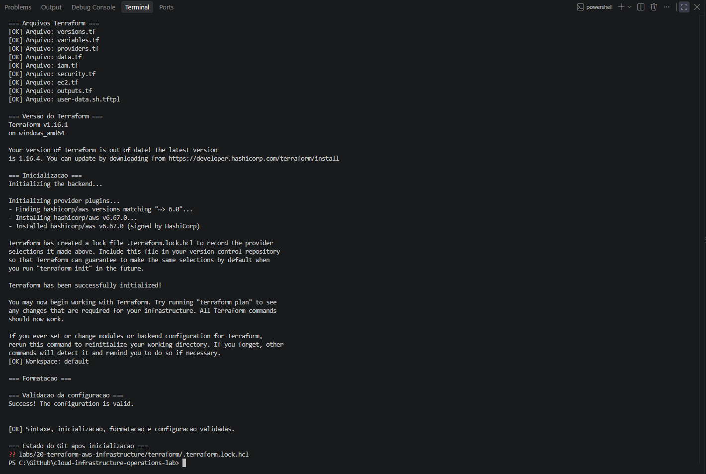
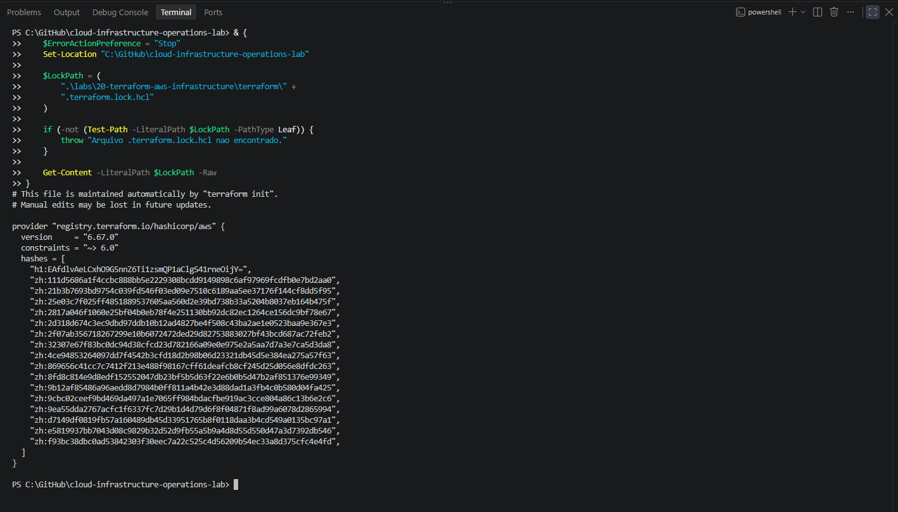
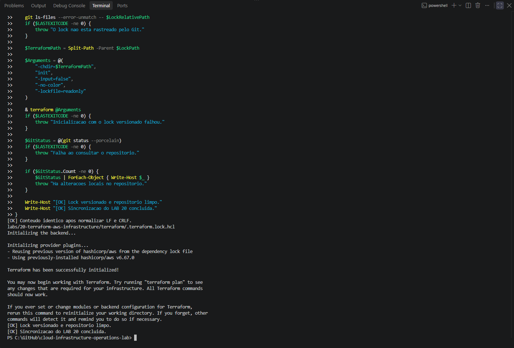
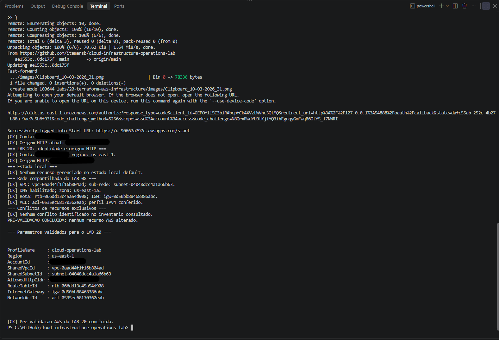
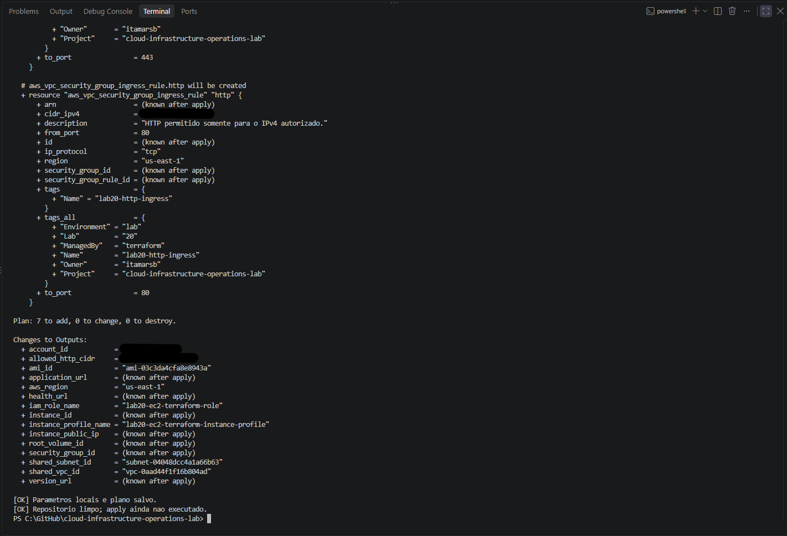
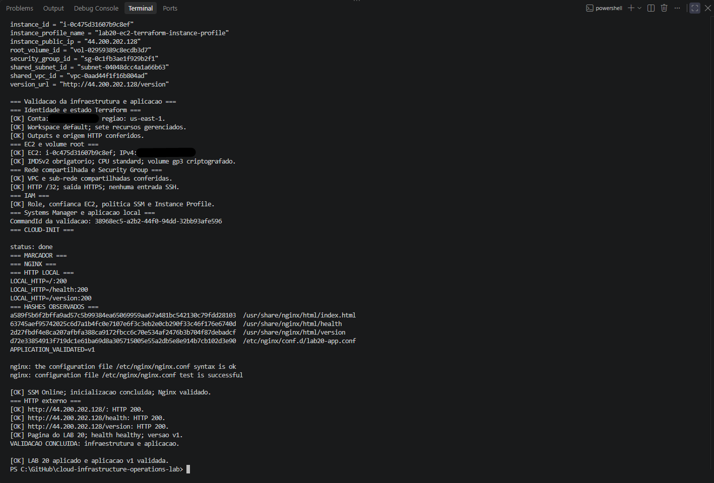
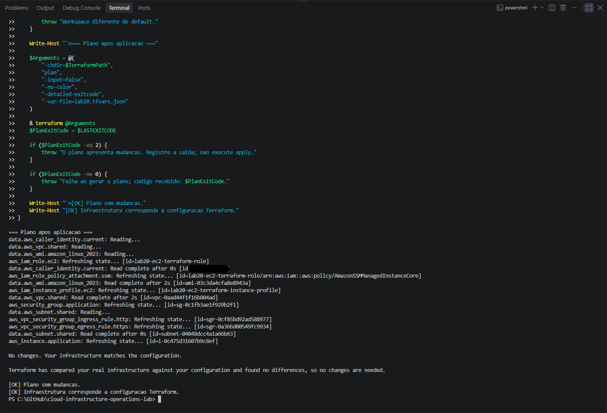
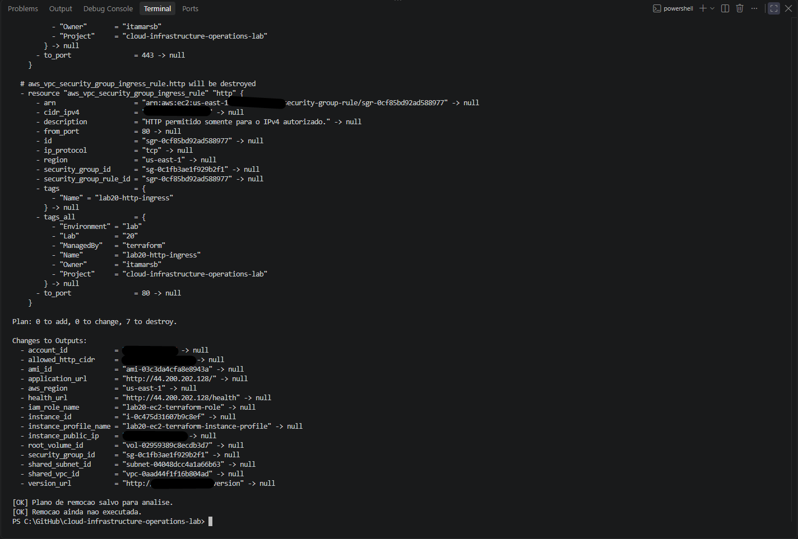
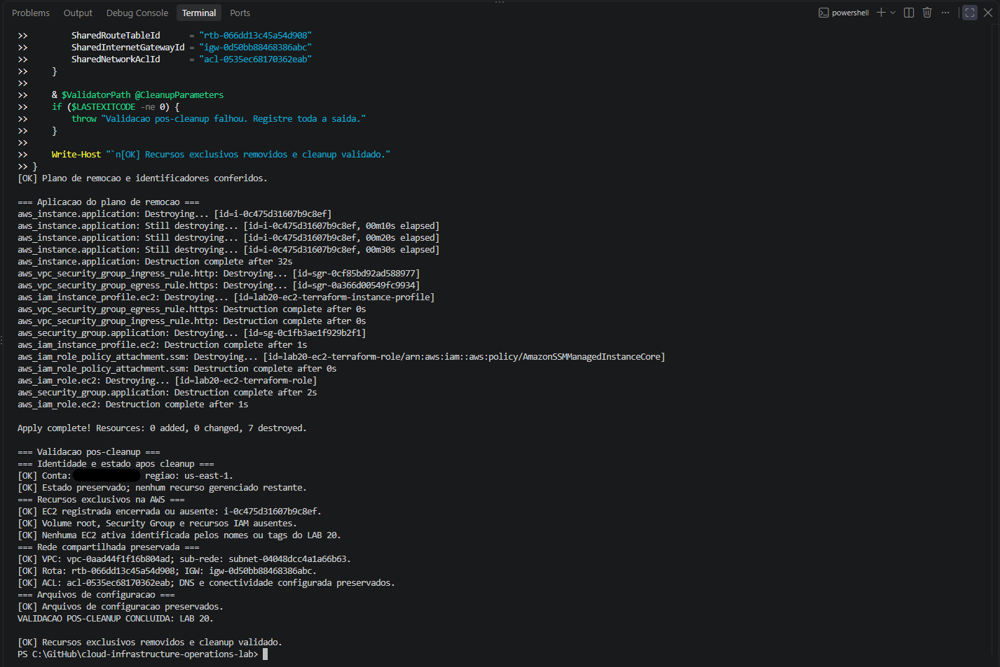

# Lab 20 — Provisioning AWS Infrastructure with Terraform

[**Português (Brasil)**](README.md) · **English**

## Overview

This lab extends the local Terraform lifecycle practiced in [Lab 19](../19-terraform-essential-workflow/) to **real AWS infrastructure**. The configuration provisions an Amazon Linux 2023 EC2 instance running Nginx, with an instance role for AWS Systems Manager, a dedicated Security Group, and an encrypted EBS root volume.

It reuses the VPC and public subnet from [Lab 08](../08-aws-application-network/) as **read-only data sources**, rather than importing that shared network into Lab 20's managed-resource state.

The recorded execution completed on **October 3, 2026**: a reviewed saved plan created seven resources, operational checks confirmed the EC2 and Nginx application, a subsequent plan proposed no changes, and a separately reviewed destroy plan removed all seven managed resources. Post-cleanup checks confirmed the shared network was preserved.

**Documentation boundary:** This English version is an editorial and static technical review of the committed HCL, shell template, PowerShell scripts, lock file and recorded results. No Terraform commands or AWS operations were run during this review.

## Architecture and ownership boundaries

```text
Developer workstation
  AWS IAM Identity Center + AWS CLI + Terraform
                   |
                   v
           AWS provider (us-east-1)
                   |
          +--------+--------+
          |                 |
          v                 v
  Read-only data         Terraform-managed
  sources                Lab 20 resources
  ----------------       -----------------
  AWS identity           EC2 instance + Nginx
  Lab 08 VPC             EC2 IAM role
  Lab 08 subnet          IAM policy attachment
  Amazon Linux AMI       Instance profile
                         Security Group
                         TCP 80 ingress rule
                         TCP 443 egress rule

  Shared subnet / public route / Internet Gateway
                   |
                   v
           EC2 public IPv4
                   |
           Nginx on TCP 80
            /    /health   /version

  Administrative access: AWS Systems Manager Run Command
  No EC2 key pair or inbound SSH rule
```

### Seven resources managed by Terraform

| Terraform resource address | Purpose |
|---|---|
| `aws_iam_role.ec2` | EC2-assumable role |
| `aws_iam_role_policy_attachment.ssm` | Attach `AmazonSSMManagedInstanceCore` |
| `aws_iam_instance_profile.ec2` | Link the role to EC2 |
| `aws_security_group.application` | Dedicated Security Group in the shared VPC |
| `aws_vpc_security_group_ingress_rule.http` | Allow TCP 80 from the operator's authorized IPv4 `/32` |
| `aws_vpc_security_group_egress_rule.https` | Allow outbound TCP 443 to `0.0.0.0/0` |
| `aws_instance.application` | EC2 instance, with Nginx bootstrap |

**Resource counting:** The `root_block_device` block configures an EBS root volume **as part of `aws_instance.application`**. The volume has its own AWS identity and lifecycle but is not an eighth independently declared Terraform resource.

### Four read-only data sources

| Data source | What it queries |
|---|---|
| `aws_caller_identity.current` | AWS account identity |
| `aws_vpc.shared` | Existing Lab 08 VPC, checked against tags and account ownership |
| `aws_subnet.shared` | Existing Lab 08 public subnet, checked against VPC, ownership and availability |
| `aws_ami.amazon_linux_2023` | Most recent matching Amazon Linux 2023 AMI |

The VPC, subnet, Internet Gateway, route tables and Network ACL belong to the shared Lab 08 infrastructure. They are **not Lab 20 managed resources**, and the saved destroy plan must not propose deleting them.

The AMI data source uses `most_recent = true`; the same configuration may choose a different image in a later run. Record the resolved AMI ID if exact reproducibility is required.

## Recorded environment

| Item | Historical configuration |
|---|---|
| Workstation | Windows, Windows PowerShell 5.1 |
| Terraform CLI | `1.16.1` on `windows_amd64` |
| Terraform version constraint | `>= 1.5.0, < 2.0.0` |
| AWS provider source | `hashicorp/aws` |
| Provider constraint | `~> 6.0` |
| Locked AWS provider | `6.67.0` |
| AWS CLI profile | `cloud-operations-lab` |
| Region | `us-east-1` |
| Availability Zone | `us-east-1a` |
| Workspace | `default` |
| Terraform state | Local |
| Instance type | `t3.micro` |
| Operating system | Amazon Linux 2023 |
| Application | Nginx, `v1` |
| Administration | AWS Systems Manager |

The historical AMI and individual AWS resource IDs are recorded in the Portuguese README. They are intentionally omitted from this English guide to avoid confusing archived execution identifiers with resources active today.

The locked provider selection identifies the original dependency used for the run, while `~> 6.0` allows other compatible 6.x versions if the lock is deliberately updated.

## Repository files

```text
labs/20-terraform-aws-infrastructure/
├── README.md
├── README.en.md
├── images/
│   └── nine execution screenshots
├── scripts/
│   ├── test-aws-terraform-prerequisites.ps1
│   ├── test-aws-terraform-infrastructure.ps1
│   └── test-aws-terraform-cleanup.ps1
└── terraform/
    ├── .terraform.lock.hcl
    ├── versions.tf
    ├── variables.tf
    ├── providers.tf
    ├── data.tf
    ├── iam.tf
    ├── security.tf
    ├── ec2.tf
    ├── outputs.tf
    └── user-data.sh.tftpl
```

| File | Responsibility |
|---|---|
| [`versions.tf`](terraform/versions.tf) | Terraform and AWS provider version constraints |
| [`variables.tf`](terraform/variables.tf) | Validated profile, Region, account, network and HTTP source variables |
| [`providers.tf`](terraform/providers.tf) | AWS profile/Region, allowed account and default tags |
| [`data.tf`](terraform/data.tf) | Account, shared VPC/subnet and latest matching AMI queries |
| [`iam.tf`](terraform/iam.tf) | Role, SSM managed-policy attachment and instance profile |
| [`security.tf`](terraform/security.tf) | Security Group and separate ingress/egress rule resources |
| [`ec2.tf`](terraform/ec2.tf) | EC2, user data, metadata, credits, root EBS and tags |
| [`outputs.tf`](terraform/outputs.tf) | Resource IDs, selected AMI, application URLs and shared network references |
| [`user-data.sh.tftpl`](terraform/user-data.sh.tftpl) | Amazon Linux/Nginx bootstrap and local service checks |
| [`.terraform.lock.hcl`](terraform/.terraform.lock.hcl) | Locked AWS provider version and checksum data |
| [Prerequisites](scripts/test-aws-terraform-prerequisites.ps1) | Verify account, operator IP, shared network and resource conflicts |
| [Infrastructure validator](scripts/test-aws-terraform-infrastructure.ps1) | Validate seven state resources and actual AWS/application behavior |
| [Cleanup validator](scripts/test-aws-terraform-cleanup.ps1) | Confirm deleted resources and retained Lab 08 dependencies |

### Why the shell file is read with `file()`

Despite its `.tftpl` extension, `user-data.sh.tftpl` is loaded with Terraform's `file()` function, not `templatefile()`. This preserves Bash variable syntax without Terraform template interpolation. The configuration converts Windows CRLF line endings to LF before passing the script as EC2 user data.

A future migration to `templatefile()` would require carefully accounting for Bash expressions and escaping, rather than simply changing the function name.

## Security and instance configuration

The source HCL implements the following controls:

- Temporary AWS IAM Identity Center authentication; no long-lived AWS access keys in Terraform source.
- AWS provider `allowed_account_ids` containing the explicitly configured expected account.
- Dedicated EC2 role with an EC2 trust policy and the `AmazonSSMManagedInstanceCore` managed policy.
- No EC2 key pair and no inbound SSH rule.
- Inbound HTTP on TCP `80` **only** from the operator's approved IPv4 `/32`.
- Outbound HTTPS on TCP `443` to `0.0.0.0/0`.
- Required IMDSv2; enabled metadata endpoint, response hop limit `1`, and instance metadata tags disabled.
- Encrypted `gp3` root EBS volume of **8 GiB**, with `delete_on_termination = true`.
- CPU credits set to `standard`.
- Default tags identifying the project, lab and Terraform management.

**Limits:** HTTP on TCP 80 is not encrypted. A `/32` restriction is not application authentication. Egress `0.0.0.0/0` on TCP 443 is broader than an endpoint-restricted production network design. IMDSv2, encrypted EBS and SSM access are useful controls but do not constitute comprehensive host or application hardening.

The provider's expected-account check is meaningful but depends on an explicitly supplied `expected_account_id` variable. The source also includes a historical default account value; do not use it as the destination for a new environment without confirming authorization.

## Application bootstrap and validation

The EC2 user-data script installs Nginx, writes the application page and two status files, validates Nginx configuration, enables the service, and checks local HTTP responses.

| Endpoint | Expected HTTP result | Expected body |
|---|---|---|
| `/` | 200 | Contains the Lab 20 application title |
| `/health` | 200 | `healthy` |
| `/version` | 200 | `v1` |

After the local checks succeed, it records `v1` at:

```text
/var/lib/lab20/bootstrap-complete
```

**Terraform apply is not an application readiness test.** AWS can mark the EC2 resource created while cloud-init is still running or while package installation/service configuration is incomplete. The separate infrastructure validator waits for the SSM-managed node and checks cloud-init, bootstrap marker, Nginx service/configuration, local application responses and external HTTP.

The validator also prints observed SHA-256 digests of the relevant application files. **It does not automatically compare them to a known-good expected-hash manifest**; the hashes are inspection data, not an independent integrity proof.

## End-to-end procedure

Run the steps from the repository root on an authorized workstation. The source repo and script names below refer to this project, but the checkout may be placed anywhere.

**Important:** These Terraform commands provision and permanently delete actual AWS infrastructure. They may incur costs. Use a dedicated account or approved lab environment, and inspect exact IDs, plans, dependencies and state before applying or destroying.

### 1. Verify local tools and configuration

Check your working tree and synchronize only if appropriate:

```powershell
git status --porcelain
git pull --ff-only
terraform version
aws --version
```

The original workflow stopped if there were uncommitted changes before pulling. Do not use `git pull` blindly when local changes need preservation.

Define working paths:

```powershell
$TerraformPath = (Resolve-Path ".\labs\20-terraform-aws-infrastructure\terraform").Path
$ScriptsPath = (Resolve-Path ".\labs\20-terraform-aws-infrastructure\scripts").Path
```

Verify that the configuration files, lock file and all three validation scripts exist before proceeding.

### 2. Initialize, format-check and validate

```powershell
$Arguments = @(
    "-chdir=$TerraformPath",
    "init",
    "-input=false",
    "-no-color",
    "-lockfile=readonly"
)
& terraform @Arguments
if ($LASTEXITCODE -ne 0) { throw "Terraform init failed." }

& terraform "-chdir=$TerraformPath" workspace show
if ($LASTEXITCODE -ne 0) { throw "Workspace query failed." }

& terraform "-chdir=$TerraformPath" fmt -check -diff
if ($LASTEXITCODE -ne 0) { throw "Terraform format check failed." }

& terraform "-chdir=$TerraformPath" validate
if ($LASTEXITCODE -ne 0) { throw "Terraform validation failed." }
```

This uses the committed `.terraform.lock.hcl` to reproduce the dependency selection. The original run used AWS provider **6.67.0** and successfully reused the lock file with `-lockfile=readonly`.

**Dependency-lock note:** A text file's raw SHA-256 can differ when line endings change from CRLF to LF. The original investigation normalized the lock file line endings and confirmed its contents matched. The checksums **inside** the lock file validate provider packages; they are distinct from a file-level hash of the lock itself.

### 3. Authenticate and check shared dependencies

```powershell
aws sso login --profile cloud-operations-lab

aws sts get-caller-identity --profile cloud-operations-lab --region us-east-1

$PublicIp = (curl.exe --noproxy "*" -fsS https://checkip.amazonaws.com).Trim()
if ($LASTEXITCODE -ne 0) { throw "Public IPv4 lookup failed." }

$ParsedIp = $null
if (
    -not [Net.IPAddress]::TryParse($PublicIp, [ref]$ParsedIp) -or
    $ParsedIp.AddressFamily -ne
        [Net.Sockets.AddressFamily]::InterNetwork
) {
    throw "Expected a public IPv4 address."
}
$AllowedHttpCidr = "$PublicIp/32"
```

The prerequisites script verifies the intended account/Region, public HTTP source IP, Lab 08 VPC/subnet, DNS, public route, Internet Gateway, Network ACL characteristics and selected resource-name conflicts.

```powershell
$PrerequisitesScript = Join-Path $ScriptsPath "test-aws-terraform-prerequisites.ps1"

$Prerequisites = & $PrerequisitesScript `
    -ProfileName "cloud-operations-lab" `
    -Region "us-east-1" `
    -AllowedHttpCidr $AllowedHttpCidr `
    -PassThru
```

**PowerShell output caution:** Treat errors and pipeline output carefully before constructing the variable file. In a new run, ensure the script returned the expected object and that the source IP and account were rechecked. The `-PassThru` fields are `AccountId`, `SharedVpcId`, `SharedSubnetId`, `AllowedHttpCidr`, `RouteTableId`, `InternetGateway` and `NetworkAclId`.

An IP lookup shows the egress address used for that request and might not match later HTTP traffic through a VPN or proxy. The validator checks the expected source again.

### 4. Write local, untracked Terraform variables

The configuration requires:

| Variable | Meaning |
|---|---|
| `aws_profile` | AWS profile for the provider |
| `aws_region` | Target Region |
| `expected_account_id` | Allowed AWS account ID |
| `shared_vpc_id` | Existing VPC from Lab 08 |
| `shared_subnet_id` | Existing subnet from Lab 08 |
| `allowed_http_cidr` | Current, authorized HTTP source `/32` |

The local file `lab20.tfvars.json` must be created in `terraform/`. It is deliberately excluded from Git by the root `.gitignore`.

An example using the validated values:

```powershell
$Vars = [ordered]@{
    aws_profile         = "cloud-operations-lab"
    aws_region          = "us-east-1"
    expected_account_id = $Prerequisites.AccountId
    shared_vpc_id       = $Prerequisites.SharedVpcId
    shared_subnet_id    = $Prerequisites.SharedSubnetId
    allowed_http_cidr   = $AllowedHttpCidr
}

$VarsPath = Join-Path $TerraformPath "lab20.tfvars.json"
$Vars | ConvertTo-Json -Depth 4 |
    Set-Content -LiteralPath $VarsPath -Encoding UTF8
```

**Windows PowerShell 5.1 note:** `Set-Content -Encoding UTF8` creates a UTF-8 BOM. If that causes a parsing issue for a particular toolchain, write an explicitly BOM-free UTF-8 file instead. This recommendation is a portability precaution; the original Lab 20 records do not claim such an error occurred here.

The variable file contains infrastructure identifiers and expected account data, not AWS credentials. Do not commit it. Review its content and the actual current account before producing plans.

### 5. Create and inspect the saved provisioning plan

```powershell
$Arguments = @(
    "-chdir=$TerraformPath",
    "plan",
    "-input=false",
    "-no-color",
    "-detailed-exitcode",
    "-var-file=lab20.tfvars.json",
    "-out=lab20-create.tfplan"
)

& terraform @Arguments
$PlanExitCode = $LASTEXITCODE

if ($PlanExitCode -ne 2) {
    throw "Expected a create plan (exit 2), got $PlanExitCode."
}
```

Inspect the saved plan before approving it:

```powershell
& terraform "-chdir=$TerraformPath" show -no-color "lab20-create.tfplan"
if ($LASTEXITCODE -ne 0) { throw "Could not read saved plan." }
```

The original result was:

```text
Plan: 7 to add, 0 to change, 0 to destroy.
```

Check the resource addresses and count, account/Region, shared data-source IDs, AMI, instance class, IAM trust and policy, HTTP source, HTTPS egress, EBS encryption/size, IMDSv2, and tags.

`terraform plan -detailed-exitcode` returns **0** for no changes, **1** for error, and **2** for a successful plan proposing changes. The expected initial result is 2.

**Stale plans:** A saved plan represents the state and data-source selections at planning time. If account identity, shared resources, instance image, variables or state change, investigate and regenerate the plan before applying.

### 6. Apply the reviewed creation plan

```powershell
$Arguments = @(
    "-chdir=$TerraformPath",
    "apply",
    "-input=false",
    "-no-color",
    "lab20-create.tfplan"
)

& terraform @Arguments
if ($LASTEXITCODE -ne 0) {
    throw "Apply failed. Inspect Terraform state and AWS before retrying."
}
```

Recorded output:

```text
Apply complete! Resources: 7 added, 0 changed, 0 destroyed.
```

Applying a saved plan bypasses the usual interactive approval prompt. The explicit safety review must occur **before** this command.

Inspect the resulting state and outputs:

```powershell
& terraform "-chdir=$TerraformPath" state list
& terraform "-chdir=$TerraformPath" output -json
& terraform "-chdir=$TerraformPath" show -no-color
```

The root EBS volume appears under the EC2 resource's configuration and AWS inventory, not as a separate eighth Terraform-managed resource.

### 7. Independently validate EC2, SSM and Nginx

```powershell
& (Join-Path $ScriptsPath "test-aws-terraform-infrastructure.ps1") `
    -ProfileName "cloud-operations-lab" `
    -Region "us-east-1" `
    -AllowedHttpCidr $AllowedHttpCidr
```

The validator checks the seven managed resource addresses in Terraform's state, their output relationships, tags and the deployed AWS resources. It examines:

- EC2 running, public networking and expected AMI/instance class.
- Encrypted `gp3` root EBS volume, 8 GiB, configured for removal on termination.
- Required IMDSv2, metadata hop limit and CPU credits `standard`.
- Dedicated Security Group, inbound TCP 80 source `/32`, outbound TCP 443.
- IAM role trust, managed-policy association and instance profile.
- SSM managed-node registration and remote command execution.
- Cloud-init status and the `/var/lib/lab20/bootstrap-complete` marker.
- Nginx service state, enabled flag and configuration validity.
- Local and external HTTP 200 responses for `/`, `/health` and `/version`.

The script accepts a configurable wait window (default **900 seconds**) for certain readiness checks. A delayed readiness state is not automatically a provisioning failure, but a timeout must be investigated rather than assumed to be harmless.

The validator uses SSM Run Command for host-level checks. Its checks are **non-remediating by intent**, not exclusively passive AWS `Describe` or Terraform queries: it initiates remote command execution.

The original test observed SSM `Online`, cloud-init `status: done`, active Nginx, and the expected application responses. The captured SHA-256 hashes are **observational**, not compared against a known-good checksum manifest.

### 8. Verify the no-change plan

With the same variable file:

```powershell
$Arguments = @(
    "-chdir=$TerraformPath",
    "plan",
    "-input=false",
    "-no-color",
    "-detailed-exitcode",
    "-var-file=lab20.tfvars.json"
)

& terraform @Arguments
$PlanExitCode = $LASTEXITCODE

if ($PlanExitCode -ne 0) {
    throw "Expected no changes (exit 0); got $PlanExitCode."
}
```

Recorded result:

```text
No changes. Your infrastructure matches the configuration.
```

The no-change result establishes that **the managed resources matched the declared configuration at the time of this plan**. It does not prove continuous absence of drift, availability under load or equivalence of every shared network setting. The lab did not deliberately introduce drift for detection.

### 9. Plan the destruction separately

**Before destruction**, preserve the live outputs needed by the independent post-cleanup check, including the EC2 instance ID, root volume ID, Security Group ID, and Lab 08 VPC, subnet, route table, Internet Gateway and Network ACL identifiers.

Check the current account and `default` workspace again. Then create a saved destroy plan:

```powershell
$Arguments = @(
    "-chdir=$TerraformPath",
    "plan",
    "-destroy",
    "-input=false",
    "-no-color",
    "-detailed-exitcode",
    "-var-file=lab20.tfvars.json",
    "-out=lab20-destroy.tfplan"
)

& terraform @Arguments
$PlanExitCode = $LASTEXITCODE
if ($PlanExitCode -ne 2) {
    throw "Expected a destroy plan (exit 2), got $PlanExitCode."
}
```

Inspect:

```powershell
& terraform "-chdir=$TerraformPath" show -no-color "lab20-destroy.tfplan"
if ($LASTEXITCODE -ne 0) { throw "Could not read destroy plan." }
```

The recorded destroy proposal was:

```text
Plan: 0 to add, 0 to change, 7 to destroy.
```

**Do not proceed** unless it contains only the seven Lab 20 managed resources and leaves shared Lab 08 dependencies untouched.

### 10. Apply the reviewed destroy plan

```powershell
$Arguments = @(
    "-chdir=$TerraformPath",
    "apply",
    "-input=false",
    "-no-color",
    "lab20-destroy.tfplan"
)

& terraform @Arguments
if ($LASTEXITCODE -ne 0) {
    throw "Destroy apply failed. Inspect state and remaining AWS resources."
}
```

Recorded result:

```text
Apply complete! Resources: 0 added, 0 changed, 7 destroyed.
```

The EC2 root EBS volume was configured with `delete_on_termination=true`; its removal was separately verified in the AWS inventory.

**Irreversibility:** This deletes live EC2/IAM/SG resources and may destroy local instance data. It is not a rollback. Tags, names and saved plan review are safeguards, but cannot alone establish that resources have no external dependencies or data-retention requirements.

### 11. Verify cleanup and shared-network preservation

The dedicated post-cleanup script accepts the saved identifiers:

```powershell
$CleanupScript = Join-Path $ScriptsPath "test-aws-terraform-cleanup.ps1"

& $CleanupScript `
    -ProfileName "cloud-operations-lab" `
    -Region "us-east-1" `
    -InstanceId "<recorded instance ID>" `
    -RootVolumeId "<recorded root EBS volume ID>" `
    -SecurityGroupId "<recorded Security Group ID>" `
    -SharedVpcId "<recorded Lab 08 VPC ID>" `
    -SharedSubnetId "<recorded Lab 08 subnet ID>" `
    -SharedRouteTableId "<recorded Lab 08 route table ID>" `
    -SharedInternetGatewayId "<recorded Lab 08 IGW ID>" `
    -SharedNetworkAclId "<recorded Lab 08 NACL ID>"
```

**Replace every placeholder with verified IDs from the actual current deployment.** Do not reuse the historical identifiers in the Portuguese README.

The original post-cleanup verification confirmed:

- The EC2 instance and root EBS volume were terminated/absent.
- Lab 20-specific Security Group and IAM resources were absent.
- No exclusive resources remained managed in the local Terraform state.
- The shared Lab 08 VPC and subnet were available and associated correctly.
- The effective route and Internet Gateway relationship remained as expected.
- The Network ACL identity and selected IPv4 profile were preserved.
- The Terraform configuration files remained present.

The checker does **not** exhaustively compare every shared-network attribute against a pre-deployment snapshot. Its conclusions apply to the identities, tags and network properties it actually checks.

## State, plans and version control

The root `.gitignore` excludes `.terraform/`, `*.tfstate`, state backups, `*.tfplan`, local `*.tfvars` and `*.tfvars.json`. The dependency lock file is committed.

| Artifact | Version-control practice |
|---|---|
| HCL source, user data, scripts and README files | Commit |
| `.terraform.lock.hcl` | Commit to preserve provider selection |
| `lab20.tfvars.json` | Keep local and untracked |
| `.terraform/` | Do not commit |
| Local state and state backups | Do not commit |
| Saved plan files | Do not commit |

State and saved plan files can contain infrastructure identities, user data and, in other configurations, sensitive material. **Git ignore rules are not encryption or access controls.** Store operational artifacts securely and preserve state for the full lifecycle of managed resources.

Deleting the state file or using `terraform state rm` merely to make the state appear empty does **not** delete AWS objects. Use a reviewed Terraform destroy workflow and independent AWS checks.

After a successful destroy, a normal plan can propose **seven creations again** because the HCL source still describes the desired infrastructure. That is expected.

The original project uses a **local state backend**, not shared remote state or collaborative locking. Multi-operator workflows should not adopt this arrangement without a deliberate state-management design.

## Original evidence

All nine screenshot paths below are present in the repository. Their labels follow the Portuguese README. The screenshots were **not inspected pixel-by-pixel at full resolution** for this English review.

### 1. Initialization, format and validation



### 2. Provider lock version and checksums



### 3. Committed and reused lock file



### 4. AWS prerequisites



### 5. Creation plan



### 6. Infrastructure and Nginx validation



### 7. No-change plan



### 8. Destruction plan



### 9. Completed cleanup



## Limitations and operational risks

**Resource scope:** Seven Terraform-managed resources were created. The root volume is represented inside the EC2 resource, and the Lab 08 network is queried but not managed.

**Provider and AMI reproducibility:** The lock selects AWS provider `6.67.0`, while the provider constraint allows compatible changes under version 6. The AMI data source chooses the latest matching image and can produce different infrastructure after a future new plan.

**Bootstrapping:** Terraform creation of EC2 is separate from cloud-init and Nginx readiness. An `apply` exit code of zero cannot substitute for operational validation.

**HTTP exposure:** The application serves HTTP without TLS, restricted to one public source IPv4; administrative access uses SSM. This is a test setup, not production hardening.

**State security:** Local state and saved plans may expose resource identifiers and user data. The source's expected-account default and the validation scripts' historical account defaults must be reviewed before porting to another account.

**Costs:** The original resources can incur EC2 compute, EBS storage, public IPv4 and network transfer charges while active. Destroying them later does not undo usage already billed. No load balancer, NAT Gateway, database or application bucket was created.

**Evidence privacy:** The Portuguese README contains historic AWS resource IDs, network identifiers and a Systems Manager CommandId; terminal screenshots can expose additional account or IP information. Inspect source and images before claiming anonymization.

**Limitations:** No remote backend, shared locking, multi-operator collaboration, automated CI/CD, drift-injection experiment, multi-AZ failover, autoscaling or external performance/SLA test was performed.

## Conclusion

Lab 20 demonstrates an end-to-end Terraform-based AWS provisioning lifecycle: **seven managed resources, four external data sources, reviewed saved plans, independent operational validation, a no-change plan, and a reviewed destroy followed by AWS cleanup checks**.

The recorded results support a successful single-instance Nginx deployment and removal under the lab conditions, while preserving the shared network and distinguishing Terraform state management from actual AWS resource health.

## Next lab

[Lab 21 — Terraform Remote State](../21-terraform-remote-state/)

---

[English repository overview](../../README.en.md) · [Portuguese repository overview](../../README.md)
