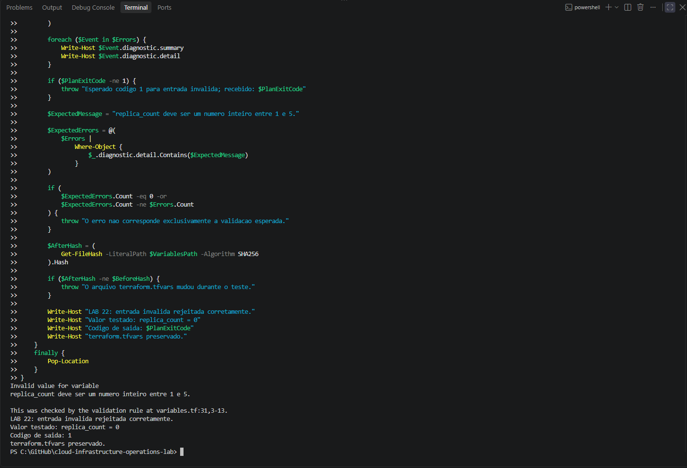
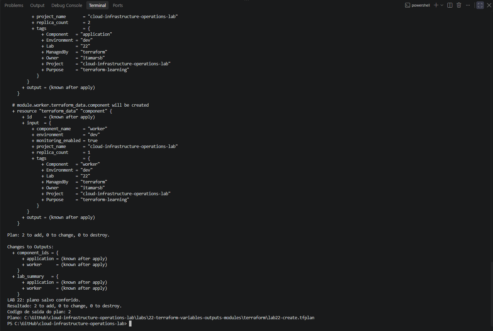
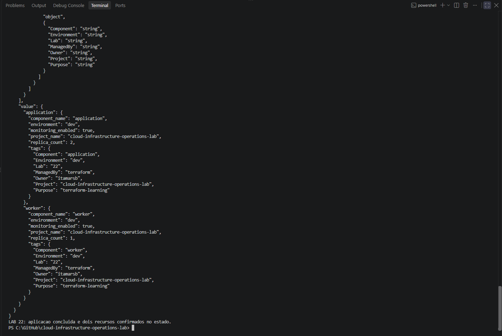
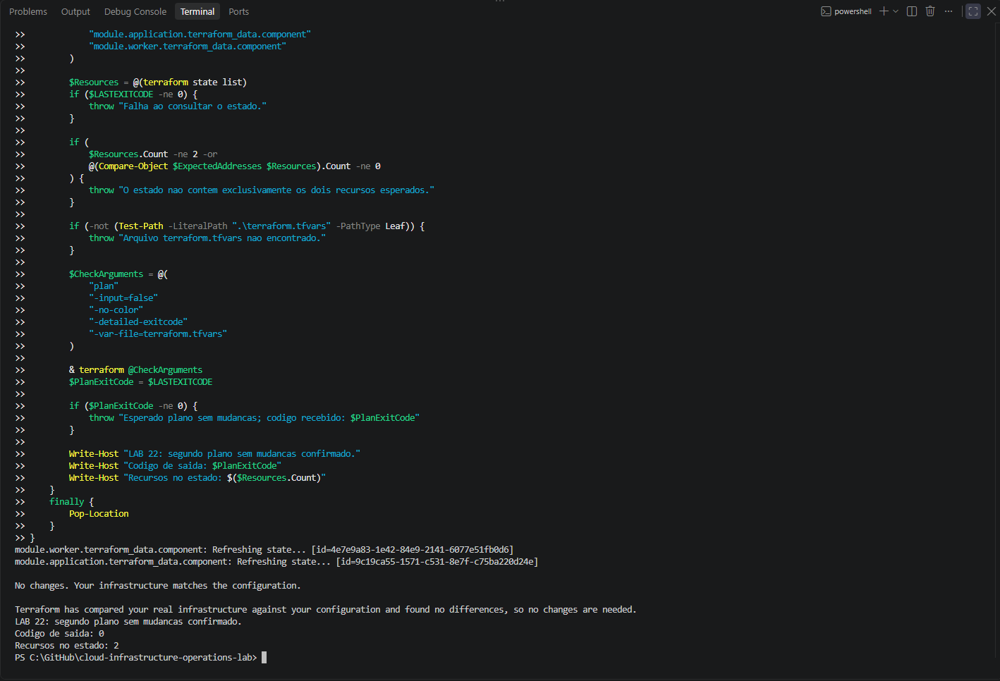
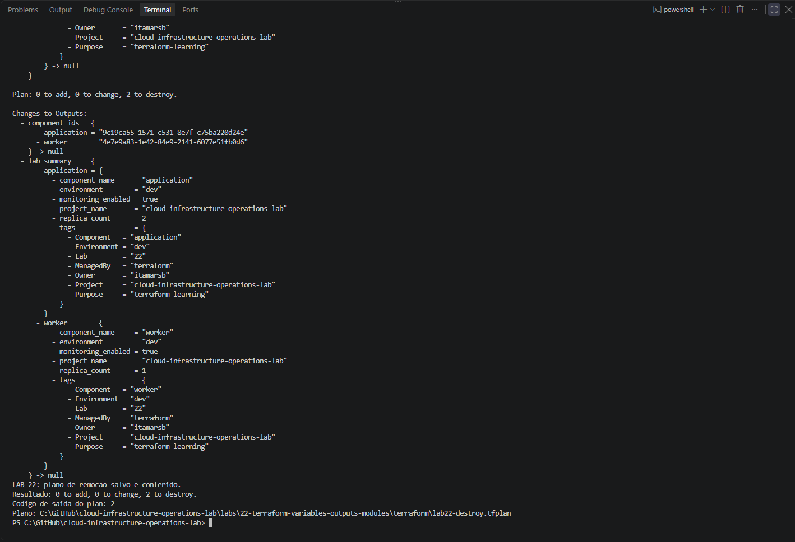
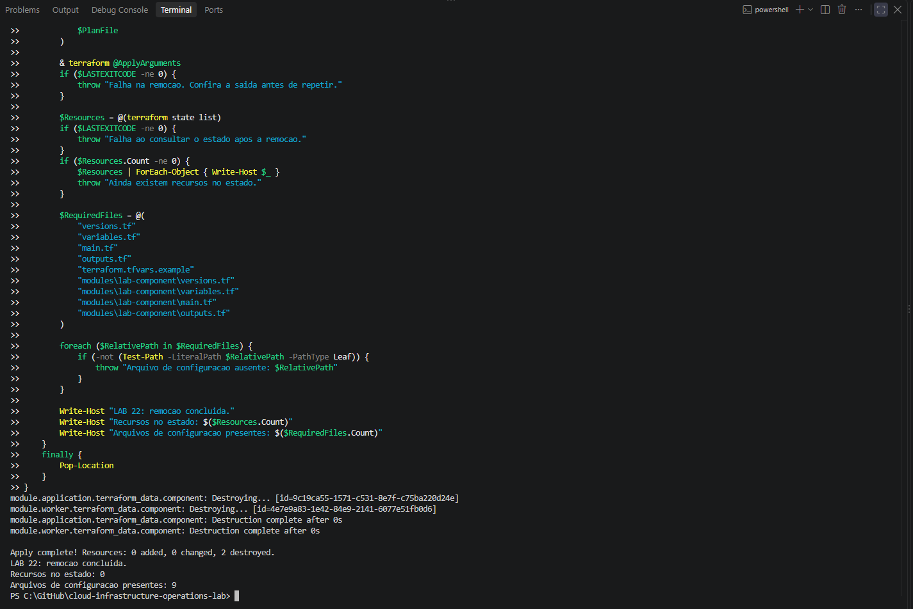

# Lab 22 — Terraform Variables, Outputs, and Reusable Modules

[**Português (Brasil)**](README.md) · **English**

## Overview

This local-only Terraform exercise demonstrates typed inputs, validation, reuse of a child module, root outputs, saved plans, state inspection, a no-change plan and controlled destruction. The root module invokes the same child module twice, under the names **application** and **worker**.

**Recorded result:** Completed October 4, 2026. An invalid value was rejected, two Terraform-managed data objects were created, their outputs were checked, a second plan reported no changes, and both objects were removed. The final state was empty and all nine configuration files remained.

This English guide is based on the committed source and historical README. **No Terraform or AWS commands were executed** during this review.

## Architecture and scope

~~~text
terraform/ (root module; local state)
  |
  +-- input variables and validation
  |
  +-- module.application
  |     ./modules/lab-component
  |     replica_count = 2 (stored metadata)
  |     terraform_data.component (ONE object)
  |
  +-- module.worker
        ./modules/lab-component
        replica_count = 1 (stored metadata)
        terraform_data.component (ONE object)

Child outputs: component_id, component_summary
       |
       v
Root outputs: component_ids, lab_summary
~~~

**Key distinction:** The values named replica_count and monitoring_enabled are teaching metadata. They do **not** create application replicas or enable monitoring. Each child module call creates exactly one built-in Terraform data object regardless of its recorded replica count.

The exercise has no AWS provider, no AWS authentication, no EC2 or other cloud resources, no provisioners and no S3 backend. The local exercise is independent of Lab 21's S3 remote state.

| Environment element | Historical value |
|---|---|
| Workstation | Windows, PowerShell |
| Terraform CLI | 1.16.1, windows_amd64 |
| Required Terraform | >= 1.4.0 and < 2.0.0 |
| Backend and workspace | Local state; default |
| Provider | terraform.io/builtin/terraform |
| Managed resource addresses | Two, one per module call |
| AWS charges | None from this exercise |

## Files and module interfaces

~~~text
labs/22-terraform-variables-outputs-modules/
├── README.md
├── README.en.md
├── images/                         (seven screenshots)
└── terraform/
    ├── versions.tf
    ├── variables.tf
    ├── main.tf
    ├── outputs.tf
    ├── terraform.tfvars.example
    └── modules/
        └── lab-component/
            ├── versions.tf
            ├── variables.tf
            ├── main.tf
            └── outputs.tf
~~~

There are **nine configuration files**: five in the root, including the sample variables file, and four in the child module.

| Source | Responsibility |
|---|---|
| [Root versions](terraform/versions.tf) | CLI compatibility |
| [Root variables](terraform/variables.tf) | Typed values and validation |
| [Root module calls](terraform/main.tf) | Application and worker calls |
| [Root outputs](terraform/outputs.tf) | IDs and component data |
| [Sample inputs](terraform/terraform.tfvars.example) | Untracked local parameters example |
| [Child versions](terraform/modules/lab-component/versions.tf) | Child CLI compatibility |
| [Child variables](terraform/modules/lab-component/variables.tf) | Validated child interface |
| [Child resource](terraform/modules/lab-component/main.tf) | One terraform_data.component per invocation |
| [Child outputs](terraform/modules/lab-component/outputs.tf) | Component ID and summary |

### Root variables

| Input | Type | Valid values / meaning |
|---|---|---|
| project_name | string | 3–50 characters; lowercase letter first, followed by lowercase letters, digits or hyphens |
| environment | string | dev, staging, prod |
| replica_count | number | An integer between 1 and 5 |
| monitoring_enabled | bool | Stored flag; no monitoring service is launched |
| common_tags | map(string) | Additional metadata, passed to each child |

All root and child variables disallow null. The child validates component_name as a 3–30-character name in the same pattern.

An example of the committed input values:

~~~hcl
project_name       = "cloud-infrastructure-operations-lab"
environment        = "dev"
replica_count      = 2
monitoring_enabled = true

common_tags = {
  Owner   = "itamarsb"
  Purpose = "terraform-learning"
}
~~~

The worker module call **sets replica_count to 1 explicitly**, while the application receives the root variable (2 in the recorded run). The module merges supplied tags with Project, Environment, Component, ManagedBy and Lab metadata. The later, module-defined map wins if a key is duplicated; these are **stored values**, not tags actually applied to AWS resources.

### How the root exposes child outputs

The child exports the ID and stored data of its one resource. The root aggregates both child instances:

~~~hcl
output "component_ids" {
  value = {
    application = module.application.component_id
    worker      = module.worker.component_id
  }
}

output "lab_summary" {
  value = {
    application = module.application.component_summary
    worker      = module.worker.component_summary
  }
}
~~~

The output descriptions in the real source remain in Portuguese, since this documentation pass does not modify Terraform code. The snippets above illustrate the exact value expressions.

## Recorded Terraform workflow

Run the commands from the root module at labs/22-terraform-variables-outputs-modules/terraform/. The original Windows checkout happened to be under C:\GitHub, but that location is not required.

### 1. Prepare, initialize and validate

From the repository root:

~~~powershell
git status --porcelain
Set-Location ".\labs\22-terraform-variables-outputs-modules\terraform"
Copy-Item "terraform.tfvars.example" "terraform.tfvars"

terraform init -input=false -no-color
if ($LASTEXITCODE -ne 0) { throw "Terraform init failed." }

terraform workspace show
if ($LASTEXITCODE -ne 0) { throw "Workspace query failed." }

terraform fmt -check -diff -recursive -no-color
if ($LASTEXITCODE -ne 0) { throw "Terraform formatting failed." }

terraform validate -no-color
if ($LASTEXITCODE -ne 0) { throw "Terraform validation failed." }
~~~

The original execution used workspace default, reported no format differences, and passed validation. The -recursive flag checks HCL formatting inside the child module as well as the root. The original repository synchronization used git pull --ff-only after checking for changes; pulling is not a Terraform prerequisite.

[Recorded initialization and validation](images/Clipboard_10-04-2026_62.png)

### 2. Demonstrate variable rejection

~~~powershell
terraform plan -input=false -json -detailed-exitcode "-var=replica_count=0"
$PlanExitCode = $LASTEXITCODE
if ($PlanExitCode -ne 1) {
    throw "Expected invalid-input error (exit 1); got $PlanExitCode."
}
~~~

The original plan failed with exit code **1** and this validation message:

~~~text
replica_count deve ser um numero inteiro entre 1 e 5.
~~~

The original workflow compared the SHA-256 digest of terraform.tfvars before and after the rejected plan and found that the file had not changed. No resource was created.

This establishes rejection of **one** invalid value, not exhaustive validation of all possible input boundaries.

### 3. Save and inspect a creation plan

~~~powershell
$ArgsCreate = @(
  "plan"
  "-input=false"
  "-no-color"
  "-detailed-exitcode"
  "-var-file=terraform.tfvars"
  "-out=lab22-create.tfplan"
)

& terraform @ArgsCreate
$PlanExitCode = $LASTEXITCODE
if ($PlanExitCode -ne 2) { throw "Expected two additions; got exit $PlanExitCode." }

terraform show -no-color lab22-create.tfplan
if ($LASTEXITCODE -ne 0) { throw "Cannot inspect saved plan." }
~~~

Recorded outcome:

~~~text
Plan: 2 to add, 0 to change, 0 to destroy.
~~~

The JSON representation of the saved plan identified only:

~~~text
module.application.terraform_data.component
module.worker.terraform_data.component
~~~

The values stored in each object are not proof that two application replicas or one worker process have actually started.

### 4. Apply and inspect state and outputs

~~~powershell
terraform apply -input=false -no-color lab22-create.tfplan
if ($LASTEXITCODE -ne 0) { throw "Terraform apply failed." }

terraform state list
if ($LASTEXITCODE -ne 0) { throw "State query failed." }

terraform output -json
if ($LASTEXITCODE -ne 0) { throw "Output query failed." }
~~~

Two objects were created, at the two module addresses above. The root component_ids output provided their generated identifiers; lab_summary exposed the component-specific recorded values.

| Module call | Stored replica_count | Actual terraform_data objects |
|---|---:|---:|
| application | 2 | 1 |
| worker | 1 | 1 |

The generated IDs in the Portuguese historical record are execution-specific. They should not be reused as configuration parameters. Applying a saved plan does not request the ordinary interactive approval prompt, so the review needs to happen **before** the apply.

### 5. Confirm a no-change plan

~~~powershell
terraform plan -input=false -no-color -detailed-exitcode "-var-file=terraform.tfvars"
$PlanExitCode = $LASTEXITCODE
if ($PlanExitCode -ne 0) { throw "Expected no changes; got exit $PlanExitCode." }
~~~

Recorded output:

~~~text
No changes. Your infrastructure matches the configuration.
~~~

This establishes the correspondence between **this local configuration and its Terraform state at the moment of the test**. It is not a test of real-cloud drift, uptime, monitoring, application health or high availability.

### 6. Plan the destruction

Verify that the workspace and state contain only the expected two module addresses, then:

~~~powershell
terraform workspace show
terraform state list

$ArgsDestroy = @(
  "plan"
  "-destroy"
  "-input=false"
  "-no-color"
  "-detailed-exitcode"
  "-var-file=terraform.tfvars"
  "-out=lab22-destroy.tfplan"
)

& terraform @ArgsDestroy
$PlanExitCode = $LASTEXITCODE
if ($PlanExitCode -ne 2) { throw "Expected a destroy plan; got exit $PlanExitCode." }

terraform show -no-color lab22-destroy.tfplan
if ($LASTEXITCODE -ne 0) { throw "Cannot inspect destroy plan." }
~~~

Recorded result:

~~~text
Plan: 0 to add, 0 to change, 2 to destroy.
~~~

A saved destroy plan must be inspected before use. This exercise manages only local Terraform data objects, but the same workflow can delete actual infrastructure in projects using external providers.

### 7. Destroy and verify

~~~powershell
terraform apply -input=false -no-color lab22-destroy.tfplan
if ($LASTEXITCODE -ne 0) { throw "Destroy failed; inspect state." }

$Remaining = @(terraform state list)
if ($LASTEXITCODE -ne 0) { throw "Cannot inspect final state." }
if ($Remaining.Count -ne 0) { throw "Managed resources remain in state." }
~~~

Recorded result:

~~~text
Apply complete! Resources: 0 added, 0 changed, 2 destroyed.
LAB 22: remocao concluida.
Recursos no estado: 0
Arquivos de configuracao presentes: 9
~~~

The nine configuration files remained, while the state contained no managed objects. A new normal plan can therefore propose creating them again. Deleting a state file is **not** equivalent to executing Terraform destroy.

## Plan exit codes

| Code for plan -detailed-exitcode | Meaning | Lab 22 observation |
|---|---|---|
| 0 | Valid plan, no changes | Post-apply plan |
| 1 | Error | Invalid input rejected |
| 2 | Valid plan, changes proposed | Creation and destruction plans |

In Windows PowerShell, check $LASTEXITCODE immediately after the relevant native command. Exit code 2 is not a failure when changed resources are expected.

## Evidence inventory

All **seven** original PNG files exist in the repository. Six are embedded beside the corresponding workflow stage, and the remaining initial-validation screenshot is linked above:

| Stage | Image |
|---|---|
| Initialization, formatting and validation | [Screenshot 62](images/Clipboard_10-04-2026_62.png) |
| Invalid variable | [Screenshot 63](images/Clipboard_10-04-2026_63.png) |
| Saved creation plan | [Screenshot 64](images/Clipboard_10-04-2026_64.png) |
| Apply, state and outputs | [Screenshot 65](images/Clipboard_10-04-2026_65.png) |
| No-change plan | [Screenshot 66](images/Clipboard_10-04-2026_66.png) |
| Destroy plan | [Screenshot 67](images/Clipboard_10-04-2026_67.png) |
| Final destruction and empty state | [Screenshot 68](images/Clipboard_10-04-2026_68.png) |

The captions reflect the original README's stage descriptions. The screenshots were **not individually inspected at full resolution** for this editorial review.

## Source control, risks and boundaries

The repository ignores local terraform.tfvars, .terraform/, Terraform state and saved plan files. The example variables file, root and child configuration, and documentation remain versioned.

Ignore rules do not encrypt or protect sensitive files from local access. In real deployments, local variable files, plan files and state can contain credentials, secrets or infrastructure metadata; they require appropriate handling and access restrictions.

The exercise intentionally does **not** demonstrate AWS provisioning, actual application replicas, a monitoring stack, remote state locking, service runtime behavior or external drift detection. Module reuse is a configuration-design practice, not proof of an operational distributed system.

A more comprehensive input test suite could cover invalid names, null inputs, unrecognized environments, fractional and excessive replica counts, conflicting metadata keys and unexpected types.

## Conclusion

Lab 22 provides a documented, local Terraform workflow of **typed variables → invalid-input rejection → child-module reuse → root outputs → saved plans → no-change validation → controlled destruction**.

The original results support two successfully managed local data objects and an empty state after cleanup, while preserving a clear distinction between **stored teaching metadata** and real runtime infrastructure.

## Next lab

[Lab 23 — Terraform Changes and Drift](../23-terraform-changes-drift/)

---

[English repository overview](../../README.en.md) · [Portuguese repository overview](../../README.md)
