# Lab 23 — Terraform Configuration Changes and Drift

[**Português (Brasil)**](README.md) · **English**

## Overview

This lab distinguishes an **intentional Terraform configuration change** from **drift introduced outside Terraform**. It uses the HashiCorp Local provider to manage a JSON configuration file on the workstation, compares the file's observed content against Terraform configuration and state, applies a reviewed reconciliation plan, and verifies the result with independent SHA-256 and content checks.

The original execution was completed in October 2026. The managed file was created, updated from v1 to v2, modified outside Terraform, restored to the declared configuration, and deleted through Terraform. The final Terraform state contained no managed resources, while the source configuration and four local evidence records were retained.

**Scope:** No EC2 instance, S3 bucket, AWS authentication, service process, or remote backend is involved. The application JSON is teaching data; no application is launched from this file. This English guide is based on static source review and the original execution record. It does **not** represent a fresh Terraform run or live filesystem validation.

## Architecture and three sources of truth

```text
Terraform source and local variables
       application_version / log_level
                 |
                 v
        local_file.application_config
                 |
          Local Terraform state
                 |
                 v
../local-artifacts/application-config.json
       (actual filesystem content)
                 |
          Direct PowerShell read
          JSON + SHA-256 comparison
```

During the drift phase:

| Source | application_version | log_level |
|---|---|---|
| Desired Terraform configuration | v2 | info |
| Terraform's previously recorded state/outputs | v2 | info |
| Actual file after outside modification | v2 | **debug** |

The mismatch illustrates why reading outputs or a previously recorded state alone cannot establish the **current** contents of an externally mutable resource. A normal Terraform plan refreshes resource observations and can detect relevant differences; direct examination remains a useful independent check.

The experiment deliberately edited **only** the dedicated Lab 23 JSON file. It did not manually edit Terraform state.

## Environment and files

| Component | Original configuration |
|---|---|
| OS and shell | Windows / Windows PowerShell 5.1 |
| Terraform CLI | 1.16.1, windows_amd64 |
| Terraform required version | >= 1.4.0, < 2.0.0 |
| Provider | hashicorp/local, exactly 2.9.1 |
| Backend / workspace | Local state / default |
| Managed resource | local_file.application_config |
| Managed target | ../local-artifacts/application-config.json |
| Terraform AWS resources | None |

The local artifact path is constructed with `abspath()` relative to the Terraform module. The original Windows path under `C:\GitHub` is incidental; the repository can be cloned elsewhere.

| File | Purpose |
|---|---|
| [versions.tf](terraform/versions.tf) | Terraform version requirement and pinned local provider |
| [variables.tf](terraform/variables.tf) | Validated project, environment, version, and log-level inputs |
| [main.tf](terraform/main.tf) | JSON generation and local_file resource |
| [outputs.tf](terraform/outputs.tf) | File path, expected content SHA-256, and recorded configuration |
| [terraform.tfvars.example](terraform/terraform.tfvars.example) | Reproducible initial v1/info/dev parameters |
| [.terraform.lock.hcl](terraform/.terraform.lock.hcl) | Provider selection and package hashes |
| [.gitignore](.gitignore) | Exclude the entire local-artifacts/ directory |
| [images/](images/) | Fourteen original execution screenshots |

The project root also ignores Terraform state, local variable files, cached plugins, and saved plans.

### Source-defined JSON object

The real HCL declares four inputs and uses `jsonencode()`, followed by a terminal newline, to write:

```json
{
  "project_name": "cloud-infrastructure-operations-lab",
  "environment": "dev",
  "application_version": "v2",
  "log_level": "info",
  "managed_by": "terraform",
  "lab": "23"
}
```

This JSON block is a **human-readable representation of the logical object**. The exact bytes produced by `jsonencode()` are compact rather than pretty-printed, and include one trailing line feed. This distinction matters when comparing SHA-256 hashes.

The source validates `project_name`, `environment` (dev, staging, prod), `application_version` (v1 or v2), and `log_level` (debug, info, warn, error). Variables are not nullable.

### Terraform outputs

The root outputs have three different meanings:

| Output | Meaning |
|---|---|
| managed_file_path | Absolute path of the resource's file |
| expected_content_sha256 | SHA-256 of the **declared** JSON bytes, including the newline |
| recorded_configuration | JSON decoded from the local_file resource content recorded by Terraform |

The expected hash describes the intended content. A matching **directly calculated hash of the filesystem file** is needed to establish that the observed file matches it. Outputs are not continuous monitoring.

## Recorded workflow

The original run executed Terraform from `labs/23-terraform-changes-drift/terraform/` with a local `terraform.tfvars` file. It initially used v1 / info / dev and later changed only the local parameter application_version to v2. The committed `terraform.tfvars.example` remains at v1 / info / dev.

### 1. Initialize and validate

```powershell
Set-Location ".\labs\23-terraform-changes-drift\terraform"

Copy-Item terraform.tfvars.example terraform.tfvars

terraform init -input=false -no-color
if ($LASTEXITCODE -ne 0) { throw "Terraform init failed." }

terraform workspace show

terraform fmt -check -diff -recursive -no-color
if ($LASTEXITCODE -ne 0) { throw "Terraform formatting check failed." }

terraform validate -no-color
if ($LASTEXITCODE -ne 0) { throw "Terraform validation failed." }
```

The original run installed the pinned local provider, confirmed workspace `default`, passed format/validation checks, and versioned the generated lock file. A later initialization used `-lockfile=readonly` after the lock file was published.

Before creation, confirm that the destination file is absent and the selected local state contains no objects from an unrelated project. A clean Git status is helpful, but not proof of a safe Terraform state or target path.

### 2. Create the v1 baseline

With `terraform.tfvars` containing application_version v1 and log_level info:

```powershell
terraform plan -input=false -no-color -detailed-exitcode `
    "-var-file=terraform.tfvars" `
    "-out=lab23-baseline-create.tfplan"

$PlanExitCode = $LASTEXITCODE
if ($PlanExitCode -ne 2) { throw "Expected one creation." }

terraform show -no-color lab23-baseline-create.tfplan
if ($LASTEXITCODE -ne 0) { throw "Could not inspect saved plan." }
```

The recorded proposal was:

```text
Plan: 1 to add, 0 to change, 0 to destroy.
```

After checking that the only resource address was `local_file.application_config`, apply the reviewed plan:

```powershell
terraform apply -input=false -no-color lab23-baseline-create.tfplan
if ($LASTEXITCODE -ne 0) { throw "Baseline apply failed." }

terraform state list
terraform output -json
```

The actual file's contents and SHA-256 were checked independently. The original run saved `local-artifacts/baseline-v1.json` and confirmed a subsequent no-change plan (exit code 0).

### 3. Apply an intentional v1 → v2 change

Change **only** the local, untracked `terraform.tfvars` setting:

```hcl
application_version = "v2"
log_level           = "info"
environment         = "dev"
```

Do not change the committed example file merely to reproduce the historical local workflow.

The original `lab23-change-v2.tfplan` proposed a replacement:

```text
Plan: 1 to add, 0 to change, 1 to destroy.
```

This is a **replace** operation for one logical `local_file` resource, not the creation of a second ongoing application or a fleet update.

After applying the reviewed plan, the original run checked the actual file against the expected JSON and SHA-256, saved `baseline-v2.json`, and confirmed another no-change plan (exit code 0).

### 4. Introduce controlled drift outside Terraform

With the v2 baseline established, the original PowerShell test modified the **managed JSON file itself**, changing only:

```text
log_level: info → debug
```

The file remained valid JSON, written in UTF-8 without a BOM. The declared HCL, `terraform.tfvars`, dependency lock and Terraform state were deliberately left unchanged.

**Do not apply this change to real production configuration files or to the Terraform state file.** It is a controlled local drift test on an isolated training artifact.

The modified contents were preserved as `local-artifacts/drift-observed.json`. At this stage the live file's SHA-256 was different from the saved v2 baseline, while the pre-refresh Terraform outputs still described info.

### 5. Diagnose the drift and inspect the proposed reconciliation

Compare the actual file with `baseline-v2.json`, the expected output hash, and the previously recorded Terraform outputs. Then generate a plan with the still-declared v2/info inputs:

```powershell
terraform plan -input=false -no-color -detailed-exitcode `
    "-var-file=terraform.tfvars" `
    "-out=lab23-recover.tfplan"

$PlanExitCode = $LASTEXITCODE
if ($PlanExitCode -ne 2) { throw "Expected drift reconciliation." }

terraform show -no-color lab23-recover.tfplan
if ($LASTEXITCODE -ne 0) { throw "Cannot inspect recovery plan." }
```

The historical plan displayed:

```text
Plan: 1 to add, 0 to change, 0 to destroy.
```

**Interpret this result carefully:** The Local provider/Terraform combination reported a `create` action after detecting drift. The original drifted file with `debug` was **still physically present immediately after planning**. The plan action describes Terraform's proposed resource-management operation; it does not prove the file was already deleted on disk.

The exact plan shape is provider- and version-dependent. Do not generalize that every kind of drift on every provider is reconciled by a create action.

### 6. Apply recovery and verify the observed file

```powershell
terraform apply -input=false -no-color lab23-recover.tfplan
if ($LASTEXITCODE -ne 0) { throw "Recovery apply failed." }
```

Recorded outcome:

```text
Apply complete! Resources: 1 added, 0 changed, 0 destroyed.
```

The restored file once again contained v2 / info / dev. Its full bytes and SHA-256 matched `baseline-v2.json`, and the state contained the expected single local_file resource. The recorded drift artifact remained available for comparison.

After recovery, the original no-change plan again returned exit code **0**.

### 7. Destroy and verify

The final destroy plan was saved and reviewed before being applied:

```powershell
terraform plan -destroy -input=false -no-color -detailed-exitcode `
    "-var-file=terraform.tfvars" `
    "-out=lab23-destroy.tfplan"

$PlanExitCode = $LASTEXITCODE
if ($PlanExitCode -ne 2) { throw "Expected one destruction." }

terraform show -no-color lab23-destroy.tfplan
if ($LASTEXITCODE -ne 0) { throw "Cannot inspect destroy plan." }

terraform apply -input=false -no-color lab23-destroy.tfplan
if ($LASTEXITCODE -ne 0) { throw "Destroy apply failed." }
```

Recorded results:

```text
Plan: 0 to add, 0 to change, 1 to destroy.
Apply complete! Resources: 0 added, 0 changed, 1 destroyed.
```

Independent final checks found **zero managed resources in the state**, absence of `application-config.json`, seven source/parameter files still present, and all four local records preserved.

The source HCL remained intact: a future normal plan can propose creation again. Deleting a local state file to simulate an empty state would not be equivalent to destroying the managed resource.

## Change versus drift: recorded plans

| Stage | Observed plan | Exit code |
|---|---|---:|
| Create v1 baseline | 1 add | 2 |
| Validate v1 baseline | No changes | 0 |
| Intentionally change v1 to v2 | 1 add, 1 destroy | 2 |
| Validate v2 baseline | No changes | 0 |
| Reconcile external drift | 1 add | 2 |
| Verify recovery | No changes | 0 |
| Destroy managed file | 1 destroy | 2 |

Terraform `plan -detailed-exitcode` returns **0** for a successful no-change plan, **1** for an error, and **2** for a successful plan that proposes changes.

**Saved-plan warning:** Applying a saved `.tfplan` does not present the normal interactive approval prompt. Always inspect resource addresses, file destination, content and proposed actions before applying. A stale plan must not be reused after changes in state or intended configuration.

## SHA-256 results recorded in the original run

| Condition | File SHA-256 |
|---|---|
| v1, info, dev | `99eae7313d4b6efc9526d8405fc8598aa09fd137992d65dd78d11fc2f6a8c40a` |
| v2, info, dev | `de6d87ba8c1239b81669c4782a631479f62b2e997c4fe10bab88ec91c1f8029d` |
| Drifted v2, debug, dev | `587652d481ed560636443dfdd4a5cc3c2b60be012560f2b4e3ff2a738e631e6a` |
| Recovered v2, info, dev | `de6d87ba8c1239b81669c4782a631479f62b2e997c4fe10bab88ec91c1f8029d` |

The v2 baseline and recovered-file hashes matched. These are **recorded historical measurements**; the translation did not recalculate them from a live resource. A hash comparison detects differences against the selected reference but does not independently prove the trustworthiness of that reference.

The original four retained local records were `baseline-v1.json`, `baseline-v2.json`, `drift-observed.json`, and `terraform-v1.tfvars`. They were stored under `local-artifacts/`, outside Git.

## Evidence from the original execution

All fourteen image paths below exist in the repository. The captions follow the original README; screenshot pixels have **not** been independently inspected at full resolution for this documentation pass.

### Setup, provider and baseline

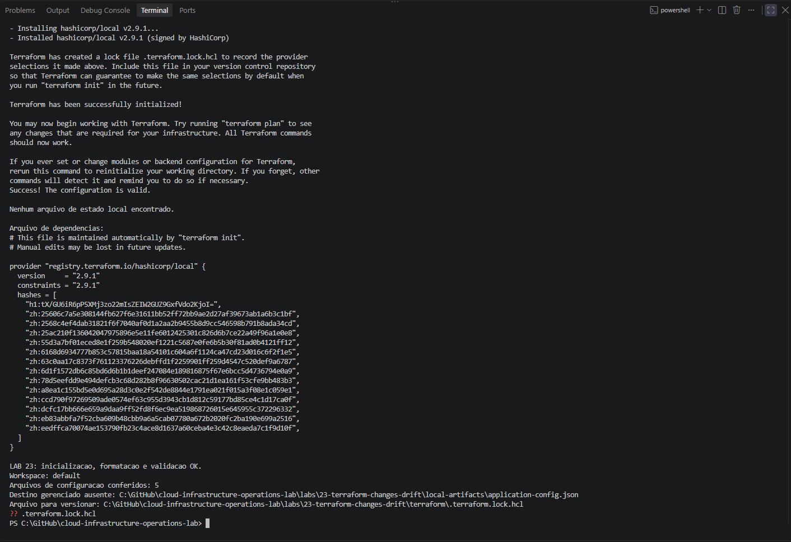

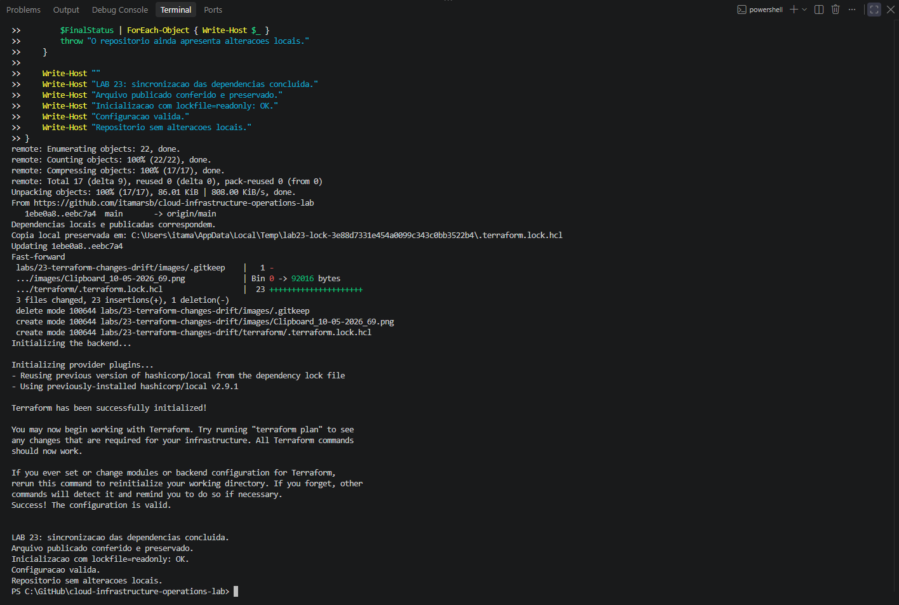

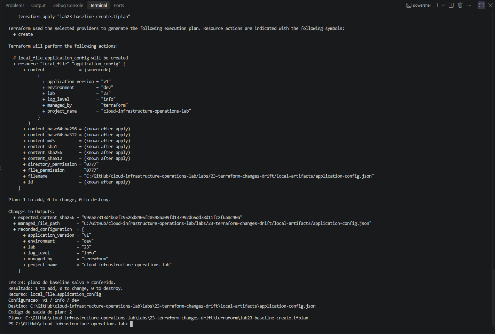

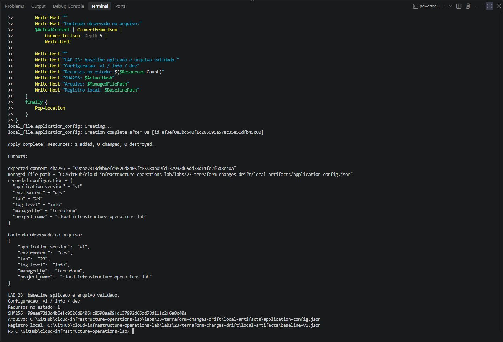

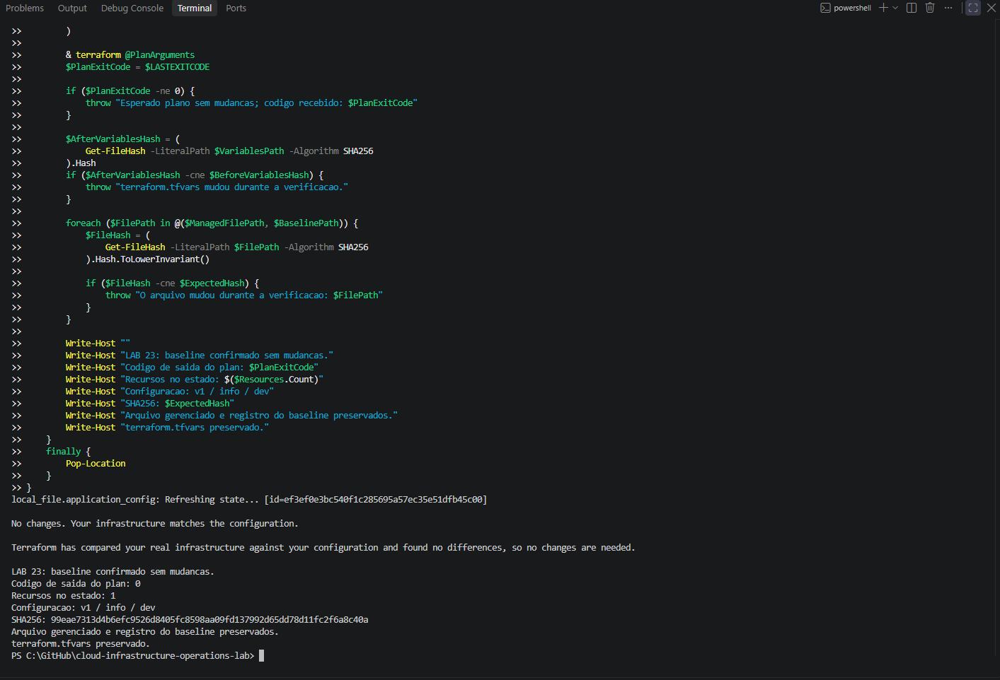

### Intentional v2 change

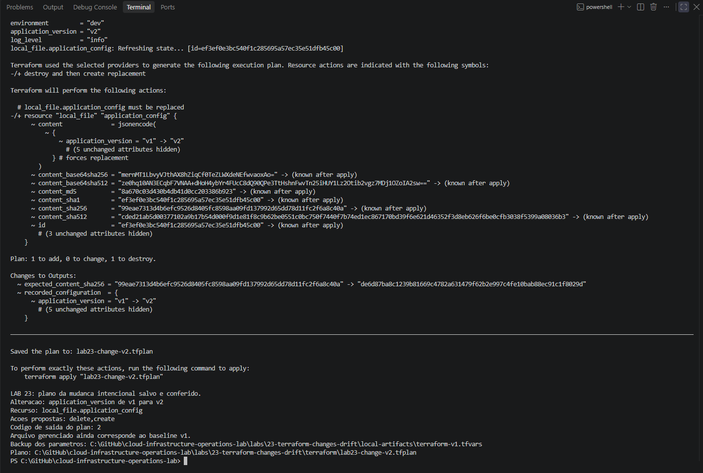

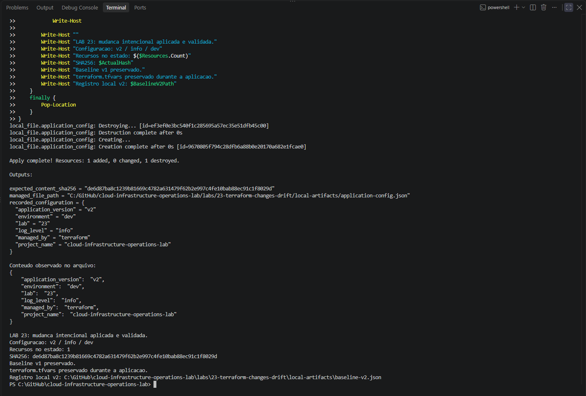

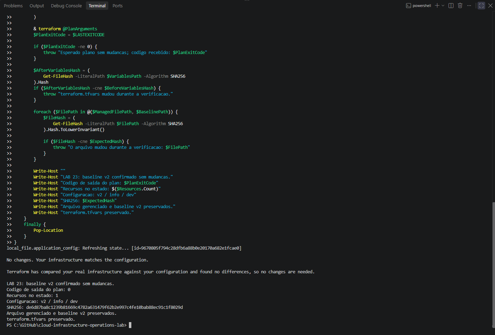

### Drift and reconciliation

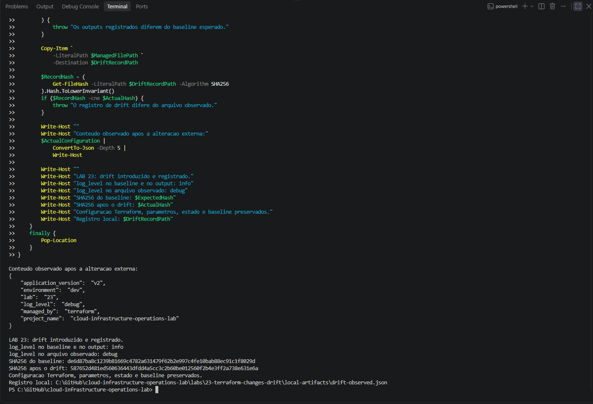

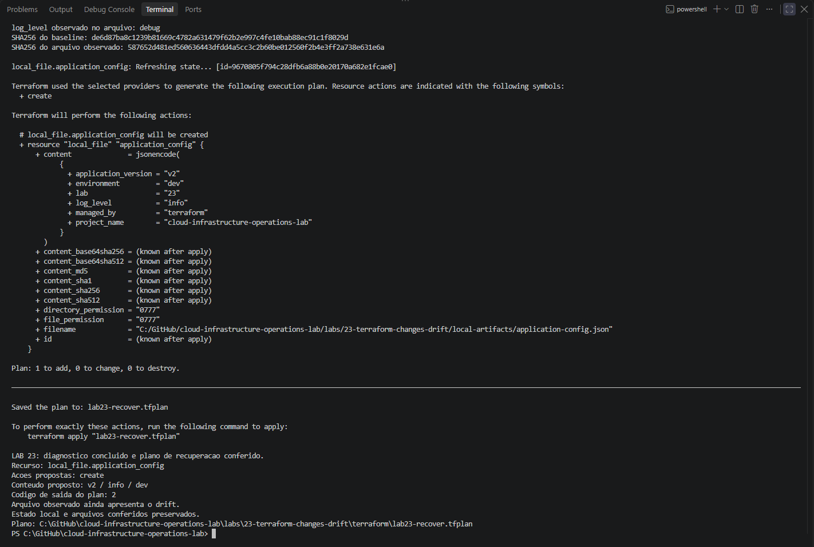

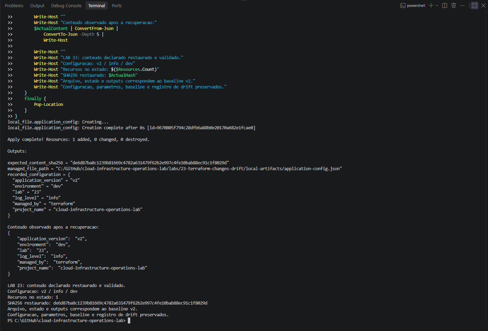

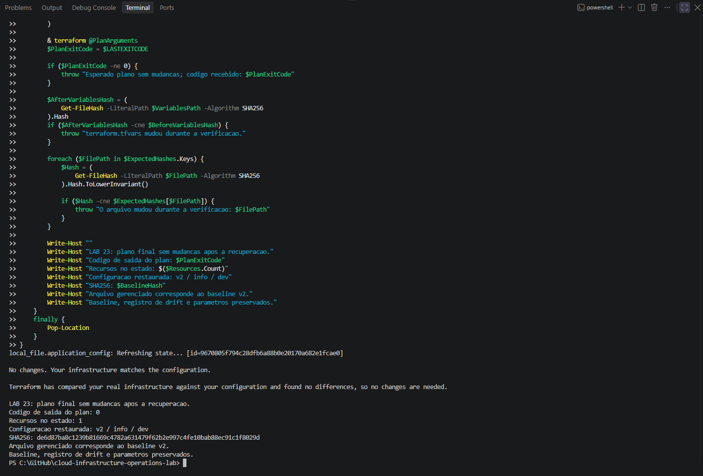

### Cleanup

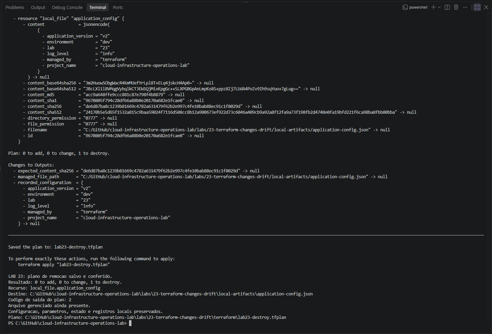

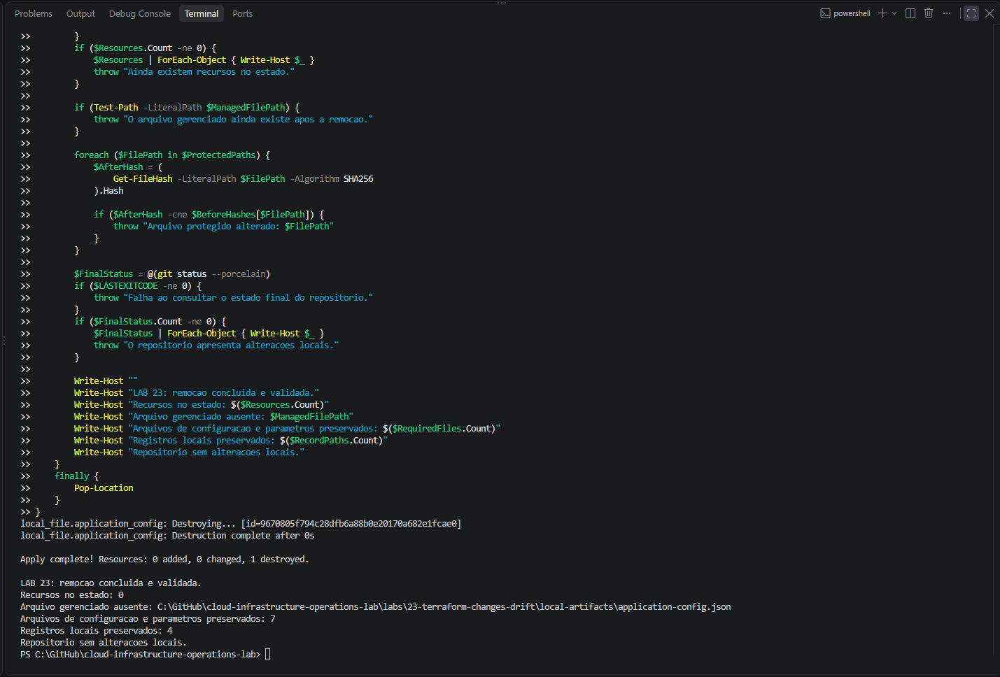

## Operational lessons and limitations

**Intentional changes and drift are different.** Changing the Terraform variable and applying a plan is a controlled update. Editing the file directly changes observed reality without first updating the declared configuration.

**State is not continuous observation.** Recorded outputs may describe prior values until Terraform refreshes resource information; compare actual files when investigating drift.

**A create plan is not a deletion observation.** The drifted file was present after the reconciliation plan. Plan actions must be read in context of provider behavior and direct resource observations.

**Drift detection does not equal remediation.** Diagnosis and planning inspect divergence; actual recovery requires a separately reviewed apply, followed by direct content and hash validation.

**No cloud drift was tested.** This was a local file managed with `hashicorp/local`, not an AWS instance, S3 object, IAM policy, or distributed service. No application was actually launched from the JSON.

**State and artifact protection.** Local state, plans, variable files and drift records can expose operational data. Both the root `.gitignore` and Lab 23's `.gitignore` exclude relevant working artifacts, but Git ignore rules are neither encryption nor access control.

**Reproducibility.** The Local provider is pinned to 2.9.1, while Terraform accepts the declared compatible range. The result of a future drift plan may differ under another provider implementation or version.

## Conclusion

Lab 23 records a complete **v1 baseline → intentional v2 update → external file drift → diagnosis → reviewed reconciliation → verified v2 restoration → controlled destroy** sequence.

Its strongest lesson is that Terraform configuration, recorded state and the actual resource are related but distinct. Effective troubleshooting compares all three and validates the **observed resource** after remediation.

## Next lab

[Lab 24 — Terraform Automated Validation](../24-terraform-automated-validation/)

---

[English repository overview](../../README.en.md) · [Portuguese repository overview](../../README.md)
