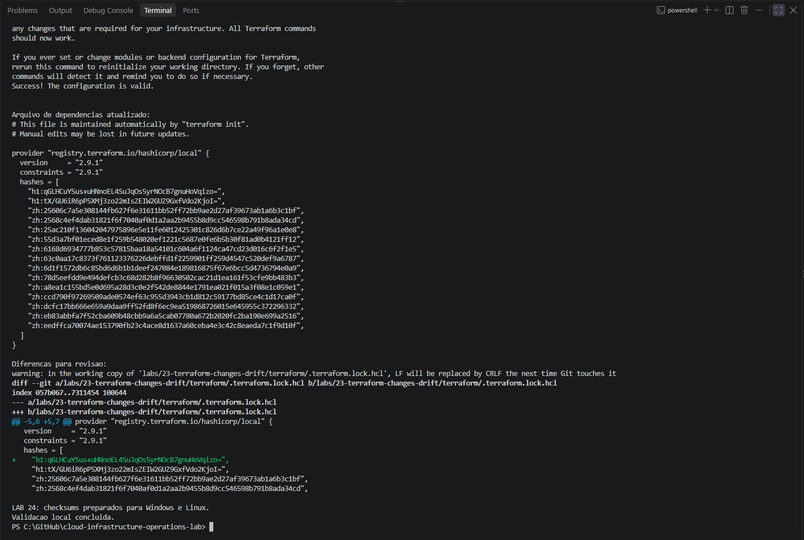
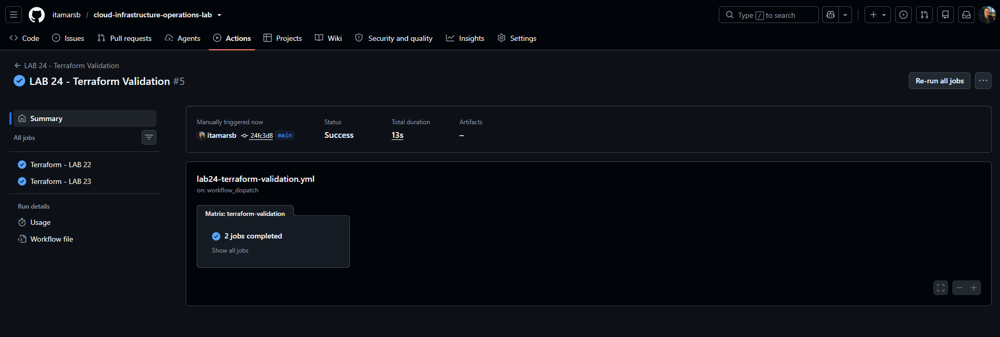
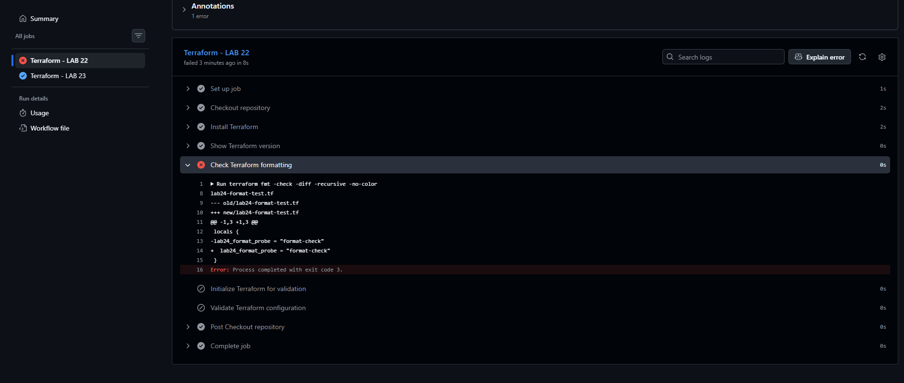
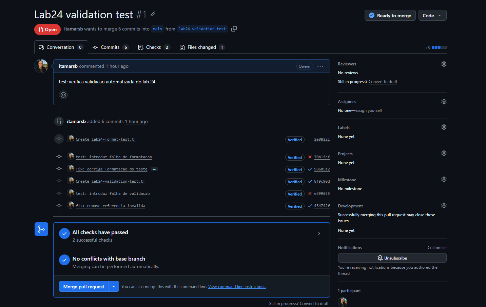
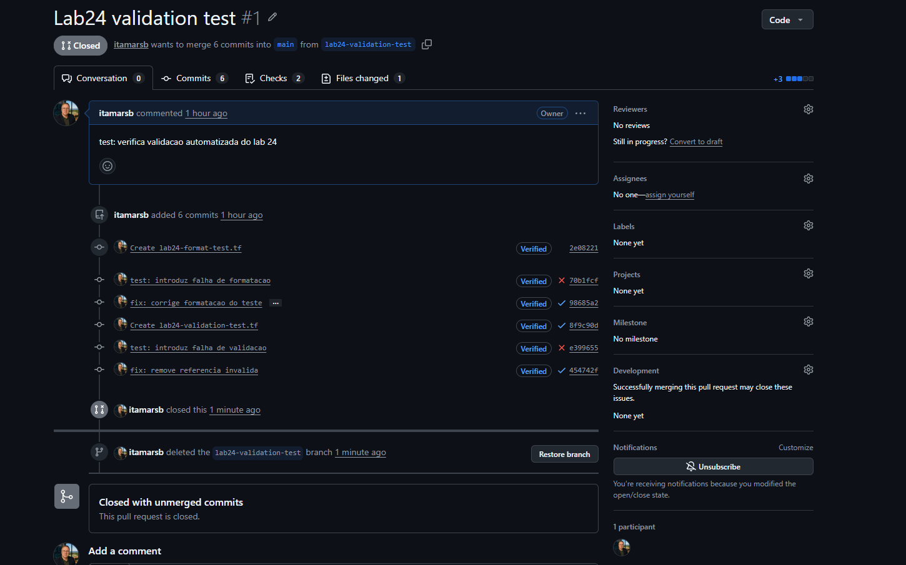

# Lab 24 — Automated Terraform Validation with GitHub Actions

[**Português (Brasil)**](README.md) · **English**

## Overview

This lab automates Terraform configuration checks for [Lab 22](../22-terraform-variables-outputs-modules/) and [Lab 23](../23-terraform-changes-drift/) with GitHub Actions. Each lab has an independent matrix job that verifies formatting, initializes provider dependencies without a backend and validates Terraform configuration.

**Recorded result:** The workflow detected an intentionally malformed Terraform file, passed after correction, detected an undeclared input variable, and passed after that error was removed. [Pull request #1](https://github.com/itamarsb/cloud-infrastructure-operations-lab/pull/1) was subsequently closed **without merge**. The temporary test branch and files were reported removed from the original execution.

**Review scope:** This English guide is based on static examination of the existing YAML workflow, the Lab 23 provider lock, the original Portuguese README, GitHub's PR record, and the image inventory. No new workflow run, Terraform command or AWS operation was performed for this update.

## Architecture

~~~text
Push to main or PR targeting main (selected paths)
           or manual workflow_dispatch
                         |
                         v
           GitHub Actions (ubuntu-24.04)
           Terraform 1.16.1
                         |
                  Matrix: 2 jobs
                  fail-fast: false
                  /            \
                 v              v
              Lab 22          Lab 23
           Built-in provider  Local provider 2.9.1
                 |              |
                 +-- terraform version
                 +-- terraform fmt -check -diff -recursive
                 +-- terraform init -backend=false
                 +-- terraform validate
                         |
                         v
                   GitHub checks
~~~

The workflow validates **configuration**, not deployed infrastructure. It does not execute Terraform plan, apply or destroy, and it does not use AWS credentials.

## Source and environment

The committed workflow is [lab24-terraform-validation.yml](../../.github/workflows/lab24-terraform-validation.yml).

| Setting | Source value |
|---|---|
| Runner | Ubuntu 24.04 |
| Terraform CLI | 1.16.1 |
| Checkout action | actions/checkout@v6 |
| Setup action | hashicorp/setup-terraform@v4 |
| Token permission | contents: read |
| Checkout credential persistence | Disabled |
| Job timeout | 10 minutes per job |
| Matrix | Two jobs, with fail-fast disabled |
| Terraform environment | TF_IN_AUTOMATION=true; TF_INPUT=false |
| Setup Terraform wrapper | Disabled |

The source uses **release-tag references** for GitHub Actions, rather than immutable full commit SHAs. This is a supply-chain consideration for a more tightly controlled production workflow.

### Event and path filters

The workflow runs on a push to main or a pull request targeting main when selected paths change, and can be launched manually using workflow_dispatch.

~~~text
.github/workflows/lab24-terraform-validation.yml
labs/22-terraform-variables-outputs-modules/terraform/**
labs/23-terraform-changes-drift/terraform/**
.gitattributes
~~~

Documentation-only changes in Lab 24 do not automatically trigger the CI. Other Terraform labs are outside this validation matrix.

## CI checks

### Version

~~~bash
terraform version
~~~

### Formatting

~~~bash
terraform fmt -check -diff -recursive -no-color
~~~

Formatting is checked recursively, including the Lab 22 child module. This is a **non-editing check**: it reports differences without rewriting Terraform files.

### Initialize for validation

Lab 22 uses the built-in Terraform provider:

~~~bash
terraform init -backend=false -input=false -no-color
~~~

Lab 23 uses the external HashiCorp Local provider:

~~~bash
terraform init -backend=false -input=false -no-color -lockfile=readonly
git diff --exit-code -- .terraform.lock.hcl
~~~

The workflow explicitly requires the Lab 23 dependency lock file to exist. Its readonly initialization and subsequent Git diff check prevent silently accepting provider-lock changes during CI.

The [Lab 23 dependency lock](../23-terraform-changes-drift/terraform/.terraform.lock.hcl) selects Local provider version **2.9.1**.

The option backend=false skips Terraform backend initialization. It does not prove that a remote backend can authenticate, obtain a state lock, or operate against real infrastructure.

### Configuration validation

~~~bash
terraform validate -no-color
~~~

This checks internal Terraform configuration consistency and declared references against initialized provider schemas. It does **not** generate or apply an execution plan, validate AWS permissions or test a running application.

A failing step prevents later ordinary steps in the **same** job from running. The matrix setting fail-fast=false permits the other job to continue.

## Cross-platform provider lock correction

The first GitHub Actions run found that the existing provider checksums were insufficient for installing the Local provider on the Ubuntu runner, even though the Windows local environment had worked.

The original correction prepared checksums for both operating-system targets:

~~~powershell
terraform providers lock -platform=windows_amd64 -platform=linux_amd64
~~~

This retained the Local provider at version **2.9.1** and updated the dependency lock with the required platform verification data. The corrected lock was committed; subsequent validation passed.

**Dependency locking is not state locking.** The dependency lock file records provider selections and checksums. It is not the Terraform state, an S3 backend lock, or evidence of infrastructure provisioning.

## Controlled experiments on pull request #1

The original tests used temporary branch lab24-validation-test and [PR #1](https://github.com/itamarsb/cloud-infrastructure-operations-lab/pull/1).

### Test A: Incorrect formatting

A temporary file under Lab 22 intentionally contained:

~~~hcl
locals {
lab24_format_probe = "format-check"
}
~~~

The Lab 22 formatting check failed with **exit code 3**; initialization and validation did not execute for that job. The independent Lab 23 job passed.

The formatting was then corrected:

~~~hcl
locals {
  lab24_format_probe = "format-check"
}
~~~

Both jobs subsequently passed.

The observed formatting exit code 3 must **not** be confused with exit codes associated with terraform plan -detailed-exitcode, which is a different command.

### Test B: Undeclared variable

A second temporary Terraform file under Lab 22 contained:

~~~hcl
locals {
  lab24_validation_probe = var.lab24_undeclared_variable
}
~~~

Formatting and initialization passed; terraform validate then failed with **exit code 1** and reported:

~~~text
Reference to undeclared input variable
~~~

Lab 23 passed independently. After the invalid file was removed, both jobs passed again.

| Test state | Lab 22 | Lab 23 |
|---|---|---|
| Valid source with cross-platform lock prepared | Passed | Passed |
| Formatting fault introduced | Failed at formatting | Passed |
| Formatting corrected | Passed | Passed |
| Undeclared input referenced | Failed at validation | Passed |
| Invalid test file removed | Passed | Passed |

These targeted tests establish detection of the **specific errors tested**. They are not exhaustive tests for Terraform correctness, security, state drift or runtime behavior.

## Final pull request status

The live GitHub record confirms the test [PR #1](https://github.com/itamarsb/cloud-infrastructure-operations-lab/pull/1) is **closed and unmerged**. The Portuguese execution record states that the temporary branch was deleted and both temporary test files were absent from main.

The workflow file itself remains committed and can run on subsequent qualifying events.

**Important governance limitation:** A passing check or a visible workflow does not prove that branch protection requires these checks before merging. Required-status-check enforcement must be configured and verified separately in repository settings or rulesets.

## Historical images

Six PNG image paths exist under Lab 24. The original README embeds five; the sixth is retained as an uncharacterized link.

[Additional historical image 88](images/Clipboard_10-07-2026_88.png)

These files were not edited. Their pixels were **not individually examined at full resolution**, so no new claims about individual screenshot contents or anonymity are made.

## Security, cost and scope limits

**Static validation only:** The workflow runs version, fmt, init and validate, without plans, remote state, apply, destroy, runtime testing or drift detection.

**No AWS activity:** The workflow uses no AWS credentials and creates no AWS infrastructure. GitHub Actions usage may be subject to platform limits or charges depending on account and repository policy; this lab does not quantify billing.

**Limited CI security:** Formatting and validation do not replace code review, secret scanning, provider integrity checks, IaC security analysis, policy-as-code or real deployment tests.

**Independent jobs:** Disabling matrix fail-fast allows unrelated checks to complete. It does not convert failure into success or automatically enforce merge blocking.

**Action supply chain:** Version-tagged third-party actions can be hardened by pinning vetted full commit SHAs and reviewing updates.

**Evidence privacy:** CI logs and screenshots may contain repository identifiers and GitHub actor metadata; inspect evidence before claiming full anonymization.

## Conclusion

Lab 24 demonstrates useful **pre-apply Terraform validation** on GitHub Actions, with two independent jobs and controlled negative tests for formatting and undeclared-variable errors. The completed experiment does not imply production deployment, an enforced merge policy, or application readiness.

## Next lab

[Lab 25 — CloudWatch Metrics](../25-cloudwatch-metrics/)

---

[English repository overview](../../README.en.md) · [Portuguese repository overview](../../README.md)
