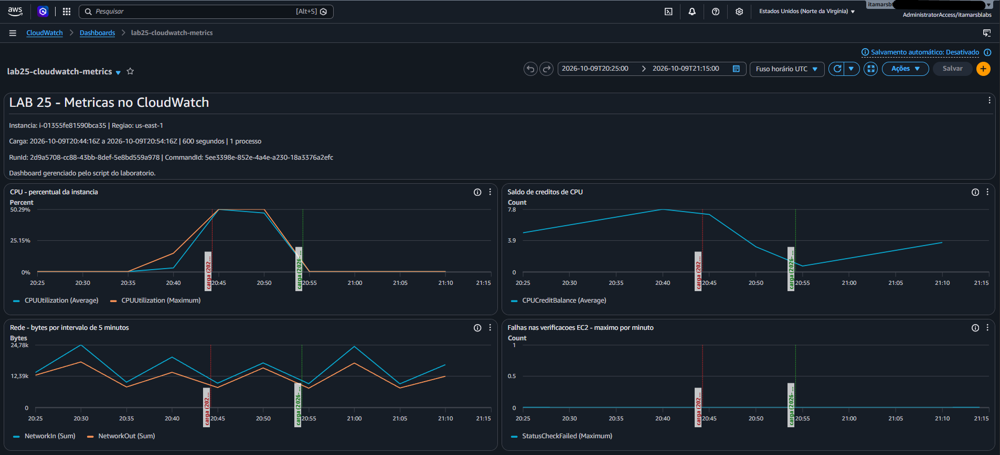
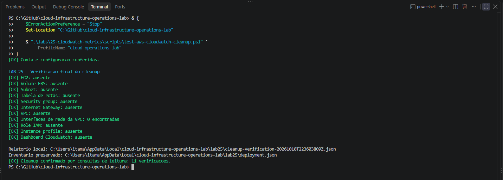

# Lab 25 — Amazon CloudWatch Metrics and CPU Load Analysis

[**Português (Brasil)**](README.md) · **English**

## Overview

This lab uses **native Amazon EC2 metrics in CloudWatch** to examine a controlled CPU workload on one Amazon Linux 2023 EC2 instance. The historical sequence covered provisioning an isolated VPC, baseline data collection, a 600-second CPU workload through AWS Systems Manager, metric analysis across baseline/load/recovery phases, a five-widget dashboard, and independently validated cleanup.

**Recorded dates:** October 9, 2026 for the experiment; October 10, 2026 for final cleanup.

**Documentation boundary:** The English edition is based on static review of the Portuguese README, eight PowerShell scripts, two JSON files and 17 image filenames. No AWS service was queried or changed during this review, and the historical measurements were not freshly reproduced.

## Recorded results

| Observation | Historical result |
|---|---|
| Instance | t3.micro, two vCPUs, Amazon Linux 2023 |
| EC2 monitoring / credits | Basic / standard |
| Initial metrics | Four query types returned data |
| CPU workload | One process, 600 seconds |
| SSM completion | Success, response code 0, LOAD_FINISHED_OK |
| Full 300-second load interval | CPU Average **50.173%**, Maximum **50.292%** |
| After load | CPU Average approximately **0.225–0.257%** in sampled intervals |
| CPUCreditBalance | Declined during load, increased after |
| StatusCheckFailed | 50 recorded samples of zero |
| CloudWatch dashboard | Five widgets, API verification and console inspection |
| Independent cleanup | 11 checks passed |

### CPU timeline

| UTC period start | Average (%) | Maximum (%) | Phase |
|---|---:|---:|---|
| 20:25 | 0.230 | 0.308 | Baseline |
| 20:30 | 0.253 | 0.300 | Baseline |
| 20:35 | 0.225 | 0.308 | Baseline |
| 20:40 | 3.182 | 14.992 | Partial load interval |
| 20:45 | **50.173** | **50.292** | Complete load interval |
| 20:50 | 47.284 | 50.292 | Partial load interval |
| 20:55 | 0.230 | 0.292 | Recovery |
| 21:00 | 0.257 | 0.308 | Recovery |
| 21:05 | 0.225 | 0.300 | Recovery |
| 21:10 | 0.250 | 0.292 | Recovery |

The load ran from **2026-10-09 20:44:16 UTC** to **20:54:16 UTC**. Because it began and ended inside five-minute periods, the 20:40 and 20:50 averages include only partial load windows. A single CPU-intensive process yielding approximately 50% instance utilization is consistent with roughly one of the two vCPUs being busy, not a requirement to reach 100% of the entire instance.

## Architecture

Unlike previous labs that reuse the Lab 08 network, **Lab 25 creates a dedicated VPC and deletes it during cleanup**.

~~~text
Windows PowerShell + AWS CLI + IAM Identity Center
                         |
         +---------------+---------------+
         |                               |
    EC2 / IAM APIs                  CloudWatch APIs
         |                               |
         v                               v
VPC: 10.25.0.0/16                   AWS/EC2 metrics
Public subnet: 10.25.1.0/24         Five-widget dashboard
Internet Gateway and public route
Dedicated Security Group: NO inbound rules
         |
         v
EC2 t3.micro, AL2023, 2 vCPUs
  - Public IPv4
  - Basic monitoring
  - CPU credit mode: standard
  - IMDSv2 required
  - Encrypted root gp3 EBS, 8 GiB
  - AWS Systems Manager managed node
         |
         v
SSM Run Command: controlled one-process CPU load
~~~

| Resource | Recorded name |
|---|---|
| VPC | lab25-cloudwatch-vpc |
| Public subnet | lab25-cloudwatch-public-subnet-a |
| Internet Gateway | lab25-cloudwatch-igw |
| Route table | lab25-cloudwatch-public-rt |
| Security Group | lab25-cloudwatch-instance-sg |
| EC2 instance | lab25-cloudwatch-instance |
| IAM role | lab25-cloudwatch-ec2-role |
| Instance profile | lab25-cloudwatch-ec2-profile |
| Dashboard | lab25-cloudwatch-metrics |

Region was us-east-1 and AZ was us-east-1a. The instance had no SSH key pair or inbound Security Group rules; management used SSM with AmazonSSMManagedInstanceCore. No NAT Gateway, Elastic IP, load balancer or VPC endpoint was created.

The public Amazon Linux 2023 AMI parameter is resolved dynamically; a new run may select a different AMI. Provisioned resources were associated with Project, Lab, ManagedBy, RunId and Name tags and tracked in a local inventory.

## Source inventory and account protection

| Source | Function |
|---|---|
| [lab25-settings.json](config/lab25-settings.json) | Expected account, Region, network, resource names, metrics |
| [ec2-ssm-trust-policy.json](config/ec2-ssm-trust-policy.json) | EC2 trust principal and sts:AssumeRole |
| [lab25-common.ps1](scripts/lab25-common.ps1) | Shared AWS CLI wrapper, identity checks, inventory, ownership assertions |
| [deploy-aws-cloudwatch-metrics.ps1](scripts/deploy-aws-cloudwatch-metrics.ps1) | Preflight and deployment |
| [test-aws-cloudwatch-metrics.ps1](scripts/test-aws-cloudwatch-metrics.ps1) | Infrastructure validation and initial metrics |
| [invoke-aws-cloudwatch-cpu-load.ps1](scripts/invoke-aws-cloudwatch-cpu-load.ps1) | Submit CPU load and check completion |
| [new-aws-cloudwatch-dashboard.ps1](scripts/new-aws-cloudwatch-dashboard.ps1) | Generate, publish and compare dashboard |
| [remove-aws-cloudwatch-dashboard.ps1](scripts/remove-aws-cloudwatch-dashboard.ps1) | Ownership-checked dashboard removal |
| [remove-aws-cloudwatch-metrics.ps1](scripts/remove-aws-cloudwatch-metrics.ps1) | Ownership-checked infrastructure removal |
| [test-aws-cloudwatch-cleanup.ps1](scripts/test-aws-cloudwatch-cleanup.ps1) | Eleven independent post-cleanup checks |

**Portability warning:** The settings JSON and common PowerShell functions contain a **fixed expected AWS account ID** in the source. Before any new execution, confirm that the CLI identity, authorized account, Region and fixed names match the intended environment. Simply choosing a different AWS profile is insufficient.

The complete historical account number, EC2 ID, RunId and SSM CommandId are not repeated here. The original README and scripts still contain them, and screenshots should be privacy-reviewed before wider reuse.

## Native EC2 metric queries

All queries use namespace AWS/EC2 and dimension InstanceId.

| Metric | Statistic | Period | Unit |
|---|---|---:|---|
| CPUUtilization | Average and Maximum | 300 seconds | Percent |
| NetworkIn | Sum | 300 seconds | Bytes |
| NetworkOut | Sum | 300 seconds | Bytes |
| StatusCheckFailed | Maximum | 60 seconds | Count |
| CPUCreditBalance | Average | 300 seconds | Count |

The **first four** metrics are the initial configuration's query set. CPUCreditBalance is queried **additionally** for interpretation and dashboard publication.

A five-minute Sum of NetworkIn or NetworkOut is a volume of **bytes in that period**, not a rate of bytes per second. The period Maximum is the greatest observed data point within its aggregation, not an instantaneous continuous measurement.

Missing CloudWatch points must **not** be treated as zero: publication delays and mismatched timing windows can produce empty responses.

EC2 status checks concern EC2 infrastructure health, not the availability of an application or its service-level objective.

## Recorded workflow

Run commands from the repository root in Windows PowerShell with AWS CLI, an authorized IAM Identity Center profile and the correct account/Region. These are historical instructions for an isolated test instance, **not commands already run for this review**.

### 1. Authenticate and inspect local scripts

~~~powershell
aws sso login --profile cloud-operations-lab
aws sts get-caller-identity --profile cloud-operations-lab --region us-east-1 --output json --no-cli-pager

$Scripts = ".\labs\25-cloudwatch-metrics\scripts"
~~~

The original procedure checked for uncommitted Git changes, synchronized the repository with git pull --ff-only and parsed every PowerShell script for syntax errors. Local parsing does not demonstrate functional AWS correctness.

### 2. Preflight without deploying

~~~powershell
& "$Scripts\deploy-aws-cloudwatch-metrics.ps1" -ProfileName "cloud-operations-lab" -ValidateOnly
~~~

Preflight verifies expected identity, Region/AZ, available resource names, resolved AMI and EC2 role trust. The ValidateOnly switch is designed to perform checks without creating AWS resources.

### 3. Provision dedicated infrastructure

~~~powershell
& "$Scripts\deploy-aws-cloudwatch-metrics.ps1" -ProfileName "cloud-operations-lab"
~~~

The deployment records IDs under an isolated local inventory, creates networking and instance/IAM resources, then waits for the managed instance to reach SSM Online.

An existing inventory blocks a new deployment to reduce the risk of duplicate resources. A partially failed deployment can leave AWS resources behind; inspect the preserved inventory before any retry or cleanup.

### 4. Independently validate AWS infrastructure and baseline metrics

~~~powershell
& "$Scripts\test-aws-cloudwatch-metrics.ps1" -ProfileName "cloud-operations-lab"
~~~

The validator checks VPC/subnet/Internet Gateway/route, Security Group with no ingress, instance type, IMDSv2, basic monitoring, credit mode standard, encrypted gp3 root volume, IAM role/profile and SSM Online. It queries the initial metric window (the previous 60 minutes, with its end aligned to five minutes).

All four initial metric types returned data in the original run. Initial CPU averages were approximately **0.342–0.685%**.

The first NetworkIn sample measured **88,826,944 bytes**, substantially more than following points. The original record did not claim that value represented stable network traffic or identify a process responsible for it.

### 5. Submit bounded CPU pressure

~~~powershell
& "$Scripts\invoke-aws-cloudwatch-cpu-load.ps1" -ProfileName "cloud-operations-lab"
~~~

The command checks instance identity and SSM registration, submits one remote CPU-intensive process and writes a local receipt containing the SSM CommandId and run identity.

The workload uses a lock to prevent overlapping runs and executes one yes process directed to /dev/null under timeout, with a **600-second** limit. It is intentionally disruptive to CPU availability and must not be run on shared or production instances.

**SendCommand acceptance is not completion.** The resulting CommandId must be checked separately.

### 6. Verify load completion

~~~powershell
& "$Scripts\invoke-aws-cloudwatch-cpu-load.ps1" -ProfileName "cloud-operations-lab" -CheckStatus
~~~

Completion requires SSM invocation status **Success**, response code **0** and standard-output marker **LOAD_FINISHED_OK**.

Within the remote shell, exit code **124** from timeout was expected when the workload reached its limit. The wrapper treated that bounded termination as successful and exited with code 0. The shell's timeout code and SSM's final response code are from different layers and should not be confused.

The first recorded load attempt failed due to CRLF line endings in a Linux shell command. That attempt was preserved in a separate receipt and was **not counted** as completed. The corrected command normalized line endings to LF.

### 7. Query baseline, load and recovery windows

After confirming completion, use the verified workload receipt to select UTC windows spanning before, during and after the 600-second interval. The recorded comparative window extended from **20:25 to 21:15 UTC** and was aligned to five-minute boundaries.

A simplified CloudWatch query pattern is:

~~~powershell
aws cloudwatch get-metric-statistics --namespace AWS/EC2 --metric-name CPUUtilization --dimensions Name=InstanceId,Value=REPLACE_WITH_CURRENT_INSTANCE_ID --start-time 2026-10-09T20:25:00Z --end-time 2026-10-09T21:15:00Z --period 300 --statistics Average Maximum --profile cloud-operations-lab --region us-east-1
~~~

The timestamps above are **historical**, for illustration only. Recalculate them from the new workload receipt for any reproduction, and replace the instance ID with the authorized current ID. The original README includes a complete PowerShell reporting script that derives the time range from SSM output, sorts every metric's points and writes a local JSON report.

Allow for CloudWatch data publication latency; a window whose end time has passed may still have missing points.

### 8. Validate and publish the dashboard

~~~powershell
& "$Scripts\new-aws-cloudwatch-dashboard.ps1" -ProfileName "cloud-operations-lab" -ValidateOnly
& "$Scripts\new-aws-cloudwatch-dashboard.ps1" -ProfileName "cloud-operations-lab"
~~~

The generated dashboard has **five widgets**:

1. Text with instance, RunId and load timestamps.
2. CPUUtilization Average and Maximum.
3. CPUCreditBalance Average.
4. NetworkIn and NetworkOut Sum.
5. StatusCheckFailed Maximum.

The charts annotate the workload start and end and use a consistent absolute time window. The script compares normalized JSON body structures after publishing, rather than expecting identical whitespace or object property order. Array ordering and values remain significant. The historical dashboard was also inspected in the AWS Console.

A successfully published and verified dashboard does not independently prove continuous metric ingestion or a service SLO.

## CPU credit analysis

| UTC period | CPUCreditBalance Average |
|---|---:|
| 20:40 | 7.798 |
| 20:45 | 7.150 |
| 20:50 | 3.130 |
| 20:55 | 0.735 |
| 21:00 | 1.709 |
| 21:05 | 2.686 |
| 21:10 | 3.661 |

The credit balance decreased during load and grew after it ended, consistent with burstable T3 standard-mode operation.

The **net difference** between 20:40 and 20:55 is approximately **7.064 credits**. That is **not** an observed gross-credit consumption figure because credits can accrue during the interval. The published aggregate points also do not establish the balance at every intermediate instant.

The comparative query returned 50 StatusCheckFailed points with value zero. This establishes no recorded EC2 status-check failure at those points, **not** that an application or user-facing service was continuously available.

## Cleanup: dashboard first, then dedicated infrastructure

### 1. Validate and remove the dashboard

~~~powershell
& "$Scripts\remove-aws-cloudwatch-dashboard.ps1" -ProfileName "cloud-operations-lab" -ValidateOnly
& "$Scripts\remove-aws-cloudwatch-dashboard.ps1" -ProfileName "cloud-operations-lab"
~~~

The removal script checks the receipt, run identity, dashboard name/ARN and retrieved JSON before deletion. It then verifies that the dashboard is absent.

### 2. Validate and remove dedicated AWS resources

~~~powershell
& "$Scripts\remove-aws-cloudwatch-metrics.ps1" -ProfileName "cloud-operations-lab" -ValidateOnly
& "$Scripts\remove-aws-cloudwatch-metrics.ps1" -ProfileName "cloud-operations-lab"
~~~

After verifying IDs, tags and associations, the original sequence terminated EC2, checked root EBS deletion, removed IAM role/profile, route-table association, subnet, route table, Security Group, Internet Gateway and the **dedicated Lab 25 VPC**.

Unlike labs that preserve Lab 08 shared networking, this VPC was created exclusively for Lab 25 and explicitly belonged to its cleanup scope.

The cleanup originally encountered a PowerShell representation error involving an unexpected property named V. The script's resource definitions were corrected before the final run.

### 3. Verify cleanup separately

~~~powershell
& "$Scripts\test-aws-cloudwatch-cleanup.ps1" -ProfileName "cloud-operations-lab"
~~~

All **11** historical checks passed:

| Resource/check | Result |
|---|---|
| EC2 instance | Absent |
| EBS root volume | Absent |
| Subnet | Absent |
| Route table | Absent |
| Security Group | Absent |
| Internet Gateway | Absent |
| VPC | Absent |
| VPC-associated network interfaces | Zero found |
| IAM role | Absent |
| IAM instance profile | Absent |
| CloudWatch dashboard | Absent |

The validator accepts an instance still returned as terminated; in the recorded run the instance was absent from the returned inventory. An expired SSO session was renewed before the final successful checks.

These are independently performed checks of identified Lab 25 resources and selected related objects, **not a complete account-wide audit**. Cleanup does not reverse charges incurred before deletion.

## Local records

The scripts preserve inventories, failed and completed command receipts, metric reports, dashboard JSON and cleanup verification under:

~~~text
%LOCALAPPDATA%\cloud-infrastructure-operations-lab\lab25\
~~~

Examples include deployment.json, metrics-baseline-<timestamp>.json, cpu-load-<RunId>.json, cpu-load-failed-<CommandId>-<timestamp>.json, metrics-after-load-<timestamp>.json, dashboard-<RunId>.json, dashboard-receipt-<RunId>.json, dashboard-cleanup-<RunId>.json and cleanup-verification-<timestamp>.json.

These may contain account, instance and command identifiers and must be reviewed before sharing. They were retained locally after the recorded cleanup, not uploaded in full by this documentation update.

## Historical evidence

The repository contains **17 screenshot files**. Their stage labels are inherited from the original README. Their pixels have **not** been individually inspected at full resolution for this editorial review.

| Stage | Image |
|---|---|
| Preflight, identity, Region/AZ and AMI | [89](images/Clipboard_10-08-2026_89.png) |
| Settings and role trust | [90](images/Clipboard_10-08-2026_90.png) |
| Script syntax and deployment validation | [91](images/Clipboard_10-08-2026_91.png) |
| Infrastructure and SSM Online | [92](images/Clipboard_10-09-2026_92.png) |
| Initial four metrics | [93](images/Clipboard_10-09-2026_93.png) |
| Initial workload attempt | [94](images/Clipboard_10-09-2026_94.png) |
| Corrected remote shell line endings | [95](images/Clipboard_10-09-2026_95.png) |
| Completed 600-second load | [96](images/Clipboard_10-09-2026_96.png) |
| Comparative metrics and credits | [97](images/Clipboard_10-09-2026_97.png) |
| Dashboard preparation | [98](images/Clipboard_10-09-2026_98.png) |
| Dashboard published and verified | [99](images/Clipboard_10-09-2026_99.png) |
| Dashboard inspected in the console | [100](images/Clipboard_10-09-2026_100.png) |
| Dashboard removal preflight | [101](images/Clipboard_10-10-2026_101.png) |
| Dashboard absent | [102](images/Clipboard_10-10-2026_102.png) |
| Infrastructure cleanup preflight | [103](images/Clipboard_10-10-2026_103.png) |
| Cleanup execution | [104](images/Clipboard_10-10-2026_104.png) |
| Independent 11-check verification | [105](images/Clipboard_10-10-2026_105.png) |

## Security, costs and limitations

**Metrics:** Five-minute aggregation and publication delays limit temporal precision. An empty CloudWatch result is not zero. Maximum aggregation is not continuous peak tracing.

**Compute:** One CPU-bound process does not replicate a real application's multi-threaded behavior. The absence of increased network traffic is compatible with a local CPU-only workload.

**Health:** EC2 status checks do not establish HTTP availability or an application SLO. No sustained end-user request load was applied.

**Security:** No inbound Security Group rule or SSH key pair was created. IAM identity and network paths still require authorization. The historical expected account ID is fixed in the repository's configuration and common script.

**Cost:** The temporary EC2 instance, EBS root volume, public IPv4 address, applicable CloudWatch usage and network transfer may incur AWS charges. Basic monitoring was used and no Free Tier eligibility was assumed.

**Data retention:** Metrics can remain queryable after an EC2 instance is deleted. Historical metric retention does not imply that the underlying resource still exists.

**Future scope:** Guest memory and filesystem statistics and CloudWatch Agent are addressed by [Lab 26](../26-cloudwatch-agent/); alarms and notifications are handled by a later laboratory.

## Conclusion

Lab 25 records a controlled lifecycle of **isolated EC2 deployment → native CloudWatch baseline → bounded CPU pressure → metric recovery → dashboard validation → cleanup verified by 11 independent checks**.

The results demonstrate a measurable CPU rise and fall with corresponding T3 credit-balance changes, while preserving the difference between EC2 infrastructure metrics and evidence of an application's actual availability.

## Next lab

[Lab 26 — CloudWatch Agent](../26-cloudwatch-agent/)

---

[English repository overview](../../README.en.md) · [Portuguese repository overview](../../README.md)
