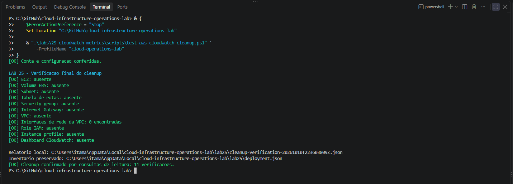

# LAB 25 — Métricas no CloudWatch

## Status

Concluído.

Experimento executado em 9 de outubro de 2026. Remoção dos recursos e verificação final concluídas em 10 de outubro de 2026.

Uma instância EC2 exclusiva foi provisionada, validada e submetida a uma carga limitada de CPU pelo AWS Systems Manager. As métricas registraram repouso, aumento de utilização durante a carga e recuperação após seu encerramento.

O dashboard foi publicado, conferido pela API e inspecionado no console. Ao final, o dashboard e a infraestrutura foram removidos. A verificação independente do cleanup passou nas 11 consultas previstas.

## Objetivo

Consultar e interpretar métricas nativas de uma instância Amazon EC2 no Amazon CloudWatch.

O laboratório demonstrou:

- identificação de namespace, métricas e dimensões;
- consultas com janela temporal, período e estatística definidos;
- comparação entre repouso, carga de CPU e recuperação;
- interpretação do saldo de créditos de uma instância T3;
- distinção entre ausência de dados e valor zero;
- publicação e validação de um dashboard;
- registro de resultados e evidências;
- remoção dos recursos exclusivos e confirmação do cleanup.

## Resultado observado

| Indicador | Resultado |
|:---:|:---:|
| Infraestrutura | Provisionada e validada por consultas de leitura |
| Gerenciamento SSM | Instância `Online` |
| Coleta inicial | Quatro métricas com dados |
| Carga concluída | Um processo durante 600 segundos |
| Execução SSM | `Success`, com código de resposta `0` |
| CPU durante o intervalo completo de carga | Média de aproximadamente `50,173%` |
| CPU após a carga | Retorno para aproximadamente `0,23%` a `0,26%` |
| Créditos de CPU | Redução durante a carga e recuperação posterior |
| Verificações de status | `StatusCheckFailed` igual a zero nos pontos consultados |
| Dashboard | Cinco widgets, com conteúdo conferido pela API |
| Cleanup | Onze verificações aprovadas |


## Ambiente

| Item | Configuração |
|:---:|:---:|
| Estação de trabalho | Windows 11 |
| Shell | Windows PowerShell 5.1 |
| Interface AWS | AWS CLI |
| Autenticação | AWS IAM Identity Center |
| Perfil | `cloud-operations-lab` |
| Região | `us-east-1` |
| Zona de disponibilidade | `us-east-1a` |
| Sistema operacional da instância | Amazon Linux 2023 |
| Arquitetura | `x86_64` |
| Tipo de instância | `t3.micro`, com duas vCPUs |
| Modo de créditos | `standard` |
| Monitoramento EC2 | Básico |
| Acesso administrativo | AWS Systems Manager |
| Volume raiz | EBS `gp3`, criptografado, 8 GiB |
| Namespace | `AWS/EC2` |
| Dimensão | `InstanceId` |

A AMI foi resolvida pelo parâmetro público do Systems Manager:

```text
/aws/service/ami-amazon-linux-latest/al2023-ami-kernel-default-x86_64
```

O ID retornado pelo parâmetro depende da data de execução. Os scripts consultam e validam a AMI antes do provisionamento.

## Organização

| Arquivo ou diretório | Finalidade |
|:---:|:---:|
| `README.md` | Procedimento, interpretação, resultados e evidências |
| `config/lab25-settings.json` | Conta esperada, região, rede, nomes e consultas |
| `config/ec2-ssm-trust-policy.json` | Trust policy da role utilizada pela EC2 |
| `scripts/lab25-common.ps1` | Funções compartilhadas, chamadas AWS e validação de identidade |
| `scripts/deploy-aws-cloudwatch-metrics.ps1` | Provisionamento da infraestrutura exclusiva |
| `scripts/test-aws-cloudwatch-metrics.ps1` | Validação da infraestrutura e coleta inicial |
| `scripts/invoke-aws-cloudwatch-cpu-load.ps1` | Envio da carga e consulta de sua conclusão |
| `scripts/new-aws-cloudwatch-dashboard.ps1` | Preparação, publicação e validação do dashboard |
| `scripts/remove-aws-cloudwatch-dashboard.ps1` | Remoção do dashboard identificado pelo recibo |
| `scripts/remove-aws-cloudwatch-metrics.ps1` | Remoção da infraestrutura inventariada |
| `scripts/test-aws-cloudwatch-cleanup.ps1` | Verificação independente após o cleanup |
| `images/` | Capturas da execução |

O corpo JSON do dashboard é gerado localmente pelo script. Ele não é um arquivo estático em `config/`.

## Infraestrutura exclusiva

| Recurso | Nome |
|:---:|:---:|
| VPC | `lab25-cloudwatch-vpc` |
| Subnet pública | `lab25-cloudwatch-public-subnet-a` |
| Internet Gateway | `lab25-cloudwatch-igw` |
| Tabela de rotas | `lab25-cloudwatch-public-rt` |
| Security group | `lab25-cloudwatch-instance-sg` |
| IAM role | `lab25-cloudwatch-ec2-role` |
| Instance profile | `lab25-cloudwatch-ec2-profile` |
| Instância EC2 | `lab25-cloudwatch-instance` |
| Dashboard | `lab25-cloudwatch-metrics` |

A rede utilizou:

- VPC: `10.25.0.0/16`;
- subnet: `10.25.1.0/24`;
- rota pública pelo Internet Gateway;
- IPv4 público atribuído automaticamente à instância.

O security group exclusivo não tinha regras de entrada. A administração foi realizada pelo Systems Manager, utilizando a política `AmazonSSMManagedInstanceCore`.

A instância foi configurada com IMDSv2 obrigatório, monitoramento básico e créditos `standard`. O volume raiz foi criptografado e configurado para exclusão na terminação.

Não foram criados NAT Gateway, Elastic IP, load balancer ou VPC endpoints.

Os recursos identificados por tags receberam:

```text
Project=cloud-infrastructure-operations-lab
Lab=25
ManagedBy=lab25-powershell
RunId=<identificador da execução>
Name=<nome do recurso>
```

O dashboard foi identificado pelo nome exclusivo, ARN, recibo local e conteúdo JSON conferido.

## Métricas e consultas

Todas as consultas utilizaram o namespace `AWS/EC2` e a dimensão `InstanceId`.

| Métrica | Estatística | Período | Unidade | Finalidade |
|:---:|:---:|:---:|:---:|:---:|
| `CPUUtilization` | `Average`, `Maximum` | 300 segundos | Percent | Comparar utilização de CPU |
| `NetworkIn` | `Sum` | 300 segundos | Bytes | Registrar bytes recebidos por intervalo |
| `NetworkOut` | `Sum` | 300 segundos | Bytes | Registrar bytes enviados por intervalo |
| `StatusCheckFailed` | `Maximum` | 60 segundos | Count | Identificar falhas nas verificações EC2 |
| `CPUCreditBalance` | `Average` | 300 segundos | Count | Acompanhar o saldo de créditos |

As quatro primeiras métricas compõem a configuração da coleta inicial. `CPUCreditBalance` foi consultada adicionalmente para interpretar o comportamento da instância T3 e compor o dashboard.

O monitoramento detalhado não foi habilitado. As métricas de créditos são publicadas em intervalos de cinco minutos. As verificações de status possuem frequência de um minuto.

### Regras de interpretação

- Todos os horários do experimento são registrados em UTC.
- Os pontos são ordenados por timestamp.
- As comparações utilizam a mesma janela temporal.
- Uma resposta sem pontos é tratada como ausência de dados.
- Ausência de dados não é convertida em zero.
- O atraso de publicação é considerado antes de interpretar uma resposta vazia.
- `Sum` de rede representa bytes acumulados no intervalo, não bytes por segundo.
- Uma carga de CPU não exige aumento proporcional do tráfego de rede.
- `Maximum` é a maior observação disponível na agregação, não uma captura instantânea.
- As verificações EC2 não representam a disponibilidade de uma aplicação.

## Procedimento de execução

Os comandos abaixo documentam o fluxo utilizado. O cenário registrado já foi removido.

Os scripts utilizam a conta esperada definida em `config/lab25-settings.json`. Antes de executar em outra conta, a configuração e as validações devem ser revisadas.

### 1. Autenticação e preparação

No PowerShell:

```powershell
Set-Location "C:\GitHub\cloud-infrastructure-operations-lab"

aws sso login --profile cloud-operations-lab

aws sts get-caller-identity `
    --profile cloud-operations-lab `
    --region us-east-1 `
    --output json `
    --no-cli-pager
```

Antes de atualizar o repositório, conferir alterações locais:

```powershell
& {
    $ErrorActionPreference = "Stop"

    $GitStatus = @(git status --porcelain)

    if ($LASTEXITCODE -ne 0) {
        throw "Falha ao consultar o repositorio."
    }

    if ($GitStatus.Count -ne 0) {
        throw "Ha alteracoes locais. Confira-as antes de atualizar."
    }

    git pull --ff-only

    if ($LASTEXITCODE -ne 0) {
        throw "Falha ao atualizar o repositorio."
    }
}
```

Se a sessão SSO expirar, executar novamente `aws sso login` antes de repetir a consulta que falhou.

### 2. Validação de sintaxe

```powershell
& {
    $ErrorActionPreference = "Stop"

    $ScriptsPath = ".\labs\25-cloudwatch-metrics\scripts"

    foreach (
        $File in (
            Get-ChildItem -LiteralPath $ScriptsPath -Filter "*.ps1" -File
        )
    ) {
        $Tokens = $null
        $ParseErrors = $null

        [System.Management.Automation.Language.Parser]::ParseFile(
            $File.FullName,
            [ref]$Tokens,
            [ref]$ParseErrors
        ) | Out-Null

        if (@($ParseErrors).Count -ne 0) {
            $ParseErrors | Format-List
            throw "Erro de sintaxe em $($File.Name)."
        }

        Write-Host "[OK] Sintaxe: $($File.Name)" -ForegroundColor Green
    }
}
```

Essa etapa verifica a sintaxe dos arquivos. A validação funcional é realizada nas etapas seguintes.

### 3. Validação antes do provisionamento

```powershell
& ".\labs\25-cloudwatch-metrics\scripts\deploy-aws-cloudwatch-metrics.ps1" `
    -ProfileName "cloud-operations-lab" `
    -ValidateOnly
```

A validação confere conta, configuração, nomes disponíveis, zona, AMI e trust policy.

### 4. Provisionamento

```powershell
& ".\labs\25-cloudwatch-metrics\scripts\deploy-aws-cloudwatch-metrics.ps1" `
    -ProfileName "cloud-operations-lab"
```

O script registra os IDs no inventário local e aguarda a instância e o gerenciamento pelo Systems Manager.

Um inventário existente interrompe um novo deploy. Ele deve ser preservado e revisado antes de iniciar outra execução.

### 5. Validação da infraestrutura e coleta inicial

```powershell
& ".\labs\25-cloudwatch-metrics\scripts\test-aws-cloudwatch-metrics.ps1" `
    -ProfileName "cloud-operations-lab"
```

O validador confere:

- VPC, subnet, Internet Gateway e rota pública;
- security group exclusivo sem regras de entrada;
- instância em execução, IMDSv2 e monitoramento básico;
- créditos `standard`;
- volume `gp3` criptografado e exclusão na terminação;
- role, instance profile e política SSM;
- gerenciamento `Online`;
- verificações de instância e sistema.

A coleta inicial consulta os últimos 60 minutos, com o fim da janela alinhado a cinco minutos. O relatório registra os pontos efetivamente disponíveis.

### 6. Envio da carga limitada de CPU

```powershell
& ".\labs\25-cloudwatch-metrics\scripts\invoke-aws-cloudwatch-cpu-load.ps1" `
    -ProfileName "cloud-operations-lab"
```

A carga utiliza um processo durante 600 segundos. O comando é enviado pelo SSM Run Command e utiliza limite de duração na própria instância.

O envio retorna um `CommandId` e salva o recibo local. A confirmação de envio não significa que a carga foi concluída.

O script também registra o saldo de créditos mais recente disponível.

### 7. Confirmação do encerramento

Após o período de execução:

```powershell
& ".\labs\25-cloudwatch-metrics\scripts\invoke-aws-cloudwatch-cpu-load.ps1" `
    -ProfileName "cloud-operations-lab" `
    -CheckStatus
```

Se o comando ainda estiver pendente, repetir a consulta posteriormente.

A conclusão exige:

- status SSM `Success`;
- código de resposta `0`;
- marcador `LOAD_FINISHED_OK` na saída.

O código `124` registrado pelo `timeout` é esperado nesse comando: ele indica o encerramento da carga após o limite definido. O script trata esse resultado e conclui a execução SSM com código `0`.

### 8. Consulta de uma janela que inclua as três fases

A coleta comparativa deve incluir pontos anteriores à carga, o intervalo de execução e a recuperação.

O bloco abaixo deriva a janela dos horários registrados no recibo. Ele utiliza 15 minutos anteriores e 20 minutos posteriores, com os limites alinhados a cinco minutos.

Executar depois de confirmar a conclusão e aguardar a publicação dos pontos posteriores à carga:

```powershell
& {
    $ErrorActionPreference = "Stop"
    $ProfileName = "cloud-operations-lab"

    . ".\labs\25-cloudwatch-metrics\scripts\lab25-common.ps1"

    Initialize-Lab25

    $State = Get-Content -LiteralPath $StatePath -Raw |
        ConvertFrom-Json

    if (
        $State.AccountId -ne $Settings.ExpectedAccountId -or
        $State.Region -ne $Settings.Region
    ) {
        throw "Inventario diferente da conta ou Regiao esperada."
    }

    $LocalDirectory = Split-Path -Parent $StatePath

    $ReceiptPath = Join-Path $LocalDirectory (
        "cpu-load-{0}.json" -f $State.RunId
    )

    $Receipt = Get-Content -LiteralPath $ReceiptPath -Raw |
        ConvertFrom-Json

    if (
        $Receipt.AccountId -ne $State.AccountId -or
        $Receipt.Region -ne $State.Region -or
        $Receipt.RunId -ne $State.RunId -or
        $Receipt.InstanceId -ne $State.Ids.Instance
    ) {
        throw "Recibo diferente do inventario."
    }

    if (
        $Receipt.Invocation.Status -ne "Success" -or
        $Receipt.Invocation.ResponseCode -ne 0
    ) {
        throw "Execute -CheckStatus e confirme a conclusao da carga."
    }

    $OutputText = [string]$Receipt.Invocation.StandardOutputContent

    $BeginMatch = [regex]::Match(
        $OutputText,
        "(?m)^LOAD_BEGIN_UTC=(\d{4}-\d{2}-\d{2}T\d{2}:\d{2}:\d{2}Z)\r?$"
    )

    $EndMatch = [regex]::Match(
        $OutputText,
        "(?m)^LOAD_END_UTC=(\d{4}-\d{2}-\d{2}T\d{2}:\d{2}:\d{2}Z)\r?$"
    )

    if (-not $BeginMatch.Success -or -not $EndMatch.Success) {
        throw "Horarios da carga nao encontrados."
    }

    $LoadBegin = [DateTimeOffset]::Parse(
        $BeginMatch.Groups[1].Value
    ).UtcDateTime

    $LoadEnd = [DateTimeOffset]::Parse(
        $EndMatch.Groups[1].Value
    ).UtcDateTime

    $StepTicks = [TimeSpan]::FromMinutes(5).Ticks

    $StartUtc = $LoadBegin.AddMinutes(-15)
    $StartUtc = $StartUtc.AddTicks(-($StartUtc.Ticks % $StepTicks))

    $EndUtc = $LoadEnd.AddMinutes(20)
    $Remainder = $EndUtc.Ticks % $StepTicks

    if ($Remainder -ne 0) {
        $EndUtc = $EndUtc.AddTicks($StepTicks - $Remainder)
    }

    if ([DateTime]::UtcNow -lt $EndUtc) {
        throw "Aguarde o fim da janela de recuperacao antes da coleta."
    }

    $StartText = $StartUtc.ToString("yyyy-MM-ddTHH:mm:ss'Z'")
    $EndText = $EndUtc.ToString("yyyy-MM-ddTHH:mm:ss'Z'")

    $Queries = @($Settings.Metrics.Queries) + @(
        [pscustomobject]@{
            MetricName    = "CPUCreditBalance"
            PeriodSeconds = 300
            Statistics    = @("Average")
        }
    )

    $Collected = @(
        foreach ($Query in $Queries) {
            $Response = Invoke-Lab25Aws `
                -Service cloudwatch `
                -Operation get-metric-statistics `
                -Request @{
                    Namespace = "AWS/EC2"
                    MetricName = $Query.MetricName
                    Dimensions = @(
                        @{
                            Name  = "InstanceId"
                            Value = $State.Ids.Instance
                        }
                    )
                    StartTime  = $StartText
                    EndTime    = $EndText
                    Period     = [int]$Query.PeriodSeconds
                    Statistics = @($Query.Statistics)
                }

            $Points = @(
                $Response.Datapoints | Sort-Object -Property {
                    ([DateTimeOffset]$_.Timestamp).UtcDateTime
                }
            )

            Write-Host ""
            Write-Host (
                "{0} | periodo={1}s | pontos={2}" -f
                $Query.MetricName,
                $Query.PeriodSeconds,
                $Points.Count
            )

            $Points |
                Format-Table Timestamp, Unit, Average, Maximum, Sum `
                    -AutoSize |
                Out-Host

            [pscustomobject]@{
                MetricName    = $Query.MetricName
                PeriodSeconds = $Query.PeriodSeconds
                Statistics    = @($Query.Statistics)
                Datapoints    = $Points
            }
        }
    )

    $Report = [pscustomobject]@{
        AccountId    = $State.AccountId
        Region       = $State.Region
        RunId        = $State.RunId
        InstanceId   = $State.Ids.Instance
        StartTimeUtc = $StartText
        EndTimeUtc   = $EndText
        Metrics      = $Collected
    }

    $ReportPath = Join-Path $LocalDirectory (
        "metrics-after-load-{0}.json" -f
        [DateTime]::UtcNow.ToString("yyyyMMddTHHmmssfffZ")
    )

    $Utf8 = New-Object System.Text.UTF8Encoding($false)
    $Json = ConvertTo-Json -InputObject $Report -Depth 30

    [IO.File]::WriteAllText($ReportPath, $Json, $Utf8)

    Write-Host ""
    Write-Host "Relatorio local: $ReportPath"
}
```

Caso ainda faltem pontos, aguardar a publicação e repetir a coleta. A existência de uma janela completa não garante que todos os dados já estejam disponíveis no momento da consulta.

### 9. Preparação e publicação do dashboard

Validar os pré-requisitos e preparar o corpo:

```powershell
& ".\labs\25-cloudwatch-metrics\scripts\new-aws-cloudwatch-dashboard.ps1" `
    -ProfileName "cloud-operations-lab" `
    -ValidateOnly
```

Publicar e conferir o conteúdo recuperado pela API:

```powershell
& ".\labs\25-cloudwatch-metrics\scripts\new-aws-cloudwatch-dashboard.ps1" `
    -ProfileName "cloud-operations-lab"
```

O dashboard possui cinco widgets:

1. Texto com identificação da execução, instância e horários.
2. `CPUUtilization`, com `Average` e `Maximum`.
3. `CPUCreditBalance`, com `Average`.
4. `NetworkIn` e `NetworkOut`, com `Sum`.
5. `StatusCheckFailed`, com `Maximum`.

Os gráficos incluem anotações verticais de início e fim da carga. A janela absoluta facilita a comparação das mesmas fases.

A validação compara o conteúdo JSON, preservando valores e ordem dos arrays. Diferenças de espaços e de ordem das propriedades dos objetos não são tratadas como alteração funcional.

## Resultados do experimento

### Identificação e janela

| Item | Valor registrado |
|:---:|:---:|
| Instância | `i-01355fe81590bca35` |
| RunId | `2d9a5708-cc88-43bb-8def-5e8bd559a978` |
| CommandId da carga concluída | `5ee3398e-852e-4a4e-a230-18a3376a2efc` |
| Início da carga | `2026-10-09T20:44:16Z` |
| Fim da carga | `2026-10-09T20:54:16Z` |
| Duração | 600 segundos |
| Processos de carga | 1 |
| Início da janela comparativa | `2026-10-09T20:25:00Z` |
| Fim da janela comparativa | `2026-10-09T21:15:00Z` |

Esses identificadores pertencem à execução registrada. Uma nova execução terá outros IDs e horários.

### Coleta inicial

As quatro métricas previstas retornaram dados.

A utilização média de CPU nos três pontos iniciais ficou aproximadamente entre `0,342%` e `0,685%`.

O primeiro ponto de `NetworkIn` registrou `88.826.944` bytes. Os pontos seguintes ficaram em uma ordem de grandeza muito menor. Esse primeiro intervalo não foi utilizado como referência de tráfego estável, e a coleta não permite atribuir sua origem a um processo específico.

Os pontos de `StatusCheckFailed` retornaram zero.

### Repouso, carga e recuperação

Seleção de pontos da consulta comparativa:

| Timestamp UTC | CPU Average (%) | CPU Maximum (%) | Interpretação |
|:---:|:---:|:---:|:---:|
| `20:25:00` | 0,230 | 0,308 | Repouso |
| `20:30:00` | 0,253 | 0,300 | Repouso |
| `20:35:00` | 0,225 | 0,308 | Repouso |
| `20:40:00` | 3,182 | 14,992 | Intervalo com início parcial da carga |
| `20:45:00` | 50,173 | 50,292 | Intervalo completo de carga |
| `20:50:00` | 47,284 | 50,292 | Intervalo com término parcial da carga |
| `20:55:00` | 0,230 | 0,292 | Recuperação |
| `21:00:00` | 0,257 | 0,308 | Recuperação |
| `21:05:00` | 0,225 | 0,300 | Recuperação |
| `21:10:00` | 0,250 | 0,292 | Recuperação |

A carga começou dentro do intervalo iniciado às `20:40` e terminou dentro do intervalo iniciado às `20:50`. Por isso, os valores agregados desses dois intervalos diferem do intervalo completo iniciado às `20:45`.

A utilização próxima de 50% é compatível com um processo de carga utilizando aproximadamente a capacidade de uma vCPU em uma instância com duas vCPUs. Ela não indica que o comando deveria necessariamente produzir 100% de utilização da instância.

Após o encerramento, a utilização retornou ao patamar observado em repouso.

### Créditos de CPU

| Timestamp UTC | CPUCreditBalance — Average |
|:---:|:---:|
| `20:40:00` | 7,798 |
| `20:45:00` | 7,150 |
| `20:50:00` | 3,130 |
| `20:55:00` | 0,735 |
| `21:00:00` | 1,709 |
| `21:05:00` | 2,686 |
| `21:10:00` | 3,661 |

O saldo diminuiu durante a carga e voltou a crescer na recuperação.

A diferença entre os valores publicados às `20:40` e `20:55` foi de aproximadamente `7,064` créditos. Essa é uma variação líquida do saldo observado, não uma medição direta do consumo bruto, pois a instância também acumula créditos durante o período.

Os pontos consultados permaneceram positivos. A agregação não permite afirmar o saldo em cada instante entre as publicações.

### Rede e verificações de status

Os gráficos de rede não apresentaram um aumento proporcional ao de CPU. O comando gerou carga computacional local, sem uma carga de aplicação voltada a usuários.

Os 50 pontos de `StatusCheckFailed` na janela comparativa retornaram zero.

Esse resultado indica ausência de falhas publicadas nas verificações EC2 consultadas. Ele não comprova um SLO de aplicação.

## Ajustes realizados durante a execução

| Situação | Diagnóstico e correção |
|:---:|---|
| Primeira tentativa de carga falhou | O comando shell recebido continha quebras de linha CRLF. O script passou a normalizá-las para LF antes do envio. |
| Dashboard ainda não existia | A consulta passou a tratar o código `ResourceNotFound` como ausência esperada. |
| Comparação literal do dashboard falhou | O conteúdo era equivalente, mas a representação JSON diferia. A validação passou a comparar o conteúdo normalizado. |
| Cleanup encontrou a propriedade `V` | A lista de definições foi substituída por objetos com campos nomeados. |
| Verificação final encontrou token SSO expirado | O login foi renovado e a consulta foi repetida. |

A tentativa inicial de carga foi preservada em um recibo separado. Ela não foi utilizada como execução concluída no experimento.

A nova tentativa foi confirmada por status SSM, código de resposta e marcadores de início, fim e encerramento.

## Cleanup

A remoção foi realizada depois da conclusão da carga e do registro das evidências.

### 1. Validar e remover o dashboard

```powershell
& ".\labs\25-cloudwatch-metrics\scripts\remove-aws-cloudwatch-dashboard.ps1" `
    -ProfileName "cloud-operations-lab" `
    -ValidateOnly
```

Após a validação:

```powershell
& ".\labs\25-cloudwatch-metrics\scripts\remove-aws-cloudwatch-dashboard.ps1" `
    -ProfileName "cloud-operations-lab"
```

O script confere recibo, ARN e conteúdo antes da exclusão. Depois consulta novamente a API para confirmar a ausência.

### 2. Validar e remover a infraestrutura

```powershell
& ".\labs\25-cloudwatch-metrics\scripts\remove-aws-cloudwatch-metrics.ps1" `
    -ProfileName "cloud-operations-lab" `
    -ValidateOnly
```

Após a validação:

```powershell
& ".\labs\25-cloudwatch-metrics\scripts\remove-aws-cloudwatch-metrics.ps1" `
    -ProfileName "cloud-operations-lab"
```

O cleanup confere IDs, tags, propriedade e associações. A sequência inclui:

1. Terminar a instância e aguardar a confirmação.
2. Confirmar a exclusão do volume raiz.
3. Remover o instance profile e a role exclusivos.
4. Desassociar a tabela de rotas.
5. Remover subnet, tabela de rotas e security group.
6. Desanexar e remover o Internet Gateway.
7. Remover a VPC.

O inventário local é preservado.

### 3. Confirmar o cleanup por consultas independentes

```powershell
& ".\labs\25-cloudwatch-metrics\scripts\test-aws-cloudwatch-cleanup.ps1" `
    -ProfileName "cloud-operations-lab"
```

Resultado registrado:

| Verificação | Resultado |
|:---:|:---:|
| Instância EC2 | Ausente |
| Volume EBS | Ausente |
| Subnet | Ausente |
| Tabela de rotas | Ausente |
| Security group | Ausente |
| Internet Gateway | Ausente |
| VPC | Ausente |
| Interfaces de rede da VPC | Zero encontradas |
| Role IAM | Ausente |
| Instance profile | Ausente |
| Dashboard CloudWatch | Ausente |

O validador aceita uma instância ainda listada como `terminated`. Na execução registrada, a consulta já retornou a instância como ausente.

A verificação cobre os recursos inventariados, os nomes da role, do instance profile e do dashboard, além das interfaces da VPC. Ela não é uma auditoria de todos os recursos da conta.



## Registros locais

Inventário, recibos, corpo do dashboard e relatórios foram armazenados fora do repositório:

```text
%LOCALAPPDATA%\cloud-infrastructure-operations-lab\lab25\
```

| Registro | Finalidade |
|:---:|:---:|
| `deployment.json` | Inventário da infraestrutura |
| `metrics-baseline-<timestamp>.json` | Coleta inicial |
| `cpu-load-<RunId>.json` | Recibo e resultado da carga |
| `cpu-load-failed-<CommandId>-<timestamp>.json` | Preservação da tentativa inicial |
| `metrics-after-load-<timestamp>.json` | Consulta comparativa |
| `dashboard-<RunId>.json` | Corpo gerado do dashboard |
| `dashboard-receipt-<RunId>.json` | Identificação da publicação validada |
| `dashboard-before-removal-<RunId>.json` | Conteúdo recuperado antes da remoção |
| `dashboard-cleanup-<RunId>.json` | Confirmação de ausência do dashboard |
| `cleanup-verification-<timestamp>.json` | Resultado das onze verificações finais |

O relatório final registrado foi:

```text
cleanup-verification-20261010T223603809Z.json
```

Os registros foram preservados após o cleanup. As capturas publicadas no repositório apresentam as evidências da execução.

## Custos e limites do escopo

O cenário utilizou serviços que podem gerar cobrança, incluindo EC2, EBS, IPv4 público, transferência de dados e utilização aplicável do CloudWatch.

Não foi presumida elegibilidade ao nível gratuito. O monitoramento detalhado não foi habilitado, e o modo de créditos foi configurado explicitamente como `standard`.

A remoção dos recursos exclusivos foi confirmada. Essa verificação não corresponde a uma conferência de faturamento.

Métricas históricas podem permanecer consultáveis após a remoção da instância. Isso não significa que ela continua ativa.

O laboratório utilizou métricas nativas. Memória, ocupação do sistema de arquivos e coleta adicional com CloudWatch Agent pertencem ao LAB 26. Alarmes e notificações pertencem ao LAB 27.

## Evidências

| Evidência | Registro |
|:---:|:---:|
| Pré-requisitos, identidade, região, zona e AMI | [89](images/Clipboard_10-08-2026_89.png) |
| Configuração JSON e trust policy | [90](images/Clipboard_10-08-2026_90.png) |
| Sintaxe e validação antes do deploy | [91](images/Clipboard_10-08-2026_91.png) |
| Infraestrutura criada e SSM Online | [92](images/Clipboard_10-09-2026_92.png) |
| Coleta inicial das quatro métricas | [93](images/Clipboard_10-09-2026_93.png) |
| Envio da primeira tentativa de carga | [94](images/Clipboard_10-09-2026_94.png) |
| Correção das quebras de linha e novo envio | [95](images/Clipboard_10-09-2026_95.png) |
| Carga concluída e encerramento confirmado | [96](images/Clipboard_10-09-2026_96.png) |
| Consulta após a carga e saldo de créditos | [97](images/Clipboard_10-09-2026_97.png) |
| Preparação e validação do dashboard | [98](images/Clipboard_10-09-2026_98.png) |
| Dashboard publicado e conteúdo conferido | [99](images/Clipboard_10-09-2026_99.png) |
| Dashboard visualizado no console | [100](images/Clipboard_10-09-2026_100.png) |
| Validação da remoção do dashboard | [101](images/Clipboard_10-10-2026_101.png) |
| Ausência do dashboard confirmada | [102](images/Clipboard_10-10-2026_102.png) |
| Validação da remoção da infraestrutura | [103](images/Clipboard_10-10-2026_103.png) |
| Comandos de cleanup concluídos | [104](images/Clipboard_10-10-2026_104.png) |
| Onze verificações finais aprovadas | [105](images/Clipboard_10-10-2026_105.png) |

## Critérios de conclusão

- [x] Configurações e scripts publicados.
- [x] Identidade AWS e pré-requisitos validados.
- [x] Infraestrutura exclusiva provisionada.
- [x] Infraestrutura validada por consultas de leitura.
- [x] Métricas iniciais coletadas.
- [x] Ausência de dados preservada nas consultas.
- [x] Carga limitada executada e encerramento confirmado.
- [x] Repouso, carga e recuperação comparados.
- [x] Saldo de créditos interpretado.
- [x] Dashboard publicado e conteúdo conferido.
- [x] Dashboard inspecionado no console.
- [x] Evidências publicadas.
- [x] Dashboard e infraestrutura removidos.
- [x] Cleanup confirmado por onze verificações.
- [x] Procedimento, resultados e ajustes documentados.

## Referências

- [Métricas disponíveis para instâncias EC2](https://docs.aws.amazon.com/AWSEC2/latest/UserGuide/viewing_metrics_with_cloudwatch.html)
- [Monitoramento dos créditos de CPU](https://docs.aws.amazon.com/AWSEC2/latest/UserGuide/burstable-performance-instances-monitoring-cpu-credits.html)
- [Instâncias Amazon EC2 T3](https://aws.amazon.com/ec2/instance-types/t3/)
- [AWS CLI — get-metric-statistics](https://docs.aws.amazon.com/cli/latest/reference/cloudwatch/get-metric-statistics.html)
- [AWS CLI — put-dashboard](https://docs.aws.amazon.com/cli/latest/reference/cloudwatch/put-dashboard.html)
- [AWS CLI — get-dashboard](https://docs.aws.amazon.com/cli/latest/reference/cloudwatch/get-dashboard.html)
- [Autenticação com IAM Identity Center](https://docs.aws.amazon.com/cli/latest/userguide/cli-configure-sso.html)
