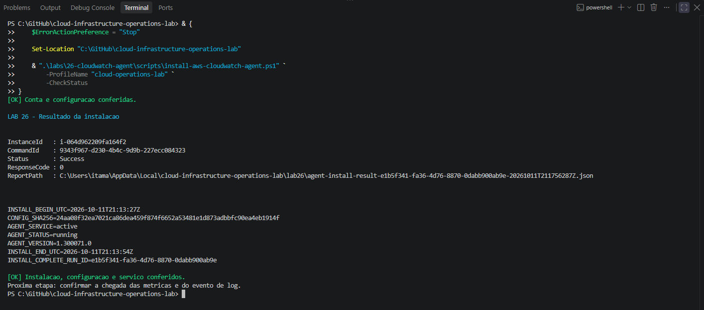
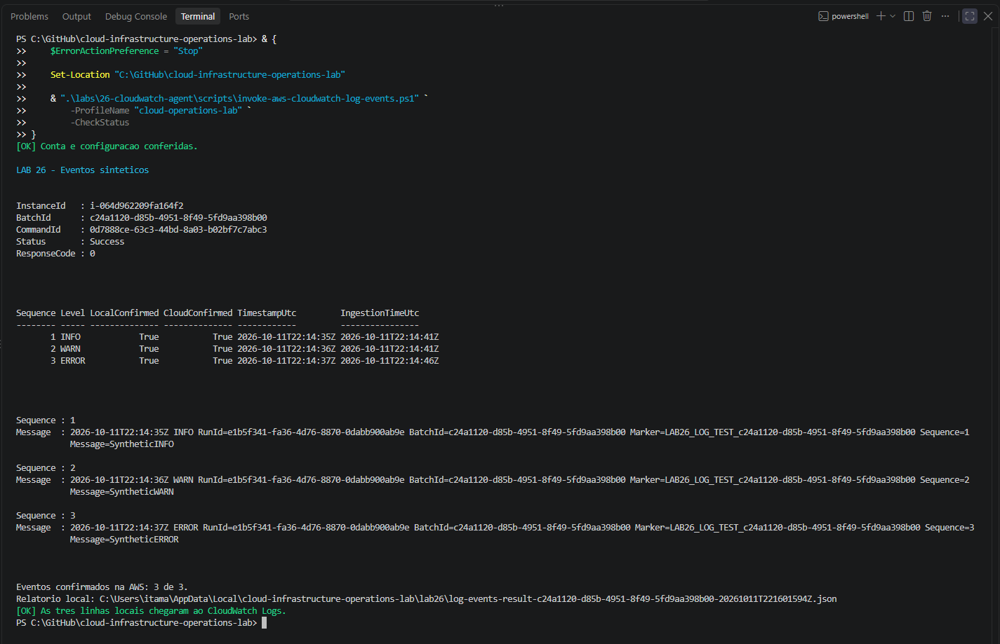
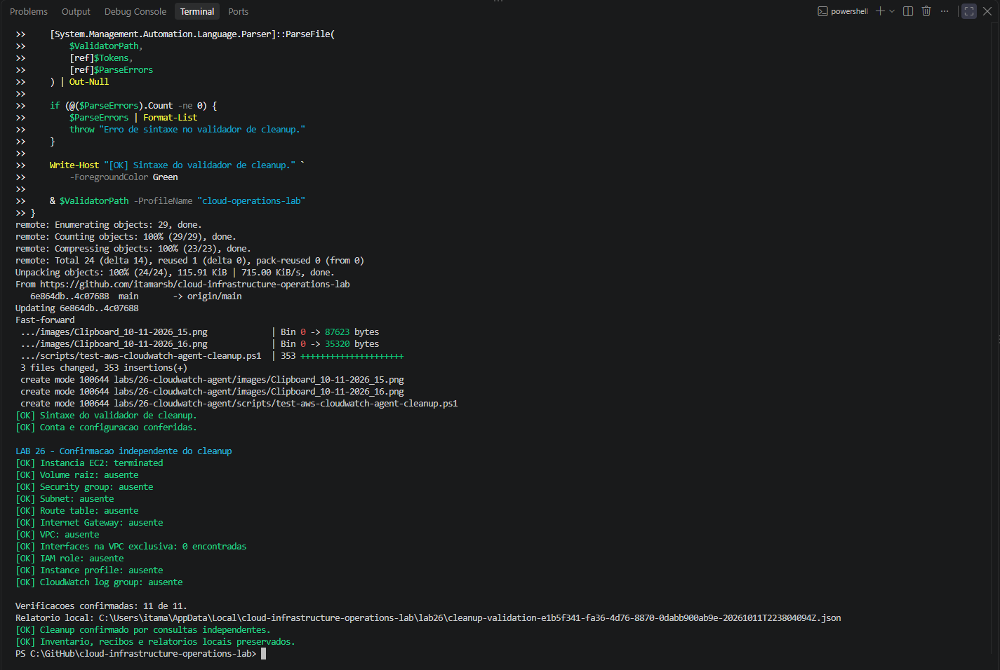

# Lab 26 — CloudWatch Agent: EC2 Memory, Disk, and Application Logs

[**Português (Brasil)**](README.md) · **English**

## Overview

Lab 26 extends the native EC2 monitoring explored in [Lab 25](../25-cloudwatch-metrics/) by installing and configuring the **Amazon CloudWatch Agent** on a dedicated Amazon Linux 2023 EC2 instance. It records guest operating-system memory and root filesystem utilization and forwards a small number of synthetic application log messages to CloudWatch Logs.

**Recorded result:** The original experiment completed on **October 11, 2026**. The agent was installed through Systems Manager, its service and configuration checksum were verified, memory and disk metrics appeared in CloudWatch, an initial agent-start log event was located, and three synthetic application events were matched between the local file and AWS. The dedicated infrastructure and log group were deleted, with **11 independent cleanup checks passing**.

**Review boundary:** This English edition is based on a static examination of the Portuguese README, seven PowerShell scripts, four JSON configuration/policy files, and 17 image paths. **No new AWS operations or agent installations were performed.** All measurements below are historical.

## Architecture and isolation

~~~text
Windows PowerShell + AWS CLI + IAM Identity Center
                         |
                         v
               AWS Systems Manager
                         |
                Run Command / SSM
                         |
                         v
Dedicated Lab 26 VPC: 10.26.0.0/16
  ├── Public subnet: 10.26.1.0/24
  ├── Internet Gateway and public route
  ├── Dedicated Security Group: NO inbound rules
  └── Amazon Linux 2023 EC2 t3.micro
        ├── IMDSv2 required
        ├── CPU credits: standard
        ├── EC2 basic monitoring
        ├── Encrypted 8 GiB gp3 root EBS
        └── Amazon CloudWatch Agent
              |
              +-- Lab26/CWAgent
              |     mem_used_percent every 60 s
              |     disk_used_percent (root /) every 60 s
              |
              +-- CloudWatch Logs
                    /cloud-infrastructure-operations-lab/lab26/application
                    Log stream: instance ID
                    Retention: 1 day
~~~

The VPC was **created specifically for Lab 26**, unlike earlier labs that reused the shared Lab 08 network. Its VPC and subnet, routing, gateway and associated resources were intentionally removed during Lab 26 cleanup.

| Setting | Historical value |
|---|---|
| Region / availability zone | `us-east-1` / `us-east-1a` |
| Profile | `cloud-operations-lab` |
| Instance | `t3.micro`, Amazon Linux 2023 x86_64 |
| CPU credits | `standard` |
| Root EBS | 8 GiB, gp3, encrypted, delete on termination |
| Network | Dedicated VPC with public subnet and IPv4 |
| Inbound Security Group rules | None |
| Administrative channel | Systems Manager; no SSH keys |
| Custom metric namespace | `Lab26/CWAgent` |
| Metric interval | 60 seconds |
| Log file | `/var/log/lab26/application.log` |
| Log group | `/cloud-infrastructure-operations-lab/lab26/application` |
| Log stream | Instance ID |
| Log retention | One day |

No NAT Gateway, dashboard or alarms were part of this exercise. The AMI was looked up through the Amazon Linux 2023 public SSM parameter, so a later deployment may resolve a different image.

## Source files

| File | Responsibility |
|---|---|
| [Lab settings](config/lab26-settings.json) | Region, account, network, metrics, log group and names |
| [EC2 trust policy](config/ec2-ssm-trust-policy.json) | EC2 service principal and sts:AssumeRole |
| [Agent configuration](config/cloudwatch-agent.json) | Metric collectors and log shipping |
| [Agent publishing IAM policy](config/cloudwatch-agent-publish-policy.json) | Permissions for PutMetricData and CloudWatch Logs |
| [Shared functions](scripts/lab26-common.ps1) | AWS requests, authorization, tags, inventory and JSON |
| [Deployment](scripts/deploy-aws-cloudwatch-agent.ps1) | Validate and create isolated infrastructure |
| [Installation](scripts/install-aws-cloudwatch-agent.ps1) | Send installer through SSM and confirm its result |
| [Agent validator](scripts/test-aws-cloudwatch-agent.ps1) | Inspect AWS resources, metrics and initial log event |
| [Log test](scripts/invoke-aws-cloudwatch-log-events.ps1) | Generate synthetic INFO/WARN/ERROR lines and match AWS events |
| [Cleanup](scripts/remove-aws-cloudwatch-agent.ps1) | Remove lab-owned infrastructure and log group |
| [Cleanup validator](scripts/test-aws-cloudwatch-agent-cleanup.ps1) | Independently verify 11 removal conditions |

The original source includes a **fixed expected AWS account ID** in both settings and script validation, and the IAM publishing policy contains account-specific CloudWatch Logs ARNs. A new authorized environment requires coordinated review of all three; selecting a different CLI profile alone is not sufficient.

## What the agent collects

The committed agent JSON specifies:

| Collector | Metric | Unit | Dimensions observed |
|---|---|---|---|
| Memory | `mem_used_percent` | Percent | `InstanceId` |
| Disk, root filesystem only | `disk_used_percent` | Percent | `InstanceId`, `path=/`, `fstype=xfs` |

Both collectors sample every **60 seconds**. The configuration appends the EC2 instance ID using the agent token, omits the hostname, and does not declare additional metric aggregations.

The disk collector uses `resources: ["/"]` and `drop_device: true`. It measures **filesystem occupancy** at the root mount point, not read/write throughput, EBS latency or total attached-volume capacity.

The namespace is separate from the native AWS/EC2 metrics. Guest memory and filesystem occupancy are not the same as the CPU, networking and EC2 status-check metrics studied in Lab 25.

The metric validator discovers the dimensions for each series, then queries the complete dimension set. It uses a default **30-minute lookback**, 60-second period, and Average and Maximum statistics; it excludes the minute currently in progress. A window may be changed, for example to 60 minutes. Empty responses remain **no data**, never a measured zero.

## CloudWatch Logs configuration

The agent watches exactly one UTF-8 file:

~~~text
/var/log/lab26/application.log
~~~

It ships to the dedicated log group, with an instance-ID stream name. The configured timestamp format is:

~~~text
%Y-%m-%dT%H:%M:%SZ
~~~

Timezone is **UTC**. The group retention was configured as **one day** by the provisioning workflow.

**Retention is not permanent archival.** Cleanup explicitly deleted the log group. The historical evidence for its contents therefore resides in the reports and screenshots preserved during execution, not in an assertion that the live group still exists.

### Instance IAM permissions

The instance role combines the managed policy `AmazonSSMManagedInstanceCore` with the dedicated inline publishing policy. The latter grants:

- `cloudwatch:PutMetricData` on the CloudWatch metric API, restricted by a `cloudwatch:namespace` condition to `Lab26/CWAgent`.
- `logs:DescribeLogGroups`, which is scoped to all resources as required by that API action.
- `logs:DescribeLogStreams` on the dedicated log group.
- `logs:CreateLogStream` and `logs:PutLogEvents` for streams in the dedicated group.

The publishing policy **does not grant log-group creation or retention updates** to the instance agent. Those operations were performed by the authorized deployment workflow, not by broadening the agent's role.

The trust policy only allows the EC2 service principal to assume the role; it does not give a human operator the rights to run SSM commands or modify AWS resources. A permission to publish metrics is not permission to retrieve arbitrary CloudWatch metrics.

## Historical execution workflow

Run from a clean, verified checkout on a workstation with Windows PowerShell, AWS CLI v2, an authorized SSO profile and appropriate operator IAM permissions.

All commands below are examples for a **new, isolated, explicitly authorized** run. The 2026 infrastructure was removed.

### 1. Authenticate and prepare

~~~powershell
aws sso login --profile cloud-operations-lab
aws sts get-caller-identity --profile cloud-operations-lab --region us-east-1

$Scripts = ".\labs\26-cloudwatch-agent\scripts"
~~~

Before updating a local checkout, inspect uncommitted changes. The original procedure used `git pull --ff-only` only after checking that the worktree was clean. It also parsed each PowerShell script for syntax errors.

A syntax check is useful but does **not** prove that AWS operations, SSM remote commands or agent startup will succeed.

### 2. Preflight and deploy

~~~powershell
& "$Scripts\deploy-aws-cloudwatch-agent.ps1" -ProfileName "cloud-operations-lab" -ValidateOnly

& "$Scripts\deploy-aws-cloudwatch-agent.ps1" -ProfileName "cloud-operations-lab"
~~~

The preflight checks JSON configuration and policies, account identity, resource-name conflicts, AZ and AMI selection. The actual deployment creates the dedicated network, IAM role/profile, log group and EC2 instance. It records resource IDs progressively and waits for the instance to become `running` and registered `Online` with SSM.

**Partial-deployment safety:** An existing inventory stops a fresh deployment. Never delete or overwrite a partial-run inventory to bypass a failure: it may describe billable AWS resources still present.

### 3. Install the agent through SSM

~~~powershell
& "$Scripts\install-aws-cloudwatch-agent.ps1" -ProfileName "cloud-operations-lab" -ValidateOnly

& "$Scripts\install-aws-cloudwatch-agent.ps1" -ProfileName "cloud-operations-lab"
~~~

The installation script normalizes the committed JSON and remote shell line endings to LF, calculates a SHA-256 digest of the normalized configuration, submits an SSM Run Command, and records its CommandId locally.

**An accepted SSM command is not a completed installation.** Check its execution separately:

~~~powershell
& "$Scripts\install-aws-cloudwatch-agent.ps1" -ProfileName "cloud-operations-lab" -CheckStatus
~~~

The original completion required successful command status and response code zero, the expected configuration hash and run marker, the agent version, active service state, and a successful agent status check.

The historical installation reported:

| Field | Observation on October 11, 2026 |
|---|---|
| Start UTC | 21:13:27 |
| End UTC | 21:13:54 |
| SSM status | Success |
| SSM response code | 0 |
| CloudWatch Agent version | 1.300071.0 |
| Service | active |
| Agent status | running |

These values were observed at installation time. The current agent version and status on a new instance may differ.

A pending installation must be checked using `-CheckStatus` rather than resubmitted blindly. The script preserves a receipt to prevent accidental duplicate installation commands.

### 4. Verify real AWS metric data and the initial log event

~~~powershell
& "$Scripts\test-aws-cloudwatch-agent.ps1" -ProfileName "cloud-operations-lab"
~~~

The validation is separate from installing or starting the agent. It verifies resource identity, SSM installation results and configuration hash, log-group retention, the actual series and dimensions, metric points, and the initial CloudWatch Logs event.

For a wider window:

~~~powershell
& "$Scripts\test-aws-cloudwatch-agent.ps1" -ProfileName "cloud-operations-lab" -WindowMinutes 60
~~~

Recorded observations:

| Query | Result |
|---|---|
| First memory query | 13 data points |
| First root disk query | 13 data points |
| Subsequent memory query | 29 data points |
| Subsequent root disk query | 30 data points |
| Memory utilization | Approximately 23.05–23.21% |
| Root filesystem utilization | Approximately 23.576–23.578% |

The difference between 29 and 30 points does not by itself prove missing agent service, nor does an individual successful query prove uninterrupted publication for every minute.

The initial synthetic agent-start marker was found in the instance's log stream. It had event time **21:13:54 UTC** and AWS ingestion time **21:14:05 UTC**, a recorded difference of **11 seconds**.

**Timing qualification:** Event timestamp-to-ingestion differences are observations from this run. They do not represent a guaranteed delivery latency, CloudWatch Logs SLO, or an end-to-end latency decomposition.

### 5. Write and confirm three synthetic application events

~~~powershell
& "$Scripts\invoke-aws-cloudwatch-log-events.ps1" -ProfileName "cloud-operations-lab" -ValidateOnly

& "$Scripts\invoke-aws-cloudwatch-log-events.ps1" -ProfileName "cloud-operations-lab"
~~~

The remote command checks the agent service, appends three uniquely identified UTF-8 log entries to the local file, then rereads the file. The entries include UTC timestamp, severity, RunId, BatchId, marker and sequence.

After allowing ingestion time, check the existing batch:

~~~powershell
& "$Scripts\invoke-aws-cloudwatch-log-events.ps1" -ProfileName "cloud-operations-lab" -CheckStatus
~~~

The script matches the **complete local lines** against AWS events from the exact instance-ID log stream and records timestamp and ingestion time.

| Sequence | Synthetic level | Event UTC | Ingestion UTC | Observed difference |
|---|---|---|---|---|
| 1 | INFO | 22:14:35 | 22:14:41 | 6 s |
| 2 | WARN | 22:14:36 | 22:14:41 | 5 s |
| 3 | ERROR | 22:14:37 | 22:14:46 | 9 s |

All three events were confirmed locally and in CloudWatch Logs in the historical run.

**A synthetic ERROR event is not an application failure.** The level is test text deliberately written to demonstrate ingestion. It should not be interpreted as evidence of an actual exception or incident.

If AWS ingestion is pending, repeat **only** `-CheckStatus`. The batch receipt blocks an accidental second submission that could generate duplicate evidence.

### 6. Remove only Lab 26 resources

Once the measurements, log events and necessary receipts have been preserved:

~~~powershell
& "$Scripts\remove-aws-cloudwatch-agent.ps1" -ProfileName "cloud-operations-lab" -ValidateOnly

& "$Scripts\remove-aws-cloudwatch-agent.ps1" -ProfileName "cloud-operations-lab"
~~~

The cleanup inspects IDs, tags, resource relationships, IAM policies, log-group ownership and active SSM commands before deletion. It terminates the dedicated instance, confirms the EBS root-volume lifecycle and removes the exclusive role/profile, Security Group, subnet, routing, Internet Gateway, VPC and log group.

The **log group is deleted after EC2 termination**, avoiding further publication from a running agent. Its one-day retention does not guarantee preservation after explicit group deletion.

This is a destructive operation, not a reversible configuration rollback. The VPC was exclusive to Lab 26; do not reuse this removal logic against shared infrastructure.

### 7. Verify cleanup independently

~~~powershell
& "$Scripts\test-aws-cloudwatch-agent-cleanup.ps1" -ProfileName "cloud-operations-lab"
~~~

The independent validator checks 11 conditions:

| Checked target | Recorded final result |
|---|---|
| EC2 instance | terminated |
| EBS root volume | Absent |
| Security Group | Absent |
| Public subnet | Absent |
| Route table | Absent |
| Internet Gateway | Absent |
| VPC | Absent |
| VPC network interfaces | Zero |
| IAM role | Absent |
| IAM instance profile | Absent |
| CloudWatch Logs group | Absent |

All 11 passed at **22:38:04 UTC on October 11, 2026**. The validation concerns those inventoried resources and names, not every resource in the AWS account.

A terminated instance can remain visible in DescribeInstances for a period; the recorded cleanup accepted the `terminated` state for that specific check.

## Local reports retained after cleanup

The scripts save JSON receipts outside the repository:

~~~text
%LOCALAPPDATA%\cloud-infrastructure-operations-lab\lab26
~~~

| File or pattern | Contents |
|---|---|
| `deployment.json` | Account, RunId and resource inventory |
| `agent-install-<RunId>.json` | Installation CommandId/receipt |
| `agent-install-result-<RunId>-<timestamp>.json` | Installation result |
| `agent-validation-<RunId>-<timestamp>.json` | Metric dimensions, points and initial event |
| `log-events-<RunId>.json` | Synthetic-batch receipt |
| `log-events-result-<BatchId>-<timestamp>.json` | Local lines and CloudWatch matches |
| `cleanup-validation-<RunId>-<timestamp>.json` | Eleven final checks |

These records can include full account/resource identifiers and operational metadata. They require appropriate handling and privacy review before sharing. A successful cleanup does not erase copies of these files on the workstation.

## Historical evidence

The repository includes **17** screenshots from the original experiment. Their labels follow the original README; their image pixels have **not been individually inspected at full resolution** for this documentation pass.

| Screenshot | Recorded stage |
|---|---|
| [01](images/Clipboard_10-11-2026_01.png) | Repository layout |
| [02](images/Clipboard_10-11-2026_02.png) | Configuration JSON and parameters |
| [03](images/Clipboard_10-11-2026_03.png) | Shared functions and initialization |
| [04](images/Clipboard_10-11-2026_04.png) | Deployment preflight |
| [05](images/Clipboard_10-11-2026_05.png) | Parser and cleanup syntax checks |
| [06](images/Clipboard_10-11-2026_06.png) | EC2 deployed, SSM Online |
| [07](images/Clipboard_10-11-2026_07.png) | Installation preflight |
| [08](images/Clipboard_10-11-2026_08.png) | Installation command submitted |
| [09](images/Clipboard_10-11-2026_09.png) | Installation completed and agent checked |
| [10](images/Clipboard_10-11-2026_10.png) | Initial metrics and start event |
| [11](images/Clipboard_10-11-2026_11.png) | Versioned metric validator/report |
| [12](images/Clipboard_10-11-2026_12.png) | Synthetic batch preflight |
| [13](images/Clipboard_10-11-2026_13.png) | Batch submitted |
| [14](images/Clipboard_10-11-2026_14.png) | Three events matched |
| [15](images/Clipboard_10-11-2026_15.png) | Cleanup preflight |
| [16](images/Clipboard_10-11-2026_16.png) | Cleanup execution |
| [17](images/Clipboard_10-11-2026_17.png) | Eleven independent checks |

### Installation result

### Confirmed log ingestion

### Verified cleanup

## Operational considerations

**Agent status versus publication:** A running agent and valid configuration hash do not independently confirm published data. Use CloudWatch metric and log queries to verify ingestion.

**Dimensional correctness:** Memory and disk metrics have different dimension sets. Querying disk without its actual path and filesystem dimensions may return no points. Empty points must not be reinterpreted as zero.

**Filesystem versus storage performance:** Disk used percentage measures occupancy of the root filesystem. It does not measure EBS IOPS, throughput, latency or available free space outside the selected mount.

**IAM least privilege:** Namespace restrictions and log-group/stream ARNs are useful, but DescribeLogGroups has a wildcard resource. Human operators need separate permissions. The hard-coded AWS account in policy ARNs is an important portability constraint.

**Retention and cleanup:** One-day retention controls log expiration while the group exists. Explicit cleanup removes the group and makes historical queries unavailable, notwithstanding locally preserved evidence.

**Measurement precision:** Collection intervals of 60 seconds are not a guarantee of exactly one available datapoint per minute. Observed ingest delays of 5–11 seconds in this small test do not establish general CloudWatch delivery guarantees.

**Synthetic events:** INFO, WARN and ERROR lines were generated to test shipping; they do not represent a real application incident or a tested alert workflow.

**Cost:** EC2, EBS, public IPv4, custom metric series, CloudWatch Logs ingestion/storage, data transfer and relevant API usage may incur charges. No Free Tier entitlement is assumed.

**No alarms:** The experiment tests guest telemetry and log shipping, not notification routing or thresholds. Those belong to [Lab 27](../27-cloudwatch-alarms-notifications/).

## Conclusion

Lab 26 records a successful workflow of **dedicated EC2 deployment → agent installation → independent memory/disk metric queries → initial and synthetic log verification → destructive cleanup → 11 independent checks**.

Its evidence demonstrates that the expected guest telemetry was published and log messages were ingested under the tested conditions. It does not prove indefinite agent availability, error-free application behavior, or a production logging/alerting SLO.

## Next lab

[Lab 27 — CloudWatch Alarms and Notifications](../27-cloudwatch-alarms-notifications/)

---

[English repository overview](../../README.en.md) · [Portuguese repository overview](../../README.md)
