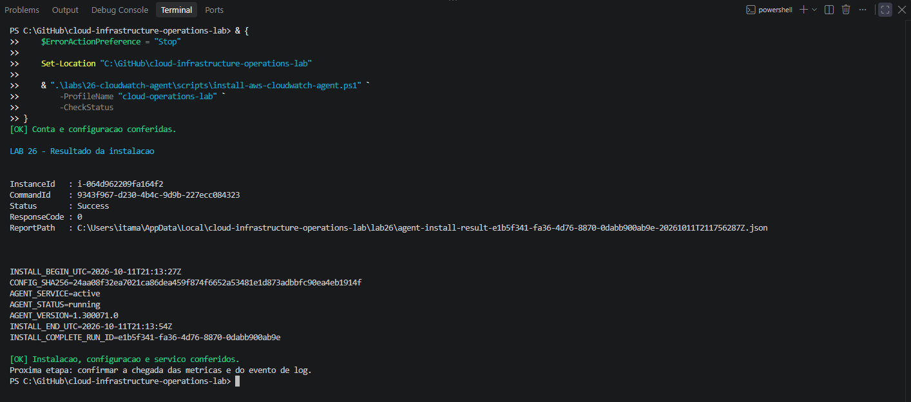
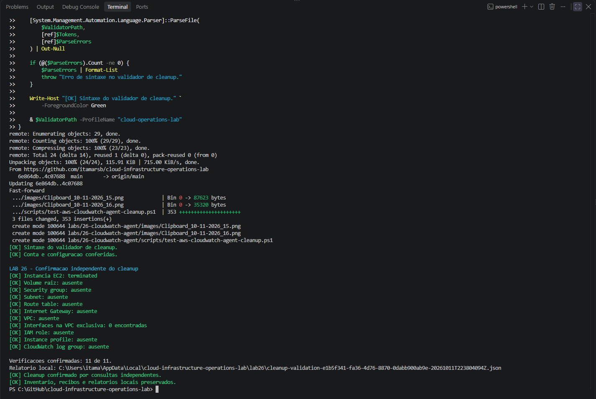

# Lab 26 — CloudWatch Agent

Coleta de métricas de memória e disco e envio de logs de aplicação a partir de uma instância EC2 administrada pelo AWS Systems Manager.

**Status:** concluído em 11 de outubro de 2026. Instalação, métricas, eventos sintéticos e cleanup validados.

> **English summary:** Installed and configured the CloudWatch Agent on a dedicated Amazon Linux 2023 EC2 instance through Systems Manager. Memory and root filesystem metrics were collected every 60 seconds. Three synthetic log events were verified locally and matched against CloudWatch Logs. Dedicated infrastructure and the log group were removed, and eleven independent cleanup checks passed.

## Objetivo

Complementar as métricas nativas EC2 estudadas no Lab 25 com dados coletados dentro do sistema operacional, utilizando configuração versionada, permissões de publicação e validações independentes.

## Resultado registrado

| Verificação | Resultado |
|:---:|:---:|
| Provisionamento | EC2 `running` e SSM `Online` durante a execução |
| Instalação | SSM `Success`, código `0` |
| Agente | Versão `1.300071.0`, serviço `active`, status `running` no comando de instalação |
| Configuração | SHA-256 da configuração aplicada conferido |
| Métricas | Memória e disco raiz com dados |
| Log inicial | Marcador de inicialização encontrado no stream da instância |
| Eventos sintéticos | INFO, WARN e ERROR: três linhas locais confirmadas na AWS |
| Retenção | Um dia |
| Cleanup | Onze verificações independentes aprovadas |

## Ambiente

| Parâmetro | Valor |
|---|---|
| Estação | Windows 11 e PowerShell |
| Autenticação | AWS IAM Identity Center / SSO |
| Perfil | `cloud-operations-lab` |
| Região / zona | `us-east-1` / `us-east-1a` |
| Sistema | Amazon Linux 2023, `x86_64` |
| EC2 | `t3.micro`, créditos `standard`, monitoramento básico |
| Volume raiz | 8 GiB, `gp3`, criptografado, exclusão na terminação |
| Rede exclusiva | VPC `10.26.0.0/16`; subnet `10.26.1.0/24` |
| Acesso | Systems Manager; security group sem regras de entrada |
| Metadados | IMDSv2 obrigatório |
| Namespace | `Lab26/CWAgent` |
| Intervalo | 60 segundos |
| Arquivo de aplicação | `/var/log/lab26/application.log` |
| Grupo | `/cloud-infrastructure-operations-lab/lab26/application` |
| Stream | ID da instância, resolvido por `{instance_id}` |

A subnet pública utilizou Internet Gateway, rota de saída e IPv4 público. A role EC2 forneceu credenciais temporárias ao agente. Não foram utilizados SSH, chaves estáticas, NAT Gateway, dashboard ou alarmes neste exercício.

## Arquivos versionados

| Arquivo | Finalidade |
|---|---|
| [lab26-settings.json](config/lab26-settings.json) | Parâmetros, nomes e tags |
| [ec2-ssm-trust-policy.json](config/ec2-ssm-trust-policy.json) | Trust policy EC2 |
| [cloudwatch-agent.json](config/cloudwatch-agent.json) | Memória, disco raiz e arquivo de aplicação |
| [cloudwatch-agent-publish-policy.json](config/cloudwatch-agent-publish-policy.json) | Publicação de métricas e logs |
| [lab26-common.ps1](scripts/lab26-common.ps1) | Identidade, JSON, chamadas AWS, tags e inventário |
| [deploy-aws-cloudwatch-agent.ps1](scripts/deploy-aws-cloudwatch-agent.ps1) | Provisionamento |
| [install-aws-cloudwatch-agent.ps1](scripts/install-aws-cloudwatch-agent.ps1) | Instalação e confirmação por SSM |
| [test-aws-cloudwatch-agent.ps1](scripts/test-aws-cloudwatch-agent.ps1) | Infraestrutura, instalação, métricas e evento inicial |
| [invoke-aws-cloudwatch-log-events.ps1](scripts/invoke-aws-cloudwatch-log-events.ps1) | Geração e confirmação dos eventos sintéticos |
| [remove-aws-cloudwatch-agent.ps1](scripts/remove-aws-cloudwatch-agent.ps1) | Cleanup |
| [test-aws-cloudwatch-agent-cleanup.ps1](scripts/test-aws-cloudwatch-agent-cleanup.ps1) | Confirmação independente do cleanup |

## Configuração e permissões

Os recursos exclusivos receberam tags `Name`, `Project=cloud-infrastructure-operations-lab`, `Lab=26`, `ManagedBy=lab26-powershell` e `RunId`.

A role utilizou `AmazonSSMManagedInstanceCore` e uma política inline com:

- `cloudwatch:PutMetricData`, condicionado ao namespace exclusivo;
- `logs:DescribeLogGroups`;
- `logs:DescribeLogStreams`, limitado ao grupo exclusivo;
- `logs:CreateLogStream` e `logs:PutLogEvents`, limitados aos streams desse grupo.

O provisionamento criou o grupo e definiu a retenção. O agente não recebeu permissão para criar grupos nem alterar sua retenção.

Os coletores `mem` e `disk` utilizaram `used_percent`, com intervalo de 60 segundos. O disco ficou limitado a `/`, com `drop_device: true`. A configuração preservou `${aws:InstanceId}`, utilizou `omit_hostname: true` e não definiu agregações adicionais.

O log utilizou UTF-8, timezone `UTC` e timestamp `%Y-%m-%dT%H:%M:%SZ`.

| Caminho na instância | Finalidade |
|---|---|
| `/opt/aws/amazon-cloudwatch-agent/etc/lab26-cloudwatch-agent.json` | Configuração aplicada |
| `/opt/aws/amazon-cloudwatch-agent/logs/amazon-cloudwatch-agent.log` | Diagnóstico do agente |
| `/var/lib/lab26/` | Registros do comando de instalação |
| `/var/log/lab26/application.log` | Eventos coletados |

As quebras de linha do comando Linux e da configuração foram normalizadas para LF. O SHA-256 foi calculado sobre a configuração normalizada.

## Pré-requisitos e registros locais

São necessários AWS CLI, perfil SSO configurado, sessão ativa e permissões para o cenário. Os scripts conferem a conta esperada. A reprodução em outra conta exige revisar em conjunto parâmetros, validações e ARNs da política.

Inventário, recibos e relatórios ficam fora do repositório:

```text
%LOCALAPPDATA%\cloud-infrastructure-operations-lab\lab26
```

| Registro | Conteúdo |
|---|---|
| `deployment.json` | IDs, RunId e estado da execução |
| `agent-install-<RunId>.json` | Recibo da instalação |
| `agent-install-result-<RunId>-<timestamp>.json` | Resultado SSM |
| `agent-validation-<RunId>-<timestamp>.json` | Dimensões, pontos e evento inicial |
| `log-events-<RunId>.json` | Recibo do lote sintético |
| `log-events-result-<BatchId>-<timestamp>.json` | Linhas locais e eventos recebidos |
| `cleanup-validation-<RunId>-<timestamp>.json` | Confirmação das onze consultas |

**A execução documentada já foi encerrada.** O deploy protege o inventário existente. Uma nova execução exige arquivar os registros anteriores após confirmar o cleanup e revisar o cenário. Não exclua o inventário para contornar uma falha parcial.

## Procedimento de execução

Os comandos documentam a sequência realizada e devem ser executados etapa por etapa, na raiz do repositório.

### 1. Atualizar e autenticar

```powershell
& {
    $ErrorActionPreference = "Stop"
    Set-Location "C:\GitHub\cloud-infrastructure-operations-lab"
    $GitStatus = @(git status --porcelain)
    if ($LASTEXITCODE -ne 0) { throw "Falha ao consultar o repositorio." }
    if ($GitStatus.Count -ne 0) { throw "Ha alteracoes locais." }
    git pull --ff-only
    if ($LASTEXITCODE -ne 0) { throw "Falha ao atualizar o repositorio." }
}
```

Se a sessão expirou:

```powershell
aws sso login --profile cloud-operations-lab
```

### 2. Validar a sintaxe

```powershell
& {
    $ErrorActionPreference = "Stop"
    $ScriptsPath = ".\labs\26-cloudwatch-agent\scripts"
    foreach ($File in Get-ChildItem -LiteralPath $ScriptsPath -Filter "*.ps1") {
        $Tokens = $null
        $ParseErrors = $null
        [System.Management.Automation.Language.Parser]::ParseFile(
            $File.FullName, [ref]$Tokens, [ref]$ParseErrors
        ) | Out-Null
        if (@($ParseErrors).Count -ne 0) {
            $ParseErrors | Format-List
            throw "Erro de sintaxe em $($File.Name)."
        }
        Write-Host "[OK] Sintaxe: $($File.Name)" -ForegroundColor Green
    }
}
```

A verificação sintática não substitui as validações de configuração e recursos.

### 3. Validar e provisionar

```powershell
& ".\labs\26-cloudwatch-agent\scripts\deploy-aws-cloudwatch-agent.ps1" `
    -ProfileName "cloud-operations-lab" -ValidateOnly
```

Após conferir nomes livres, configuração, zona e AMI:

```powershell
& ".\labs\26-cloudwatch-agent\scripts\deploy-aws-cloudwatch-agent.ps1" `
    -ProfileName "cloud-operations-lab"
```

O deploy registra os IDs progressivamente e aguarda EC2 `running` e SSM `Online`. A instalação é uma etapa separada.

### 4. Instalar e conferir o agente

```powershell
& ".\labs\26-cloudwatch-agent\scripts\install-aws-cloudwatch-agent.ps1" `
    -ProfileName "cloud-operations-lab" -ValidateOnly
```

```powershell
& ".\labs\26-cloudwatch-agent\scripts\install-aws-cloudwatch-agent.ps1" `
    -ProfileName "cloud-operations-lab"
```

Aguarde aproximadamente um minuto e consulte:

```powershell
& ".\labs\26-cloudwatch-agent\scripts\install-aws-cloudwatch-agent.ps1" `
    -ProfileName "cloud-operations-lab" -CheckStatus
```

Se o comando estiver em andamento, repita somente `-CheckStatus`. A confirmação exige sucesso, código zero, hash correto, versão, serviço ativo e marcador da execução.

### 5. Confirmar métricas e log inicial

```powershell
& ".\labs\26-cloudwatch-agent\scripts\test-aws-cloudwatch-agent.ps1" `
    -ProfileName "cloud-operations-lab"
```

O validador descobre as dimensões e consulta cada série com seu conjunto completo. A janela padrão é de 30 minutos, período de 60 segundos e estatísticas `Average` e `Maximum`, excluindo o minuto em andamento.

Uma janela alternativa pode ser indicada com `-WindowMinutes 60`. Respostas sem pontos ficam pendentes e não são convertidas em zero. Aguarde e repita a consulta antes de concluir que existe falha de publicação.

### 6. Gerar e confirmar eventos sintéticos

```powershell
& ".\labs\26-cloudwatch-agent\scripts\invoke-aws-cloudwatch-log-events.ps1" `
    -ProfileName "cloud-operations-lab" -ValidateOnly
```

Envie o lote uma vez:

```powershell
& ".\labs\26-cloudwatch-agent\scripts\invoke-aws-cloudwatch-log-events.ps1" `
    -ProfileName "cloud-operations-lab"
```

Após aproximadamente 30 segundos:

```powershell
& ".\labs\26-cloudwatch-agent\scripts\invoke-aws-cloudwatch-log-events.ps1" `
    -ProfileName "cloud-operations-lab" -CheckStatus
```

O comando confirma o serviço ativo, acrescenta três linhas ao arquivo e relê o conteúdo para confirmar a gravação. Cada linha contém timestamp UTC, nível, RunId, BatchId, marcador e sequência.

A consulta compara as linhas locais com os eventos do stream da instância. Se a entrega estiver pendente, repita somente `-CheckStatus`. O recibo impede um segundo envio acidental.

INFO, WARN e ERROR são mensagens sintéticas; ERROR não representa uma falha real.

### 7. Validar e executar o cleanup

Depois de confirmar os eventos e preservar as evidências:

```powershell
& ".\labs\26-cloudwatch-agent\scripts\remove-aws-cloudwatch-agent.ps1" `
    -ProfileName "cloud-operations-lab" -ValidateOnly
```

```powershell
& ".\labs\26-cloudwatch-agent\scripts\remove-aws-cloudwatch-agent.ps1" `
    -ProfileName "cloud-operations-lab"
```

O cleanup confere propriedade, associações e comandos SSM ativos. Termina a instância, confere o armazenamento e remove os recursos IAM e a rede exclusivos. O grupo de logs é removido depois da instância, evitando publicação posterior pelo agente.

### 8. Confirmar o cleanup

```powershell
& ".\labs\26-cloudwatch-agent\scripts\test-aws-cloudwatch-agent-cleanup.ps1" `
    -ProfileName "cloud-operations-lab"
```

O resultado esperado é `11 de 11` verificações confirmadas. Esse validador não executa remoções.

## Resultados e interpretação

### Instalação

| Campo | Resultado em 11/10/2026 |
|---|---|
| Início UTC | `21:13:27Z` |
| Fim UTC | `21:13:54Z` |
| Status / código | `Success` / `0` |
| Serviço / agente | `active` / `running` |
| Versão | `1.300071.0` |

O serviço foi conferido no comando remoto de instalação. A entrega ao CloudWatch foi comprovada separadamente por consultas à AWS.

### Métricas

| Métrica | Unidade | Dimensões observadas |
|---|---|---|
| `mem_used_percent` | `Percent` | `InstanceId` |
| `disk_used_percent` | `Percent` | `InstanceId`, `path=/`, `fstype=xfs` |

A primeira consulta retornou 13 pontos de cada métrica. A validação versionada posterior retornou 29 pontos de memória e 30 de disco, com timestamps UTC.

| Coleta versionada | Utilização aproximada |
|---|---|
| Memória | `23,05%` a `23,21%` |
| Disco raiz | `23,576%` a `23,578%` |

Os valores representam o comportamento observado, sem teste de pressão de memória ou disco e sem thresholds de alarme. A métrica de disco descreve a ocupação do sistema de arquivos, não I/O do EBS.

A quantidade de pontos pode variar entre séries e consultas. O validador confirma dados na janela, mas não certifica continuidade de todos os minutos nem disponibilidade futura do agente.

### Logs

O evento inicial `CloudWatchAgentStarted` tinha timestamp `21:13:54Z` e ingestão `21:14:05Z`, diferença observada de 11 segundos.

| Sequência | Nível | Timestamp UTC em 11/10/2026 | Ingestão UTC | Diferença |
|---|---|---|---|---|
| 1 | INFO | `22:14:35Z` | `22:14:41Z` | 6 s |
| 2 | WARN | `22:14:36Z` | `22:14:41Z` | 5 s |
| 3 | ERROR | `22:14:37Z` | `22:14:46Z` | 9 s |

Os três eventos corresponderam às linhas locais. As diferenças comparam timestamp e horário de ingestão informado pela AWS; não são uma garantia de latência ou um SLO.

### Cleanup

| Verificação | Resultado |
|---|---|
| Instância EC2 | `terminated` |
| Volume raiz | Ausente |
| Security group | Ausente |
| Subnet | Ausente |
| Route table | Ausente |
| Internet Gateway | Ausente |
| VPC | Ausente |
| Interfaces na VPC exclusiva | Zero |
| IAM role | Ausente |
| Instance profile | Ausente |
| CloudWatch log group | Ausente |

As onze consultas foram aprovadas às `22:38:04Z` de 11 de outubro de 2026. Inventário, recibos e relatórios foram preservados.

A confirmação abrange os IDs e nomes registrados no cenário. O grupo foi excluído; consultas posteriores aos eventos devem usar os relatórios preservados. O cleanup não tenta excluir pontos individuais de métricas históricas.

## Evidências

| Captura | Etapa |
|---|---|
| [01](images/Clipboard_10-11-2026_01.png) | Estrutura inicial |
| [02](images/Clipboard_10-11-2026_02.png) | JSONs e parâmetros conferidos |
| [03](images/Clipboard_10-11-2026_03.png) | Arquivo comum e inicialização |
| [04](images/Clipboard_10-11-2026_04.png) | Pré-validação do deploy |
| [05](images/Clipboard_10-11-2026_05.png) | Sintaxe e inicialização do cleanup antes do deploy |
| [06](images/Clipboard_10-11-2026_06.png) | Infraestrutura criada e SSM Online |
| [07](images/Clipboard_10-11-2026_07.png) | Pré-validação da instalação |
| [08](images/Clipboard_10-11-2026_08.png) | Instalação enviada |
| [09](images/Clipboard_10-11-2026_09.png) | Instalação, versão, configuração e serviço |
| [10](images/Clipboard_10-11-2026_10.png) | Primeira coleta e evento inicial |
| [11](images/Clipboard_10-11-2026_11.png) | Validador versionado e relatório |
| [12](images/Clipboard_10-11-2026_12.png) | Pré-validação do lote sintético |
| [13](images/Clipboard_10-11-2026_13.png) | Lote enviado |
| [14](images/Clipboard_10-11-2026_14.png) | Três eventos confirmados localmente e na AWS |
| [15](images/Clipboard_10-11-2026_15.png) | Pré-validação do cleanup após o exercício |
| [16](images/Clipboard_10-11-2026_16.png) | Comandos de cleanup concluídos |
| [17](images/Clipboard_10-11-2026_17.png) | Onze verificações independentes aprovadas |

### Instalação confirmada



### Eventos recebidos


### Cleanup confirmado



## Proteções e limites

- `-ValidateOnly` interrompe antes das operações de criação, instalação, geração de eventos ou remoção, conforme o script.
- Os validadores executam consultas de leitura à AWS e gravam relatórios locais.
- `-CheckStatus` consulta resultados e atualiza registros locais, sem reenviar comandos.
- Ausência esperada utiliza códigos específicos; erros de autenticação e permissão não significam recurso ausente.
- O inventário registra IDs progressivamente e permanece disponível em caso de falha parcial.
- O cleanup confere propriedade e associações dos recursos exclusivos.
- O validador de métricas confirma o evento inicial; o lote sintético é confirmado pelo script de eventos.
- Retenção ou exclusão do grupo podem impedir consultas futuras ao evento inicial; os relatórios preservam a evidência já coletada.

## Custos

O cenário pode gerar cobrança por EC2, EBS, IPv4 público, métricas personalizadas, ingestão e armazenamento de logs, transferência e chamadas de API conforme a utilização.

A coleta ficou limitada a duas séries, um sistema de arquivos e um arquivo de aplicação, com poucos eventos sintéticos. Não foi presumida elegibilidade ao nível gratuito.

A retenção de um dia não substitui o cleanup. A infraestrutura e o grupo foram removidos ao final.

## Checklist final

- [x] Estrutura, configurações e scripts versionados.
- [x] Identidade e pré-requisitos conferidos.
- [x] Infraestrutura exclusiva provisionada.
- [x] EC2 e SSM confirmados durante a execução.
- [x] Instalação, versão e configuração do agente conferidas.
- [x] Métricas e dimensões efetivas registradas.
- [x] Evento inicial encontrado no CloudWatch Logs.
- [x] Três eventos sintéticos confirmados localmente e na AWS.
- [x] Relatórios JSON e evidências preservados.
- [x] Cleanup confirmado por onze consultas independentes.

## Próxima etapa

O [roadmap](../../docs/roadmap.md) prevê o **Lab 27 — Alarmes e notificações**, com thresholds, CloudWatch e Amazon SNS. O cenário será definido antes da implementação; a infraestrutura do Lab 26 foi removida.

[Voltar ao repositório](../../README.md)
