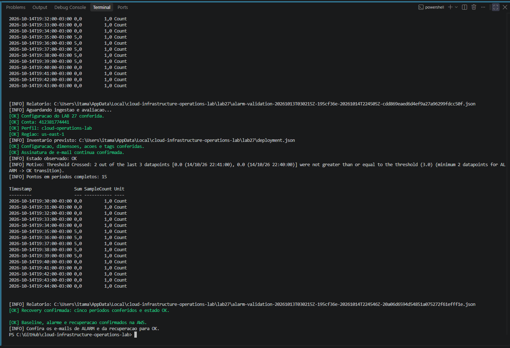
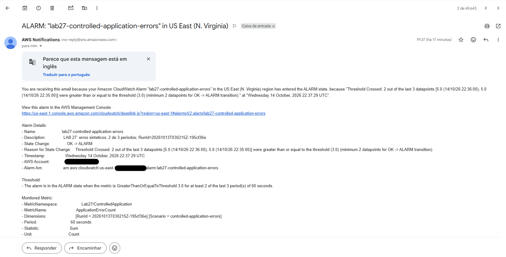
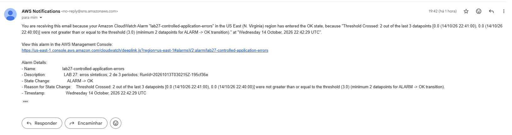
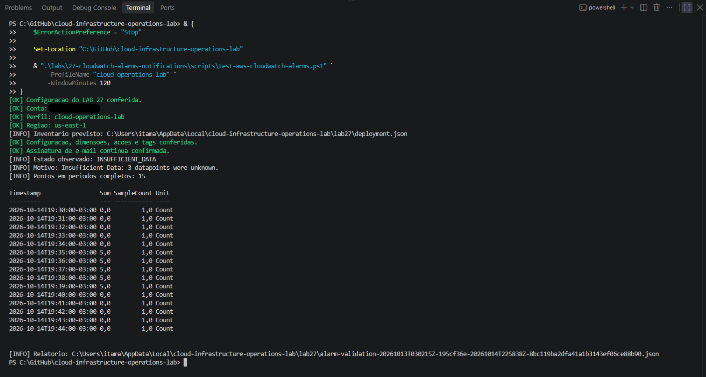
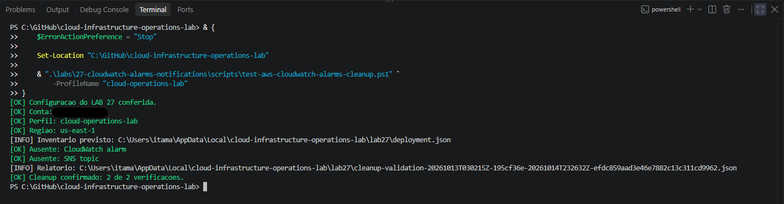

# Lab 27 — CloudWatch Alarms and Amazon SNS Notifications

[**Português (Brasil)**](README.md) · **English**

## Overview

This lab documents a controlled Amazon CloudWatch alarm experiment using a **synthetic application error-count metric** and an Amazon SNS email subscription. The original exercise publishes known values, observes threshold-based alarm transitions, checks SNS action history, verifies email delivery, and removes the alarm and topic.

**Recorded outcome:** The main experiment completed on **October 14, 2026**. Fifteen metric samples were published across baseline, breach, and recovery phases. CloudWatch reported the expected **OK → ALARM → OK** progression and later **INSUFFICIENT_DATA** when publication stopped. Three successful SNS action executions were recorded, and email evidence exists for the baseline, alarm, and recovery notifications. Independent cleanup confirmed the alarm and SNS topic absent.

**Scope:** There was no EC2, VPC, CloudWatch Agent, Logs group, application process, or production error stream in this exercise. All metric samples were generated deliberately in PowerShell. These results do **not** establish real application availability, error rate, incident detection quality, or an SLO.

This English edition is based on static review of the original README, seven PowerShell scripts, the settings JSON, and 25 evidence filenames. No AWS calls were executed during the documentation review.

## Architecture and state transitions

~~~text
Windows PowerShell + authorized AWS CLI profile
                  |
             PutMetricData
                  |
                  v
CloudWatch custom metric
  Namespace: Lab27/ControlledApplication
  Metric: ApplicationErrorCount
  Dimensions: Scenario + RunId
                  |
          CloudWatch metric alarm
          Sum >= 3
          2 out of 3 periods (60 s each)
          missing data = missing
                  |
        +---------+----------+
        |                    |
        v                    v
  OK action             ALARM action
        |                    |
        +---------+----------+
                  |
                  v
       Dedicated Amazon SNS topic
        Confirmed email subscription
                  |
                  v
           Recipient mailbox

INSUFFICIENT_DATA has no SNS action configured.
~~~

**What the alarm measures:** A sum of synthetic error-count values, not a sampled application's logs or traces. Its metric dimension RunId isolates each test execution. AWS accepts individual PutMetricData requests before the resulting aggregated points necessarily appear in read queries or influence alarm state.

### Settings verified in source

| Setting | Committed value |
|---|---|
| Region / profile | us-east-1 / cloud-operations-lab |
| Namespace | Lab27/ControlledApplication |
| Metric | ApplicationErrorCount |
| Unit and statistic | Count / Sum |
| Dimensions | Scenario=controlled-application-errors and the active RunId |
| Resolution and period | 60 seconds / 60 seconds |
| Comparison | GreaterThanOrEqualToThreshold |
| Threshold | 3 |
| Evaluation | DatapointsToAlarm=2; EvaluationPeriods=3 |
| Missing data handling | missing |
| Alarm actions | SNS on ALARM |
| OK actions | SNS on OK |
| INSUFFICIENT_DATA actions | None |
| Topic | lab27-cloudwatch-alarm-notifications |
| Alarm | lab27-controlled-application-errors |
| Baseline / breach / recovery values | 0 / 5 / 0 |
| Samples per phase | 5, separated by at least 60 seconds |

Two periods out of three need to breach the threshold to enter ALARM. A single error-count sample of five is **not sufficient by itself** to prove that the alarm should have transitioned. The evaluation also depends on the CloudWatch datapoints and their period alignment.

With TreatMissingData set to missing, a period with **no datapoint is not a zero**. The observed return to INSUFFICIENT_DATA is separate from recovery to OK.

## Repository files

| File | Responsibility |
|---|---|
| [Scenario settings](config/lab27-settings.json) | Fixed account, Region, resource names, alarm and metric parameters |
| [Shared functions](scripts/lab27-common.ps1) | Settings verification, identity, JSON, AWS calls, receipts and inventory |
| [Deploy](scripts/deploy-aws-cloudwatch-alarms.ps1) | Validate and create SNS topic, policy and CloudWatch alarm |
| [Email subscription](scripts/subscribe-aws-alarm-email.ps1) | Request subscription and verify recipient confirmation |
| [Alarm validator](scripts/test-aws-cloudwatch-alarms.ps1) | Inspect resource configuration, subscription, datapoints, state and history |
| [Metric publisher](scripts/invoke-aws-alarm-metric-scenario.ps1) | Five controlled samples in a selected phase |
| [Cleanup](scripts/remove-aws-cloudwatch-alarms.ps1) | Validate ownership, dependencies and delete alarm before topic |
| [Cleanup validator](scripts/test-aws-cloudwatch-alarms-cleanup.ps1) | Independently check absence of alarm and topic |

The historical phase orchestration and extra history export were **PowerShell blocks run on the workstation**, not separate versioned scripts in the repository.

### Topic policy and permissions

The deployment builds and applies a topic policy permitting the CloudWatch service principal to invoke sns:Publish. It restricts that permission with both the expected AWS account and the **exact alarm ARN**, reducing the risk that unrelated CloudWatch alarms publish to this topic.

The operator needs separate IAM rights to create, inspect and remove SNS and CloudWatch resources and to publish metric data. The topic policy is **not** a substitute for operator permissions.

The settings and shared functions contain a **hard-coded expected AWS account ID**. A new authorized account requires deliberate review of these checks and generated ARNs. The English guide does not repeat historical account identifiers.

### Email subscription privacy and confirmation

The email address is **not committed** in the settings file. It is entered interactively on the operator's workstation and retained in an untracked local receipt.

An SNS subscription request and a returned ARN do **not** prove email delivery or activation. The recipient must click the confirmation link, and the script's CheckStatus step verifies the resulting subscription via AWS.

Email receipts and screenshots may expose the recipient address or other personal metadata; review them before public sharing.

## Historical workflow and reproduction

The following commands are procedural examples for a fresh authorized exercise. The original topic and alarm were deleted after the October 2026 run.

### 1. Authenticate and inspect scripts

~~~powershell
aws sso login --profile cloud-operations-lab
aws sts get-caller-identity --profile cloud-operations-lab --region us-east-1

$Scripts = ".\labs\27-cloudwatch-alarms-notifications\scripts"
~~~

The original preparation checked a clean Git working tree, updated its checkout as appropriate, and parsed the seven PowerShell files for syntax errors. A parser pass does not prove that all AWS write permissions exist or that a metric alarm can transition.

### 2. Preflight and create the topic and alarm

~~~powershell
& "$Scripts\deploy-aws-cloudwatch-alarms.ps1" -ProfileName "cloud-operations-lab" -ValidateOnly

& "$Scripts\deploy-aws-cloudwatch-alarms.ps1" -ProfileName "cloud-operations-lab"
~~~

Deployment checks account, Region and name collisions; creates the dedicated topic; attaches the narrowly conditioned CloudWatch publish policy; creates the alarm; and verifies the applied threshold, periods, dimensions, action ARNs and tags.

It records a RunId and progressive inventory under a local directory. The original first deployment encountered a Windows File.Replace inventory-writing error; it was corrected to use an explicit backup path. The partially attempted state was inspected and archived before the successful run.

**Do not delete an existing inventory to bypass a failed deployment.** It may describe resources that still exist, or operations whose results are uncertain.

### 3. Request and confirm an email subscription

~~~powershell
$Email = Read-Host "Email address for Lab 27"

& "$Scripts\subscribe-aws-alarm-email.ps1" -ProfileName "cloud-operations-lab" -EmailAddress $Email -ValidateOnly

& "$Scripts\subscribe-aws-alarm-email.ps1" -ProfileName "cloud-operations-lab" -EmailAddress $Email
~~~

The recipient must open the SNS email and select **Confirm subscription**. Then:

~~~powershell
& "$Scripts\subscribe-aws-alarm-email.ps1" -ProfileName "cloud-operations-lab" -CheckStatus
~~~

A pending subscription must be checked rather than blindly requested again. The receipt prevents accidental duplicate submissions. The historical subscription was confirmed in the browser and independently through the CLI.

### 4. Inspect the initial state

~~~powershell
& "$Scripts\test-aws-cloudwatch-alarms.ps1" -ProfileName "cloud-operations-lab"
~~~

Before new samples, the expected initial state was **INSUFFICIENT_DATA**. This does not mean a numerical zero was measured. The validator checks alarm configuration, topic tags, subscription confirmation, metric datapoints and alarm history, and saves a local report.

### 5. Publish five samples for each controlled phase

For a new, isolated run after inspecting the current alarm state, the intended sequence is:

~~~powershell
& "$Scripts\invoke-aws-alarm-metric-scenario.ps1" -ProfileName "cloud-operations-lab" -Phase Baseline
& "$Scripts\test-aws-cloudwatch-alarms.ps1" -ProfileName "cloud-operations-lab"
~~~

Confirm that all **five** baseline points appear with Sum 0 and SampleCount 1 in their respective one-minute periods and that the alarm is **OK** before continuing.

~~~powershell
& "$Scripts\invoke-aws-alarm-metric-scenario.ps1" -ProfileName "cloud-operations-lab" -Phase Breach
& "$Scripts\test-aws-cloudwatch-alarms.ps1" -ProfileName "cloud-operations-lab"
~~~

Confirm five breach periods with Sum 5 and the resulting **ALARM** state. The publisher checks that the prior state is OK before allowing the Breach phase.

~~~powershell
& "$Scripts\invoke-aws-alarm-metric-scenario.ps1" -ProfileName "cloud-operations-lab" -Phase Recovery
& "$Scripts\test-aws-cloudwatch-alarms.ps1" -ProfileName "cloud-operations-lab"
~~~

Confirm five recovery periods with Sum 0 and a return to **OK**. The publisher requires ALARM before Recovery.

**Timing:** Each phase takes multiple minutes because the script schedules five samples at least 60 seconds apart. After publishing, wait for CloudWatch ingestion and alarm evaluation before starting the next phase. The historical experiment used an additional PowerShell orchestrator loop to verify each period and state before moving on. That orchestration is printed in the original Portuguese README and is **not a separate committed script**.

**No blind retries:** The publisher saves a receipt for each RunId and phase, blocks reuse of a phase with an existing receipt, and records partial or uncertain results. If a phase or a remote request appears to time out, inspect its receipt and the actual metric/state before attempting any repeat.

### 6. Inspect missing data, history and emails

After stopping publication, query the current state and an expanded historical window:

~~~powershell
& "$Scripts\test-aws-cloudwatch-alarms.ps1" -ProfileName "cloud-operations-lab" -WindowMinutes 120
~~~

The longer query window retrieves more **historical points**. It does not change the alarm's own two-of-three evaluation or its missing-data policy.

Eventually the original alarm returned to **INSUFFICIENT_DATA**. CloudWatch may consider older datapoints in its evaluation range, so the transition is not guaranteed to happen exactly three minutes after the last publication.

Review three distinct evidence layers:

1. **CloudWatch metric data** — expected Sum and SampleCount in every period.
2. **Alarm history and SNS actions** — state transitions and successfully invoked topic actions.
3. **Recipient mailbox** — actual email messages for baseline, alarm and recovery.

An SNS action marked successful does not by itself prove that a recipient's email was delivered or read.

## Main experiment: October 14, 2026

### Metric phases

| Phase | UTC minute periods | Values per period | Expected state |
|---|---|---|---|
| Baseline | 22:30–22:34 | Sum 0, SampleCount 1 | OK |
| Breach | 22:35–22:39 | Sum 5, SampleCount 1 | ALARM |
| Recovery | 22:40–22:44 | Sum 0, SampleCount 1 | OK |

The original points were submitted within each one-minute period. On the first post-recovery query only **14 of 15** datapoints were available; a subsequent query retrieved all **15**. The initial absence of a point was not misrepresented as permanent loss.

### Recorded transitions and successful SNS actions

| State transition | Alarm timestamp, UTC | SNS action result |
|---|---|---|
| INSUFFICIENT_DATA → OK | 22:31:29.877 | Success at 22:31:29.919 |
| OK → ALARM | 22:37:29.876 | Success at 22:37:29.919 |
| ALARM → OK | 22:42:29.876 | Success at 22:42:29.919 |
| OK → INSUFFICIENT_DATA | 22:53:29.876 | **No action configured** |

All timestamps are for **October 14, 2026, UTC**. Brasília time was UTC−3 for this execution. For example, the recovery notification's state transition was at **19:42:29 Brasília time**.

The ALARM reason cited breaches at 22:35 and 22:36 UTC, each with Sum 5. Recovery was based on non-breaching periods at 22:40 and 22:41 UTC, each with Sum 0.

The specific times reflect this experiment; they are **not CloudWatch evaluation-latency guarantees**. CloudWatch may reevaluate older datapoints, and subscription delivery latency adds separate behavior.

### Three email confirmations

The original evidence documents receipt of the **baseline**, **alarm** and **recovery** emails. In particular, screenshot 42 records the **ALARM → OK** recovery email corresponding to the transition at 22:42:29 UTC.

The history demonstrates three successful SNS actions, while the screenshots provide the separate recipient-side evidence. These claims must not be collapsed into “SNS accepted, therefore the email arrived.”

### Earlier baseline and deployment troubleshooting

A separate baseline on **October 13, 2026** submitted five zeros at UTC minute periods 19:03–19:07. The alarm reached OK at 19:04:29 and later returned to INSUFFICIENT_DATA at 19:16:29. A later 30-minute query no longer included those older points.

The existing phase receipt prevented accidental duplicate publication. Before the main October 14 run, the earlier record was inspected and intentionally archived. The three main phases then ran against the **same RunId dimension series** with no long pause between phases.

## Cleanup and verification

### 1. Preflight before deletion

~~~powershell
& "$Scripts\remove-aws-cloudwatch-alarms.ps1" -ProfileName "cloud-operations-lab" -ValidateOnly
~~~

The cleanup inspects inventory, expected ARNs, resource tags, RunId, SNS subscriptions, other alarm actions referencing the topic, and composite-alarm dependencies. It refuses unexpected ownership or references rather than deleting arbitrary resources with similar names.

**Concurrency limit:** This lab does not implement an exclusive lock between a running metric publisher and resource removal. Stop all publishers and preserve metrics, histories, mailbox evidence and local receipts before cleanup.

### 2. Remove the alarm and then the SNS topic

~~~powershell
& "$Scripts\remove-aws-cloudwatch-alarms.ps1" -ProfileName "cloud-operations-lab"
~~~

The alarm is removed first, then the topic. This prevents leaving the alarm with a notification target scheduled for deletion. The local inventory is retained for auditing and recovery from partial cleanup.

### 3. Independently confirm absence

~~~powershell
& "$Scripts\test-aws-cloudwatch-alarms-cleanup.ps1" -ProfileName "cloud-operations-lab"
~~~

The recorded report at **23:26:32 UTC on October 14, 2026** confirmed:

| Checked target | Result |
|---|---|
| Metric or composite alarm with the exact configured name | Absent |
| SNS topic at the expected ARN | Absent |

These are **two independent checks**, not a complete account inventory or a third separate check of every subscription. Historical custom metric datapoints are governed by CloudWatch retention and are not deleted one by one by this cleanup procedure.

## Local evidence and data privacy

The scripts store operational artifacts outside Git:

~~~text
%LOCALAPPDATA%\cloud-infrastructure-operations-lab\lab27
~~~

| Local artifact | Description |
|---|---|
| deployment.json | RunId, topic/alarm ARNs, status and cleanup |
| email-subscription-<RunId>.json | Recipient address, subscription and confirmation |
| metric-scenario-<RunId>-<Phase>.json | Five timestamps and write receipts |
| alarm-validation-<RunId>-<timestamp>-<id>.json | Observed state, metric points and alarm history |
| experiment-history-<RunId>-<timestamp>-<id>.json | All phases and exported history |
| cleanup-validation-<RunId>-<timestamp>-<id>.json | The two independent absence checks |
| *.bak and archive/ | Archived inventory and previous receipts |

The email address is not present in the versioned settings, but it **may exist in local receipts or screenshot pixels**. Do not publish local files containing recipient information without review. The settings and scripts also include a fixed AWS account identity check.

## Historical screenshots

All **25** image filenames below were verified as present in the repository. Stage descriptions follow the original Portuguese README. Full-resolution image content and privacy were **not independently inspected** during this documentation update.

| Image | Stage |
|---|---|
| [18](images/Clipboard_10-12-2026_18.png) | Local repository preparation |
| [19](images/Clipboard_10-12-2026_19.png) | Syntax, configuration and AWS identity |
| [20](images/Clipboard_10-12-2026_20.png) | Deployment preflight |
| [21](images/Clipboard_10-12-2026_21.png) | Second preflight and cleanup readiness |
| [22](images/Clipboard_10-13-2026_22.png) | Archived inventory and successful deployment |
| [23](images/Clipboard_10-13-2026_23.png) | Cleanup preflight after deployment |
| [24](images/Clipboard_10-13-2026_24.png) | Subscription script checks |
| [25](images/Clipboard_10-13-2026_25.png) | Subscription request |
| [26](images/Clipboard_10-13-2026_26.png) | Pending subscription |
| [27](images/Clipboard_10-13-2026_27.png) | SNS confirmation email |
| [28](images/Clipboard_10-13-2026_28.png) | Browser confirmation |
| [29](images/Clipboard_10-13-2026_29.png) | CLI confirmation |
| [30](images/Clipboard_10-13-2026_30.png) | Initial state and missing points |
| [31](images/Clipboard_10-13-2026_31.png) | Baseline preflight |
| [32](images/Clipboard_10-13-2026_32.png) | Older points outside query window |
| [33](images/Clipboard_10-14-2026_33.png) | Fifteen points and recovery |
| [34](images/Clipboard_10-14-2026_34.png) | Baseline email |
| [35](images/Clipboard_10-14-2026_35.png) | ALARM email |
| [36](images/Clipboard_10-14-2026_36.png) | Missing-data state with historical points |
| [37](images/Clipboard_10-14-2026_37.png) | Exported history and receipts |
| [38](images/Clipboard_10-14-2026_38.png) | Second history export |
| [39](images/Clipboard_10-14-2026_39.png) | Final cleanup preflight |
| [40](images/Clipboard_10-14-2026_40.png) | Cleanup actions |
| [41](images/Clipboard_10-14-2026_41.png) | Two independent checks passed |
| [42](images/Clipboard_10-14-2026_42.png) | ALARM → OK recovery email |

### Alarm and recovery

### Missing data and cleanup

## Security, reliability, and cost boundaries

**Synthetic test:** The published metric represents controlled test values, not real application errors. The experiment does not demonstrate automatic log-to-metric filters, latency under operational load, application SLOs, or end-to-end incident reliability.

**Missing data:** TreatMissingData=missing is not the same as treating missing periods as zero or as breaching values. The initial and later INSUFFICIENT_DATA states were recorded separately from the OK recovery.

**SNS action versus delivery:** The CloudWatch action history records successful notification actions; recipient-side screenshots support email receipt for the three observed transitions. Neither guarantees future email deliverability or inbox placement.

**Subscription authorization:** SNS email subscriptions require explicit recipient confirmation. A pending request is not an active notification path.

**Account and policy scope:** The SNS topic policy restricts CloudWatch publishing to a source alarm and account, but the administrator's AWS permissions, IAM changes and downstream email handling require independent consideration.

**Cleanup safety:** Checking names, tags and references reduces deletion risk, but does not protect against all concurrent external changes. Avoid destroying the alarm or topic during publishing or before exporting required evidence.

**Costs:** Custom CloudWatch metrics, alarm usage, API requests and SNS notifications may incur charges. No Free Tier eligibility is assumed. Deleted alarm/topic resources may still have incurred usage charges.

**No infrastructure reuse:** This lab did not recreate EC2, VPC, CloudWatch Agent or the Lab 26 log group; the previous labs' dedicated resources had already been removed.

## Conclusion

Lab 27 records a successful controlled lifecycle of **SNS topic/alarm provisioning → confirmed email subscription → five baseline datapoints → five threshold-breaching datapoints → five recovery datapoints → missing-data state → independent cleanup**.

The key operational distinction is between **metric write acceptance**, **aggregated data availability**, **observed CloudWatch state**, **SNS action success**, and **actual recipient email evidence**. Each was checked separately in the original run.

## Next lab

[Lab 28 — CloudWatch Logs Insights](../28-cloudwatch-logs-insights/)

---

[English repository overview](../../README.en.md) · [Portuguese repository overview](../../README.md)
