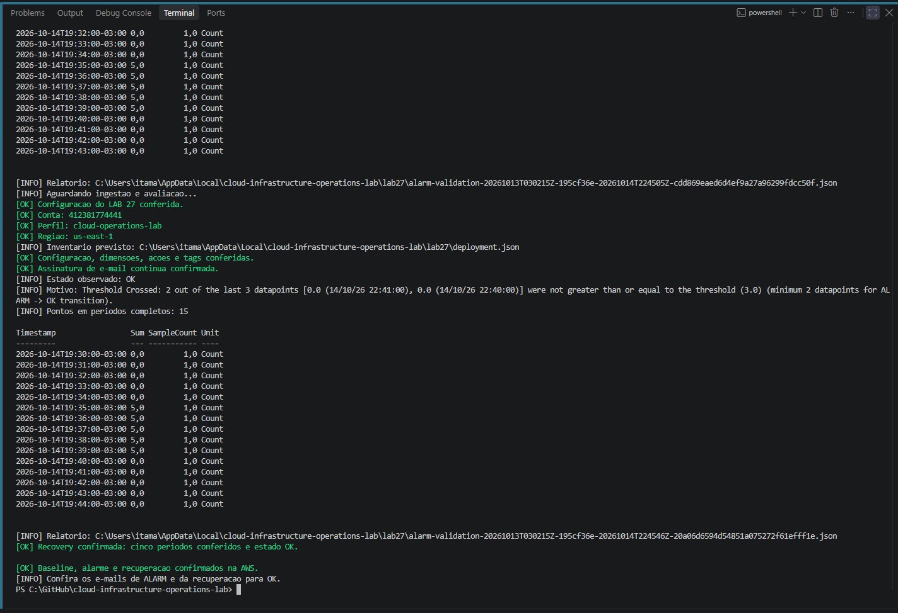
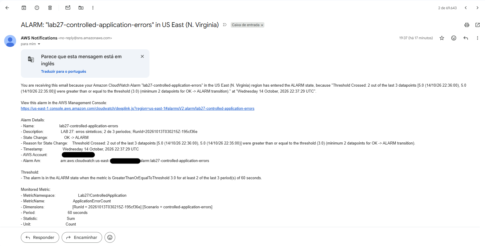
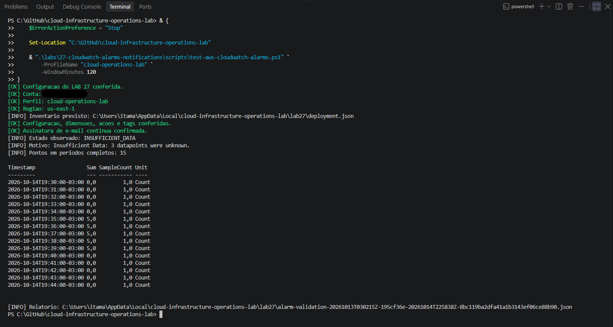

# Lab 27 — Alarmes e notificações

Avaliação de uma métrica sintética de erros de aplicação pelo Amazon CloudWatch, com ações de alarme e recuperação pelo Amazon SNS.

**Status:** execução e cleanup concluídos em 14 de outubro de 2026. Quinze períodos conferidos e duas verificações independentes de cleanup aprovadas.

> **English summary:** Published fifteen controlled metric samples and verified CloudWatch baseline, alarm, recovery, and missing-data transitions. The alarm used Sum >= 3 in two of three 60-second periods. Three successful SNS actions were recorded; baseline and alarm email delivery was captured. Recovery email delivery is not documented in the available screenshots. The alarm and SNS topic were removed, and two independent cleanup checks passed.

## Objetivo

Verificar o fluxo entre publicação de métricas, avaliação de thresholds, mudanças de estado e notificações. Distinguir publicação aceita, pontos recebidos, estado observado, ação SNS e recebimento na caixa postal.

Os valores são sintéticos e publicados pelo PowerShell. Não representam erros coletados em uma aplicação real nem uma medição de disponibilidade ou SLO.

## Resultado registrado

| Verificação | Resultado |
|:---:|:---:|
| Identidade e configuração | Conta, perfil, região e parâmetros conferidos |
| Provisionamento | Tópico, política, alarme, dimensões, ações e tags conferidos |
| Assinatura | E-mail confirmado pelo link e pela AWS CLI |
| Baseline | Cinco períodos com soma zero e estado OK |
| Estímulo | Cinco períodos com soma cinco e estado ALARM |
| Recuperação | Cinco períodos com soma zero e retorno a OK |
| Dados ausentes | Retorno a INSUFFICIENT_DATA após interromper a publicação |
| Ações SNS | Três ações bem-sucedidas no histórico do ensaio de 14/10 |
| Entrega na caixa postal | Capturas dos e-mails de baseline e alarme |
| Cleanup | Alarme e tópico ausentes; 2 de 2 verificações aprovadas |

O histórico comprova a ação SNS da recuperação. O recebimento desse e-mail não está documentado nas capturas disponíveis e não é presumido a partir da ação bem-sucedida.

## Ambiente e configuração

| Parâmetro | Definição |
|:---:|:---:|
| Estação | Windows e PowerShell |
| Autenticação | AWS IAM Identity Center / SSO |
| Perfil | `cloud-operations-lab` |
| Região | `us-east-1` |
| Namespace | `Lab27/ControlledApplication` |
| Métrica | `ApplicationErrorCount` |
| Unidade / estatística | `Count` / `Sum` |
| Dimensões | `Scenario=controlled-application-errors` e `RunId` |
| Período / resolução | 60 segundos / 60 segundos |
| Threshold | `GreaterThanOrEqualToThreshold`, valor 3 |
| Avaliação | `DatapointsToAlarm=2`, `EvaluationPeriods=3` |
| Dados ausentes | `TreatMissingData=missing` |
| Ações | SNS nas transições para ALARM e OK |
| Ação de INSUFFICIENT_DATA | Nenhuma |
| Tópico | `lab27-cloudwatch-alarm-notifications` |
| Alarme | `lab27-controlled-application-errors` |
| RunId documentado | `20261013T030215Z-195cf36e` |

O cenário utilizou um tópico SNS e um alarme exclusivos. Não provisionou EC2, rede, CloudWatch Agent ou grupo de logs. Os recursos dos Labs 25 e 26 já tinham sido removidos.

As tags foram `Name`, `Project=cloud-infrastructure-operations-lab`, `Lab=27`, `ManagedBy=lab27-powershell` e `RunId`.

A política do tópico permitiu `sns:Publish` ao serviço `cloudwatch.amazonaws.com`, condicionada à conta esperada e ao ARN exato do alarme. As credenciais do perfil executor forneceram as permissões administrativas do exercício.

## Arquivos versionados

| Arquivo | Finalidade |
|:---:|:---:|
| [lab27-settings.json](config/lab27-settings.json) | Configuração do cenário |
| [lab27-common.ps1](scripts/lab27-common.ps1) | JSON, configuração, identidade e chamadas AWS |
| [deploy-aws-cloudwatch-alarms.ps1](scripts/deploy-aws-cloudwatch-alarms.ps1) | Pré-validação e provisionamento |
| [subscribe-aws-alarm-email.ps1](scripts/subscribe-aws-alarm-email.ps1) | Solicitação única e consulta da assinatura |
| [test-aws-cloudwatch-alarms.ps1](scripts/test-aws-cloudwatch-alarms.ps1) | Configuração, propriedade, assinatura, pontos e histórico |
| [invoke-aws-alarm-metric-scenario.ps1](scripts/invoke-aws-alarm-metric-scenario.ps1) | Cinco pontos por fase: Baseline, Breach ou Recovery |
| [remove-aws-cloudwatch-alarms.ps1](scripts/remove-aws-cloudwatch-alarms.ps1) | Remoção com conferência de propriedade e dependências |
| [test-aws-cloudwatch-alarms-cleanup.ps1](scripts/test-aws-cloudwatch-alarms-cleanup.ps1) | Consultas independentes da ausência do alarme e tópico |

O encadeamento das fases e a exportação adicional de histórico foram executados como blocos PowerShell na estação. Não existe um script separado de exportação no diretório versionado.

## Registros locais

Inventário, recibos e relatórios ficam fora do repositório:

```text
%LOCALAPPDATA%\cloud-infrastructure-operations-lab\lab27
```

| Registro | Conteúdo |
|:---:|:---:|
| `deployment.json` | RunId, ARNs, etapas solicitadas e confirmadas; registro de cleanup |
| `email-subscription-<RunId>.json` | Endereço de e-mail, ARN e confirmação observada |
| `metric-scenario-<RunId>-<Phase>.json` | Timestamps e aceitação das cinco amostras |
| `alarm-validation-<RunId>-<timestamp>-<id>.json` | Estado, motivo, dimensões, pontos e histórico |
| `experiment-history-<RunId>-<timestamp>-<id>.json` | Recibos das três fases e histórico exportado |
| `cleanup-validation-<RunId>-<timestamp>-<id>.json` | Duas consultas independentes de ausência |
| `*.bak` e `archive/` | Versões anteriores e registros preservados |

O endereço de e-mail não está na configuração versionada. Revise os recibos antes de compartilhá-los.

A execução documentada foi encerrada. O deploy bloqueia inventário existente, e o publicador bloqueia recibo existente da mesma fase. Uma nova execução exige confirmar o cleanup e arquivar os registros anteriores de maneira deliberada. Não apague registros para contornar uma falha parcial.

## Procedimento de reprodução

Os comandos abaixo descrevem o fluxo em uma execução nova, com registros anteriores já arquivados após confirmação do cleanup. Execute a partir da raiz do repositório e use uma sessão SSO ativa.

### 1. Autenticação e sintaxe

Se necessário:

```powershell
aws sso login --profile cloud-operations-lab
```

```powershell
& {
    $ErrorActionPreference = "Stop"
    Set-Location "C:\GitHub\cloud-infrastructure-operations-lab"
    $ScriptsPath = ".\labs\27-cloudwatch-alarms-notifications\scripts"
    foreach ($File in Get-ChildItem -LiteralPath $ScriptsPath -Filter "*.ps1") {
        $Tokens = $null
        $ParseErrors = $null
        [System.Management.Automation.Language.Parser]::ParseFile(
            $File.FullName, [ref]$Tokens, [ref]$ParseErrors
        ) | Out-Null
        if (@($ParseErrors).Count -ne 0) {
            $ParseErrors | Format-List
            throw "Erro de sintaxe em $($File.Name)."
        }
        Write-Host "[OK] Sintaxe: $($File.Name)" -ForegroundColor Green
    }
}
```

### 2. Pré-validar e provisionar

```powershell
& ".\labs\27-cloudwatch-alarms-notifications\scripts\deploy-aws-cloudwatch-alarms.ps1" `
    -ProfileName "cloud-operations-lab" -ValidateOnly
```

Após conferir o resultado:

```powershell
& ".\labs\27-cloudwatch-alarms-notifications\scripts\deploy-aws-cloudwatch-alarms.ps1" `
    -ProfileName "cloud-operations-lab"
```

O deploy registra o inventário antes das chamadas de criação e confere os recursos aplicados. A pré-validação não comprova antecipadamente todas as permissões de escrita.

### 3. Solicitar e confirmar a assinatura

```powershell
& {
    $ErrorActionPreference = "Stop"
    $SubscriptionScript = ".\labs\27-cloudwatch-alarms-notifications\scripts\subscribe-aws-alarm-email.ps1"
    $NotificationEmail = Read-Host "Informe seu e-mail para o LAB 27"
    & $SubscriptionScript -ProfileName "cloud-operations-lab" `
        -EmailAddress $NotificationEmail -ValidateOnly
    & $SubscriptionScript -ProfileName "cloud-operations-lab" `
        -EmailAddress $NotificationEmail
}
```

Clique em `Confirm subscription` no e-mail referente ao tópico do laboratório. Depois execute:

```powershell
& ".\labs\27-cloudwatch-alarms-notifications\scripts\subscribe-aws-alarm-email.ps1" `
    -ProfileName "cloud-operations-lab" -CheckStatus
```

Se estiver pendente, repita apenas `-CheckStatus`. Um ARN retornado na solicitação não comprova ativação.

### 4. Registrar o estado inicial

```powershell
& ".\labs\27-cloudwatch-alarms-notifications\scripts\test-aws-cloudwatch-alarms.ps1" `
    -ProfileName "cloud-operations-lab"
```

Antes de publicar a série nova, o estado esperado é INSUFFICIENT_DATA. A ausência de pontos não é convertida em zero.

### 5. Executar as três fases sem pausas longas

O publicador registra cinco pontos por fase, com intervalo mínimo de 60 segundos. Breach exige estado OK; Recovery exige ALARM. O bloco consulta até confirmar os cinco períodos da fase e o estado esperado antes de iniciar a seguinte.

```powershell
& {
    $ErrorActionPreference = "Stop"
    $ScriptsPath = (Resolve-Path ".\labs\27-cloudwatch-alarms-notifications\scripts").Path
    . (Join-Path $ScriptsPath "lab27-common.ps1")
    Initialize-Lab27 -ProfileName "cloud-operations-lab"
    $Deployment = Read-Lab27Json -Path $script:StatePath
    $ValidatorPath = Join-Path $ScriptsPath "test-aws-cloudwatch-alarms.ps1"
    $PublisherPath = Join-Path $ScriptsPath "invoke-aws-alarm-metric-scenario.ps1"
    foreach ($PhaseName in @("Baseline", "Breach", "Recovery")) {
        $ReceiptPath = Join-Path $script:LocalDirectory "metric-scenario-$($Deployment.RunId)-$PhaseName.json"
        if (Test-Path -LiteralPath $ReceiptPath) {
            throw "Recibo existente: $PhaseName. Confira a execucao anterior."
        }
    }
    foreach ($Phase in @(
        @{ Name = "Baseline"; Value = 0; State = "OK" }
        @{ Name = "Breach"; Value = 5; State = "ALARM" }
        @{ Name = "Recovery"; Value = 0; State = "OK" }
    )) {
        & $PublisherPath -ProfileName "cloud-operations-lab" -Phase $Phase.Name
        $ReceiptPath = Join-Path $script:LocalDirectory "metric-scenario-$($Deployment.RunId)-$($Phase.Name).json"
        $Receipt = Read-Lab27Json -Path $ReceiptPath
        if ($Receipt.Status -cne "Published" -or @($Receipt.Samples).Count -ne 5) {
            throw "Publicacao incompleta: $($Phase.Name)."
        }
        $DeadlineUtc = [DateTime]::UtcNow.AddMinutes(3)
        while ($true) {
            $Observation = & $ValidatorPath -ProfileName "cloud-operations-lab" -PassThru
            $MatchingPeriods = 0
            foreach ($Sample in $Receipt.Samples) {
                if ($Sample.Status -cne "Accepted" -or $Sample.Value -ne $Phase.Value) {
                    throw "Amostra inesperada: $($Phase.Name)."
                }
                $SampleUtc = [DateTimeOffset]::Parse([string]$Sample.TimestampUtc).UtcDateTime
                $MinuteUtc = $SampleUtc.AddTicks(-($SampleUtc.Ticks % [TimeSpan]::TicksPerMinute))
                $Matches = @($Observation.Datapoints | Where-Object {
                    $PointUtc = [DateTimeOffset]::Parse([string]$_.Timestamp).UtcDateTime
                    $PointUtc -eq $MinuteUtc -and $_.Sum -eq $Phase.Value -and $_.SampleCount -eq 1
                })
                if ($Matches.Count -eq 1) { $MatchingPeriods++ }
            }
            if ($Observation.AlarmState -ceq $Phase.State -and $MatchingPeriods -eq 5) {
                Write-Host "[OK] $($Phase.Name): cinco periodos e estado $($Phase.State)." -ForegroundColor Green
                break
            }
            if ([DateTime]::UtcNow -ge $DeadlineUtc) {
                throw "Confirmacao pendente: $($Phase.Name). Preserve os recibos."
            }
            Start-Sleep -Seconds 15
        }
    }
}
```

A conclusão depende da ingestão e avaliação do serviço. Se uma fase parar, preserve seus recibos e consulte o validador; não repita automaticamente o bloco inteiro.

### 6. Conferir notificações e dados ausentes

Confira os e-mails de baseline, alarme e recuperação pelas transições e horários. Uma ação SNS bem-sucedida e o recebimento na caixa postal são evidências diferentes.

Após interromper a publicação, consulte sem reenviar pontos:

```powershell
& ".\labs\27-cloudwatch-alarms-notifications\scripts\test-aws-cloudwatch-alarms.ps1" `
    -ProfileName "cloud-operations-lab" -WindowMinutes 120
```

A janela de 120 minutos é para consulta histórica; ela não altera a configuração do alarme. O validador exclui o minuto em andamento e salva os pontos e o histórico no relatório local. Aguarde e repita a consulta até observar INSUFFICIENT_DATA, preservando a evidência antes do cleanup.

### 7. Pré-validar e remover

Com publicadores encerrados e evidências preservadas:

```powershell
& ".\labs\27-cloudwatch-alarms-notifications\scripts\remove-aws-cloudwatch-alarms.ps1" `
    -ProfileName "cloud-operations-lab" -ValidateOnly
```

```powershell
& ".\labs\27-cloudwatch-alarms-notifications\scripts\remove-aws-cloudwatch-alarms.ps1" `
    -ProfileName "cloud-operations-lab"
```

O cleanup confere ARNs, tags, RunId, dependências de alarmes compostos, referências CloudWatch ao tópico e assinaturas compatíveis com o cenário. Remove o alarme antes do tópico e preserva o inventário.

### 8. Confirmar independentemente

```powershell
& ".\labs\27-cloudwatch-alarms-notifications\scripts\test-aws-cloudwatch-alarms-cleanup.ps1" `
    -ProfileName "cloud-operations-lab"
```

Esperado: `2 de 2 verificacoes`. As duas consultas confirmam a ausência do alarme e tópico. Não constituem uma consulta separada de cada assinatura.

## Resultados e interpretação

### Ensaio principal de 14/10/2026

| Fase | Períodos UTC | Períodos em Brasília | Soma / SampleCount | Estado confirmado |
|:---:|:---:|:---:|:---:|:---:|
| Baseline | 22:30–22:34 | 19:30–19:34 | 0 / 1 | OK |
| Breach | 22:35–22:39 | 19:35–19:39 | 5 / 1 | ALARM |
| Recovery | 22:40–22:44 | 19:40–19:44 | 0 / 1 | OK |

Os timestamps acima identificam períodos agregados. Os pontos foram enviados aproximadamente aos segundos 43 na baseline, 42 no estímulo e 37 na recuperação; os recibos preservam os timestamps exatos.

A primeira consulta posterior à recuperação retornou 14 pontos. A consulta seguinte retornou os 15 e confirmou todos os períodos. Essa diferença não foi tratada como perda de um ponto.

### Transições e ações

| Transição | UTC em 14/10/2026 | Brasília | Ação SNS |
|:---:|:---:|:---:|:---:|
| INSUFFICIENT_DATA → OK | 22:31:29.877 | 19:31:29.877 | Sucesso às 22:31:29.919 UTC |
| OK → ALARM | 22:37:29.876 | 19:37:29.876 | Sucesso às 22:37:29.919 UTC |
| ALARM → OK | 22:42:29.876 | 19:42:29.876 | Sucesso às 22:42:29.919 UTC |
| OK → INSUFFICIENT_DATA | 22:53:29.876 | 19:53:29.876 | Nenhuma ação configurada |

O motivo de ALARM identificou os períodos 22:35 e 22:36 UTC, ambos com soma cinco, acima do threshold três. O motivo da recuperação identificou os períodos 22:40 e 22:41 UTC, ambos com soma zero.

O estado OK da baseline é distinto da recuperação após ALARM. A descrição genérica do threshold na mensagem não substitui o campo de transição efetiva.

Com `missing`, falta de publicação não equivale a zero nem a recuperação. O CloudWatch pode recuperar pontos anteriores na faixa de avaliação; por isso, o retorno a INSUFFICIENT_DATA não é garantido exatamente três minutos após o último ponto. Os horários registrados são observações desta execução, não garantias de latência.

### Baseline anterior e retomada

Em 13/10, uma baseline publicou cinco zeros nos períodos 19:03–19:07 UTC. O histórico confirmou OK às 19:04:29 UTC e retorno a INSUFFICIENT_DATA às 19:16:29 UTC. A consulta posterior dos últimos 30 minutos não continha esses pontos antigos.

O recibo impediu o reenvio acidental. Após conferir publicação e dados históricos, o recibo anterior foi arquivado. Em 14/10, as três fases foram encadeadas sem pausas longas, mantendo a mesma série identificada pelo RunId.

Uma tentativa inicial de deploy havia parado na gravação do inventário por `File.Replace`. A persistência foi corrigida com caminho explícito de backup, a ausência dos recursos foi consultada e o inventário anterior foi arquivado antes do deploy bem-sucedido.

### Cleanup

| Consulta independente | Resultado |
|:---:|:---:|
| Nome do alarme, incluindo tipos métrico e composto | Ausente |
| ARN do tópico SNS | Ausente |

O relatório de 14/10/2026 às 23:26:32 UTC confirmou 2 de 2 verificações. O resultado abrange esses nomes e ARNs, não um inventário geral da conta. Os pontos históricos da métrica permanecem sujeitos à retenção do serviço.

## Evidências

| Captura | Conteúdo |
|:---:|:---:|
| [18](images/Clipboard_10-12-2026_18.png) | Atualização local |
| [19](images/Clipboard_10-12-2026_19.png) | Sintaxe, configuração e identidade |
| [20](images/Clipboard_10-12-2026_20.png) | Pré-validação do deploy |
| [21](images/Clipboard_10-12-2026_21.png) | Nova pré-validação com cleanup preparado |
| [22](images/Clipboard_10-13-2026_22.png) | Retomada, inventário arquivado e deploy confirmado |
| [23](images/Clipboard_10-13-2026_23.png) | Pré-validação do cleanup após provisionamento |
| [24](images/Clipboard_10-13-2026_24.png) | Sintaxe com script de assinatura |
| [25](images/Clipboard_10-13-2026_25.png) | Pré-validação e solicitação de assinatura |
| [26](images/Clipboard_10-13-2026_26.png) | Assinatura pendente |
| [27](images/Clipboard_10-13-2026_27.png) | E-mail de confirmação SNS |
| [28](images/Clipboard_10-13-2026_28.png) | Confirmação pelo navegador |
| [29](images/Clipboard_10-13-2026_29.png) | Confirmação pela AWS CLI |
| [30](images/Clipboard_10-13-2026_30.png) | Estado inicial e ausência de pontos |
| [31](images/Clipboard_10-13-2026_31.png) | Pré-validação da baseline |
| [32](images/Clipboard_10-13-2026_32.png) | Consulta posterior sem pontos recentes |
| [33](images/Clipboard_10-14-2026_33.png) | Quinze pontos e recuperação confirmados |
| [34](images/Clipboard_10-14-2026_34.png) | E-mail da baseline: INSUFFICIENT_DATA → OK |
| [35](images/Clipboard_10-14-2026_35.png) | E-mail do alarme: OK → ALARM |
| [36](images/Clipboard_10-14-2026_36.png) | INSUFFICIENT_DATA e quinze pontos históricos |
| [37](images/Clipboard_10-14-2026_37.png) | Histórico e recibos exportados |
| [38](images/Clipboard_10-14-2026_38.png) | Segunda exportação do mesmo histórico |
| [39](images/Clipboard_10-14-2026_39.png) | Sintaxe e pré-validação final do cleanup |
| [40](images/Clipboard_10-14-2026_40.png) | Remoção confirmada pelo cleanup |
| [41](images/Clipboard_10-14-2026_41.png) | Duas verificações independentes aprovadas |

### Série e recuperação



### Notificação de alarme



### Dados ausentes



### Cleanup independente


## Proteções e limites

- `-ValidateOnly` interrompe antes da mutação AWS correspondente; o publicador chama o validador, que pode gravar relatório local.
- `-CheckStatus` consulta a assinatura e atualiza seu recibo local, sem reenviar a solicitação.
- Validadores de alarme e cleanup não alteram recursos AWS.
- Falhas de autenticação e permissão não significam recurso ausente.
- Inventário e recibos existentes bloqueiam execuções acidentais repetidas.
- Backups de inventário e recibos ficam fora do repositório.
- Os publicadores devem estar encerrados durante o cleanup; os scripts não oferecem exclusão mútua entre publicação e remoção.
- A proteção por nomes, tags e inventário não é garantia contra mutações concorrentes externas.
- Os relatórios distinguem aceitação da publicação e pontos efetivamente consultados.
- Os resultados medem um estímulo sintético; não comprovam confiabilidade de uma aplicação real nem entrega de todos os e-mails.

## Custos

O cenário pode gerar cobrança por métricas personalizadas, alarme, consultas e utilização do SNS. Não foi presumida elegibilidade ao nível gratuito.

O alarme e o tópico foram removidos. O procedimento não exclui pontos individuais da métrica histórica.

## Checklist final

- [x] Configuração, scripts e evidências versionados.
- [x] Identidade, sintaxe e pré-validações conferidas.
- [x] Tópico, política e alarme provisionados e conferidos.
- [x] Assinatura confirmada pelo navegador e AWS CLI.
- [x] Quinze períodos consultados e comparados com os recibos.
- [x] Baseline OK, ALARM e recuperação OK confirmados.
- [x] Três ações SNS comprovadas no histórico.
- [x] E-mails da baseline e alarme documentados.
- [ ] Captura do recebimento do e-mail da recuperação anexada.
- [x] Retorno a INSUFFICIENT_DATA documentado.
- [x] Histórico, inventários, recibos e relatórios preservados.
- [x] Cleanup confirmado por duas consultas independentes.

## Próxima etapa

O [roadmap](../../docs/roadmap.md) prevê o **Lab 28 — CloudWatch Logs Insights**, com consultas e investigação de eventos. O cenário será definido antes da implementação; os recursos do Lab 27 foram removidos.

## Referências

- [Tratamento de dados ausentes em alarmes CloudWatch](https://docs.aws.amazon.com/AmazonCloudWatch/latest/monitoring/alarms-and-missing-data.html)
- [Notificações de mudanças de estado](https://docs.aws.amazon.com/AmazonCloudWatch/latest/monitoring/Notify_Users_Alarm_Changes.html)
- [AWS CLI: get-metric-statistics](https://docs.aws.amazon.com/cli/latest/reference/cloudwatch/get-metric-statistics.html)

[Voltar ao repositório](../../README.md)
