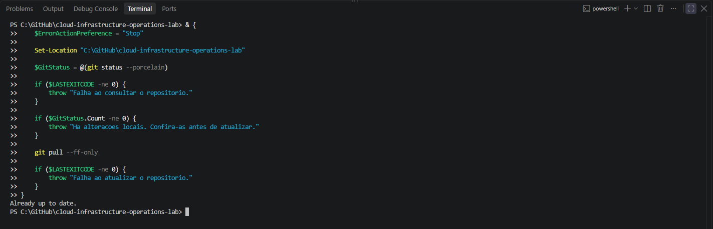
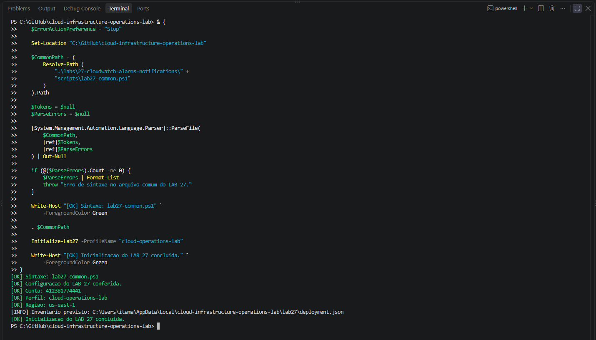

# Lab 27 — Alarmes e notificações

Avaliação de uma métrica sintética de erros de aplicação pelo Amazon CloudWatch, com notificações de alarme e recuperação pelo Amazon SNS.

**Status:** em preparação. Configuração, sintaxe do arquivo comum e identidade AWS validadas. Provisionamento e ensaios ainda pendentes.

> **English summary:** This lab uses a controlled synthetic application error metric to study CloudWatch alarm evaluation, missing data, and SNS email notifications. Initial configuration and AWS identity checks have passed. Deployment and experimental results are pending.

## Objetivo

Verificar o fluxo entre publicação de métricas, avaliação de thresholds, mudança de estado e entrega de notificações.

Os valores são sintéticos e publicados pelo PowerShell. Não representam erros observados em uma aplicação real.

## Ambiente e configuração

| Parâmetro | Definição |
|:---:|:---:|
| Estação | Windows e PowerShell |
| Autenticação | AWS IAM Identity Center / SSO |
| Perfil | `cloud-operations-lab` |
| Região | `us-east-1` |
| Namespace | `Lab27/ControlledApplication` |
| Métrica | `ApplicationErrorCount` |
| Unidade | `Count` |
| Dimensões | `Scenario` e `RunId` |
| Estatística | `Sum` |
| Período | 60 segundos |
| Threshold | Maior ou igual a 3 |
| Avaliação | 2 de 3 períodos |
| Dados ausentes | `missing` |
| Notificações | Transições para `ALARM` e `OK` |
| Tópico SNS | `lab27-cloudwatch-alarm-notifications` |
| Alarme | `lab27-controlled-application-errors` |

O RunId será gerado no deploy e utilizado na série da métrica e nas tags dos recursos.

A infraestrutura dos Labs 25 e 26 foi removida. Este cenário utiliza recursos exclusivos, sem EC2, CloudWatch Agent ou alterações em recursos de outros laboratórios.

## Arquivos

- [Configuração](config/lab27-settings.json)
- [Funções comuns e validação](scripts/lab27-common.ps1)
- [Provisionamento e pré-validação](scripts/deploy-aws-cloudwatch-alarms.ps1)

Os scripts de assinatura, estímulo, consulta, exportação de evidências e cleanup serão adicionados nas próximas etapas.

## Registros locais

O inventário ficará fora do repositório:

```text
%LOCALAPPDATA%\cloud-infrastructure-operations-lab\lab27\deployment.json
```

O inventário registrará os ARNs previstos, RunId, etapas solicitadas e resultados confirmados. Uma falha parcial exige preservar esse arquivo e consultar os recursos antes de qualquer nova execução.

O endereço de e-mail será informado em uma etapa separada e não será incluído na configuração versionada.

## Protocolo experimental planejado

1. Conferir configuração, identidade, nomes disponíveis e inventário local.
2. Provisionar o tópico SNS, sua política de publicação e o alarme.
3. Solicitar a assinatura de e-mail e confirmar a assinatura.
4. Publicar valores zero em períodos separados e confirmar o estado OK.
5. Publicar valores cinco em períodos separados e confirmar ALARM.
6. Conferir a notificação de alarme recebida.
7. Publicar valores zero e confirmar a recuperação para OK.
8. Conferir a notificação de recuperação recebida.
9. Interromper a publicação e observar o tratamento de dados ausentes.
10. Exportar resultados, preservar evidências e executar o cleanup.
11. Confirmar a ausência dos recursos por consultas independentes.

A avaliação depende dos pontos disponíveis e do processamento do CloudWatch. O envio de um ponto não comprova imediatamente uma mudança de estado.

## Validações já realizadas

- Repositório local atualizado.
- Sintaxe de `lab27-common.ps1` aprovada.
- Configuração inicial conferida.
- Conta esperada confirmada.
- Perfil e região conferidos.

## Evidências iniciais

### Atualização do repositório



### Sintaxe, configuração e identidade



## Proteções previstas

- Conferência da conta esperada e dos parâmetros do cenário.
- Pré-validação com `-ValidateOnly`.
- Bloqueio diante de inventário local ou recursos preexistentes.
- Tags de identificação e RunId.
- Permissão de publicação pelo CloudWatch limitada ao alarme exclusivo.
- Inventário preservado em caso de falha parcial.
- Validadores sem operações de alteração na AWS.
- Remoção limitada aos recursos registrados e com propriedade conferida.

## Custos

O cenário pode gerar cobrança por métricas personalizadas, alarme, chamadas de API e utilização do SNS. Não é presumida elegibilidade ao nível gratuito.

O cleanup removerá o alarme e o tópico. Os dados históricos da métrica permanecerão sujeitos à retenção do CloudWatch; não há exclusão de pontos individuais no procedimento.

## Checklist

- [x] Configuração inicial publicada.
- [x] Arquivo comum publicado.
- [x] Sintaxe e identidade AWS conferidas.
- [x] Evidências iniciais preservadas.
- [ ] Pré-validação do deploy aprovada.
- [ ] Scripts de cleanup preparados.
- [ ] Tópico, política e alarme provisionados.
- [ ] Assinatura de e-mail confirmada.
- [ ] Baseline OK confirmada.
- [ ] ALARM e notificação confirmados.
- [ ] Recuperação e notificação confirmadas.
- [ ] Tratamento de dados ausentes observado.
- [ ] Resultados exportados.
- [ ] Cleanup confirmado.

[Voltar ao repositório](../../README.md)
