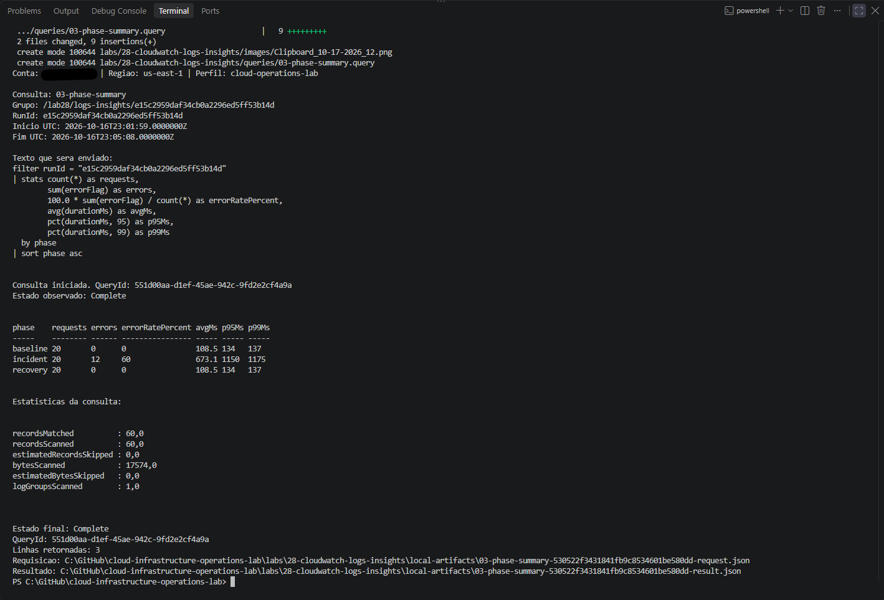
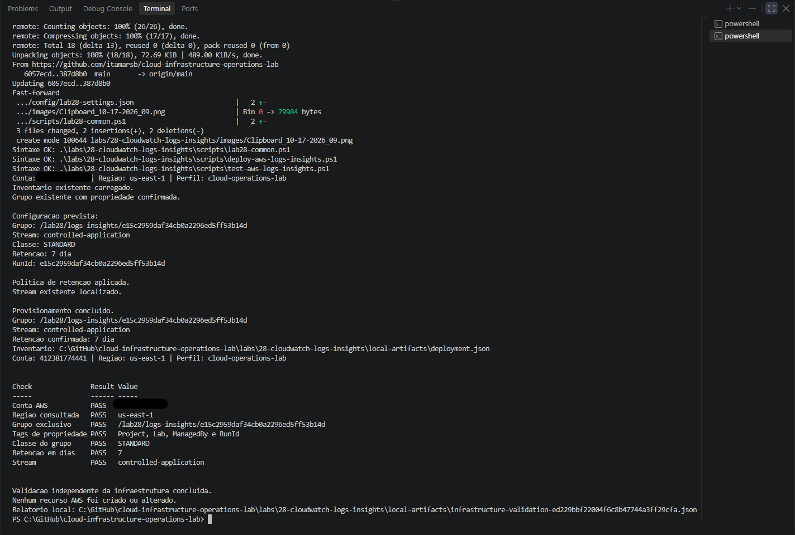
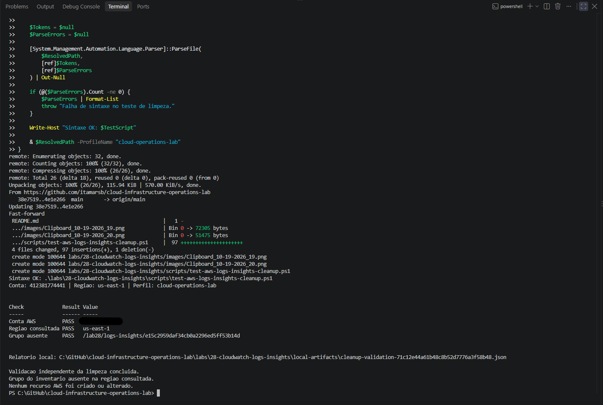

# Lab 28 — CloudWatch Logs Insights: Investigating Synthetic Application Logs

[**Português (Brasil)**](README.md) · **English**

## Overview

Lab 28 demonstrates a structured investigation using **Amazon CloudWatch Logs Insights**. A PowerShell generator creates a controlled dataset of 60 JSON application-log events, publishes them to an exclusive CloudWatch Logs group, and verifies the read-back data before running seven version-controlled queries.

**Recorded outcome:** The experiment was completed in October 2026. All **60 synthetic events** were found and matched to the original local dataset. Seven Logs Insights queries completed, identifying **12 HTTP 503 events**, a **60% error rate in the incident phase**, and a **20% error rate across the entire dataset**. A retention-related interruption was investigated, the log group was configured for seven days, and an independent cleanup query confirmed that the group had been deleted on **October 19, 2026**.

**Evidence boundary:** This English documentation is based on a static review of eight PowerShell scripts, seven query definitions, one settings file, the lab Git ignore rules, the Portuguese README and 20 image paths. **No AWS operations or fresh investigations were performed during this review.**

## Scope and architecture

~~~text
Windows PowerShell + AWS CLI / IAM Identity Center
                     |
      Local synthetic JSON dataset
       baseline  incident  recovery
         20        20        20
                     |
               PutLogEvents
                     |
                     v
CloudWatch Logs — one exclusive log group
  Class: STANDARD
  Name: /lab28/logs-insights/<RUN_ID>
  Stream: controlled-application
  Retention: 7 days (after adjustment)
                     |
                     v
       GetLogEvents + pagination
       Exact messages and timestamps
       compared to local 60-event dataset
                     |
                     v
            Logs Insights
             Seven queries
                     |
                     v
       Phase, errors, latency, timeline,
       endpoint/cause and request ID
                     |
                     v
     DeleteLogGroup + independent check
~~~

There was **no running checkout API**, production dependency, EC2 instance, network, CloudWatch Agent, alarm, or SNS topic. The simulated service name checkout-api and its reported errors are constructed fields, not observations of a live application.

| Item | Historical configuration |
|---|---|
| Operator environment | Windows PowerShell, AWS CLI and SSO |
| AWS profile / Region | cloud-operations-lab / us-east-1 |
| Group prefix | /lab28/logs-insights |
| Log group class | STANDARD |
| Log stream | controlled-application |
| Final group retention | Seven days |
| Resource tags | Project, Lab, ManagedBy and RunId |
| Dataset | 60 synthetic JSON events |
| Queries | Seven, against one RunId and its event-time window |

The group is named using a new RunId for each execution. The full historical RunId and group path remain in the Portuguese source but are omitted here because they are not reusable credentials or active resource addresses.

## Repository inventory

| File | Responsibility |
|---|---|
| [Settings](config/lab28-settings.json) | Account restriction, Region, group prefix, retention, tags |
| [Common functions](scripts/lab28-common.ps1) | AWS CLI calls, JSON, identity, local inventory and group ownership |
| [Deployment](scripts/deploy-aws-logs-insights.ps1) | Validate and provision group/stream and retention |
| [Dataset publisher](scripts/invoke-aws-log-investigation-scenario.ps1) | Build and publish 60 JSON events |
| [Infrastructure validator](scripts/test-aws-logs-insights.ps1) | Check group class, retention, stream and tags |
| [Ingestion validator](scripts/test-aws-log-events.ps1) | Paginated event retrieval and exact comparison |
| [Query runner](scripts/invoke-aws-logs-insights-query.ps1) | Execute saved queries, poll, save results and statistics |
| [Removal](scripts/remove-aws-logs-insights.ps1) | Check ownership, delete exclusive group, verify absence |
| [Cleanup validator](scripts/test-aws-logs-insights-cleanup.ps1) | Fresh AWS read for the inventoried group's absence |
| [Query directory](queries/) | Seven committed Logs Insights queries |
| [Git ignore rules](.gitignore) | Exclude local-artifacts/ |

The settings and common code contain a **fixed expected AWS account ID**. Do not assume that a different AWS CLI profile makes the scripts portable: the source account checks must be reviewed in an explicitly authorized environment.

## Dataset construction and observed results

Each log message contains the following fields:

~~~text
runId, phase, service, requestId, endpoint, statusCode,
level, durationMs, errorFlag, cause, synthetic
~~~

The generator assigns its events to three consecutive UTC minutes in the recent past. It writes twenty records per phase:

| Phase | Synthetic requests | HTTP 503 errors | Error rate |
|---|---:|---:|---:|
| baseline | 20 | 0 | 0% |
| incident | 20 | 12 | **60%** |
| recovery | 20 | 0 | 0% |
| **Overall** | **60** | **12** | **20%** |

The first twelve events in the incident phase are assigned HTTP status **503**, severity ERROR, errorFlag 1, endpoint /orders, cause dependency_timeout, and durations from **900 to 1,175 ms**.

**Interpretation:** The field dependency_timeout is a label written into a synthetic message. Finding that label in CloudWatch does not prove a real timeout, failing upstream service or root cause. The recovery phase also represents generated successful events, not the observed restoration of a production API.

### Validation before queries

The dataset is written locally **before** publication. A PutLogEvents response with no reported rejection is treated as write acceptance, **not proof that all logs are queryable**.

The separate ingestion validator used GetLogEvents, followed its pagination tokens, and compared **all 60 observed event timestamps and full JSON messages** against the saved dataset. The historical successful read used **three pages** and confirmed the expected 20/20/20 phase counts and twelve synthetic errors.

A missing or blank nextForwardToken is an **unverified pagination outcome**, not evidence that the data stream has been fully read.

## Seven investigations

All committed queries filter the current RunId. The runner replaces the literal query-file token representing that RunId, limits queries to the dataset time window, and saves the resulting records and query statistics.

| Query file | Question | Recorded result |
|---|---|---|
| [01-events](queries/01-events.query) | Which events belong to this run? | 60 rows |
| [02-errors](queries/02-errors.query) | Which events have HTTP status 5xx? | 12 rows |
| [03-phase-summary](queries/03-phase-summary.query) | How do error rates and latency compare by phase? | Three summary rows |
| [04-endpoint-errors](queries/04-endpoint-errors.query) | Which endpoint and recorded cause group the failures? | /orders, dependency_timeout, 12 errors |
| [05-timeline](queries/05-timeline.query) | In which one-minute interval did failures occur? | Twelve errors in the middle minute |
| [06-request](queries/06-request.query) | What happened to request req-021? | HTTP 503, duration 900 ms |
| [07-total](queries/07-total.query) | What is the dataset-wide error rate? | 60 requests, 12 errors, 20% |

These links point to the **actual Logs Insights query language files**. They use filter, fields, sort, stats, pct and one-minute bin aggregation; the original query syntax remains authoritative.

### Phase-level performance results

The original [phase summary](queries/03-phase-summary.query) reported:

| Phase | Requests | Errors | Error rate | Mean ms | P95 ms | P99 ms |
|---|---:|---:|---:|---:|---:|---:|
| baseline | 20 | 0 | 0% | 108.5 | 134 | 137 |
| incident | 20 | 12 | **60%** | **673.1** | **1,150** | **1,175** |
| recovery | 20 | 0 | 0% | 108.5 | 134 | 137 |

The reported P95 and P99 values are percentiles from **only twenty synthetic observations per phase**. They illustrate Logs Insights aggregation rather than a reliable production latency distribution or service-level objective.

### Endpoint/cause aggregation

The [endpoint error query](queries/04-endpoint-errors.query) filters HTTP statuses of at least 500 before grouping by endpoint and assigned cause:

| Endpoint | Assigned cause | Errors | Mean duration | Maximum |
|---|---|---:|---:|---:|
| /orders | dependency_timeout | 12 | **1,037.5 ms** | 1,175 ms |

**Denominator matters:** The 1,037.5 ms mean considers only the twelve error events. The phase-level 673.1 ms mean also includes the eight incident events without errors.

### Timeline of generated event timestamps

The [timeline query](queries/05-timeline.query) uses one-minute bins:

| UTC minute on October 16, 2026 | Requests | Errors | Error rate |
|---|---:|---:|---:|
| 23:02 | 20 | 0 | 0% |
| 23:03 | 20 | 12 | 60% |
| 23:04 | 20 | 0 | 0% |

These are **event timestamps assigned by the generator**, not CloudWatch ingestion timestamps or the time when the query ran.

### One request

The [request query](queries/06-request.query) selected the current RunId-prefixed request ending in req-021. The recorded event had service checkout-api, phase incident, endpoint /orders, status 503, duration **900 ms**, assigned cause dependency_timeout, and timestamp **2026-10-16 23:03:00 UTC**.

This dataset contains **one event per request**. Finding a request's log record is not the same as distributed tracing across multiple services.

### Overall error rate and scanning volume

The [total query](queries/07-total.query) returned:

~~~text
requests = 60
errors = 12
errorRatePercent = 20
~~~

The 20% overall error rate is distinct from the 60% incident-only rate.

Each of the seven historical queries scanned **60 events and 17,574 bytes**, even though some returned only one line. Fewer returned rows do **not necessarily mean lower data volume scanned or lower Logs Insights query cost**.

## Retention and pagination troubleshooting

The log group was **initially configured for one-day retention**, and the investigation resumed after that interval.

The original sequence recorded:

1. An event read returned zero events and did not contain nextForwardToken.
2. Read attempts with normal and disabled CLI pagination both returned the same empty/no-token response.
3. A query against the original historical time range reported MalformedQueryException, referencing group creation or retention limits.
4. The committed setting and shared validation code were changed to **seven days**.
5. Deployment logic reapplied retention to the **existing** group, and independent validation confirmed seven days.
6. The original 60 events became queryable again **without republishing**.

**Do not generalize the result into deleted-log recovery.** Increasing retention is not guaranteed to recover events that CloudWatch Logs has already permanently deleted. Expired events may undergo delayed physical deletion; the precise lifecycle observed here cannot be assumed for another execution.

The ingestion validator was also updated to detect a missing or blank nextForwardToken, save a diagnostic response and fail rather than claiming complete pagination. Its subsequent successful 60-event test exercised the normal path, **not** a second occurrence of the missing-token path.

## Reproduction procedure

The historical group was deleted. The following commands describe a **new authorized run**, not new operations performed for this translation.

### 1. Authenticate and prepare a clean run

From the repository root in PowerShell:

~~~powershell
aws sso login --profile cloud-operations-lab

$LabPath = ".\labs\28-cloudwatch-logs-insights"
$Scripts = Join-Path $LabPath "scripts"
~~~

Confirm the current AWS account/Region and source settings, verify the previous group is absent, and archive older contents under local-artifacts/ before starting anew.

The publisher refuses to run if dataset.json already exists. **Never delete a preserved dataset simply to bypass an uncertain previous publication.**

### 2. Provision and independently validate

~~~powershell
& "$Scripts\deploy-aws-logs-insights.ps1" -ProfileName "cloud-operations-lab" -ValidateOnly

& "$Scripts\deploy-aws-logs-insights.ps1" -ProfileName "cloud-operations-lab"

& "$Scripts\test-aws-logs-insights.ps1" -ProfileName "cloud-operations-lab"
~~~

In a fresh preflight, the displayed proposed RunId is temporary. The actual deployment generates and saves its own RunId. The validator checks group class STANDARD, seven-day retention, exact stream, expected tags and account.

**After cleanup, do not rerun deploy solely to check removal.** With preserved inventory, deployment may **recreate the missing log group**. Use the dedicated cleanup verifier instead.

### 3. Publish a single synthetic batch and confirm ingestion

~~~powershell
& "$Scripts\invoke-aws-log-investigation-scenario.ps1" -ProfileName "cloud-operations-lab" -ValidateOnly

& "$Scripts\invoke-aws-log-investigation-scenario.ps1" -ProfileName "cloud-operations-lab"

& "$Scripts\test-aws-log-events.ps1" -ProfileName "cloud-operations-lab"
~~~

The first action previews the test. The second generates and stores the exact dataset and submits its 60 events. The third reads the events back, follows pagination and compares their timestamps and messages.

A successful write response **must not replace** the independent read-back check.

### 4. Run the seven saved queries

~~~powershell
& "$Scripts\invoke-aws-logs-insights-query.ps1" -ProfileName "cloud-operations-lab" -QueryName "01-events" -ValidateOnly

$Names = @(
  "01-events",
  "02-errors",
  "03-phase-summary",
  "04-endpoint-errors",
  "05-timeline",
  "06-request",
  "07-total"
)

foreach ($Name in $Names) {
  & "$Scripts\invoke-aws-logs-insights-query.ps1" -ProfileName "cloud-operations-lab" -QueryName $Name
}
~~~

The runner uses the locally preserved dataset time range, capped at **ten minutes**, submits each query, polls status (up to **120 seconds** by default), saves request/start/result files and expects **Complete**. If execution times out or fails while still running, it attempts StopQuery and preserves available diagnostics.

The runner limits result rows to **100** and does not implement arbitrary extra-result pagination. It refuses an indicated continuation token rather than silently claiming a complete result set.

Before using the loop in an unattended script, add explicit terminating-error handling for each invocation; do not assume that a returned PowerShell invocation necessarily means the query completed successfully.

### 5. Remove the exclusive group

~~~powershell
& "$Scripts\remove-aws-logs-insights.ps1" -ProfileName "cloud-operations-lab" -ValidateOnly

& "$Scripts\remove-aws-logs-insights.ps1" -ProfileName "cloud-operations-lab"
~~~

Cleanup checks the exact group name, ownership tags and inventoried RunId. Deleting the log group also removes its stream and available CloudWatch-stored events. The local dataset and query reports are preserved.

This is a **destructive** operation; review retention and evidence requirements before deleting.

### 6. Independently check cleanup

~~~powershell
& "$Scripts\test-aws-logs-insights-cleanup.ps1" -ProfileName "cloud-operations-lab"
~~~

The original cleanup validator independently queried AWS and confirmed that the exact log group was absent in the verified account and Region on **October 19, 2026**.

This is not an exhaustive inventory of all CloudWatch log groups.

## Locally preserved operational records

The lab's [.gitignore](.gitignore) excludes:

~~~text
labs/28-cloudwatch-logs-insights/local-artifacts/
~~~

Historical local artifacts include:

| Pattern | Description |
|---|---|
| deployment.json | Identity, Region, RunId and resource names |
| dataset.json | Exact sixty-event dataset and timestamps |
| publication-response.json | PutLogEvents response |
| infrastructure-validation-*.json | Group, stream, class and retention |
| ingestion-observed-*.json | Read-back events |
| ingestion-validation-*.json | Exact dataset comparison |
| ingestion-missing-token-*.json | Missing pagination token diagnostics |
| pagination-diagnostic-*.json | Troubleshooting comparisons |
| Per-query request, started, result and stop JSON | Query configuration, status, IDs and statistics |
| removal request/result JSON | Deletion and its verification |
| cleanup-validation-*.json | Independent final query |

These files are **not in the versioned repository**. They can contain account IDs, RunIds, query IDs and full log messages. A Git ignore rule does not provide encryption or prevent all accidental disclosure.

## Evidence inventory

The repository contains **20 historical screenshots**, numbered **01–07 and 09–21**. There is **no screenshot 08** in the inspected directory. The table follows the stage descriptions from the Portuguese README; the pixels were **not inspected individually at full resolution** during this documentation review.

| Screenshot | Stage |
|---|---|
| [01](images/Clipboard_10-15-2026_01.png) | Initial syntax, ignore checks and preflight |
| [02](images/Clipboard_10-16-2026_02.png) | Log group provisioning |
| [03](images/Clipboard_10-16-2026_03.png) | Independent infrastructure validation |
| [04](images/Clipboard_10-16-2026_04.png) | Dataset preflight |
| [05](images/Clipboard_10-16-2026_05.png) | Publication and stored receipts |
| [06](images/Clipboard_10-16-2026_06.png) | Original ingestion confirmation |
| [07](images/Clipboard_10-16-2026_07.png) | First query preflight |
| [09](images/Clipboard_10-17-2026_09.png) | Empty pagination troubleshooting |
| [10](images/Clipboard_10-17-2026_10.png) | Retention set to seven days |
| [11](images/Clipboard_10-17-2026_11.png) | All events query |
| [12](images/Clipboard_10-17-2026_12.png) | HTTP 5xx query |
| [13](images/Clipboard_10-17-2026_13.png) | Per-phase summary |
| [14](images/Clipboard_10-17-2026_14.png) | Endpoint and cause |
| [15](images/Clipboard_10-18-2026_15.png) | Minute-binned timeline |
| [16](images/Clipboard_10-18-2026_16.png) | One request |
| [17](images/Clipboard_10-18-2026_17.png) | Global error rate |
| [18](images/Clipboard_10-18-2026_18.png) | Ingestion revalidation |
| [19](images/Clipboard_10-19-2026_19.png) | Cleanup preflight |
| [20](images/Clipboard_10-19-2026_20.png) | Group deleted |
| [21](images/Clipboard_10-19-2026_21.png) | Independent absence verification |

## Security, reliability and cost limits

**Synthetic investigation:** The incident, assigned root cause, latency and recovery are constructed. No production outage, live API error, distributed tracing or actual remediation is demonstrated.

**Retention:** Raising retention to seven days cannot guarantee preservation of already expired or deleted data. Explicit group deletion removes service-side events regardless of prior retention.

**Query completeness:** A 100-row result limit is sufficient for this fixed 60-event exercise, not a generic complete-export system.

**Data volume and costs:** CloudWatch Logs ingestion, storage and Logs Insights scanning may incur charges. The row count returned by a query is not a reliable proxy for bytes scanned.

**Access control:** Expected account and tags protect the workflow from accidental wrong-resource operations but do not replace IAM least privilege or exclusive access by other actors.

**Privacy:** The English guide avoids unnecessary reproduction of historical AWS identifiers, but screenshots and locally retained files still need disclosure review.

## Conclusion

Lab 28 records a complete **synthetic dataset → CloudWatch Logs ingestion verification → seven progressive investigations → retention troubleshooting → log group deletion and independent cleanup** sequence.

Its essential operational lesson is to distinguish **write acceptance from confirmed ingestion**, **a logged cause from a proven root cause**, and **an observed retention-related recovery from guaranteed restoration of expired data**.

## Next lab

[Lab 29 — Zabbix Monitoring](../29-zabbix-monitoring/)

---

[English repository overview](../../README.en.md) · [Portuguese repository overview](../../README.md)
