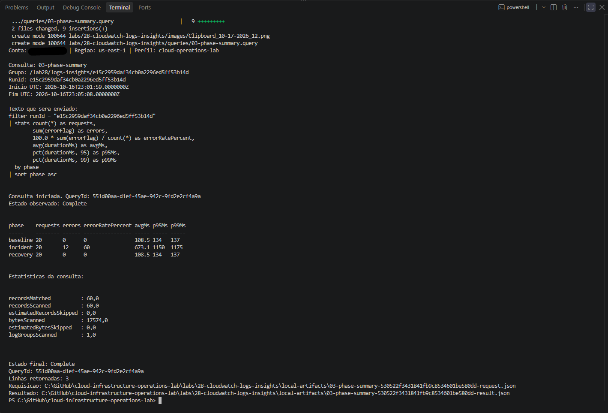
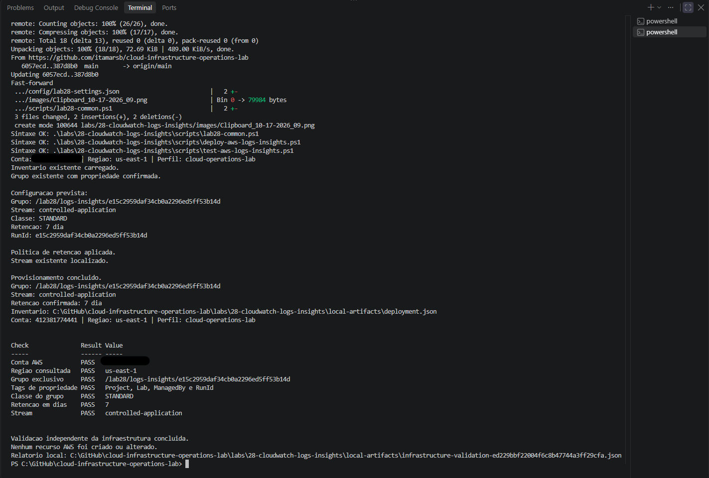
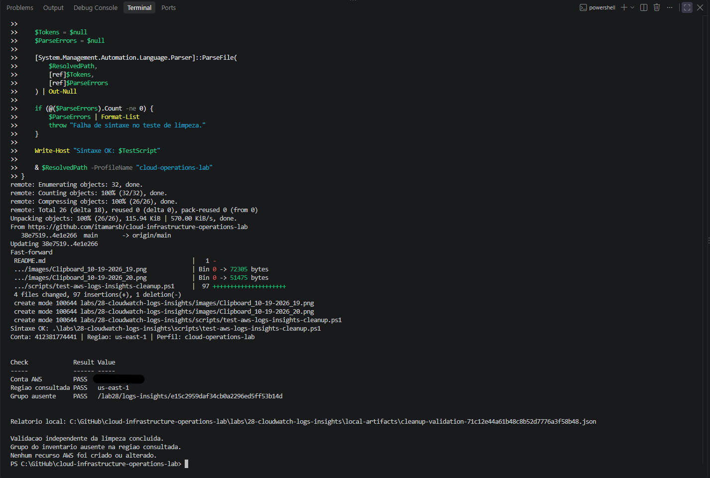

# Lab 28 — CloudWatch Logs Insights

Investigação de logs JSON sintéticos com Amazon CloudWatch Logs Insights, utilizando filtros, agregações, percentis, linha do tempo e identificação de uma requisição.

**Status:** execução e cleanup concluídos. A validação independente confirmou a ausência do grupo de logs em 19 de outubro de 2026.

> **English summary:** Published and independently verified 60 synthetic JSON log events across baseline, incident, and recovery phases. Seven Logs Insights queries identified 12 HTTP 503 events, a 60% incident error rate, a 20% overall error rate, latency changes, and a specific request. Retention was adjusted from one to seven days during the exercise. The exclusive log group was deleted, and an independent cleanup check confirmed its absence.

## Objetivo

Construir uma investigação progressiva de eventos de aplicação:

1. Confirmar a ingestão do dataset.
2. Listar os eventos da execução.
3. Isolar respostas HTTP 5xx.
4. Comparar erros e durações entre fases.
5. Agrupar falhas por endpoint e causa registrada.
6. Organizar os eventos em intervalos de um minuto.
7. Localizar uma requisição específica.
8. Calcular a taxa global de erro.
9. Remover o recurso exclusivo e verificar sua ausência.

Os eventos foram gerados pelo PowerShell. Os campos de serviço, duração, status e causa representam um cenário didático.

Não houve execução de uma API real, falha de uma dependência ou recuperação de um serviço. A fase `recovery` representa eventos sintéticos sem erro após a fase `incident`.

## Resultados registrados

| Verificação | Resultado |
|:---:|:---:|
| Infraestrutura | Grupo exclusivo, classe STANDARD e stream conferidos |
| Propriedade | Tags Project, Lab, ManagedBy e RunId verificadas |
| Retenção final | Sete dias |
| Publicação | Lote de 60 eventos, sem rejeição informada |
| Ingestão | 60 eventos idênticos ao dataset local |
| Paginação observada | Três páginas consultadas no teste de ingestão |
| Consultas | Sete consultas concluídas com estado Complete |
| Erros | 12 eventos HTTP 503, todos em `/orders` |
| Causa registrada | `dependency_timeout` nos 12 erros |
| Taxa de erro no incidente | 60% |
| Taxa global de erro | 20% |
| Requisição investigada | `req-021`, HTTP 503 e duração de 900 ms |
| Cleanup | Grupo excluído; ausência confirmada por nova consulta independente |

A publicação aceita foi tratada separadamente da confirmação de ingestão. O teste comparou timestamps e mensagens dos eventos recebidos com o dataset preservado antes do envio.

## Ambiente e configuração

| Parâmetro | Valor |
|:---:|:---:|
| Estação | Windows e PowerShell |
| Autenticação | AWS IAM Identity Center / SSO |
| Perfil | `cloud-operations-lab` |
| Região | `us-east-1` |
| Prefixo do grupo | `/lab28/logs-insights` |
| Classe | `STANDARD` |
| Stream | `controlled-application` |
| Retenção na configuração final | Sete dias |
| Serviço representado nos eventos | `checkout-api` |
| RunId documentado | `e15c2959daf34cb0a2296ed5ff53b14d` |

Grupo utilizado:

```text
/lab28/logs-insights/e15c2959daf34cb0a2296ed5ff53b14d
```

Tags de propriedade:

| Tag | Valor |
|:---:|:---:|
| Project | `cloud-infrastructure-operations-lab` |
| Lab | `28` |
| ManagedBy | `lab28-powershell` |
| RunId | Identificador da execução |

O laboratório criou um grupo de logs e um stream exclusivos. Não provisionou EC2, rede, CloudWatch Agent, alarme ou tópico SNS.

As permissões de execução foram fornecidas pelo perfil AWS utilizado. As tags e validações dos scripts delimitam o alvo das operações, mas não substituem as permissões IAM.

## Arquivos versionados

| Arquivo | Finalidade |
|:---:|:---:|
| [lab28-settings.json](config/lab28-settings.json) | Conta esperada, região, retenção, prefixo e tags |
| [lab28-common.ps1](scripts/lab28-common.ps1) | Identidade, inventário, JSON, chamadas AWS e propriedade |
| [deploy-aws-logs-insights.ps1](scripts/deploy-aws-logs-insights.ps1) | Pré-validação e provisionamento |
| [test-aws-logs-insights.ps1](scripts/test-aws-logs-insights.ps1) | Validação independente da infraestrutura |
| [invoke-aws-log-investigation-scenario.ps1](scripts/invoke-aws-log-investigation-scenario.ps1) | Preparação e publicação do lote sintético |
| [test-aws-log-events.ps1](scripts/test-aws-log-events.ps1) | Leitura paginada e comparação com o dataset |
| [invoke-aws-logs-insights-query.ps1](scripts/invoke-aws-logs-insights-query.ps1) | Execução das consultas e preservação dos resultados |
| [remove-aws-logs-insights.ps1](scripts/remove-aws-logs-insights.ps1) | Pré-validação e remoção do grupo |
| [test-aws-logs-insights-cleanup.ps1](scripts/test-aws-logs-insights-cleanup.ps1) | Consulta independente da ausência do grupo |
| [queries/](queries/) | Sete consultas versionadas |
| [images/](images/) | Capturas da execução |
| [.gitignore](.gitignore) | Exclusão dos artefatos locais do versionamento |

## Dataset sintético

Cada evento contém:

```text
runId, phase, service, requestId, endpoint, statusCode,
level, durationMs, errorFlag, cause, synthetic
```

O gerador posiciona as três fases em minutos UTC distintos no passado recente. Os horários representam os timestamps atribuídos aos eventos.

| Fase | Eventos | Erros | Taxa de erro |
|:---:|:---:|:---:|:---:|
| baseline | 20 | 0 | 0% |
| incident | 20 | 12 | 60% |
| recovery | 20 | 0 | 0% |
| Total | 60 | 12 | 20% |

Nas primeiras doze requisições de `incident`, o gerador atribui:

- `statusCode = 503`;
- `level = ERROR`;
- `errorFlag = 1`;
- `endpoint = /orders`;
- `cause = dependency_timeout`;
- durações entre 900 e 1175 ms.

A causa é um campo previamente definido no dataset. Sua presença nos resultados não comprova uma falha real de dependência.

## Consultas e interpretação

Todas as consultas filtram o `runId` da execução. O executor substitui `{{RUN_ID}}` pelo valor do inventário e utiliza a janela temporal do dataset.

| Consulta | Pergunta investigada | Resultado observado |
|:---:|:---:|:---:|
| [01-events](queries/01-events.query) | Quais eventos pertencem à execução? | 60 linhas |
| [02-errors](queries/02-errors.query) | Quais eventos têm status HTTP 5xx? | 12 linhas |
| [03-phase-summary](queries/03-phase-summary.query) | Como erros e durações variam por fase? | Três linhas |
| [04-endpoint-errors](queries/04-endpoint-errors.query) | Onde os erros estão concentrados? | `/orders`, 12 erros, `dependency_timeout` |
| [05-timeline](queries/05-timeline.query) | Em qual minuto os erros aparecem? | 12 erros no minuto intermediário |
| [06-request](queries/06-request.query) | O que foi registrado para `req-021`? | Uma linha, HTTP 503 e 900 ms |
| [07-total](queries/07-total.query) | Qual é a taxa global de erro? | 60 requisições, 12 erros e 20% |

### Comparação entre fases

Resultados retornados por `03-phase-summary`:

| Fase | Requisições | Erros | Taxa de erro | Média (ms) | P95 (ms) | P99 (ms) |
|:---:|:---:|:---:|:---:|:---:|:---:|:---:|
| baseline | 20 | 0 | 0% | 108,5 | 134 | 137 |
| incident | 20 | 12 | 60% | 673,1 | 1150 | 1175 |
| recovery | 20 | 0 | 0% | 108,5 | 134 | 137 |

Os percentis são os valores retornados pelo Logs Insights para esse conjunto pequeno e sintético. Não estabelecem desempenho de produção ou um SLO.



### Endpoint e causa registrada

A consulta `04-endpoint-errors` considerou somente eventos com `statusCode >= 500`.

| Endpoint | Causa registrada | Erros | Média (ms) | Máximo (ms) |
|:---:|:---:|:---:|:---:|:---:|
| `/orders` | `dependency_timeout` | 12 | 1037,5 | 1175 |

A média de 1037,5 ms considera somente os doze erros. A média de 673,1 ms da fase `incident` inclui também suas oito requisições sem erro.

### Linha do tempo

A consulta `05-timeline` agrupou os eventos por `bin(1m)`:

| Minuto UTC em 16/10/2026 | Requisições | Erros | Taxa de erro |
|:---:|:---:|:---:|:---:|
| 23:02 | 20 | 0 | 0% |
| 23:03 | 20 | 12 | 60% |
| 23:04 | 20 | 0 | 0% |

Esses horários representam os eventos do dataset, não o momento em que as consultas foram executadas.

### Investigação de uma requisição

A consulta `06-request` encontrou:

| Campo | Valor |
|:---:|:---:|
| Timestamp UTC | `2026-10-16 23:03:00.000` |
| Serviço | `checkout-api` |
| Fase | `incident` |
| Sufixo do requestId | `req-021` |
| Endpoint | `/orders` |
| Status | `503` |
| Duração | `900 ms` |
| Causa registrada | `dependency_timeout` |

A pesquisa demonstra a localização de um evento pelo identificador da requisição. O dataset contém um evento por requisição e não implementa tracing distribuído.

### Taxa global e volume consultado

A consulta `07-total` retornou:

```text
requests = 60
errors = 12
errorRatePercent = 20
```

A taxa global de 20% inclui as três fases. Ela não substitui os 60% observados durante o incidente.

Nas sete execuções registradas, cada consulta examinou 60 eventos e 17574 bytes em um grupo. A consulta por requestId retornou uma linha, mas também examinou os 60 eventos.

Reduzir as linhas retornadas não significa necessariamente reduzir os dados examinados.

## Retenção e diagnóstico durante a execução

O grupo foi criado inicialmente com retenção de um dia. A continuidade do exercício ocorreu depois dessa janela.

Durante a investigação:

1. A leitura retornou zero eventos e não apresentou `nextForwardToken`.
2. O diagnóstico comparou chamadas com paginação padrão e `--no-paginate`; ambas apresentaram o mesmo resultado vazio sem token.
3. A tentativa de iniciar a consulta da janela original recebeu `MalformedQueryException`, com mensagem sobre criação do grupo ou limites de retenção.
4. A configuração e a validação compartilhada foram ajustadas para sete dias.
5. O deploy reaplicou a retenção ao grupo existente.
6. A validação independente confirmou sete dias.
7. As consultas e a nova leitura confirmaram os 60 eventos originais.

Não houve republicação do lote.

O retorno dos eventos após a alteração não significa que aumentar a retenção restaure dados já excluídos. A documentação da AWS descreve que a exclusão física dos eventos expirados pode ocorrer posteriormente.

O teste de ingestão também foi corrigido para verificar a existência de `nextForwardToken` antes de acessar seu valor. Se o token estiver ausente ou vazio, o script preserva a resposta em um diagnóstico e interrompe a validação.

A versão corrigida passou novamente na leitura dos 60 eventos. Nessa execução, o ramo de resposta sem token não ocorreu.



## Registros locais

Os artefatos ficam em:

```text
labs/28-cloudwatch-logs-insights/local-artifacts/
```

Esse diretório é ignorado pelo Git.

| Registro | Conteúdo |
|---|---|
| `deployment.json` | Conta, região, RunId, grupo e stream |
| `dataset.json` | Lote exato e janela temporal |
| `publication-response.json` | Resposta da publicação |
| `infrastructure-validation-*.json` | Verificações da infraestrutura |
| `ingestion-observed-*.json` | Eventos observados na leitura |
| `ingestion-validation-*.json` | Comparação com o dataset e contagens por fase |
| `ingestion-missing-token-*.json` | Diagnóstico quando a resposta não apresenta token válido |
| `<consulta>-*-request.json` | Texto e parâmetros da consulta |
| `<consulta>-*-started.json` | QueryId e resposta de início |
| `<consulta>-*-result.json` | Resultado e estado observado |
| `<consulta>-*-stop.json` | Resposta de parada, quando solicitada pelo executor |
| `removal-*-request.json` | Alvo e condição anterior à remoção |
| `removal-*-result.json` | Solicitação de exclusão e verificação de ausência |
| `cleanup-validation-*.json` | Nova consulta independente após a remoção |

O diagnóstico de paginação executado durante o troubleshooting também preservou arquivos locais `pagination-diagnostic-*.json`.

Os JSONs locais não estão incluídos no repositório. As capturas documentam os resultados exibidos durante a execução.

## Procedimento de reprodução

A execução documentada já foi encerrada. Os comandos abaixo descrevem uma nova execução e não precisam ser repetidos para concluir este registro.

Antes de uma nova execução:

- confirme a ausência do grupo anterior;
- preserve e arquive os artefatos anteriores;
- utilize um diretório `local-artifacts` novo;
- confira a configuração e mantenha uma sessão SSO ativa.

O publicador bloqueia a execução quando encontra `dataset.json`. Não remova esse arquivo para contornar uma publicação parcial.

O deploy pode recriar o grupo de um inventário preservado caso ele esteja ausente. Por isso, não execute o deploy após o cleanup apenas para consultar o estado.

A conta esperada e outros valores também são conferidos em `lab28-common.ps1`. Uma adaptação para outra conta exige revisar a configuração e essas validações.

### 1. Autenticação e sintaxe

Se necessário:

```powershell
aws sso login --profile cloud-operations-lab
```

A partir da raiz do repositório:

```powershell
& {
    $ErrorActionPreference = "Stop"

    $ScriptsPath = ".\labs\28-cloudwatch-logs-insights\scripts"

    foreach ($File in Get-ChildItem -LiteralPath $ScriptsPath -Filter "*.ps1") {
        $Tokens = $null
        $ParseErrors = $null

        [System.Management.Automation.Language.Parser]::ParseFile(
            $File.FullName,
            [ref]$Tokens,
            [ref]$ParseErrors
        ) | Out-Null

        if (@($ParseErrors).Count -ne 0) {
            $ParseErrors | Format-List
            throw "Falha de sintaxe: $($File.Name)"
        }

        Write-Host "Sintaxe OK: $($File.Name)"
    }
}
```

### 2. Provisionamento e validação

Defina o caminho na sessão PowerShell:

```powershell
$LabPath = ".\labs\28-cloudwatch-logs-insights"
```

Pré-valide:

```powershell
& "$LabPath\scripts\deploy-aws-logs-insights.ps1" `
    -ProfileName "cloud-operations-lab" `
    -ValidateOnly
```

Confira o alvo exibido. Depois execute, separadamente:

```powershell
& "$LabPath\scripts\deploy-aws-logs-insights.ps1" `
    -ProfileName "cloud-operations-lab"
```

Valide:

```powershell
& "$LabPath\scripts\test-aws-logs-insights.ps1" `
    -ProfileName "cloud-operations-lab"
```

Em uma execução sem inventário, a pré-validação gera um RunId temporário sem salvá-lo. O deploy efetivo gera e registra o RunId utilizado.

### 3. Publicação e ingestão

Pré-valide o cenário:

```powershell
& "$LabPath\scripts\invoke-aws-log-investigation-scenario.ps1" `
    -ProfileName "cloud-operations-lab" `
    -ValidateOnly
```

Após conferir as contagens, publique uma vez:

```powershell
& "$LabPath\scripts\invoke-aws-log-investigation-scenario.ps1" `
    -ProfileName "cloud-operations-lab"
```

Confirme a ingestão:

```powershell
& "$LabPath\scripts\test-aws-log-events.ps1" `
    -ProfileName "cloud-operations-lab"
```

Aguarde a validação dos 60 eventos antes das consultas. Em caso de falha, preserve o dataset e os recibos para diagnóstico.

### 4. Consultas

Pré-valide a primeira consulta:

```powershell
& "$LabPath\scripts\invoke-aws-logs-insights-query.ps1" `
    -ProfileName "cloud-operations-lab" `
    -QueryName "01-events" `
    -ValidateOnly
```

Execute:

```powershell
& "$LabPath\scripts\invoke-aws-logs-insights-query.ps1" `
    -ProfileName "cloud-operations-lab" `
    -QueryName "01-events"
```

Repita o comando, uma consulta por vez, substituindo `QueryName` nesta ordem:

```text
02-errors
03-phase-summary
04-endpoint-errors
05-timeline
06-request
07-total
```

Confira o estado `Complete` e interprete o resultado antes de avançar.

O executor utiliza limite de 100 resultados e janela de até dez minutos. Ele não percorre páginas adicionais de resultados e interrompe o fluxo se receber indicação de continuação.

O tempo de espera padrão é de 120 segundos. Se a consulta não concluir no prazo ou houver falha durante o acompanhamento, o executor tenta solicitar sua parada e preserva os registros disponíveis.

### 5. Remoção

Pré-valide:

```powershell
& "$LabPath\scripts\remove-aws-logs-insights.ps1" `
    -ProfileName "cloud-operations-lab" `
    -ValidateOnly
```

Após conferir o alvo, execute a exclusão:

```powershell
& "$LabPath\scripts\remove-aws-logs-insights.ps1" `
    -ProfileName "cloud-operations-lab"
```

A remoção confere a propriedade antes da exclusão e verifica posteriormente a ausência do grupo. Os arquivos locais são preservados.

### 6. Verificação independente

```powershell
& "$LabPath\scripts\test-aws-logs-insights-cleanup.ps1" `
    -ProfileName "cloud-operations-lab"
```

Resultado registrado:

| Verificação | Resultado |
|---|---|
| Conta AWS | PASS |
| Região consultada | PASS |
| Grupo ausente | PASS |

O teste faz uma nova chamada à AWS e compara o nome exato do grupo. Sua conclusão se limita ao grupo do inventário na conta e região verificadas.



## Evidências

As capturas iniciais mostram retenção de um dia. A captura 10 registra a alteração e a validação de sete dias.

| Captura | Etapa |
|---|---|
| [01](images/Clipboard_10-15-2026_01.png) | Sintaxe, exclusão dos artefatos pelo Git e pré-validação inicial |
| [02](images/Clipboard_10-16-2026_02.png) | Provisionamento inicial |
| [03](images/Clipboard_10-16-2026_03.png) | Validação independente da infraestrutura |
| [04](images/Clipboard_10-16-2026_04.png) | Pré-validação do dataset sintético |
| [05](images/Clipboard_10-16-2026_05.png) | Publicação e preservação do dataset e recibo |
| [06](images/Clipboard_10-16-2026_06.png) | Confirmação inicial da ingestão |
| [07](images/Clipboard_10-16-2026_07.png) | Pré-validação da consulta 01-events |
| [09](images/Clipboard_10-17-2026_09.png) | Diagnóstico da resposta vazia com e sem paginação automática |
| [10](images/Clipboard_10-17-2026_10.png) | Retenção ajustada para sete dias e validada |
| [11](images/Clipboard_10-17-2026_11.png) | Consulta 01-events concluída, com 60 linhas |
| [12](images/Clipboard_10-17-2026_12.png) | Consulta 02-errors |
| [13](images/Clipboard_10-17-2026_13.png) | Consulta 03-phase-summary |
| [14](images/Clipboard_10-17-2026_14.png) | Consulta 04-endpoint-errors |
| [15](images/Clipboard_10-18-2026_15.png) | Consulta 05-timeline |
| [16](images/Clipboard_10-18-2026_16.png) | Consulta 06-request |
| [17](images/Clipboard_10-18-2026_17.png) | Consulta 07-total |
| [18](images/Clipboard_10-18-2026_18.png) | Nova validação da ingestão após a correção do teste |
| [19](images/Clipboard_10-19-2026_19.png) | Pré-validação da remoção |
| [20](images/Clipboard_10-19-2026_20.png) | Exclusão e confirmação da ausência do grupo |
| [21](images/Clipboard_10-19-2026_21.png) | Validação independente da limpeza |

## Checklist de conclusão

- [x] Configuração e identidade conferidas.
- [x] Grupo e stream exclusivos provisionados.
- [x] Infraestrutura validada independentemente.
- [x] Dataset sintético publicado e preservado.
- [x] Sessenta eventos comparados com o dataset local.
- [x] Sete consultas concluídas.
- [x] Erros, durações, endpoint e requisição investigados.
- [x] Taxas global e por fase diferenciadas.
- [x] Retenção ajustada e validada.
- [x] Tratamento de token ausente corrigido; fluxo normal revalidado.
- [x] Grupo removido.
- [x] Ausência do grupo confirmada por consulta independente.
- [x] Evidências de execução registradas.

## Referências

- [CloudWatch Logs Insights — stats](https://docs.aws.amazon.com/AmazonCloudWatch/latest/logs/CWL_QuerySyntax-Stats.html)
- [AWS CLI — get-log-events](https://docs.aws.amazon.com/cli/latest/reference/logs/get-log-events.html)
- [AWS CLI — put-retention-policy](https://docs.aws.amazon.com/cli/latest/reference/logs/put-retention-policy.html)
- [AWS CLI — delete-log-group](https://docs.aws.amazon.com/cli/latest/reference/logs/delete-log-group.html)
